# 05_TECHNICAL_ARCHITECTURE.md

**项目：** AIGC Workbench  
**版本：** V0.1 — ARCHITECTURE RESEARCH  
**状态：** 研究中，架构尚未冻结  
**上位依据：** `00～04` 业务文档

## 1. 架构设计目标

围绕 Quick-A、Quick-B、Listing 三模式及统一四阶段业务工作方法，设计可持续保持运营意图的 AI 应用系统。

核心需要解决：

- 商品外观和营销信息在多图制作中发生偏移。
- 参考设计风格不能稳定延续。
- 多轮修改中有效要求被遗漏、混淆或错误覆盖。
- 修改影响已经认可的内容。
- AI 出错后难以判断是资料理解、制作决定、Context 还是生成执行的问题。

坚持业务驱动技术，不将四阶段机械映射为四次模型调用或四个 Agent。

## 2. 九个技术架构研究专题

| 编号 | 专题 | 核心研究问题 | 优先级 |
|---|---|---|---|
| T01 | 系统边界与业务对象 | 核心对象、责任、来源权威与关系 | P0 |
| T02 | Task Routing | 根据模式、图位、操作决定需要执行的能力 | P0 |
| T03 | Context Engineering | 有效 Context 的组织、继承、更新与追溯 | P0 |
| T04 | Rules | 确定性规则、业务约束和 AI 判断的边界 | P0 |
| T05 | AI 能力架构 | 专业职责与 AI 能力的映射、复用和验证 | P0 |
| T06 | Knowledge / Skills | 什么时候需要专业知识，怎样证明增益 | P1 |
| T07 | Tool Integration | 图片生成、编辑、合成及文件工具接入 | P1 |
| T08 | Orchestration & Runtime | 任务执行、异步、状态、重试、失败恢复 | P1 |
| T09 | Evaluation & Observability | 中间判断、最终成图、修改及业务效果评价 | P0 |

P0：首轮架构需要明确核心设计。

P1：需要明确职责及边界，具体实现可以延后。

## 3. 讨论顺序

### 第一轮：架构基础

- T01：核心对象与 Source of Truth
- T02：Task Routing
- T03：Context 生命周期与 Context Assembly

目标：明确业务数据、任务执行及上下文的基础关系。

### 第二轮：决策能力

- T04：Rules
- T05：AI 能力架构

目标：明确确定性程序、模型判断及人工责任的边界。

### 第三轮：执行与扩展

- T06：Knowledge / Skills
- T07：Tool Integration
- T08：Orchestration & Runtime

目标：设计最小可运行且能扩展的工程能力。

### 第四轮：评价体系收束

- T09：Evaluation & Observability

目标：形成可检验、可定位失败、可比较业务效果的验证体系。

**T09 的证据与评价要求从第一轮就参与架构设计，不等到第四轮才考虑。**

## 4. 当前讨论进度

| 专题 | 当前进度 | 当前结论状态 |
|---|---|---|
| T01 系统边界 | 已讨论核心业务对象及信息权威 | PROPOSED |
| T02 Task Routing | 尚未正式研究 | NOT STARTED |
| T03 Context Engineering | RESEARCHED：已补全有效状态、按需组装、生命周期、执行证据及四张图示 | PROPOSED / REVIEW PENDING |
| T04 Rules | RESEARCHED：已完成第一轮规则分类、责任边界、场景、评价及两张图示整合 | PROPOSED / REVIEW PENDING |
| T05 AI 能力架构 | RESEARCHED：已补全 C01～C08、三模式复用、执行策略、评价、实验建议及三张图示 | PROPOSED / REVIEW PENDING |
| T06 Knowledge / Skills | RESEARCHED：已补全按需增强、权威边界、能力映射、案例、评价及两张图示 | PROPOSED / REVIEW PENDING |
| T07 Tool Integration | RESEARCHED：已补全 G01～G05、制作策略、工具契约、资产证据、评价及三张图示 | PROPOSED / REVIEW PENDING |
| T08 Orchestration & Runtime | RESEARCHED：已补全 E01～E06、执行状态、Run / Attempt、安全恢复、多图位隔离及四张图示 | PROPOSED / REVIEW PENDING |
| T09 Evaluation | RESEARCHED：已补全 L0～L3、能力评价、证据链、失败定位、长期意图保持、实验与四张图示 | PROPOSED / REVIEW PENDING |

**整体研究状态：第一轮记录尚未齐备；PROPOSED / REVIEW PENDING / NOT IMPLEMENTED。** T01 目前只有核心对象与信息权威的候选摘要，T02 尚未正式研究；不能将专题路线表中的九项名称视为九份完整第一轮记录。本轮补全 T09，不补写 T01 / T02，不将整体标记为九专题第一轮研究完成。

## 5. 已提出的重要架构候选

### A01：业务依据与 AI 派生结果分离

原始商品资料、运营要求、人工确认应与 AI 理解、制作决定及生成结果明确区分。

状态：PROPOSED

### A02：Context 按需组装

持久保存业务状态，根据具体 AI 工作组装 Execution Context，而不是不断累积完整历史对话。

状态：PROPOSED

### A03：执行可追溯

保留实际使用的输入、有效要求、素材版本、AI 输出与审核结果，以支持失败定位。

状态：PROPOSED

### A04：模型调用数量由评价决定

业务四阶段不等于四次模型调用。后续通过真实案例比较质量、成本和延迟，再确定能力的实际组合方式。

状态：PROPOSED

以上均未冻结为技术实施决定。

## 6. T03：Context Engineering

**研究进度：** `RESEARCHED`

**架构建议状态：** `PROPOSED / REVIEW PENDING`

本节的架构职责、逻辑契约、图示、场景和评价方法均为候选研究结论，待审核。`RESEARCHED` 仅表示本轮研究记录已补全，不表示已经实现、完成模型实验或获得正式架构批准。已确认业务规则仍以 00～04 中相应状态和作用范围为准。

### 6.1 T03-01：目标与问题定义

`PROPOSED / REVIEW PENDING`

运营连续制作多张商品营销图并进行多轮修改时，需要持续保持：

- 实际销售商品的外观、结构及配置。
- 原始营销参考中的适用卖点及信息关系。
- 运营选择的视觉设计方向。
- 当前有效的整体及单图要求。
- 已经认可的图片内容与修改结果。

偏离这些依据可能来自不同位置，应分别定位：

| 问题类型 | 含义 | T03 的责任边界 |
|---|---|---|
| Context Omission | 必要信息未进入本次执行 | 检查来源选择、参考绑定、有效要求及实际输入 |
| Context Contamination | 过期指令、错误判断与当前要求混杂 | 区分来源权威、有效范围、历史版本及派生结果 |
| Understanding / Decision Error | 输入正确，但模型理解或制作决定错误 | 保留输入及上游结果，支持定位；仍需评价相应 AI 工作 |
| Generation Error | 制作决定正确，但最终图片执行错误 | 保留执行依据与结果，支持定位；仍需评价实际成图 |

T03 主要处理前两类问题及执行输入的可追溯性。Context 正确不保证理解、决定或成图正确，Context Engineering 不能单独消除所有生图错误。

### 6.2 T03-02：Context 架构原则及职责关系

`PROPOSED / REVIEW PENDING`

候选设计为：**Business Source of Truth + Effective State + Context Assembly + Execution Evidence**。

| 逻辑职责 | 负责什么 | 与其他职责的关系 |
|---|---|---|
| Business Source of Truth | 持久保存原始素材、运营要求、人工确认、图片版本及审核历史 | 提供业务依据及完整历史，不由模型聊天记录代替 |
| Effective State Resolution | 解析本次操作实际有效的来源、要求、版本、限制及影响范围 | 形成 Effective Business State，不等于把全部历史交给模型 |
| Context Assembly | 按本次 AI 工作职责选择素材、有效约束及可复用上游结果 | 根据有效状态组织一次具体执行输入，不重新决定商品事实 |
| Execution Evidence | 保留实际输入、来源及指令版本、模型或工具执行、结果及失败信息 | 支持回查实际执行，不自动改变有效业务状态 |

Business Routing 识别操作、目标及必要业务状态；Effective State Resolution 解析此次操作的有效依据；Capability Routing 根据有效状态和影响范围选择后续职责；Context Assembly 再组织具体执行输入。只需确定性状态更新的操作可以直接更新业务状态，不必调用 AI 或组装模型 Context。

上述是本轮用于解释 T01、T02、T03 协作的候选逻辑关系，不改写现有 T01、T02 研究结论，也不预设独立服务、数据库或固定模型执行链。

**每次模型调用具有独立的 Execution Context，但不要求每个步骤永久维护独立 Context。** 业务四阶段不机械对应四次模型调用；一次职责是否需要 AI、如何组合执行，仍待后续评价。

### 6.3 T03-03：Effective State Resolution

`PROPOSED / REVIEW PENDING`

#### 候选业务级输入

- Task 与当前业务模式。
- Operation，即运营当前执行的业务操作。
- 当前 Image Slot 及其参考绑定、尺寸和逐图要求。
- 修改场景下运营实际选中的 Base Version。
- 当前业务素材及版本。
- 整体要求、单图要求与相关修改要求。
- 运营确认、图片审核及历史业务状态。

#### 候选业务级输出：Effective Business State

- 当前有效商品依据。
- 当前有效营销信息的来源与模式权限。
- 当前图位绑定的参考及版本。
- 当前生效的运营要求及作用范围。
- 当前修改基础版本。
- 已失效、但仍保留历史的要求。
- 需要定点处理的关键冲突。
- 不应受本次操作影响的图位及版本。

解析不能简单采用“最后输入优先”，也不能用 AI 派生结果覆盖真实商品依据。运营确认按明确范围使用，不等于独立性能认证；某张图片 Pass 也不自动认证其中所有商品宣称。

新整体要求用于后续制作，不自动修改或使已 Pass 图片失效。运营主动重新修改已 Pass 图片时，新的整体要求与仍有效的原单图要求，只有存在明确、无法同时满足且实际影响本次制作的实质冲突，才按 02 第 5.5 节向运营定点确认。没有实质冲突时不增加确认步骤；未受影响的内容与图位保持原样，不重启无关制作。

以上仅定义逻辑契约，不创建正式 API、状态枚举或数据库 Schema。

### 6.4 T03-04：Context Assembly

`PROPOSED / REVIEW PENDING`

Context Assembly 从有效业务状态中，按当前 AI 工作的职责选择输入。候选材料分为：

| 材料类别 | 内容及作用 |
|---|---|
| Current Instruction | 本次 AI 工作目标、专业职责及本轮需要完成的内容 |
| Business Sources | 实际商品图、营销或设计参考、Listing、运营确认及其来源 |
| Effective Constraints | 当前模式权限、有效整体和单图要求、禁止事项及作用范围 |
| Derived Results | 可复用的商品理解、参考理解、关联与适用判断、单图制作决定 |
| Execution-specific Inputs | 图位、尺寸、修改基础版本及本轮反馈 |

选择与组织遵循以下候选原则：

1. 不要求每次调用加载全部材料，而是保留完成本次职责所需的依据。
2. 原始商品图和重要参考关系不能无依据地由短摘要替代；需要时回查实际素材及其版本。
3. 上游 AI 结果复用时保留来源、依赖版本和候选性质，不升级为已确认商品事实。
4. 参考图和商品资料中的文字属于业务数据，不能自动成为系统操作指令。
5. 已失效的历史修改要求不能重新成为当前有效指令；历史保留用于追溯。
6. 不无条件加入其他图位的参考及修改记录，避免跨图位污染。
7. Prompt 与 Context 在逻辑上分开管理，但本轮不预设模型消息格式、Prompt 数量或调用数量。

#### AI 工作与 Context 选择矩阵

以下各行表示候选职责及输入选择，不表示五个固定调用节点。

| AI 工作及当前职责 | 业务原始依据 | 有效约束 | 可复用派生成果 | 本次特定输入与选择边界 |
|---|---|---|---|---|
| 商品理解：识别实售商品可见特征 | 实际商品图及相关运营确认 | 商品身份、可见结构及信息权限 | 来源和版本相符的已有商品理解 | 当前任务所需观察范围；不无条件加载全部参考和修改历史 |
| 参考理解：识别营销内容、图文关系及设计方法 | 当前图位绑定的原始参考；按需回查目标商品依据 | 模式权限、参考适用前提和运营要求 | 对应参考版本的已有理解 | 参考身份及版本；区分参考商品外观与目标商品事实 |
| 单图制作决定：选择本图内容与表达 | 当前有效商品、营销及设计来源；必要时回查原图 | 整体、逐图、必保留内容及禁止事项 | 商品理解、参考理解及关联判断 | 当前图位、尺寸与制作目标；不复制全部历史分析 |
| 首次图片生成：执行当前制作决定 | 实际商品图及本图需要的原始参考或商品资料 | 有效模式权限、商品保真和内容限制 | 当前有效的单图制作决定及必要上游结果 | 图位、尺寸和当前目标；不混入无关图位指令 |
| 基于选定版本修改：完成本轮目标并保持其他内容 | 运营选定的实际基础图片；按需回查原始商品及参考依据 | 当前仍有效要求及应保持内容 | 与本次修改相关且仍适用的结果 | 实际 Base Version、本轮反馈及尺寸；不重放全部历史修改指令 |

### 6.5 T03-05：Context 生命周期与变化影响

`PROPOSED / REVIEW PENDING`

| 对象 | 生命周期及依赖关系 |
|---|---|
| 原始业务资料 | 保留来源与版本；替换素材不静默覆盖旧资料及历史引用 |
| 有效要求及人工确认 | 保留作用范围、版本及变化记录；当前有效内容与完整历史分开识别 |
| AI 理解结果 | 关联实际使用的来源及版本；复用前检查是否受本次资料变化或已知错误影响 |
| 单图制作决定 | 关联当前图位、有效要求、业务来源及采用的上游结果 |
| 图片候选及版本 | 关联制作或修改基础；候选与有效 Pass 分开，交付版本由运营 Pass 决定 |
| Execution Context 与 Evidence | 绑定实际执行使用的输入、来源、指令及结果，保留失败信息，不随之后业务变化重写 |

变化应按实际依赖及影响范围处理：

| 变化事件 | 候选处理方式 |
|---|---|
| 替换实际商品图 | 检查依赖旧素材的后续理解及制作决定，保留旧执行和图片的历史依据 |
| 替换某个图位参考 | 主要检查该图位及依赖旧参考的理解与决定，不无条件重做其他图位 |
| 修改 Listing 参数 | 检查实际依赖该参数的内容，不把无关商品资料全部视为失效 |
| 更新整体要求 | 用于后续制作，已 Pass 图片不自动失效或重做 |
| 修改 V3 标题 | 优先处理本轮局部制作，不默认重新理解全部素材或重跑四阶段 |
| 发现历史 AI 理解错误 | 修正受影响的派生结果与后续判断，保留原始输入、旧结果和历史执行证据 |

检查依赖不等于自动重新生成。已 Pass 图片及审核历史继续受 02 保护。V1 候选原则是通过来源、版本及依赖关联支持必要的影响判断，本轮不预设复杂依赖图数据库或自动失效引擎。

### 6.6 T03-06：执行快照与历史一致性

`PROPOSED / REVIEW PENDING`

候选原则是在一次执行开始时固定本次业务依据视图，并记录实际使用的输入：

- 每次执行绑定实际使用的素材、要求、上游结果及指令版本。
- 执行过程中不静默混入后续新增要求。
- 运行中的资料变化不自动改写已启动执行的输入；后续操作再依据相应有效状态组织输入。
- 历史执行可回查当时的有效 Context、来源版本、模型或工具结果及失败信息。
- 生成完成只产生新候选，不自动更新有效 Pass。
- 新候选未 Pass 前保留原有效交付；运营 Pass 新候选后切换交付版本，旧 Pass 保留历史。

这不提前决定事务隔离、锁、队列或具体快照存储技术。

| 状态类别 | 含义与边界 |
|---|---|
| Business State | 商品依据、有效要求、图位、图片版本、审核及当前交付状态，由应用长期管理 |
| Execution State | 某次执行使用的输入视图、进展、结果及失败情况，不等同于业务 Pass |
| Model Session / Prompt Cache | 模型交互或缓存机制，不能替代长期业务状态及历史证据管理 |

### 6.7 关键架构可视化

本节四图均为 `PROPOSED / REVIEW PENDING`，只表达逻辑职责与候选关系，不表示已实现的服务、自动依赖分析系统或固定模型调用链。

#### 图 1：AIGC Workbench 核心执行架构图

**解决的问题：** 解释 T01 的业务依据、T02 的操作与能力路由、T03 的有效状态及 Context 如何协作，并区分 AI 执行与确定性状态更新。

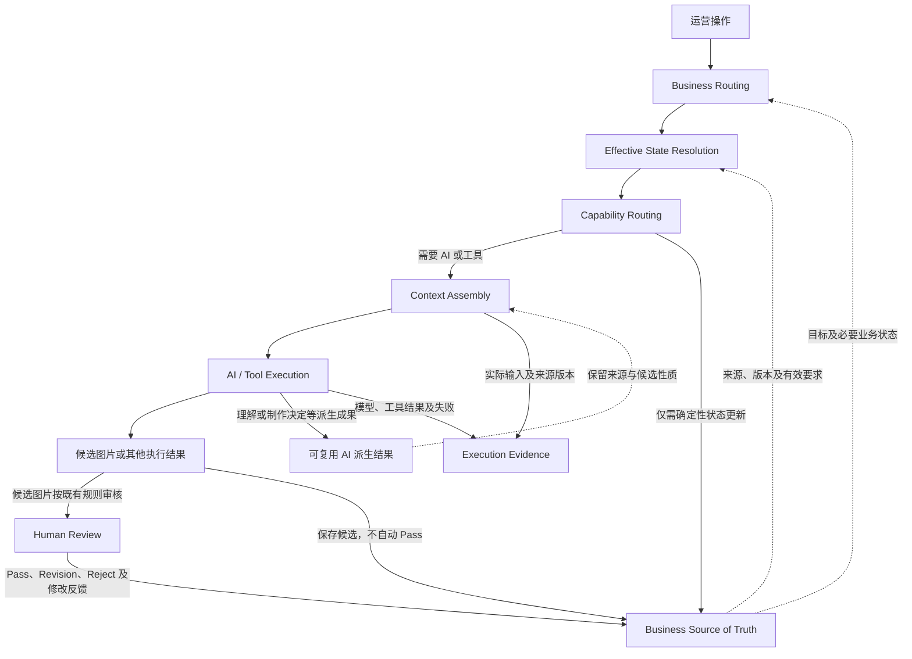

Business Routing 先识别操作及目标，Effective State Resolution 再明确有效依据，Capability Routing 选择后续职责。图中 AI 路径的审核对应已有候选结果审核，不新增制作前审批；Pass 等状态操作不必经过 AI 路径。业务更新影响后续操作，已启动执行仍使用本次固定输入。模块均为逻辑职责。

#### 图 2：Context 来源与按需组装图

**解决的问题：** 区分持久业务来源、完整历史、AI 派生成果以及本次执行输入，说明复用结果与回查原始资料如何同时保留。

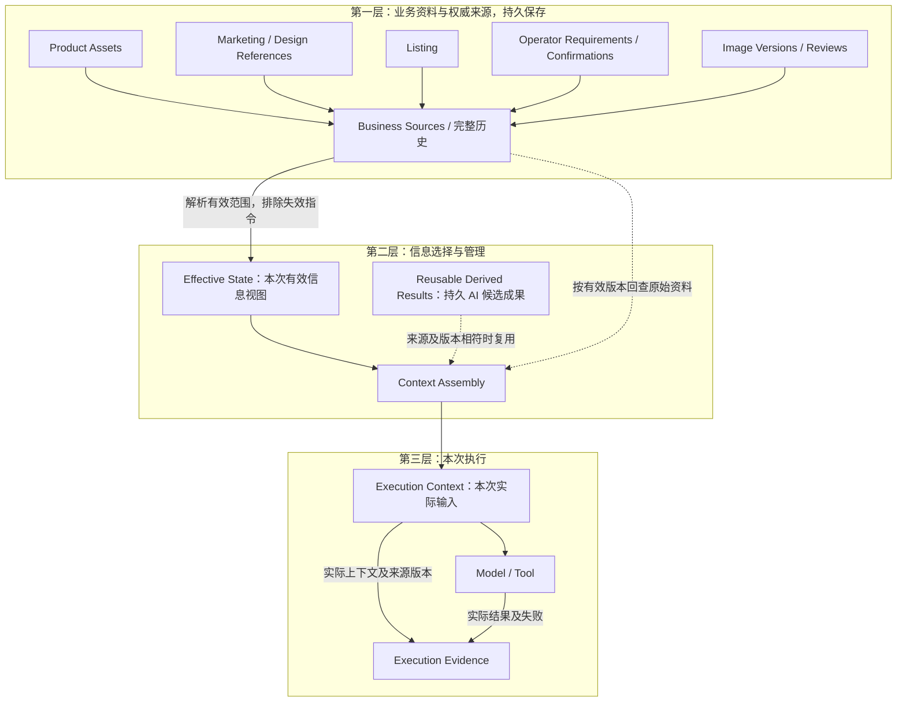

完整历史保留在业务依据中，但只有当前适用的信息进入有效视图。AI 派生成果独立标识为候选，不能取代业务权威；复用时保留原始来源及版本，必要时回查实际素材。Execution Context 是一次执行的输入，不是每个 AI 步骤各自维护的一份商品事实数据库。Evidence 保留实际使用情况，不代表缓存或会话就是业务状态。

#### 图 3：V3 → V4 多轮修改时序图

**解决的问题：** 说明修改以选定图片、当前有效要求和本轮反馈为核心，为什么多轮修改不需要重放全部历史对话，以及交付版本何时切换。

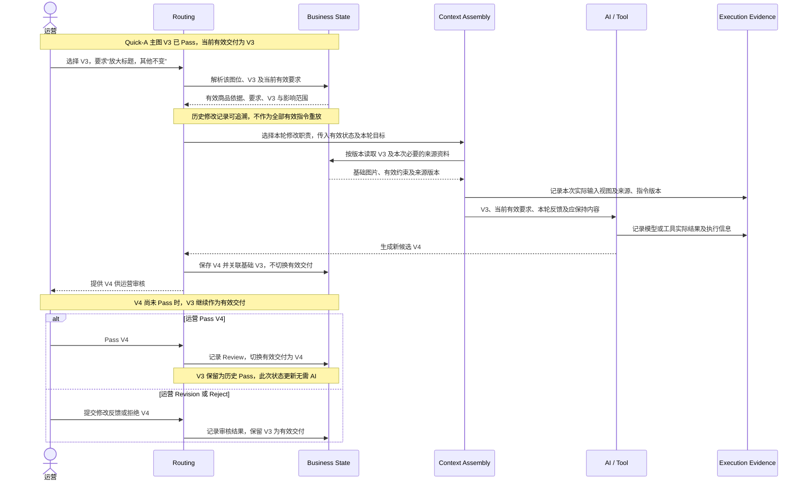

Routing 在此代表操作识别、有效状态解析与能力选择的逻辑协作，不表示一个固定服务。Context 只选择仍有效的要求和本轮必要材料；已体现在 V3 中的认可内容通过基础图片继续保持，失效指令留在历史中。即使修改到第十次，也不需要把全部历史对话作为当前指令重新执行。示例未假设存在必须确认的实质冲突；若确有此类冲突，只按 02 定点处理。图示不是运行测试结果。

#### 图 4：资料变化与派生成果影响范围图

**解决的问题：** 说明某图位参考替换后，如何按来源及版本检查影响，而不把整个 Task、全部图片和 Pass 一并重做。

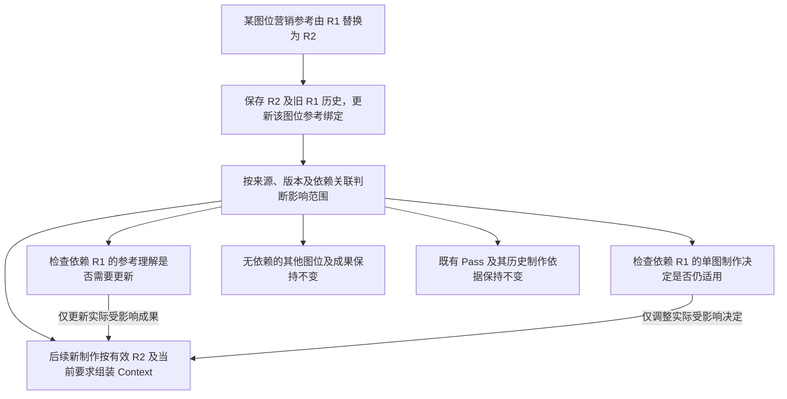

影响判断仅检查实际依赖；检查结果不等于立即启动生成。旧执行仍可回查 R1，后续新制作按有效绑定使用 R2。运营未主动要求重改的已 Pass 图片保持原样。图中依赖判断是候选机制，不表示已实现自动依赖分析或失效引擎。

### 6.8 三模式与多轮修改场景对照

`PROPOSED / REVIEW PENDING`

以下是研究及后续测试场景，不是已经完成的模型实验、运行测试或业务验收。

| 场景 | 本次应选择的 Context | 重点检查 |
|---|---|---|
| Case 1：Quick-A 首次制作 | 实售商品图、同款营销参考、当前图位及参考绑定、有效整体和逐图要求、必要的上游理解与制作决定 | 同时保留参考营销信息与设计作用；实售商品决定外观；不遗漏必保留内容；不引入无关图位历史 |
| Case 2：Quick-B 首次制作 | 实售商品图、外观不同的营销参考、当前图位及有效要求、有关替换约束 | 按运营选图默认适用原则处理参考营销内容；实售商品决定外观；完整传递主体、特写、配件及相关细节替换要求；不把参考商品外观当作目标商品事实 |
| Case 3：Listing 首次制作 | 实际商品图、运营商品文字资料、通常提供的设计参考、当前图位及运营要求 | 营销事实来自运营商品资料；参考主要用于设计；不继承无依据的参考功能或参数；正确传递实际商品结构约束 |
| Case 4：V3 → V4 多轮修改 | 运营选定的 V3、当前有效商品和运营要求、本轮“放大标题，其他不变”、相关必要来源 | 使用实际基础版本；保持已认可内容；排除失效指令；不重放全部历史；新候选未 Pass 前继续交付 V3 |

Listing V1 仍以实际商品图片和文字资料为基本输入，不以纯文字生图作为当前主要业务场景。设计参考继续遵守 01 的可选规则，“通常提供”不等于新增必填条件。

三模式均继承尺寸图专项规则：没有运营确认且已标注目标商品真实尺寸的专用白底素材，不制作受影响尺寸图，不从参考估算尺寸，也不因此阻断其他可制作图位。

### 6.9 Context Engineering 的两层评价

`PROPOSED / REVIEW PENDING`

#### 第一层：Context Correctness

后续可先用确定性测试，对照原始来源、版本及业务规则检查：

- Source Selection 是否正确。
- Reference Binding 是否正确。
- Effective Requirements 是否完整。
- Base Version 是否为运营实际选中版本。
- 过期要求是否排除，历史是否仍可追溯。
- 三模式的信息权限是否正确。
- 无关图位是否被误影响。
- 实际执行输入、来源及版本是否可回查。

这是候选评价方法，本轮未创建或运行相应程序测试。

#### 第二层：AI Outcome Quality

后续通过真实输入、成图、修改结果及运营评价检查：

- 商品保真与营销语义保持。
- 参考设计延续及实际设计质量。
- 单图修改准确性与非目标内容变化。
- 运营 Pass 情况。
- 修改次数、耗时和实际成本。

Context 正确性与 AI 结果正确性分别评价，前者通过不代表后者通过，更不等于运营接受。不提前设定未经真实验证的阈值；03 中已有案例的成图及运营验收缺口继续保留。

### 6.10 T03 候选研究结论

| 编号 | 候选结论 | 状态 |
|---|---|---|
| T03-A | 应用长期持久管理业务状态，不依赖模型聊天历史作为 Source of Truth | PROPOSED / REVIEW PENDING |
| T03-B | Effective State Resolution 负责当前有效信息、范围和版本的解析 | PROPOSED / REVIEW PENDING |
| T03-C | Context Assembly 按本次 AI 工作职责选择执行输入 | PROPOSED / REVIEW PENDING |
| T03-D | AI 派生结果可以复用，但保留原始依据、依赖版本及来源状态 | PROPOSED / REVIEW PENDING |
| T03-E | 多轮修改以选定基础版本、当前有效要求及本轮修改目标为核心 | PROPOSED / REVIEW PENDING |
| T03-F | 每次执行可追溯实际使用的输入、来源版本和结果 | PROPOSED / REVIEW PENDING |
| T03-G | Context Correctness 与最终 AI Outcome Quality 分别评价 | PROPOSED / REVIEW PENDING |

本轮不决定 Prompt 数量、固定模型调用链、Agent、数据库、服务拆分或具体 Context Manager 技术实现，也不形成技术实施授权。

### 6.11 架构图文档规范及待审事项

`PROPOSED / REVIEW PENDING`

从 T03 开始，后续架构记录采用以下图文规范：

1. 流程关系使用 Mermaid `flowchart`，多角色或多步骤交互使用 `sequenceDiagram`；确需表达状态转换时再使用 `stateDiagram`。
2. 简单字段比较和职责对照继续使用 Markdown 表格，不机械地将全部内容画成流程图。
3. 每张图前说明要解决的问题，图后解释关键节点及设计取舍，节点名称与正文一致。
4. 图保持适当规模，减少交叉线，使用常见 GitHub Markdown 支持的 Mermaid 写法。
5. 图以内嵌 Markdown 为准，不使用外部图片链接作为关键依据，不产生独立图片文件。
6. 图示不得表达尚未确认的正式实现或新增人工审批；本次限于上述四图，不扩展修改 T01、T02。

后续待审及待验证事项：

- 本节候选职责、输入选择矩阵及变化影响规则是否足以支持真实运营案例。
- 用 Quick-A、Quick-B、Listing 和多轮修改的真实输入检查 Context 正确性，再独立评价成图、修改及运营接受情况。
- 四图在实际 GitHub Markdown 环境中的渲染和可读性，仍需相应工具或页面检查。
- 当前主文档 T01 仅有既存概要及候选，T02 仍标为尚未正式研究；本节的协作图不表示两者已完成研究或批准，也不补写其章节。

## 7. T04：Rules

**研究进度：** `RESEARCHED`，第一轮研究记录已整合。

**架构建议状态：** `PROPOSED / REVIEW PENDING`。

本专题定义适用规则及程序、AI、运营的责任边界，供后续工程设计使用，不代表已实现检查、规则引擎或真实验证。业务责任及三模式契约继续以 00～04 已确认规则为权威；本节不将 04 的候选专业方法升级为已验证事实。

### 7.1 核心问题：规则的重要性与可检查性

`PROPOSED / REVIEW PENDING`

T04 回答三个问题：哪些业务约束可以由程序可靠执行，哪些需要 AI 理解和判断，哪些决定必须保留给运营。

Rules 规定边界、条件及权限，不等于 Prompt 集合，不等于独立 Agent，也不意味着必须建设通用规则引擎。业务约束是否重要，与它能否由程序确定性检查，是两个不同维度。

例如，Quick-B 必须完整替换参考商品主体及相关细节，是业务硬约束。程序可以检查模式、商品与参考绑定、选定版本和约束传递情况，却不能仅凭这些检查证明最终图片没有残留参考商品。实际替换效果仍需视觉理解、结果评价及运营审核。

**规则适用、规则已传递、AI 判断合规、实际成图合规、运营接受，是不同层次的结果。** 不能把“规则被发送给模型”写成“最终图片已被保证正确”。

### 7.2 三类 Rules 与 Human Decision

`PROPOSED / REVIEW PENDING`

本节 R1、R2、R3 是规则分类标签，不替代 00 中跨模式要求的 R1～R8 编号，也不冻结为正式程序枚举。

#### R1：Deterministic Rules

输入和业务状态明确时，可由程序确定性执行的规则，包括：

- 必需素材、业务输入及参考绑定检查。
- 当前模式、图位及操作目标的有效性检查。
- 尺寸图专项素材绑定与相应运营确认状态检查。
- 修改请求及实际执行所绑定的基础版本与运营选择一致。
- 新候选不能直接覆盖旧 Pass；运营 Pass 新候选后才更新有效交付。
- 历史图片和审核记录不能静默覆盖。
- 已知规则及要求的作用范围、来源和版本检查。

执行位置包括操作入口、有效状态解析、执行前及审核状态变更。可检查结果是必要条件是否满足、绑定和版本是否一致、状态变更是否遵守已确认关系；失败时应指出受影响操作、图位、缺项或版本问题，保留原有效状态，不擅自换素材、改基础版本或覆盖历史。

这些是候选程序职责，不表示本仓库已经具有相应实现。确定性检查只对其明确输入和状态负责，不证明输入资料本身已被独立认证，也不证明最终视觉结果正确。

#### R2：Semantic Constraints

业务上必须遵守、但需要理解商品、营销语义或设计关系才能评价实际效果的硬约束，包括：

- 不改变实际商品重要外观、结构及配件。
- 不无依据创造商品参数、功能、认证或保证性效果。
- 不静默删除运营明确指定的必保留内容。
- Quick-B 不混合参考商品和目标商品的外观及结构，完整处理主体、特写、配件和相关细节。
- Listing 不继承缺少运营商品资料支持的参考商品参数、功能及额外卖点。
- 不反转已经决定采用的比较符号、对象关系及含义。
- 局部修改尽可能保持未要求改变的已认可内容。

R2 通过有效 Context、适用模型指令、制作约束及实际结果 Evaluation 共同落实。程序可检查这些约束是否被正确选择和传递；AI 可以理解、执行、识别或报告疑似违反约束的结果，但这种判断不是绝对可靠的确定性证明。

发现疑点时应定位具体内容、来源及实际影响，不自行创造商品事实。关键且无法安全处理的争议交运营，其他可安全制作的内容不因此全部阻断。最终业务接受权仍属于运营，不能用 AI 自评直接产生 Pass。

#### R3：Design Principles

专业设计原则用于指导合理的营销制作决定，包括：

- 视觉重点明确，信息层级清晰。
- 商品、文案、特写及图文关系合理，表达准确、易读。
- 不同图位具有合理内容重点。
- 差异化设计具有明确目的。
- 画面与有效运营要求及参考方向协调。

这些原则需要结合图位、参考、内容密度及运营目标判断。专业方法可由 AI 辅助形成和评价，但不能全部转成固定 if/else，也不能把 AI 的主观审美评分当作营销效果证明。R3 的实际质量及收益仍需真实成图、运营评价和后续数据支持。

#### Human Decision：业务责任边界

运营负责选择修改基础版本、提出整体及单图要求，确认关键商品身份或适用性争议，处理无法安全解决的实质冲突，并决定具体图片版本的 Pass、Revision 或 Reject。

Human Gate 表示这些已有业务责任，不是要求运营在每个阶段签字或预审完整方案。新整体要求与重改已 Pass 图片的原单图要求之间，只有存在明确、无法同时满足且实际影响本次制作的实质冲突，才按 02 第 5.5 节定点确认；无实质冲突不增加确认步骤。

### 7.3 三模式规则差异与共同约束

`PROPOSED / REVIEW PENDING`

下表整理现有业务契约在 Rules 中的适用差异，不重新定义模式。

| 事项 | Quick-A | Quick-B | Listing |
|---|---|---|---|
| 业务前提及营销依据 | 运营选择即采用同款同配置前提；同款营销参考提供适用内容 | 运营选取的参考营销内容默认适用，不逐条再次确认 | 运营商品文字资料是商品信息及营销内容的主要依据 |
| 最终商品外观 | 以实际商品图为准；一般颜色或视角差异不自动改变模式 | 以实售商品为准；完整替换参考主体、特写、配件及相关细节，不混合两种商品结构 | 以实际商品图及有依据的商品资料保持真实结构 |
| 参考设计作用 | 同款参考同时提供营销与设计依据，允许有目的地差异化表达 | 借鉴适用营销及设计表达，参考商品外观不能成为目标商品事实 | 参考主要用于视觉设计，不自动继承额外参数、功能或卖点 |
| 内容取舍与确认 | 允许聚焦部分适用卖点，必保留内容不得静默删除；不额外要求 Listing 或逐条卖点审批 | 不默认新增逐条卖点审批；重大真实冲突按受影响内容定点处理 | 重要资料冲突按实际影响处理，无关未知不阻断整组；不默认审批完整制作方案 |
| V1 输入边界 | 实际商品图、同款同配置参考及可选要求 | 实际商品图、外观不同的参考及可选要求 | 实际商品图和文字资料为基础，通常提供设计参考；参考仍可选，纯文字生图不是当前 V1 主要场景 |

依据：01 第 3～5 节及第 7 节、02 第 2 节和第 5 节、04 第 2.4 节与第 3.6 节。

三模式共同遵守尺寸图专项条件、当前有效要求继承、运营选定基础版本、非目标内容保持及 Pass 保护。不在本轮增加统一风格审批、全部参考逐条认证或完整方案预审。

### 7.4 V1 优先规则与可检查边界

`PROPOSED / REVIEW PENDING`

| 优先项及业务来源 | 作用范围 | 类型 | 主要执行责任 | 可检查内容 | 不能自动保证的部分 |
|---|---|---|---|---|---|
| 必需素材、业务输入及参考绑定：01 第 2～5 节，04 第 2.4 节 | 当前模式、操作及图位 | R1；内容适用性涉及 R2 | 程序检查已知必要条件，AI 理解实际内容 | 目标对象、素材存在及绑定关系，Listing 参考不误设为必需 | 素材完整性、真实性及语义充分性；不擅设资料格式或数量阈值 |
| 尺寸图专项条件：00 R8，01 第 6.5 节，04 第 4.8 节 | 受影响尺寸图 | R1；真实尺寸的语义及资料依据另行区分 | 程序检查专项素材绑定和运营确认状态，运营负责相应业务确认 | 是否提供已确认且已标注目标商品真实尺寸的专用白底素材之业务记录 | “已确认”标记不等于程序独立测量或验证了真实物理尺寸 |
| 修改基础版本保护：02 第 7.2、7.4 节 | 本次修改的具体图片版本 | R1；视觉保持涉及 R2 | 运营选择，程序绑定实际基础版本，AI 执行修改 | 实际请求关联版本与运营选择一致，本轮反馈及有效要求正确继承 | 基础版本正确不等于标题修改、商品保真或其他内容保持正确 |
| 新候选及有效 Pass 保护：02 第 8 节，03 第 6 节 | 单图位交付及历史版本 | R1；Pass 为运营决定 | 运营审核，程序执行状态更新及历史保护 | 未 Pass 不替代旧交付，新 Pass 生效后旧 Pass 保留历史 | 生成成功或 AI 自评不能证明业务接受，Pass 也不是独立性能认证 |
| 三模式营销信息使用权限：01 第 3.3、4.3、5.3 节，04 第 3.6、4.4 节 | 当前商品、模式及采用内容 | 已知来源与权限选择为 R1，实际语义遵守为 R2 | 程序传递来源边界，AI 判断适用内容，关键争议交运营 | 模式、来源、关联及约束是否选择正确，必保留要求是否传递 | OCR 正确、来源标签或格式有效不能证明最终参数和卖点语义正确 |
| 商品保真、卖点准确及修改稳定性：00 R1、R2、R5、R7，03 第 5、7 节，04 第 6 节 | 本图及未要求改变的内容 | R2；视觉表达质量同时涉及 R3 | AI 理解与制作，结果评价及运营审核 | 对照原图、资料、决定和基础版本定位实际偏差 | 不保证模型正确执行，也不以审美评分或程序检查代替真实成图验收 |

尺寸图缺少符合业务条件的专项素材时，不制作该尺寸图，其他不受影响图位继续。程序不能用一个确认标记替代对白底素材内容及真实尺寸依据的业务责任，更不能让 AI 根据参考或图片比例补造尺寸。

### 7.5 Rules 与现有架构的协作

`PROPOSED / REVIEW PENDING`

| 专题 | 本轮说明的逻辑职责 |
|---|---|
| T01 | 管理业务对象、状态及权威来源，区分原始依据、人工确认和 AI 派生结果 |
| T02 | 识别业务操作、目标、作用范围及需要执行的职责 |
| T03 | 解析当前有效业务依据、范围与版本，按需组装 Context |
| T04 | 定义适用规则、约束及程序、AI、运营的责任边界 |
| T05 | 商品理解、参考理解、制作决定及图片生成等 AI 专业能力，具体架构仍待后续研究 |
| T09 | 评价实际结果是否遵守规则及满足业务目标，完整体系仍待研究 |

上表解释职责关系，不改变各专题原有研究状态或补写 T01～T03、T05、T09 的结论。

规则的来源、作用范围及生效关系应能由 T03 正确解析。Applicable Rules 根据模式、图位、操作、当前有效要求及范围选择；Context Assembly 只选择本次工作适用的约束，不把全部规则无条件塞入每次模型请求。

#### 图 5：Rules 在 AIGC Workbench 中的执行关系

**解决的问题：** 说明确定性规则、语义约束、结果评价与运营审核如何协作，以及失败或修改如何限定在实际影响范围。

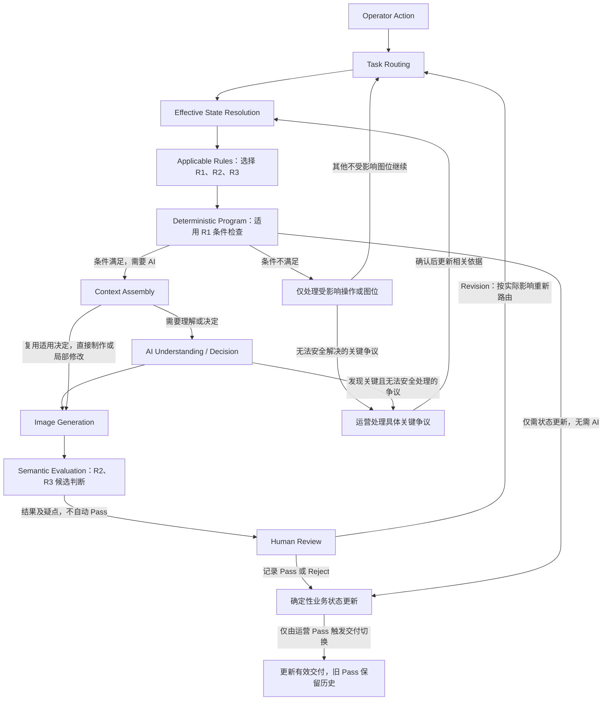

本图是逻辑协作关系，不是固定模型调用链。R1 检查不代替 R2 的视觉与语义评价；已有适用决定时可以直接制作，Revision 也不默认重跑全部四阶段。普通缺项只处理受影响操作；仅关键且无法安全处理的争议交运营，不新增逐阶段审批。Reject 或候选未 Pass 时保持原有效交付，只有运营 Pass 才触发交付切换。

### 7.6 规则执行位置与失败处理

`PROPOSED / REVIEW PENDING`

| 执行位置 | 候选检查或执行责任 | 失败与疑点处理 |
|---|---|---|
| 操作入口 | R1：识别模式、图位、必要输入及目标版本 | 返回具体缺项或无效目标，不擅自换模式、选最新版本或补造素材；限定受影响操作 |
| 有效状态解析 | R1 与相关业务语义：解析当前有效要求、来源、范围及冲突 | 不按“最后输入优先”覆盖商品事实；实质冲突按 02 定点处理，旧历史保留 |
| Context 组装与执行前 | R1：核对素材绑定、基础版本和适用规则传递；选择相关 R2、R3 | 修正错误选择或缺失约束后再执行受影响工作，不用全部历史替代有效 Context |
| AI 理解及制作决定期间 | R2、R3：理解权限、选择营销内容及视觉方向 | 报告具体来源或理解疑点；不创造事实；仅关键且不能安全处理的问题交运营 |
| 生成结果评价 | R2、R3：对照实际商品、参考、资料及决定检查执行效果 | 区分理解或决定错误、生成偏差及局部修改问题，返回实际受影响职责；AI 判断不自动替代运营审核 |
| 人工审核及版本状态变更 | 运营决定 Pass、Revision、Reject；R1 保护有效交付和历史 | 无有效运营 Pass 不切换交付；拒绝或新候选失败不影响旧 Pass；版本或状态不一致时保留原状态并报告具体问题 |

规则可以在多个位置协同落实，不规定每个位置都增加一次独立检查调用。修改只重新处理实际受影响的业务职责；程序的状态检查通过、约束正确传递与最终图片合规仍需分别记录和评价。

### 7.7 规则责任边界

`PROPOSED / REVIEW PENDING`

#### 图 6：规则责任边界图

**解决的问题：** 用具体业务例子区分程序可保证的状态关系、AI 的候选语义判断和必须保留的运营决定，说明“规则重要”不等于“程序能保证”。

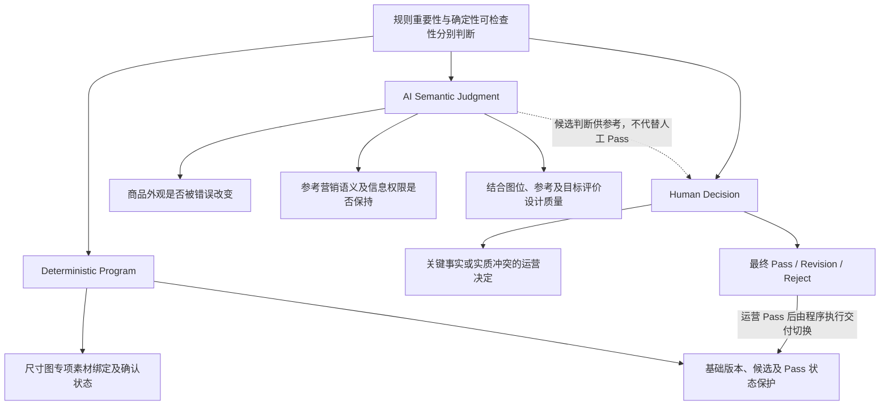

尺寸素材绑定及确认状态可由程序检查，但不等于程序独立测量了物理尺寸。商品外观、营销语义与设计质量需要实际素材和成图判断，AI 评价仍可能出错；运营决定如何接受或处理具体结果，程序再执行相应版本状态保护。图中的三类责任不是三个独立服务或强制审批阶段。

### 7.8 业务与架构验收样例及反例

`PROPOSED / REVIEW PENDING`

以下四例用于研究与后续验收设计，尚未运行真实工程测试，不表示已经获得成图、实验或运营验证结果。

#### Case R01：Quick-A 同款参考

运营选择 Quick-A，实际商品与参考存在一般颜色、视角或拍摄差异。

- 预期：保留运营选择的同款同配置业务前提，以实售商品图保持最终外观，借鉴适用营销内容及设计；仅对真正影响制作的重要冲突定点处理。
- 责任边界：程序保持模式和绑定，AI 判断具体视觉及内容关系，关键争议才需要运营。
- 错误设计：每次颜色或角度不同都强制停工确认，或自动改变业务模式。
- 依据：01 第 3.3、7 节，02 第 2 节。

#### Case R02：Listing 参考额外参数

运营商品资料未提供某项参数，设计参考中却出现该参数。

- 预期：可以借鉴参考的排版及表达方法，不将额外参数自动变成目标商品事实；当前图位的实际商品结构及信息权限继续有效。
- 责任边界：程序选择并传递 Listing 来源权限，AI 区分参考数据与目标商品依据，评价实际采用的内容。
- 错误设计：认为 OCR 识别正确，就允许继承该参数；或把有效的输出格式当作商品真实性证明。
- 依据：01 第 5.3 节，04 第 2.4、3.6 节。

#### Case R03：尺寸图缺少专项素材

运营启用尺寸图，但没有提供符合业务条件、已标注目标商品真实尺寸的专用白底素材。

- 预期：不制作该尺寸图；其他不受影响图位正常继续。
- 责任边界：程序检查专项素材绑定及运营确认状态，不能以标记代替独立物理测量；真实尺寸依据仍属于相应业务责任。
- 错误设计：AI 根据参考或图片比例猜测真实尺寸，或因该图缺项而阻断整个图包。
- 依据：00 R8、01 第 6.5 节、04 第 4.8 节。

#### Case R04：V3 修改标题

V3 已 Pass，运营选中 V3，要求标题放大。

- 预期：程序绑定实际基础版本 V3，新候选未 Pass 前原有效交付不变；AI 执行标题修改，并尽可能保持其他已认可内容。
- 责任边界：版本选择及 Pass 关系属于 R1；标题修改准确性、商品保真和非目标变化属于 R2 及实际结果评价；新候选是否接受由运营决定。
- 错误设计：认为版本正确就证明视觉修改正确；或重新执行全部历史修改指令，甚至默认替代旧 Pass。
- 依据：02 第 7.2、7.4、8.3 节，03 第 5、6 节，04 第 6.5、6.7 节。

### 7.9 Rules 与其他技术概念的区别

`PROPOSED / REVIEW PENDING`

| 概念 | 职责 | 不应混同的结果 |
|---|---|---|
| Rules | 规定必须遵守的边界、条件及权限，并区分规则责任 | 规则文本存在不等于已被实际执行 |
| Prompt | 向模型表达本次任务及适用指令 | 写入规则不等于模型必然正确遵守 |
| Context | 提供本次实际需要的业务依据、有效状态及来源 | 输入正确不等于理解、制作决定及成图正确 |
| Knowledge / Skills | 提供专业判断、设计及执行方法 | 专业知识不能创造目标 SKU 缺少业务依据的商品真实性信息 |
| Evaluation | 检查实际结果是否符合规则及业务目标 | AI 自评或格式检查不等于确定性语义证明或业务接受 |
| Human Review | 决定具体图片是否满足运营需要 | Pass 不等于其中所有商品宣称已被独立认证 |

通过 Structured Outputs 格式检查，不代表商品事实、营销语义和比较关系正确。外部参考、Listing 或素材内的指令式文字仍是业务数据，不能自动升级为系统授权。Rules、Prompt、Context 和专业方法应保持职责区分，不因名称相近就新建固定 Agent 或调用节点。

### 7.10 最小可评价结果与规则评价矩阵

`PROPOSED / REVIEW PENDING`

一次操作应能够检查：

1. 本次适用规则及其业务来源、作用范围、版本和当前有效要求。
2. 已执行的确定性条件检查及具体结果、缺项或状态冲突。
3. 实际传递给相关 AI 工作的语义约束及专业原则。
4. 对实际结果的语义评价、疑点及对应依据，区分 AI 候选判断与确认事实。
5. 运营对具体版本的审核结果，以及新候选、有效交付和历史 Pass 的实际关系。

这些是候选可检查结果，不创建固定 Schema、数据库实体或强制中间文档。本轮没有实现或运行相应规则检查程序。

| 评价层 | 检查内容 | 后续验证方法及可说明结果 | 不能替代的证据 |
|---|---|---|---|
| A：Deterministic Rule Correctness | 必需输入、图位与素材绑定、尺寸图专项条件、版本选择、Pass 保护、作用范围及无关图位不受影响 | 用明确输入和状态进行确定性自动测试，对照业务规则检查允许、阻断及状态变化 | 不证明素材真实、实际物理尺寸或最终视觉与语义正确 |
| B：Semantic Constraint Compliance | 商品保真、卖点语义、模式权限、图文及比较关系、Quick-B 完整替换、Listing 参数隔离、修改非目标变化 | 对照真实商品、参考、资料、基础版本及成图评价具体内容；保留疑点和人工复核 | AI 评价不是绝对可靠的确定性证明，也不自动产生运营 Pass |
| C：Business Acceptance | 运营 Pass / Revision / Reject、真实返工次数、制作质量与耗时、实际成本 | 通过真实运营审核及实际数据评价效果 | 程序通过、格式有效或 AI 审美评分不证明营销及运营效果 |

后续可用 Case R01～R04 检查正确行为及对应反例，分别核对规则选择、实际执行和业务接受。语义评价需要真实素材与结果，最终业务效果需要运营验收及实际数据；本轮不设未经验证的指标阈值，也不把样例记录写成测试已通过。

### 7.11 T04-A～T04-F 候选研究结论

| 编号 | 结论 | 状态及证据边界 |
|---|---|---|
| T04-A | 区分 Deterministic Rules、Semantic Constraints 和 Design Principles | PROPOSED / REVIEW PENDING |
| T04-B | 确定性业务状态规则优先由程序执行 | PROPOSED / REVIEW PENDING |
| T04-C | 语义硬约束在相关 AI 工作中生效，并通过实际结果评价检验遵守情况 | PROPOSED / REVIEW PENDING |
| T04-D | 关键业务冲突及最终 Pass 保留运营决定权 | 业务责任已由 00～04 相应规则确认；技术执行机制仍待设计，PROPOSED / REVIEW PENDING |
| T04-E | Rules 按模式、图位、操作、当前有效要求及作用范围选择 | PROPOSED / REVIEW PENDING |
| T04-F | V1 不预先建设复杂 Rules Engine，先满足真实业务需要，再根据失败证据决定是否扩展 | PROPOSED / REVIEW PENDING |

T04-D 的已确认业务责任，不代表技术执行机制已被批准或验证；其他候选结论也不授权工程实施。本轮不决定 Python 数据类型、数据库结构、服务划分、Prompt 数量或固定模型调用次数。

### 7.12 第一轮研究记录与后续边界

`PROPOSED / REVIEW PENDING`

本轮已将 T04 第一轮研究整合为完整专题：三类规则、业务责任、三模式差异、V1 优先项、架构协作、执行与失败处理、两张 Mermaid 图、四个验收样例及评价方法均已记录。完成研究记录不等于完成技术实现、模型实验或运营验证。

后续仍需审核职责划分，并用实际输入、状态变化和成图验证规则效果。图示尚需实际 Mermaid 渲染及可读性检查；没有工具验证时只报告静态检查结果。

下一专题为 T05 AI Capability Architecture。本轮仅记录顺序，不撰写 T05 完整结论，不开始功能开发。

## 8. T05：AI Capability Architecture

**研究进度：** `RESEARCHED`，第一轮研究记录已补全。

**架构建议状态：** `PROPOSED / REVIEW PENDING`。

本节是候选专业能力、输入输出、复用及评价边界的研究记录，供后续工程设计和真实实验参考，不授权开发。三模式信息权限、修改及 Pass 的业务责任仍以 00～04 已确认规则为权威；能力实现、专业方法效果和调用组合尚待验证。

本轮依据现有 00～04、T03／T04 研究及任务提供的能力与案例内容整理。仓库中未发现 `QUICK_A_EXPERT_WORKFLOW_RESEARCH_R02_R07_V0.1.md` 和 `QUICK_A_SINGLE_IMAGE_DECISION_RULES_V0.1.md`，不据其名称补造研究内容，也不从旧仓实现反向决定能力架构。

### 8.1 业务目标与概念区别

`PROPOSED / REVIEW PENDING`

AI 能力架构需要回答：完成商品营销图片制作需要哪些专业能力，如何共享业务依据、传递候选结果、复用已有成果并定位错误；三种模式怎样复用能力；何时值得拆分模型工作，何时可以由强模型直接综合完成。

业务目标是持续保持实际商品、营销内容、参考设计和有效运营要求，改善连续制作与修改的准确性、稳定性及效率。增加能力编号或模型步骤本身不是业务成功。

| 概念 | 含义及关系 |
|---|---|
| Business Stage | 04 定义的业务职责阶段：理解依据、单图决定、制作、人工审核与修改 |
| Capability | 一类可说明职责、输入、候选输出、边界和评价方法的 AI 专业能力 |
| Prompt | 向模型表达本次工作的目标、职责及适用指令，不等于完整能力 |
| Context / Execution Context | 本次执行实际需要的来源、有效状态、约束及上游结果；由 T03 按职责选择，不等于 Prompt |
| Model Call | 一次实际模型执行，可以承担多项能力；同一能力也可能以不同执行组合实现 |
| Agent | 可能的工程组织方式；一次模型调用或一项能力并不自动构成独立 Agent |

**业务阶段 ≠ AI 能力；AI 能力 ≠ Prompt；Prompt ≠ Context；AI 能力 ≠ Model Call；模型调用 ≠ Agent。**

四阶段不等于四次调用，八项能力也不意味着八次调用、八个服务、八个 Agent 或八份永久独立 Context。能力划分首先是职责、输入输出及评价的划分，具体执行方式由后续实验决定。

### 8.2 能力与业务阶段的关系

`PROPOSED / REVIEW PENDING`

| 业务阶段 | 主要相关能力 | 责任边界 |
|---|---|---|
| ① 资料理解与业务依据 | C01 商品理解、C02 参考理解、C03 跨来源语义核对 | 理解与关联均保留来源、权限及不确定性，不独立认证全部商品事实 |
| ② 单图制作决定 | C04 营销内容决定、C05 视觉制作决定 | 为当前图位确定采用内容及呈现方式，不直接生成图片或替运营 Pass |
| ③ 图片生成 | C06 图片生成、C07 图片修改，必要时 C08 辅助检查 | 执行当前制作目标，产生独立候选，生成成功不自动改变有效交付 |
| ④ 人工审核与修改 | 运营 Review 为核心，C08 可以辅助结果检查与失败定位 | 不是自动审批 Agent；运营决定 Pass、Revision 或 Reject |

模型辅助评价、确定性规则检查、运营最终 Pass 是三种不同责任。必要判断可以合并执行，修改也只返回实际受影响职责，不要求重新运行全部能力或全部四阶段。

### 8.3 C01～C08 候选能力地图

`PROPOSED / REVIEW PENDING`

C01～C08 是本轮研究编号，不要求对应旧仓 S1～S6，不冻结代码模块、正式 Schema 或调用节点。以下输出均须保留实际来源及候选性质。

#### C01：Product Visual Understanding｜商品视觉理解

**业务阶段：** ①。

**职责：** 理解实际商品主体，识别可见外观、结构、颜色及配件，识别按钮、接口、标识和连接关系；区分可见内容、运营声明、推断和未知，为后续商品保真提供视觉依据。

**主要输入：** 实际商品图片、必要的运营商品身份与配置确认、当前任务相关商品约束。

**候选输出：** 可见商品特征、重要部件及关系、必须保持的视觉特征、当前相关不确定性及对应来源。

**边界：** 不补造不可见结构，不把未拍到理解为不存在，不独立认证商品性能和参数，不将视觉观察升级为运营确认。

**评价重点：** 对照原图检查特征准确性、重要配件遗漏、附件或连接关系混淆及不可见结构编造。

#### C02：Marketing Reference Understanding｜营销参考理解

**业务阶段：** ①。

**职责：** 理解参考的文字、数字、单位及符号，营销主题、功能与卖点，图文对应、表格行列和比较关系，商品整体与局部特写关系，以及构图、层级、阅读顺序和设计方法；记录重要歧义。

**主要输入：** 当前绑定的原始营销或设计参考、业务模式、相关运营要求及必要的来源说明。

**候选输出：** 参考营销内容、重要内容与对象关系、营销语义、视觉设计方法、来源及不确定性。

**边界：** 识别参考宣称不等于确认其已独立认证。Listing 参考主要提供设计依据，参考商品参数不能因此升级为目标商品事实；不能只识别孤立符号而忽略所属对象和图例。

**评价重点：** 原始文字、数字、单位、符号、行列和引线关系是否忠实，营销语义是否误读，设计解释是否有画面依据。

#### C03：Cross-source Semantic Reconciliation｜跨来源语义核对

**业务阶段：** ①。

**职责：** 按模式理解商品、参考和文字资料的关系，识别实际影响制作的重要矛盾，区分适用性、来源和事实认证，提出必须由运营处理的具体关键问题，并识别可安全继续的内容范围。

**主要输入：** 当前有效商品图、参考、Listing 或其他商品资料、相关运营确认、模式权限及来源关联；可使用来源和版本明确的 C01／C02 结果。

**候选输出：** 当前制作可用的关联依据、重要语义冲突及影响范围、必要的定点确认问题、可安全继续的内容范围。

**边界：** Quick-A 已采用同款同配置前提；Quick-B 选定参考的营销内容默认适用，不逐条重新审批；Listing 以运营商品资料为营销主要依据，不自动继承参考额外事实。C03 不承担全面商品认证，不能用无关未知阻断其他图位。

**评价重点：** 关联判断是否遵守模式权限，冲突是否重要且有来源依据，确认问题是否限于实际影响，是否产生不必要阻断。确定性权限由 T04 规定、有效范围由 T03 解析；C03 只承担需要语义理解的关联和冲突判断。

#### C04：Marketing Content Decision｜单图营销内容决定

**业务阶段：** ②。

**职责：** 确定当前图位营销目标，按有效依据选择卖点，区分必保留、重点、辅助、暂不展示及待处理内容，保持数字、单位、比较关系和限定条件，不静默删除运营指定的必保留内容。

**主要输入：** 当前模式的有效营销来源及关联判断、商品依据、图位目标、整体及逐图要求、必保留内容和相关限制。

**候选输出：** 本图营销目标、采用信息、内容重点与优先级、暂不展示内容及必要理由、关键内容约束。

**边界：** 不在本图展示不等于卖点不适用，也不从原始业务依据中删除该信息。C04 不重新认证商品事实，不生成图片，不无依据新增营销承诺。

**评价重点：** 目标是否符合图位和运营要求，取舍是否有依据，必保留内容是否遗漏，数字、比较关系和限定条件是否被改变。

#### C05：Visual Creation Decision｜视觉制作决定

**业务阶段：** ②。

**职责：** 决定视觉方向、商品展示与构图、文字及卖点层级、合理背景和场景表达、整体与局部特写关系；明确不可改变的商品和内容约束，形成足以支持实际制作的决定。

**主要输入：** 商品及参考设计依据、C04 营销内容决定或等价的当前内容目标、图位与输出尺寸、有效运营要求、修改场景的基础图片和本轮目标。

**候选输出：** 单图视觉方向、商品与文案的呈现关系、设计借鉴及变化说明、必须保持的约束、当前制作疑点。

**边界：** Quick-A 关注同款营销图差异化改版；Quick-B 同时覆盖主体、特写、配件和相关细节完整替换；Listing 根据商品资料及参考组织营销视觉。不能决定不存在的商品结构，不预设独立全局风格审批。

**评价重点：** 方向是否具体且有参考或运营依据，商品及图文关系是否合理，替换和保真限制是否完整，当前素材能否支持所需呈现。C04／C05 是逻辑能力，不要求分别调用模型。

#### C06：Image Generation｜图片生成

**业务阶段：** ③。

**职责：** 使用实际商品素材及必要参考，按当前有效制作决定生成候选图片，尽可能保持商品外观、卖点和设计约束，避免无依据的商品特征及营销事实。

**主要输入：** 实际商品图、必要的原始参考和商品资料、当前有效营销及视觉决定、适用约束、图位和输出尺寸。

**候选输出：** 新候选图片、实际执行关联、模型或工具实际结果及相关错误信息；执行关联以真实执行证据为准。

**边界：** 不预设具体生图模型。生成成功不等于制作正确或运营通过，新候选不自动成为有效 Pass，也不自动成为其他图片的制作标准。

**评价重点：** 实售商品保真、营销内容、参考设计执行、图文关系和商业视觉质量，对照真实输入及实际决定分别检查。

#### C07：Image Revision / Editing｜图片修改

**业务阶段：** ③。

**职责：** 以运营实际选中的图片为基础，执行本轮目标，尽可能保持非目标内容，避免重新引入历史错误或参考商品主体，形成独立新候选。

**主要输入：** 选定基础图片、当前有效业务依据、本轮修改目标、必须保持的内容、必要的商品与参考素材。

**候选输出：** 修改候选图片、实际基础版本关联、本次执行证据及相关结果。

**边界：** 不默认使用最新版本，不重放全部历史修改文字，不要求每次重跑全部四阶段；Pass 及有效版本切换属于业务规则和运营责任，不属于 C07 自动决定。

**评价重点：** 实际基础版本是否匹配、目标修改是否实现、商品与未要求改变的内容是否保持、是否出现新错误或参考主体残留。基础版本正确与视觉修改正确分开评价。

#### C08：Result Checking / Failure Diagnosis｜结果检查与错误定位

**业务阶段：** ③～④之间的辅助工作。

**职责：** 对照原始依据和制作决定检查候选，识别商品保真、营销文字、比较关系、设计执行、目标修改及非目标变化问题；依据可见证据尝试区分理解、决定和执行错误。

**主要输入：** 具体候选图片、对应商品和参考原始资料、有效要求、实际制作决定，以及修改基础版本、反馈和可用执行证据。

**候选输出：** 可观察错误及对应证据、可能的失败责任位置、候选修复方向、尚不能确定的问题。

**边界：** 可能误判或漏判，不保证所有图片正确，不仅凭最终错误图认定上游责任，不自动替运营 Pass，也不要求固定增加一次评价模型调用。

**评价重点：** 发现的错误是否真实、遗漏和误报有哪些、定位及修复建议是否有来源与中间结果支持；诊断推断与直接观察分开，运营 Review 仍为独立业务责任。

### 8.4 C01～C08 的三模式复用矩阵

`PROPOSED / REVIEW PENDING`

| 能力 | Quick-A | Quick-B | Listing |
|---|---|---|---|
| C01 商品理解 | 以实际商品图识别外观，普通颜色或视角差异不推翻同款前提 | 以实售商品图识别目标外观和配件，不能混入参考商品结构 | 以实际商品图提供外观、结构及配件依据，与文字资料各自保留来源 |
| C02 参考理解 | 同款参考同时提供营销内容、比较关系及设计方法 | 参考同时提供默认适用的营销内容和设计，识别需替换的商品及相关细节 | 参考主要提供视觉设计，不将额外商品参数直接授权给目标商品 |
| C03 语义核对 | 遵守运营已选择的同款同配置前提，定点处理重要实际冲突 | 保持选图默认适用，不逐条再确认；识别真正影响制作的重大冲突 | 以运营资料为营销依据，识别资料与实物的重要矛盾，隔离参考额外事实 |
| C04 内容决定 | 从适用参考营销信息中取舍，保持必保留内容和比较关系 | 从默认适用的参考营销信息中合理取舍，不无依据改写卖点 | 从运营商品资料中按图位取舍，不能用参考参数补全目标商品事实 |
| C05 视觉决定 | 同款营销图差异化表达，保持实售商品及有效设计方向 | 差异化改版并完整处理参考主体、局部特写、配件和相关细节替换 | 根据商品资料与可选参考组织营销内容及真实商品呈现 |
| C06 图片生成 | 执行实售商品、适用营销内容及差异化决定 | 执行实际商品保真、完整主体替换及适用营销约束 | 执行商品资料、实际结构及设计决定，避免无依据功能和参数 |
| C07 图片修改 | 使用选定基础版本、当前有效要求和本轮目标，保持其他认可内容 | 同样遵守版本和有效要求，特别避免修改后重新出现参考商品 | 同样遵守版本和有效要求，保持有资料依据的文字、参数及结构 |
| C08 结果检查 | 检查商品、营销语义、比较关系及设计保持 | 特别检查主体、接口、局部特写及配件是否仍残留参考商品 | 特别检查资料准确性、结构组合及无依据宣称 |

**三模式共用专业 AI 能力，但不共用无差别的营销信息授权规则。** 不建立三套完全重复的 AI 系统，也不预设一个统一 Prompt 足以满足全部模式。

Listing V1 保留实际商品图片和文字资料驱动，设计参考通常提供但仍可选，不以纯文字生图作为当前主要场景。各模式继续遵守尺寸图专项素材条件、有效要求继承及 Pass 保护；能力选择不能绕过这些业务边界。

### 8.5 与其他架构专题的协作

`PROPOSED / REVIEW PENDING`

| 专题 | 与 T05 的逻辑职责关系 |
|---|---|
| T01 Business State / Source of Truth | 保存原始业务输入、运营确认、版本和审核，提供权威业务依据 |
| T02 Task Routing | 根据本次操作、有效状态和影响范围选择所需职责与能力 |
| T03 Context Engineering | 解析有效来源、要求及版本，按本次 AI 工作需要组装实际执行 Context |
| T04 Rules | 定义适用信息权限、语义约束、确定性条件及操作边界 |
| T05 AI Capability | 承担具体语义理解、专业决定和图片制作，不独立管理商品事实权威 |
| T07 Tool Integration | 承接需要外部图片、文件或编辑工具的执行，具体工具仍待研究 |
| T08 Orchestration | 组织实际任务执行、重试与失败恢复，具体机制仍待研究 |
| T09 Evaluation | 评价理解、决定、实际执行和业务结果，不将模型成功等同业务接受 |

T03 提供对应执行 Context，T04 规定适用规则，T05 承担专业执行，T09 评价真实结果。上述均是逻辑职责，不预设分别部署，也不表示 T07～T09 已完成研究或实现。

### 8.6 AI 派生结果的保存、复用与有效性

`PROPOSED / REVIEW PENDING`

| 能力结果 | 候选复用边界 | 需要重新检查适用性的变化 |
|---|---|---|
| C01 | 相同有效商品素材及配置范围内可复用视觉理解 | 商品素材、配置确认变化，或发现原理解错误 |
| C02 | 相同有效参考素材及用途下可复用理解 | 参考版本、用途、绑定关系变化，或发现内容和关系误读 |
| C03 | 相关来源及适用条件未改变时可复用关联判断 | 关键商品资料、参考、模式权限或运营确认变化 |
| C04 | 对应特定图位、营销目标及有效要求的内容决定 | 目标、采用信息、必保留要求或相关业务来源变化 |
| C05 | 对应特定图位、视觉目标、素材和有效要求的制作决定 | 参考、商品展示条件、内容目标或视觉要求变化 |
| C06 | 保存具体生成候选及执行关联供查看、比较和审核 | 不自动成为其他图位的有效决定；新制作按当前有效依据选择 |
| C07 | 保存具体基础版本、本轮目标、修改候选及执行关联 | 更换基础版本、反馈或有效要求时重新判断相关复用范围 |
| C08 | 检查结果对应具体候选版本及评价依据 | 候选图片、核对依据或已知错误变化时检查是否需重新评价 |

可复用结果应保留：原始依据、实际输入及版本、对应能力职责、候选判断性质，以及可能使其不再适用的变化。保存结果不代表永久有效，AI 观察也不自动升级为运营确认事实。

这不要求每个结果独立建立数据库实体。原始素材必要时仍由下游能力直接使用，不由短摘要无依据地替代；变化只检查实际受影响结果，不自动重做整个 Task 或既有 Pass。

### 8.7 能力组合与模型执行策略

`PROPOSED / REVIEW PENDING`

| 候选方案 | 执行思路 | 候选优势 | 风险及待验证点 |
|---|---|---|---|
| A：单次综合执行 | 尽可能在一次或少量调用中完成多项必要专业工作 | 执行结构简单，调用及状态管理少，可能降低延迟和协调成本 | 中间判断不易独立观察，错误来源较难定位，长任务可能遗漏关键约束 |
| B：分阶段执行 | 按实际专业判断拆分工作，形成可观察的理解及制作决定 | 中间判断可独立评价，部分成果可复用，较易区分理解、决定和执行错误 | 调用、成本和延迟可能增加，上游错误仍可能传递给下游 |
| C：按需组合 | 依据任务复杂度、有效已有结果、规则及实际能力评价选择合并或拆分 | 有机会平衡质量、效率和可观察性，复用有效成果，不必完整执行能力序列 | 依赖可靠选择及状态管理，可能增加路由和测试复杂度，收益不能预先保证 |

研究倾向是将 C 作为待验证方向、A 作为基础对照，B 用于比较可观察的分阶段工作。当前不能宣称 C 已被证明最佳，也不能仅因存在八个能力编号就采用八次调用。强模型能否直接综合完成、哪些拆分有实际增益及正式调用拓扑，留给真实实验决定。

### 8.8 三张能力架构图

本节图示均为 `PROPOSED / REVIEW PENDING`，表示业务依赖、来源选择及候选职责，不表示已实现系统或固定模型执行顺序。

#### 图 7：AI Capability Map

**用途：** 展示四阶段中的八项能力如何共享依据、按需选用和复用，同时保留原始素材直达制作及运营最终审核。

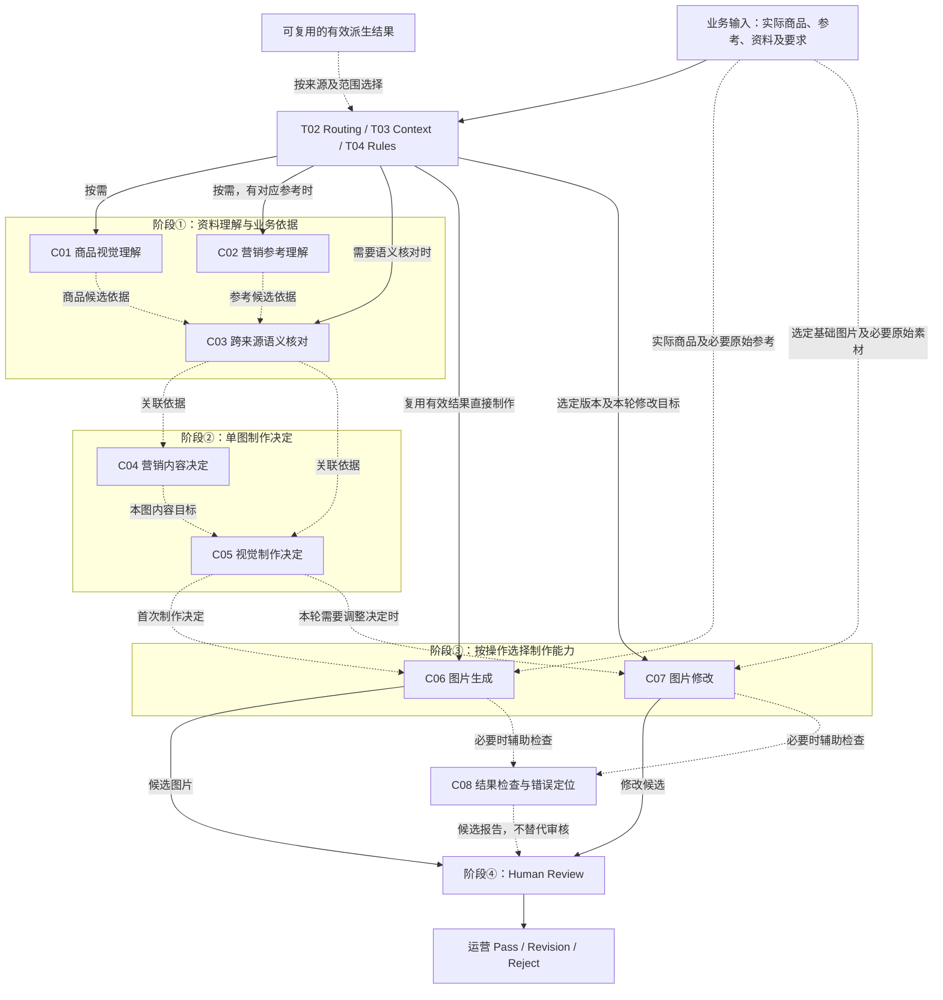

C01／C02 可按需选用，C04／C05 可合并完成，C06／C07 按首次制作或修改操作选择。虚线表示来源、候选依赖、复用或可选检查，不表示独立调用；已有适用结果时可直接制作。原始图片仍参与实际生成或修改，C08 并非强制额外调用，且不能代替 Human Review。Revision 由 Routing 重新选择受影响职责，不默认重新走完整图。

#### 图 8：AI 能力与 Context / Rules / Evaluation 的协作

**用途：** 回答每项能力是否需要永久独立 Context，说明实际执行输入、结果来源、复用及错误反馈的关系。

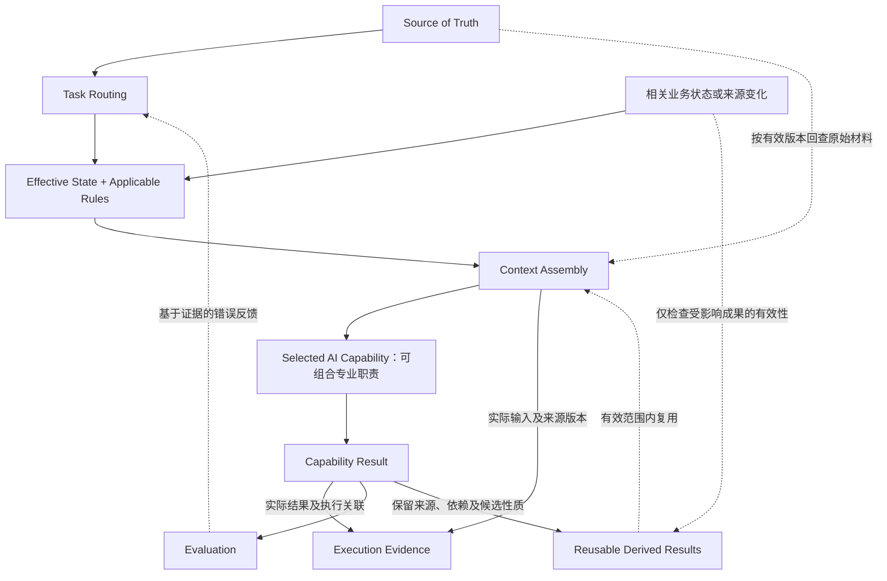

每次独立模型执行都有对应的 Execution Context，但一次执行可以承担多项能力，多项能力不需要永久各自维护商品事实。派生结果保留原始来源及依赖，由有效状态及变化范围决定能否复用；Evidence 记录实际输入和结果，Evaluation 作出可复核的评价，两者不混同。错误反馈和资料变化不自动授权整组重做，也不自动更改 Pass。

#### 图 9：生成失败的责任定位

**用途：** 以 Quick-A 已采用的比较项由 `×` 错成 `✓` 为例，说明为什么必须回查真实依据和中间结果，不能仅凭最终图片归因。

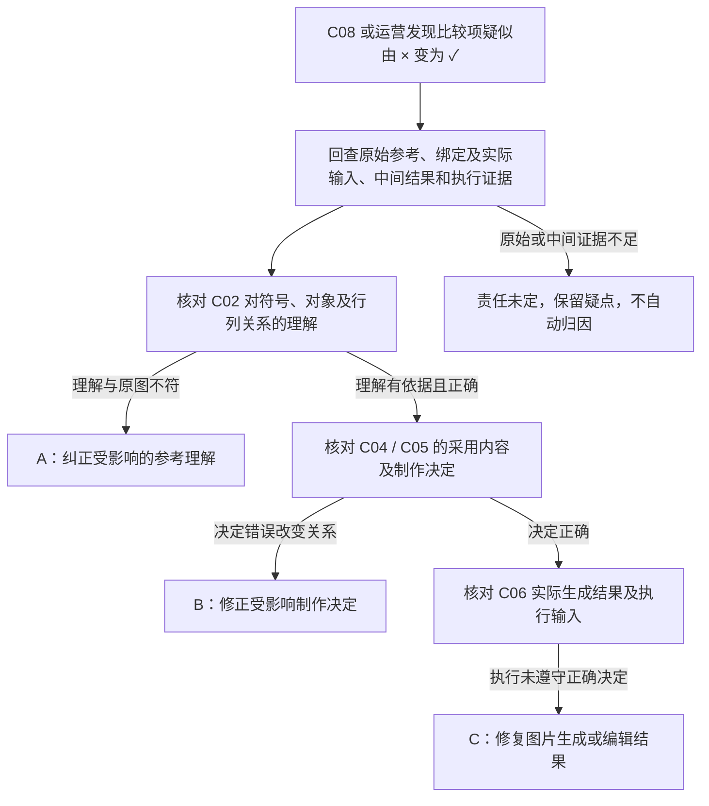

三条路径是可能的责任位置，不是已经完成的独立实验结论。先核对实际来源和输入，再比较理解、决定与成图；若上游已正确，应修复实际制作偏差，而非无限重复理解。缺少中间证据时不强行选定某一路径；修复只涉及相应职责及真实受影响成果。

### 8.9 历史业务案例与责任定位

`PROPOSED / REVIEW PENDING`

下列 Case 编号与能力编号分开使用。Case C01、Case C02 的具体历史失败描述来自本轮任务，仓库未提供与该描述绑定的完整原图、成图及各阶段证据，本轮不声称已独立复核，也不虚构模型实验或关联到未指明的历史 Run。Case C03 的资料及验收状态以 03 为准。

#### Case C01：Quick-A 比较关系错误

本轮提供的历史描述是：参考中的某比较关系为 `×`，成图中出现 `✓`。需先核对原图的行列、对象及图例，以及实际执行使用的参考和对应制作内容。

- 若 C02 已误读符号、对象或行列关系，应修正受影响参考理解，再检查其下游依赖。
- 若 C02 理解正确，而 C04／C05 改变已采用的比较内容或表达关系，应修正相应制作决定。
- 若理解与决定都正确，而 C06 把符号制作错误，应优先修复生成或编辑结果。
- 若缺少原图、实际输入或中间结果，只能记录候选原因，不能从最终错误断言哪项能力失败。

04 第 3.4、5.7 节支持图文关系理解与执行偏差的责任区分，但不证明本例已完成独立定位或真实验收。

#### Case C02：Quick-B 参考主体残留

本轮提供的历史描述是：目标与参考外观不同，成图的某个局部特写仍保留参考商品接口或配件。03 Case B01 已记录主体替换失败类型，但状态仍是 `PENDING REAL SAMPLE`，缺少完整可复核样本。

应依次核对 C01／C02 是否识别了目标与参考的部件关系，C05 是否覆盖局部替换及相关配件，C06 是否执行了正确替换决定；修改场景再检查 C07 是否重新引入参考主体。

上游理解及决定已经正确且实际输入匹配时，不应无限重新执行商品理解。应针对生成或修改偏差修复受影响部位，随后评价目标商品一致性及非目标变化。当前不能凭残留描述确定唯一责任，也不能宣称已验证修复效果。

#### Case C03：Listing 洗车设备

依据 03 Case L01，业务资料为实际商品图、运营商品文字资料及设计参考。已记录内容包括五种喷射模式：0°、15°、25°、40°、泡沫，三档水压、三档水量，以及清洗、浇灌、泡沫等场景；这些是运营案例资料，不代表独立性能检测。

已知风险是错误组合喷壶与水枪，生成不存在的商品结构。应分别检查：

- C01 是否忠实识别实物结构及部件关系。
- C04 是否从运营资料正确选择喷射模式、参数及场景，没有引入参考额外事实。
- C05 是否作出不合理的商品呈现或结构组合决定。
- C06 是否在正确输入及决定下仍生成错误结构。

最终结构错误不能直接证明 C01 失败，必须对照各阶段实际依据。03 的实际验收状态仍为 `NOT TESTED / BUSINESS ACCEPTANCE NOT ESTABLISHED`，本轮不改变此状态或补造最终成图与运营评价。

### 8.10 C01～C08 独立评价矩阵

`PROPOSED / REVIEW PENDING`

| 能力 | 实际输入 | 可检查候选结果 | 核对依据 | 主要失败类型 | 需要人工评价的部分 |
|---|---|---|---|---|---|
| C01 | 实际商品原图、相关身份及配置声明 | 可见特征、配件关系、保持项及未知 | 原始商品素材与明确运营确认 | 编造结构、漏配件、混淆连接或把推断当事实 | 可见关系是否忠实，无法观察的内容是否正确保留不确定性 |
| C02 | 本图绑定的原始参考及用途 | 文字、符号、对象关系、营销语义和设计方法 | 原始参考、图例、行列及指向关系 | OCR 或数字错误、关系错位、语义扩写、无依据设计解释 | 营销与视觉关系的忠实性及重要歧义 |
| C03 | 相关商品、参考、资料、确认及模式权限 | 关联依据、重要冲突、确认问题和可继续范围 | 01／02 权限规则及原始资料 | 越权继承、遗漏关键冲突、把一般未知升级为阻断 | 冲突是否真实重要、确认是否必要且范围适当 |
| C04 | 有效营销依据、图位目标及必保留要求 | 采用内容、重点、暂不展示内容及限制 | 运营要求、商品资料或适用参考 | 丢必保留、改数字含义、无依据卖点、不合理取舍 | 营销重点及信息取舍是否符合运营目标 |
| C05 | 内容目标、商品及设计依据、图位与有效要求 | 视觉方向、商品展示、图文关系及约束 | 原始商品、参考、内容目标和运营要求 | 决定不存在结构、局部替换遗漏、方向偏离、约束不足 | 设计合理性、商品呈现和差异化质量 |
| C06 | 原始素材、当前制作决定、有效约束及尺寸 | 候选图片及实际执行关联 | 实售商品、营销来源、参考和制作决定 | 改形、错参数或比较关系、未执行正确决定 | 真实保真、营销及商业视觉质量，仍由运营决定是否接受 |
| C07 | 选定基础图、有效要求、本轮反馈及必要来源 | 修改候选、基础版本及执行证据 | 实际基础图片、反馈和保持要求 | 基础版本错误、目标未完成、非目标变化、新增商品错误 | 修改是否准确，其他已认可内容是否保持 |
| C08 | 具体候选、原始依据、决定及可用执行证据 | 错误报告、候选责任位置、修复方向和未知 | 原始资料、阶段成果、执行结果及人工核对 | 漏判、误判、无证据归因、修复建议偏离 | 报告是否真实，定位证据是否充分，是否仍有未发现错误 |

各项能力可独立观察和评价，但评价拆分不决定生产执行必须按同样方式调用。JSON 格式正确不等于业务语义正确，AI 自评不等于运营接受；不设置当前尚无真实依据的评分阈值。

### 8.11 第一轮真实实验研究方案

`PROPOSED / REVIEW PENDING`，仅记录建议，本轮不执行实验、不调用付费 API、不生成商品图。

需要研究的问题：

1. 强模型直接综合制作的实际质量如何。
2. 单独商品理解能否改善商品保真。
3. 单独参考理解能否减少卖点和比较关系错误。
4. 单图制作决定能否改善最终图片质量。
5. 分阶段执行能否减少返工。
6. 多次调用实际增加多少成本及延迟。
7. 复用有效理解结果能否提高效率。
8. C08 能否发现真实错误，其漏判、误判及定位质量如何。

建议先固定同一组真实 Quick-A 商品、参考和有效要求，比较：

| 实验候选 | 输入与工作安排 | 主要比较内容 |
|---|---|---|
| 方案 A | 原始商品图、参考及有效要求，直接完成必要综合 AI 工作 | 直接执行质量、实际结果、成本及延迟，作为基础对照 |
| 方案 B | 相同原始业务输入，先形成可评价的商品和参考理解，再形成制作决定并生图 | 中间判断、最终成图、错误定位及返工变化，以及额外成本和延迟 |

条件包括：相同原始业务输入，同样模式权限与有效约束；明确各方案实际模型及执行条件，记录实际输入、输出、耗时和成本；由人工依据原始资料核对商品、营销及设计结果，分别评价阶段性判断与最终成图。

为减少成本，可先仅研究 C01／C02，不强制第一轮完成整套生图。单项理解结果改善不能直接证明最终成图或运营收益改善；方案 C 的按需组合收益也必须另行验证。以上不构成已完成实验、最佳方案或正式调用拓扑结论。

### 8.12 T05-A～T05-G 第一轮候选结论

| 编号 | 候选结论 | 状态及边界 |
|---|---|---|
| T05-A | AI 能力、业务阶段、Prompt、Execution Context 和模型调用分别建模 | PROPOSED / REVIEW PENDING |
| T05-B | V1 先以 C01～C08 建立候选能力地图 | PROPOSED / REVIEW PENDING |
| T05-C | 三模式复用专业 AI 能力，但严格遵守各自营销信息使用权限 | 业务权限已确认；具体能力实现仍待验证，PROPOSED / REVIEW PENDING |
| T05-D | 中间 AI 结果保留来源、依赖及候选性质，在有效边界内复用 | PROPOSED / REVIEW PENDING |
| T05-E | 按需合并或拆分 AI 工作是研究方向，不预设固定调用数量 | PROPOSED / REVIEW PENDING |
| T05-F | 重要能力具有可检查结果，支持独立评价和失败定位 | PROPOSED / REVIEW PENDING |
| T05-G | AI 辅助检查不能代替运营最终 Pass | 业务责任已确认；技术实现尚未完成，PROPOSED / REVIEW PENDING |

业务权限及运营责任已确认，与候选能力是否有效、技术机制是否完成分别管理。上述研究结论不代表工程实现、真实验证或正式架构批准。

### 8.13 第一轮记录、待验证问题与实施边界

`PROPOSED / REVIEW PENDING`

本轮已补全能力职责、阶段关系、三模式复用、来源及复用边界、执行策略、三张架构图、三个案例、独立评价矩阵和实验建议。T01～T04 原有结论及 T06～T09 研究路线保持不变。

后续待验证：C01／C02 的独立理解质量，C03 冲突判断是否避免不必要阻断，C04／C05 对实际成图的增益，C06／C07 的保真和修改稳定性，C08 的漏判、误判及证据支持，以及方案 A／B／C 的质量、复用、成本和延迟差异。历史案例仍需实际输入、中间结果、成图及运营评价形成可复核证据；Mermaid 仍需实际渲染与可读性检查。

本次不决定模型供应商或具体模型、Prompt 模板及数量、固定 S1～S6 工作流、正式 JSON Schema、Python 类或模块、Agent 数量、多 Agent 框架、LangGraph 等 Workflow 技术、Knowledge／Skills 正式组织、图像合成或修图工具、生产 Runtime、自动评价模型及阈值。八个能力编号不授权创建八个目录、Prompt 或独立执行节点。

下一研究专题为 T06 Knowledge / Skills。本轮不开始 T06，也不开展功能开发。

## 9. T06：Knowledge / Skills

**研究进度：** `RESEARCHED`，第一轮研究记录已补全。

**技术设计状态：** `PROPOSED / REVIEW PENDING`。

本节记录专业知识及可复用方法何时值得参与 AI 工作、如何进入本次 Context，以及如何评价收益。业务事实和运营责任继续以 00～04 相应已确认规则为准；候选专业方法不因写入本文而成为已验证事实、强制业务规则或技术实施授权。

### 9.1 研究目标与 Model-first 原则

`PROPOSED / REVIEW PENDING`

本专题需要回答：

1. 在模型已具备多种理解和制作能力的前提下，专业增强还可能解决什么具体缺口。
2. Knowledge、Skills、Retrieval / RAG、Rules、Prompt、Context、Tools 与 Evaluation 分别承担什么职责。
3. C01～C08 中哪些专业能力可能需要知识增强。
4. 何时模型原生能力已足够，无须额外增强。
5. 何时只需少量针对性知识或示例。
6. 何时稳定、重复使用的方法值得形成 Skill。
7. 何时资料规模及变化频率使 Retrieval / RAG 有必要。
8. 专业材料怎样按当前能力需要进入 Execution Context。
9. 怎样避免专业知识覆盖商品事实、模式权限及有效运营要求。
10. 怎样用真实案例证明质量收益，并核对新增复杂度、延迟及成本。

核心候选原则：**Model-first, Knowledge on demand, Evidence-driven.**

- 首先用模型原生能力建立基线，不先假定必须补充知识或 Skill。
- 根据真实失败定位专业能力缺口，不把所有制作错误都归因于缺少知识。
- 只在存在具体需要时补充相关知识或方法。
- 通过真实案例评价目标错误、成图或判断质量，以及耗时和成本变化。
- 不因为某项技术存在，就要求业务必须使用。
- 不提前建设完整 Knowledge Base、RAG 或通用 Skill Runtime。

该原则是 `PROPOSED` 技术方向，不表示模型原生能力已经满足所有任务，也不表示增强方案已经被证明有效。

### 9.2 概念与职责边界

`PROPOSED / REVIEW PENDING`

| 概念 | 职责与示例 | 权限或效果边界 |
|---|---|---|
| Rules | 规定业务条件、权限和约束，例如 Listing 参数来源、尺寸图专项条件、新候选与 Pass 保护 | 已确认业务规则按其来源和范围生效，不能由专业建议替换 |
| Knowledge | 提供商品摄影、结构观察、复杂表格关系、营销内容组织、视觉层级、排版、编辑及合成知识 | 帮助理解和选择方法，不证明某个 SKU 必然具有通用类别中常见的功能、附件、认证或性能 |
| Skills | 提供输入、输出和目标明确、可复用的专业工作方法，例如复杂比较营销图解读 | 方法仍为候选，不能保证执行结果正确，也不获得改写商品事实及运营要求的权限 |
| Retrieval / RAG | 从大量或动态资料中检索当前任务需要的信息，例如指定平台规范、目标市场广告资料或相关设计方法 | 不等于必须建设向量数据库；资料少且稳定时直接提供可能更合理；检索命中不等于有效业务授权 |
| Prompt | 说明本次工作目标、职责及适用的规则和方法 | 不等于 Knowledge Base，也不保证模型正确执行 |
| Context | 为一次执行组织有效业务依据、必要约束、专业资料及上游结果 | Knowledge 或 Skill 可以是其中一部分，不默认加载全部材料 |
| Tools | 实际读取或处理图片、生成或编辑图像、提取主体、排版文字和图表、存储或导出文件 | Skill 可描述工具使用方法，但不等于工具已执行或执行成功 |
| Evaluation | 检查模型及专业增强是否改善实际任务 | 增加 Knowledge 或 Skill 本身不构成质量提升证据 |

候选“复杂比较营销图解读 Skill”可以描述以下方法，而不在本轮创建实际 Skill：

1. 识别参与比较的对象。
2. 判断表格行、列、标题和单元格关系。
3. 识别图例、符号及所属对象。
4. 标出模糊单元格和不能确定的关系，不猜测填充。
5. 保留关键数字、单位、限定词及相关条件。
6. 对照原始参考核对理解结果。

这些步骤是否改善 C02，仍需与模型原生理解对照，不要求运营新增逐步骤审批。

### 9.3 Knowledge 的来源与权威边界

`PROPOSED / REVIEW PENDING`

| 信息性质 | 来源及用途 | 权威边界 |
|---|---|---|
| A：Product / Business Truth | 实际商品素材、运营商品资料、有效要求及运营确认，构成相应业务依据 | 按 00～04 的模式权限和作用范围使用，不把业务声明或 Pass 视为独立性能认证 |
| B：Professional Knowledge | 行业设计、营销表达、商品摄影和图片制作知识，帮助理解、判断和表达 | 提供方法或候选判断，不能自行改变目标商品事实或运营要求 |
| C：AI-derived Results | 模型基于业务材料及专业知识形成的观察、分析和制作建议 | 保留候选性质、来源及适用范围，不自动升级为运营确认 |

**Professional Knowledge 不是 Product Truth。** 通用资料说明某类洗车机常见五种喷射模式，不能证明目标商品具备这些模式。03 中洗车设备案例的相应营销信息依据是运营提供的具体商品资料，而不是对商品类别的推断。

参考营销图仍按三模式既有权限参与，不能因“专业资料”标签改变其来源性质。不应把运营没有要求的额外商品规格凭通用知识补入最终图片，也不能借专业知识补造不可见结构、配件、认证或真实尺寸。

以上是逻辑来源区分，不建立新的事实认证系统，也不冻结正式状态枚举。

### 9.4 C01～C08 的专业增强映射

`PROPOSED / REVIEW PENDING`

| 能力及模型基础职责 | 可能需要的专业知识或方法 | 候选引入条件 | 不可突破的边界 |
|---|---|---|---|
| C01：识别可见结构、配件、标识及关系 | 商品摄影与视角、光线反光和材质表现、结构部件识别方法、可见内容与推断的区别 | 真实案例反复出现结构或部件理解错误，且证据支持主要缺口在专业识别方法 | 不能凭知识创造不可见结构或把类别常识当作目标商品事实 |
| C02：理解营销内容、文字、符号、图文关系及设计 | 复杂比较表结构、数字与单位关联、箭头和特写对应、视觉层级及信息设计 | 优先研究复杂比较图的关系理解；先确认错误确在理解而非决定或生成 | 不用正确 OCR 代替关系理解，不擅自反转图例和比较含义 |
| C03：跨来源关联与重要语义冲突判断 | 适用性判断、营销宣称语义范围、变体及配置差异识别方法 | 真实冲突识别存在遗漏或误判，且需要语义方法帮助 | 遵守 Quick-A 同款前提、Quick-B 默认适用和 Listing 资料权限，不新增逐项确认 |
| C04：确定本图营销目标及内容取舍 | 卖点排序、特征与消费者利益表达、信息密度和可读性、不同图位的内容组织 | 原生内容决定出现有证据的重点或组织问题，再比较针对性方法 | 不能静默删除必保留信息，也不能以通用营销知识创造商品承诺 |
| C05：形成视觉方向、商品展示与图文关系 | 视觉层级、构图与信息组织、主体及特写呈现、色彩对比留白、阅读顺序和电商设计原则 | 优先评价模型原生设计判断，再验证专业方法是否改善真实决定及成图 | 不默认认定设计 Skill 提升商业视觉质量，不覆盖有效运营要求 |
| C06：按有效决定制作候选图 | 商品视觉保真、图像合成及制作、文字与图表精确表达方法 | 定位执行问题后比较知识是否有帮助；若模型无法精确制作数字或复杂图表，优先研究 T07 的工具能力 | 不以无限增加生成知识代替工具与执行能力研究，不把生成成功当作正确 |
| C07：基于选定版本执行本轮修改 | 局部修改、非破坏性编辑、素材复用与局部合成、修改范围及非目标变化控制 | 基础版本和有效要求正确后，研究实际局部执行方法是否改善稳定性 | 仍由 T03 确保真实基础版本、当前要求和反馈，不重放全部历史或自动改 Pass |
| C08：检查结果及定位错误 | 商品保真、图文对应、数字参数和比较核对、前后差异分析、错误分类及修复判断 | 已有真实失败可供人工核对，评价方法能否减少漏判、误判及无依据归因 | AI 自评不是运营 Pass，专业检查方法也不保证发现全部错误 |

**每项能力可能使用专业 Knowledge，不代表每项能力必须拥有独立 Skill。** 本轮不创建八个 Skill、固定增强节点或对应代码目录。

### 9.5 三模式的专业知识使用差异

`PROPOSED / REVIEW PENDING`

| 模式 | 重点考虑的专业方法 | 信息权限与业务边界 |
|---|---|---|
| Quick-A | 同款商品保真、参考营销解读、设计方法提取、适用卖点取舍及有目的的视觉差异化 | 不用专业知识重新质疑已选择的同款同配置前提，不把全部参考卖点变成逐项审批 |
| Quick-B | 参考与实售商品的结构差异、主体和特写完整替换、配件及相关场景细节、营销表达迁移 | 选图默认营销内容适用，不逐条再确认；不混入参考商品结构，重大实际冲突定点处理 |
| Listing | 商品资料理解、卖点组织、图文及视觉表达、真实结构与营销内容一致性 | V1 由实际商品图和运营文字资料驱动；参考通常提供但仍可选，主要用于设计；不继承无依据的参考商品事实，不以纯文字生图为当前主要场景 |

三模式可复用专业知识和方法，但不得突破各自信息权限。实际商品素材仍提供最终外观依据，运营明确必保留内容、尺寸图专项条件、有效要求继承及 Pass 保护继续生效。

### 9.6 何时采用 Model-only、Knowledge、Skill 或 Retrieval

`PROPOSED / REVIEW PENDING`

| 情况 | 候选选择 | 需要满足或核对的条件 | 选择边界 |
|---|---|---|---|
| A：原生能力足够 | Model-only | 原始业务输入、有效约束和当前能力基线足以完成目标 | 不为了技术完整性增加专业增强 |
| B：缺少少量判断方法 | 简短 Targeted Knowledge 或示例 | 有具体缺口，少量相关材料可直接说明方法并可评价 | 不必额外建设 Skill 系统或检索平台 |
| C：稳定且重复使用的方法 | 研究 Reusable Skill | 方法有重复价值，输入输出明确，目标可评价，额外步骤有实际收益 | 方法仍需验证，不保证执行结果，也不要求每项能力各一个 Skill |
| D：资料规模较大 | 研究 Retrieval / RAG | 无法合理完整提供，每次需要不同片段，并有来源和适用范围管理需要 | 不预设向量数据库；知识少且稳定时直接提供可能更合理 |
| E：资料经常变化 | 研究带来源、时间及条件的检索 | 明确指定的平台、市场、地区和时间范围，核对资料是否仍适用 | 未验证、过期或不适用资料不自动升级为发布规则，不自动抓取全部平台 |
| F：理解正确但制作失败 | 排查 C05、C06／C07 及 T07 工具能力 | 回查实际决定和执行输入，判断问题发生在决定、生成或编辑 | 不默认继续堆叠 Knowledge / Skills |

这些是按实际需要选择的候选方式，不是全任务固定互斥的四种 Runtime，也不是强制串行增强链。不同 AI 工作可以选用不同方式，适用的知识、Skill 和检索材料也可组合；应由真实失败与收益证据决定取舍。

### 9.7 按需参与与 Execution Context

`PROPOSED / REVIEW PENDING`

| 专题 | 与 T06 的逻辑协作 |
|---|---|
| T02 Task Routing | 识别本次 AI 工作、目标和实际影响范围 |
| T03 Context Engineering | 解析有效业务状态，选择商品依据、要求、规则及必要专业材料，组织实际执行 Context |
| T04 Rules | 规定信息权限、业务条件及不可突破的约束 |
| T05 AI Capabilities | 承担本次语义理解、专业决定及制作工作 |
| T06 Knowledge / Skills | 仅在需要时提供相关专业增强，不独立管理商品事实或代替 Rules |
| T09 Evaluation | 对比增强前后的质量、错误、输入规模、延迟及成本 |

专业材料参与时，应保留来源、版本或时间、用途与适用范围，并按本次能力需要组织。检索命中的材料仍需核对其来源和当前适用性，不能因为存在“平台规范”或“专业 Skill”字样就获得更高业务权威。

T03 将选中的材料与原始商品依据、有效要求和必要上游结果共同组织成实际 Execution Context，保留本次使用情况供回查。资料后续变化不静默改写历史执行。专业方法可进入当前指令及上下文的适用部分，但外部资料本身不取得改变业务规则或系统行为的权限。

不要求独立 Knowledge Agent、通用 Skill Runtime 或每次固定增加一次检索／模型调用。本节只说明候选职责及材料选择，不决定服务、数据库、消息格式或调用数量。

### 9.8 两张 Knowledge / Skills 架构图

两图均为 `PROPOSED / REVIEW PENDING`，表示按需增强与权威边界，不表示已实现的知识平台或执行链。

#### 图 10：Knowledge / Skills 按需参与架构

**用途：** 说明先建立模型原生能力基线，再根据真实缺口选择专业增强，并将实际质量和成本反馈到后续技术取舍。

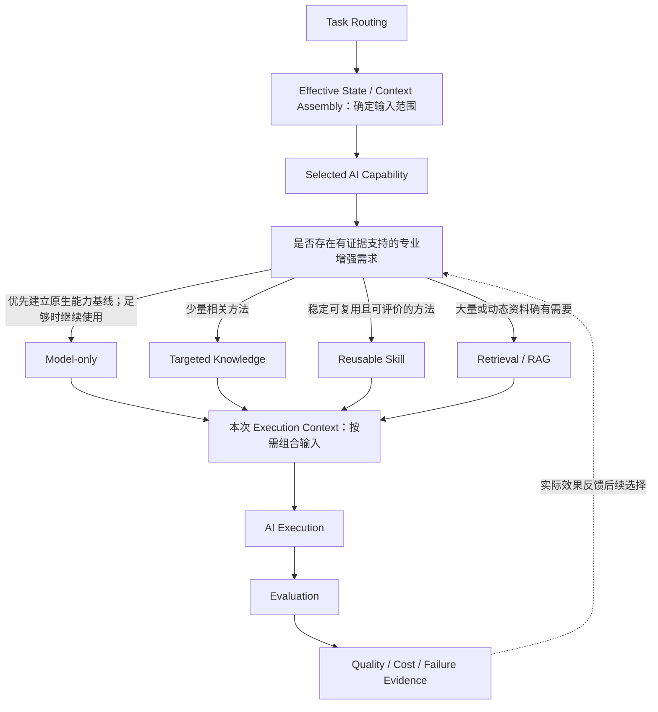

Model-only 不加载专业增强；其他候选材料可按任务组合，不要求整个 Task 固定选择唯一路径。前部确定输入范围与后部形成实际 Context 属于 T03 的逻辑工作，不表示两次独立模型调用。Knowledge、Skill、Retrieval 不是每次必经节点，不存在默认 Knowledge Agent，评价结果也不自动证明增强方案更好。

#### 图 11：业务事实与专业知识的权威边界

**用途：** 区分业务依据路径和专业参考路径，说明专业材料可以辅助执行，却不能覆盖商品事实、有效要求或取得系统授权。

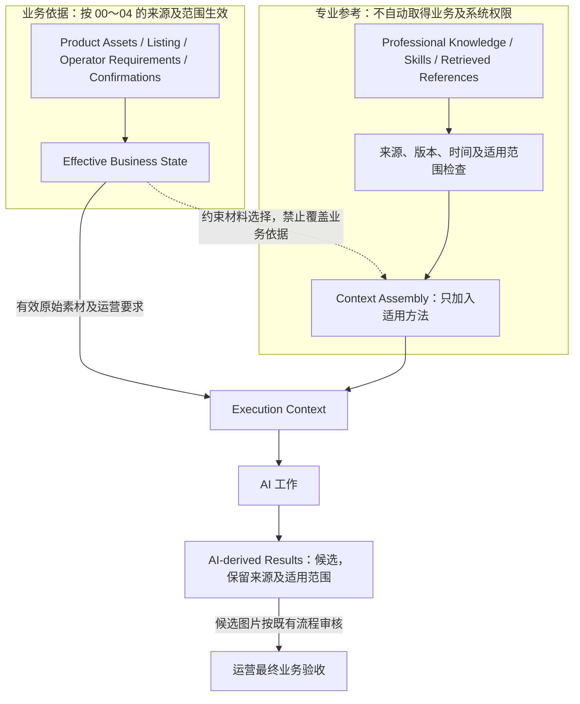

专业资料通过来源和适用范围检查参与 Context，但不成为目标 SKU 的事实证明，也不改写有效运营要求。AI 派生成果保持候选性质，不自动成为运营确认。资料中的指令式文本仍按业务数据或专业参考处理，不能改变系统访问权限和行为。图中的运营验收对应已有图片审核，不新增上游阶段审批或自动 Pass。

### 9.9 历史案例、失败定位与反例

`PROPOSED / REVIEW PENDING`

沿用 T05 已记录的历史失败描述及 03 的案例状态。本轮没有对应原图、成图和阶段成果的完整独立复核，也未运行知识增强实验；下列分析是待验证的责任定位及技术选择，不是已确认根因。

#### Case K01：Quick-A 复杂比较图

历史描述为参考比较关系 `×` 在成图中变为 `✓`。先核对实际参考、对象、行列、图例、输入和中间结果，再区分：

| 可能失败位置 | 需要核对的证据 | 候选处理方向 |
|---|---|---|
| A：C02 参考理解错误 | 原图关系与实际 C02 结果是否一致 | 可测试针对性表格解读 Knowledge 或可复用方法，检查关系理解是否改善 |
| B：C04 制作决定错误 | 理解已正确，但内容决定是否错误改变比较含义 | 修正信息取舍和语义保护，不把问题默认归为缺少 C02 Skill |
| C：C06 图片生成错误 | 上游理解及决定正确，实际成图是否仍错误生成符号 | 研究生成能力或 T07 精确文字和图表工具，不无限增加理解知识 |

不能看到最终符号错误就认定必须新增 C02 Skill。缺少真实输入或中间证据时保留责任未定，不宣称增强已经有效。

#### Case K02：Quick-B 参考商品残留

历史描述为实售商品与参考外观不同，成图某个局部特写仍保留参考商品接口或配件。需要分别核对：

- C01 是否识别错目标商品或相关部件。
- C02 是否遗漏参考商品的局部特征及关联。
- C05 是否没有覆盖完整主体、特写、配件及相关细节替换。
- C06 是否未执行正确的替换决定。

若上游理解和决定已正确、实际执行输入也匹配，继续堆叠商品知识可能无效，应检查图像执行及 T07 工具能力边界。03 Case B01 仍缺少完整可复核样本，状态为 `PENDING REAL SAMPLE`；本轮不虚构已定位或已修复结果。

#### Case K03：Listing 商品营销图

依据 03 Case L01，洗车设备案例已有运营商品文字资料、实际商品图及设计参考背景。资料包含五种喷射模式、三档水压、三档水量和清洗、浇灌、泡沫等场景，已有风险包括错误组合喷壶与水枪结构；这些不是凭通用知识补出的规格。

应研究模型能否直接组织营销内容，原设计参考是否足以指导画面，专业视觉方法能否改善 C04／C05 决定，以及增强是否反而引入额外商品事实幻觉或错误结构组合。实际问题仍须区分理解、决定及生成执行，不能只看到错误结构就判定缺少商品知识。

事实来源及验收状态以 03 为准，仍为 `NOT TESTED / BUSINESS ACCEPTANCE NOT ESTABLISHED`。本轮不新增成图评价、独立性能验证或业务接受结论。

### 9.10 主要风险与控制原则

`PROPOSED / REVIEW PENDING`

| 风险 | 可能表现 | 候选控制原则 |
|---|---|---|
| Product Truth Contamination | 将行业常见配置或知识建议升级为目标商品事实 | 保留来源及信息性质；专业材料只提供方法或候选判断，不无依据补参数、功能及附件 |
| Operator Intent Override | 设计 Skill 自动覆盖运营要求或必保留内容 | 专业原则按实际任务使用，不转为无条件硬规则；不能擅自修改已确认要求 |
| Prompt / Context Pollution | 每次加载大量无关知识和方法，引入相互干扰的指令 | 由本次能力及任务选择必要材料，不默认加载全部知识或 Skill |
| Prompt Injection / Untrusted Sources | 检索资料、图片或外部文档中的指令式文字改变业务规则、权限或系统行为 | 区分业务数据、专业参考及真正授权的执行指令；外部文本不自动取得系统指令权限 |
| Unverified Improvement | 系统复杂度增加，但质量不变或引入新误判 | 通过同一真实任务的对照和人工核对判断收益，不用模型自评宣布成功 |

例如，某方法建议每张图最多三个卖点，不能自动覆盖运营明确要求展示四个卖点的决定。这是专业建议与业务要求的权威边界示例，不新增“三个卖点”的业务限制或审批环节。

### 9.11 Knowledge / Skills 增强评价

`PROPOSED / REVIEW PENDING`

| 维度 | 需要回答的问题 |
|---|---|
| Baseline Quality | 不加专业增强时，原生能力在真实输入上表现如何 |
| Enhanced Quality | 加入知识或方法后，哪些具体判断或实际结果改善 |
| Error Reduction | 被定位的目标错误是否减少 |
| New Errors | 是否新增误判、遗漏、事实幻觉或过度阻断 |
| Source Integrity | 是否正确区分商品事实、专业知识和 AI 候选结果 |
| Context Cost | 输入规模是否明显增加，新增材料是否与任务相关 |
| Latency | 实际执行时间及额外检索或步骤是否增加 |
| Monetary Cost | 实际模型和检索成本如何变化 |
| Business Acceptance | 运营是否更容易接受实际结果，返工是否改善 |

候选对照方案：

| 方案 | 输入及方法 | 适用条件 |
|---|---|---|
| A：Model-only Baseline | 原始业务输入、有效约束及当前模型，不添加专业增强 | 先建立可核对的原生能力基线 |
| B：Targeted Knowledge | 在 A 的基础上加入针对目标缺口的简短专业知识 | 有具体缺口，少量知识可直接提供 |
| C：Reusable Skill | 使用输入输出及目标明确的专业步骤和检查方法 | 稳定、重复使用的方法确有评价和复用价值 |
| D：Retrieval | 在必要时检索适用专业资料，并保留来源及条件 | 资料规模或动态变化确有检索需求 |

不要求四种方案全部执行，第一轮可以只比较 A 与 B。使用同一真实业务输入、同样权限及可比较执行条件；由原始素材和人工评价建立核对依据，记录实际耗时、成本、输入规模和错误变化，不让模型自行宣布增强方案更好，也不提前设置未经验证的阈值。

中间判断改善、最终成图质量及运营接受分别评价。如果目标能力没有改善，不能仅因未来已经投入 Skill 开发就继续保留其复杂性。以上仅为实验建议，本轮未执行模型实验、检索、付费调用或商品图制作。

### 9.12 V1 实施边界与开发工具 Skill 的区别

`PROPOSED / REVIEW PENDING`

以下不作为 V1 前置条件：完整专业 Knowledge Base、企业级 RAG、大规模向量数据库、通用 Skill Registry、Skill 自动发现和复杂调度、知识图谱、知识驱动的通用多 Agent 系统、为 C01～C08 分别开发固定 Skill、自动抓取全部平台规范，以及未经实际验证的专业 Prompt 集合。

架构只预留专业材料按需参与的位置。具体实现由真实能力缺口及实验收益决定，不因本节分类而创建知识库、Skill 文件、Prompt 模板、Agent 或 Runtime 框架，也不决定正式模型调用次数。

**开发工具的 Skill 机制与产品 Runtime 能力必须区分。** Codex 等开发工具已有的 `SKILL.md` 机制，不等于 AIGC Workbench 未来的运行时 Skill 能力；不能因开发工具支持 Skill，就宣称产品已拥有相同的发现、调度或执行能力。

### 9.13 T06-A～T06-G 第一轮候选结论

| 编号 | 候选结论 | 状态 |
|---|---|---|
| T06-A | 采用 Model-first，仅在实际能力缺口获得证据支持时考虑专业增强 | PROPOSED / REVIEW PENDING |
| T06-B | Knowledge、Skills、Retrieval、Rules、Prompt 和 Tools 分别承担不同职责 | PROPOSED / REVIEW PENDING |
| T06-C | 专业知识提供方法，不无依据生成目标商品事实，也不擅自覆盖运营确认 | BUSINESS CONSTRAINT CONFIRMED / TECHNICAL DESIGN PROPOSED |
| T06-D | 专业材料由 T03 按当前任务及能力需要组织，不默认全部加载 | PROPOSED / REVIEW PENDING |
| T06-E | 根据资料规模、任务特点及验证效果选择少量知识、可复用 Skill 或 Retrieval | PROPOSED / REVIEW PENDING |
| T06-F | 用真实案例比较增强前后的正确性、返工、延迟及成本 | PROPOSED / REVIEW PENDING |
| T06-G | V1 不提前建设完整 Knowledge Base、RAG 或通用 Skill 调度系统 | PROPOSED / REVIEW PENDING |

T06-C 的业务约束依据 00 R7、01 的模式权限、02 第 4 节及 04 第 11.3 节；相应技术选择与执行机制仍为 `PROPOSED / REVIEW PENDING`。本轮所有候选方案均未获得工程实现、真实验证或业务接受的结论。

### 9.14 第一轮研究记录与后续专题

`PROPOSED / REVIEW PENDING`

本轮已完整记录 Model-first 原则、八类概念、三类来源权威、C01～C08 映射、三模式差异、技术选择矩阵、按需参与机制、两张 Mermaid 图、三个案例、五类风险及对照评价方案。研究记录完成不等于增强收益已经验证。

| 后续专题 | 与本节的关系及边界 |
|---|---|
| T07 Tool Integration | 研究图片生成、局部编辑、主体复用及文字图表工具；理解正确而执行失败时优先检查工具和制作能力，不无限增加 Skill |
| T08 Orchestration & Runtime | 后续研究任务执行、状态、重试、恢复及工具组织；本节不提前设计复杂 Skill 调度引擎 |
| T09 Evaluation & Observability | 后续研究统一评价，本节增强对照可作为候选场景，不代表评价体系已完成 |

待验证事项包括：原生能力基线是否足够，真实失败是否确属专业方法缺口，少量知识或稳定方法是否改善目标错误，是否引入事实污染及意图覆盖，以及收益是否足以抵消输入规模、延迟、成本和复杂度。案例仍需原始输入、中间结果、成图及人工评价支持；两图仍待实际渲染和可读性检查。

下一专题为 T07 Tool Integration。本轮不开始 T07，不提前补全 T08／T09，不开展代码、知识库或 Skill 实施。

## 10. T07：Tool Integration

**研究进度：** `RESEARCHED`，第一轮研究记录已补全。

**技术设计状态：** `PROPOSED / REVIEW PENDING`。

本节研究在商品、参考、运营意图和制作决定明确后，如何选择、组合和交接实际制作工具，尽可能准确完成图片并支持可控修改。能力地图、制作策略、契约、图示和实验均为研究建议，不表示已实现工具接入、自动素材解析、生成能力或实际业务收益。

### 10.1 业务目标与工具责任

`PROPOSED / REVIEW PENDING`

图片制作不能等同于一次生图模型调用。理解和决定正确后，实际制作仍可能改变商品、配件、文字及比较关系；“其他不变”的指令也不构成非目标区域必然保持的证明。需要分别评价制作决定、实际工具执行及运营接受。

本专题回答：何时生成新图、何时局部编辑、何时复用真实主体、何时采用确定性文字或图表处理；扁平图片与可编辑成果对修改有何影响；如何提供正确素材与 Context，记录实际输入、输出和失败，并比较质量、延迟、成本及运营返工。

核心候选原则：**AI Capability 与 Tool Capability 解耦。** T05 定义需要完成什么专业工作，T07 研究采用什么工具或组合方式完成。不规定 `C06 = 固定某个生图 API` 或 `C07 = 固定某个编辑 API`。

工具选择依据当前制作目标、原始素材条件、商品保真要求、文字及图表精度、修改区域、视觉质量、成本、延迟和实际可行性。本轮不冻结供应商或技术栈，也不因分类而创建固定 Tool Agent 或执行链。

### 10.2 G01～G05 候选工具能力地图

`PROPOSED / REVIEW PENDING`

G01～G05 是研究编号，不代表五个服务、Agent 或固定执行节点。工具成功与结果合规、运营 Pass 分开管理。

#### G01：Generative Image Creation｜生成式图片制作

**职责：** 支持 C06 生成新候选，创作营销场景、背景及视觉元素，实现新构图或较大视觉改版，服务 Quick-A／B 差异化设计及 Listing 营销视觉。

**主要输入：** 实际销售商品图、必要参考、当前有效制作决定、商品与营销约束、输出尺寸及制作条件。

**主要输出：** 候选图片、工具实际结果、对应输入及执行记录。

**局限与风险：** 商品结构和配件变化、参考主体误入、文字数字及符号失真、营销语义改变、视觉方向偏离。图片成功生成不等于业务正确，不能仅靠 Prompt 承诺完全避免偏移。

#### G02：Generative Image Editing｜生成式图片编辑

**职责：** 支持 C07 根据现有图片及本轮要求产生新候选，改变背景、场景、对象或局部内容，并尝试保持未修改内容。

**主要输入：** 运营实际选定的基础图片版本、本轮反馈、当前有效业务约束、必要商品与参考素材，以及可用时的编辑区域或蒙版。

**主要输出：** 修改候选、实际基础版本及输入关联、工具结果与相关错误信息。

**局限与风险：** 非目标区域、商品细节或其他文字可能被重绘，编辑边界可能偏移，也可能引入新的事实及设计错误。**生成式编辑的 Mask 不应默认视为严格像素级修改边界。** 已读取的 [OpenAI 图像生成与编辑官方说明](https://developers.openai.com/api/docs/guides/image-generation)将相关蒙版描述为编辑引导，不能保证完全遵循其形状；具体模型和工具的控制效果仍需分别实测，不将一个工具的说明泛化为所有工具的保证。

#### G03：Deterministic Image Processing & Composition｜确定性处理与合成

**职责：** 研究裁剪、缩放、格式转换、多素材叠加、精确文字排版、表格及符号绘制、指定位置对象处理，以及已有可编辑元素的确定性修改。

**主要输入：** 明确的真实素材、正确的文字或表格数据、位置及布局条件、必要字体、可用蒙版或图层、输出要求。

**主要输出：** 处理或合成结果、必要中间成果及实际执行关联。

**候选价值：** 对明确且可操作的输入提供更可控的处理，例如绘制 `0° / 15° / 25° / 40°`，保留已决定采用的比较项 `×`，或调整独立文字层的标题字号。

**局限与风险：** 正确绘制不等于正确设计；输入数据错误时程序仍会绘制错误内容。缺少合适素材、蒙版或图层时不能保证完成复杂编辑，简单覆盖文字可能破坏背景及布局；合成仍需处理透视、边缘、光影与视觉协调。本轮不决定使用 Pillow、Sharp、Photoshop 或其他工具。

#### G04：Product Subject Extraction & Reuse｜真实商品主体提取与复用

**职责：** 研究从实际商品图提取主体、保留真实结构及配件，将其用于新视觉设计，按需组合前景、背景及局部素材，减少不必要的商品重新生成。

**主要输入：** 实际商品原始素材及来源、可用视角和部件依据、当前呈现目标及必要区域信息。

**主要输出：** 主体或局部提取成果、来源及用途关联、后续制作可用素材和实际处理结果。

**候选价值：** 有机会减少真实细节变化，分开处理商品与场景，并支持部分局部修改和可控合成。

**局限与风险：** 边缘、透明、反光及复杂结构可能提取不佳，新场景的光影和透视仍需协调。遮挡区域没有真实信息时不能凭空还原；缺少某个原始角度，不代表可以安全生成真实的新角度。主体复用是否改善保真必须对照评价，不设为所有图片的强制方式。

#### G05：File & Asset Operations｜文件素材及成果交接

**职责：** 获取正确输入，区分商品、营销参考、设计参考、基础图片及临时素材角色，保持身份和来源，交接必要临时文件，将候选结果交回系统，支持保存及后续处理。

**主要输入：** 当前操作的素材身份、版本、角色及使用边界，以及工具实际返回的结果和必要中间成果。

**主要输出：** 可供工具使用的实际输入、交回的候选或中间成果、输入输出关联及可追溯信息。

**局限与边界：** T01 定义业务对象与版本权威，T07 定义工具素材及结果交接，T08 后续负责执行生命周期与失败恢复。G05 不决定 Pass，不因文件已保存就改变有效交付，也不自行冻结存储布局或永久保留全部临时文件。

### 10.3 三种候选图片制作策略

`PROPOSED / REVIEW PENDING`

| 策略 | 候选制作方式与适用范围 | 可能优势 | 主要风险及条件 |
|---|---|---|---|
| A：Generative-first | 商品图、参考、制作决定和有效要求进入生成工具；研究首次制作、新场景、大构图改版及复杂视觉创意 | 流程较简单，创意自由度较高，不必预建完整图层或合成系统 | 商品细节、文字及复杂关系可能出错，局部修改可能影响其他内容 |
| B：Hybrid Generation & Composition | 生成场景或背景，复用实际商品主体，确定性绘制关键文字及比较图表，再合成协调 | 有机会加强主体和关键信息控制，减少数字符号错误并支持部分定点修改 | 依赖抠图及素材条件，需处理遮挡、光影和融合；复杂度和成本增加，不一定适合每图 |
| C：Editable Composition | 尽可能保留独立商品、背景、标题、卖点文字、表格图标等可修改元素 | 已有可编辑文字可直接调整，部分修改不必整图重新生成，影响范围可能更可控 | 需可编辑素材或中间表示，生产维护成本可能增加；生成图不一定能可靠拆成正确图层，创意场景也未必能简单元素化 |

**扁平 PNG/JPEG 不会因为接入编辑工具，就自动拥有可编辑文字层和商品层。** 只有扁平图时，仍可能需要局部修复、背景重建、文字重排或重新制作；不能假设接入某工具就能精确编辑任意元素。

三种策略可组合，例如先生成场景，再复用商品并精确排版，最后保留部分可编辑元素。但这不是 V1 强制流程。建议先建立 Generative-first 的真实业务基线，再依据明确失败证据评价混合及可编辑策略，不预设后两者优于基线。

### 10.4 工具选择与架构协作

`PROPOSED / REVIEW PENDING`

| 专题 | 与 T07 的逻辑职责关系 |
|---|---|
| T01 | 定义业务对象、素材及版本身份、当前有效交付和历史关系 |
| T02 Task Routing | 识别首次生成、选定版本修改、新增图位、重新制作、审核及 Pass 等操作和影响范围 |
| T03 Context Engineering | 选择有效商品依据、参考、制作决定、要求、实际基础版本与本轮目标，组织执行 Context |
| T04 Rules | 提供适用信息权限、业务条件、工具操作及版本保护约束 |
| T05 AI Capability | 定义需完成的专业工作，例如 C06 生成或 C07 修改候选，不绑定单一工具 |
| T06 Knowledge / Skills | 必要时提供专业制作方法，不因执行失败就无限增加知识，也不代替工具实际能力 |
| T07 Tool Integration | 按目标及素材条件选择候选工具方式，执行或交接制作操作及实际结果 |
| T08 Orchestration | 后续研究执行组织、状态、等待、重试、取消及恢复，不在本节冻结机制 |
| T09 Evaluation | 评价实际制作质量、修改准确性、返工、延迟及成本 |

T07 不替代 T03 组装 Context，不自行修改运营要求，不将工具成功转为 Pass。组合工具不等于需要自主决策的 Tool Agent，各项逻辑职责也不要求分别部署。

### 10.5 Tool Execution Contract：最小逻辑契约

`PROPOSED / REVIEW PENDING`

以下是候选职责约定，不是正式 JSON Schema、API 或代码类型。

| 类别 | 应明确的信息 |
|---|---|
| Operation | 生成、编辑、合成、排版或素材处理 |
| Target | 本次 Task、Image Slot 或指定图片版本 |
| Input Assets | 实际参与执行的素材及版本 |
| Asset Roles | 实售商品、营销参考、设计参考、基础图片、临时素材等角色 |
| Creation Intent | 当前制作目标及必要的实际制作决定 |
| Constraints | 必须保持的商品、营销和设计约束及适用范围 |
| Edit Scope | 修改目标、基础图片及应保持内容 |
| Output Conditions | 输出尺寸、格式及其他实际条件 |
| Tool Identity | 实际使用的工具、模型或处理方式及可取得的版本信息 |
| Execution Result | 实际结果、失败信息及必要成果 |
| Evidence | 实际使用的素材、指令、配置与输出关联 |

工具调用成功只说明完成相应技术执行，不证明业务内容正确。即便图像 API 支持多张输入图，也不能据此假定它天然知道哪个是真实商品权威、哪个只是设计参考；资产角色及业务权限由 Workbench 应用层提供和检查。

执行证据记录实际可取得的输入、结果与关联；无法取得的信息保留未知，不捏造工具内部采用情况或版本。请求中包含约束与素材，也不等于最终图片已正确遵守。

### 10.6 三模式及多轮修改的工具使用差异

`PROPOSED / REVIEW PENDING`

| 模式或操作 | 目标与候选工具方向 | 主要风险及检查重点 |
|---|---|---|
| Quick-A | 同款参考差异化改版，保持实售商品及适用营销内容；研究生成式改版、真实主体复用、精确文字与比较关系处理及必要局部编辑 | 参考商品外观覆盖实售商品、卖点或比较关系改变、差异化不足或过度；一般颜色与视角差异不自动改变模式 |
| Quick-B | 参考营销内容默认适用，完整替换参考商品；研究整体替换、相关区域编辑、主体配件和特写复用，以及必要合成或重新制作 | 主体替换而局部残留、配件接口混合、结构失真或修改后参考商品再次出现；不新增逐条卖点确认 |
| Listing | 实际商品图和运营文字资料驱动，通常结合仍可选的设计参考；研究创意生成、真实主体保真、精确参数图表排版及局部修改 | 参数被改写、无依据参考参数进入成图、结构错误组合，或文字准确但设计不足；参考主要用于视觉设计 |
| 修改选定版本 | 实际基础图片、当前有效要求和本轮目标共同决定工具方式；根据已知可编辑元素、独立素材或仅有扁平图的条件选择 | 不默认最新版本、不重放全部历史；检查目标修改与非目标变化，新候选未 Pass 前不替代原交付 |

三模式共享商品事实和版本保护规则，但可选择不同工具组合。缺少符合业务条件的专项白底尺寸素材时，不制作该尺寸图，不用生成或合成工具猜尺寸，其他不受影响图位继续。

### 10.7 真实案例、候选比较与待验证假设

`PROPOSED / REVIEW PENDING`

以下保留 03 的来源及验收缺口，四个案例不等于已经完成的工具对照实验；Case 编号也不等于同编号 G 工具能力的实现记录。

#### Case G01：Quick-A 同款商品改版

03 Case A01 记录黑色实售汽车电路测试仪及蓝色主体营销参考。制作须保持黑色商品和实际配件，借鉴参考营销主题及设计方法，有目的地差异化，不编造或改变性能。

候选 A 是直接生成式制作；候选 B 是真实商品主体复用与背景、文字合成。比较商品保真、营销信息保持、视觉质量、人工修改轮次、成本及延迟，不预设 B 更好。03 的该链路最终成图验收仍为 `NOT_TESTED`，本轮未新增任何成图或运营评价。

#### Case G02：Quick-B 主体完整替换

以目标商品 A 与参考商品 B 表示当前输入角色，不虚构具体 SKU 或已有完整实验。目标是同时替换主体、局部特写、配件和相关细节。

候选比较包括整体生成、局部生成式编辑、主体提取合成及必要混合方式。逐项检查主商品、特写中是否仍有 B、配件是否混合、场景结构是否真实，以及缺少实售商品角度时是否无法安全完成某种呈现。

03 Case B01 仍为 `PENDING REAL SAMPLE`，缺少完整可复核输入、输出及人工评价；本例用于后续检验保真和替换完整性，不宣称任何工具已经解决问题。

#### Case G03：Listing 洗车设备营销图

03 Case L01 的运营资料包含五种喷射模式：0°、15°、25°、40°、泡沫，三档水压、三档水量，以及清洗、浇灌、泡沫等场景；已记录风险是喷壶与水枪错误结构组合。

研究生成工具完成场景和设计、确定性工具处理关键数字及图表、真实素材保持商品结构的组合是否减少错误，同时评价是否新增视觉融合问题、成本或维护负担。上述参数依据运营案例资料，不是由通用商品知识或参考额外参数补入。

具体事实与验收状态以 03 为准，仍为 `NOT TESTED / BUSINESS ACCEPTANCE NOT ESTABLISHED`，不虚构已完成生成及人工评价。

#### Case G04：V3 → V4 标题修改

验收场景为 V3 已 Pass，运营选中 V3，要求标题放大、其他内容尽可能保持。按素材实际条件比较：

| 素材条件 | 候选处理方式 | 必须核对的限制 |
|---|---|---|
| A：已有可编辑文字层 | 修改字号及必要布局 | 文字层、字体及可编辑条件实际可用，不能假定任意扁平图已有文字层 |
| B：仅有扁平 PNG/JPEG | 研究生成式局部编辑，或清除原文字后重新排版 | 可能需要修复背景及布局；蒙版不自动保证非目标像素保持 |
| C：商品、背景及文字已有独立素材 | 修改受影响元素后重新合成 | 需要可用素材及正确关联，仍需检查融合与非目标变化 |

评价标题是否改变、商品结构、背景及其他卖点是否保持、有无新增文字或布局问题，以及 V4 未 Pass 前 V3 是否仍为有效交付。版本正确性是 T01／T04 的候选程序责任；视觉编辑正确性由 T07 实际能力与 T09 评价检验，两者不能相互替代。这里不声称仓库已有图层解析或相应编辑功能。

### 10.8 文件资产角色与版本关系

`PROPOSED / REVIEW PENDING`

| 文件角色 | 内容与交接要求 | 与业务权威和历史的关系 |
|---|---|---|
| Original Assets | 实售商品图、营销及设计参考、运营资料；保留来源并关联任务及相应版本 | 加工结果不静默覆盖原件，不改变各类素材的业务权限 |
| Intermediate Assets | 抠图、蒙版、裁剪、合成中间结果及其他临时制作素材；记录来源和用途，保留必要调试证据 | 不升级为原始商品事实，不要求所有临时文件永久保存 |
| Candidate & Editable Outputs | 生成、修改候选，以及存在时的可编辑成果；关联实际执行、图位、基础版本及新版本 | 不覆盖历史有效版本，可编辑成果的存在和正确性均需核对 |
| Effective Delivery | 运营 Pass 确定的当前有效交付版本 | 不能因工具成功、文件保存或 AI 自评自动产生；新 Pass 生效后旧 Pass 保留历史 |

素材身份、访问权限、来源、完整性和结果交接是后续设计要求。本轮不决定本地或 NAS 目录、对象存储供应商、数据库类型、文件服务技术栈和图层格式；T07 不代替 T01 的版本权威或 T08 的执行生命周期管理。

### 10.9 执行限制、失败处理与 Evidence

`PROPOSED / REVIEW PENDING`

| 风险或限制 | 候选处理及证据要求 |
|---|---|
| Generative Drift | 对照商品、参考、资料和制作决定评价实际偏移，不仅凭 Prompt 承诺无变化 |
| Edit Scope Drift | 检查目标修改与非目标变化；保留基础图、反馈及实际编辑条件，不假定蒙版是严格像素边界 |
| Flat Image Limitation | 先核对真实素材条件；没有图层时研究修复、重排或重做，不假定所有元素均可精确编辑 |
| Subject Fidelity Risk | 检查结构、边缘、遮挡、透视、配件与光影；提取、复用和合成都不是自动保真证明 |
| Text & Symbol Error | 对照原始业务数据检查数字、文字、图标和复杂关系，研究更可控方式但不把错误输入画成正确事实 |
| Tool Failure & Recovery | 记录格式、权限、大小、超时或供应商错误及可取得成果；保留具体失败信息，重试、取消和恢复机制留给 T08 |
| Third-party Data Boundary | 核对素材传给第三方时的使用权限、隐私、数据处理条件和成本，不能因支持上传就忽略既有边界 |

Evidence 应能关联实际输入身份与角色、基础版本、使用的指令和可取得配置、实际工具或模型信息、输出及失败结果。临时成果按实际需要保留来源和调试关联，不把所有中间文件永久保留作为前置条件。

技术执行失败与内容执行错误分别记录。理解或决定正确而制作出错时，优先处理受影响制作；发现上游依据或决定有误时返回相应职责，不默认重做整个图包。工具失败、新候选失败或未通过不覆盖旧 Pass，不在本节擅自规定自动重试策略。

### 10.10 三张工具集成架构图

以下均为 `PROPOSED / REVIEW PENDING`，表示候选职责、条件选择和状态关系，不表示已经实现的工具、素材自动解析或固定调用链。

#### 图 12：Tool Integration Architecture

**用途：** 说明 AI 制作职责怎样按实际条件选择及组合工具，并通过素材交接、评价和运营审核形成候选及交付。

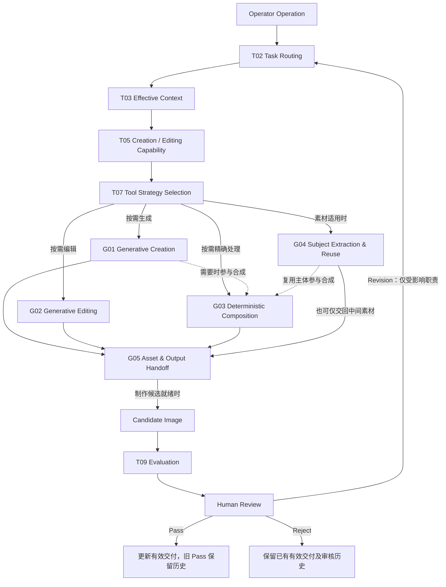

分支按目标及素材条件选择，不要求 G01～G04 全部依次执行，也不设置强制优先级。G04 中间素材不自动成为成图候选；G05 交接后，只有实际制作候选进入相应审核。Evaluation 不要求额外固定模型调用，工具成功不直接产生 Pass，Revision 返回实际受影响职责。

#### 图 13：V3 → V4 修改工具选择时序图

**用途：** 展示同一标题修改怎样依据已有素材条件选工具，并保护选定基础、执行证据及当前交付版本。

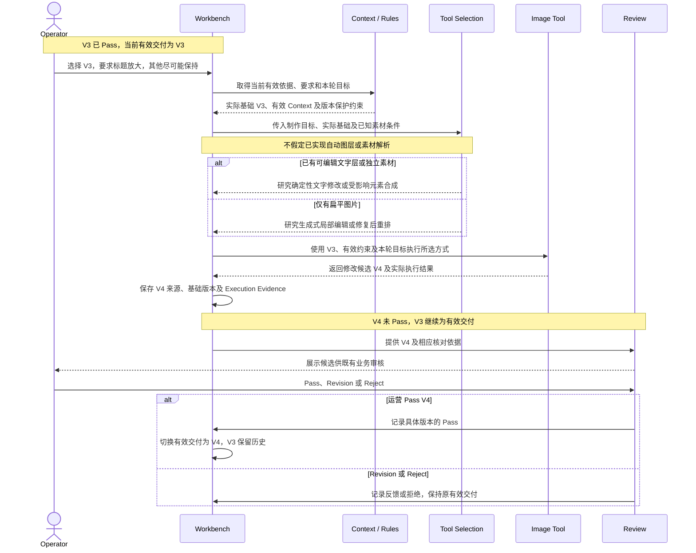

图示为候选成功路径和业务状态关系，不是运行测试；具体失败信息按 10.9 节保留，执行恢复留待 T08。工具选择不新增人工预审，素材条件需基于实际可取得记录或核查，不能把未实现的自动解析当作已验证能力。实际基础版本正确仍不保证视觉修改正确。

#### 图 14：Asset Lifecycle & Evidence

**用途：** 区分资产身份、实际执行证据、候选版本和业务有效交付，说明原件保护及可选中间成果的来源关系。

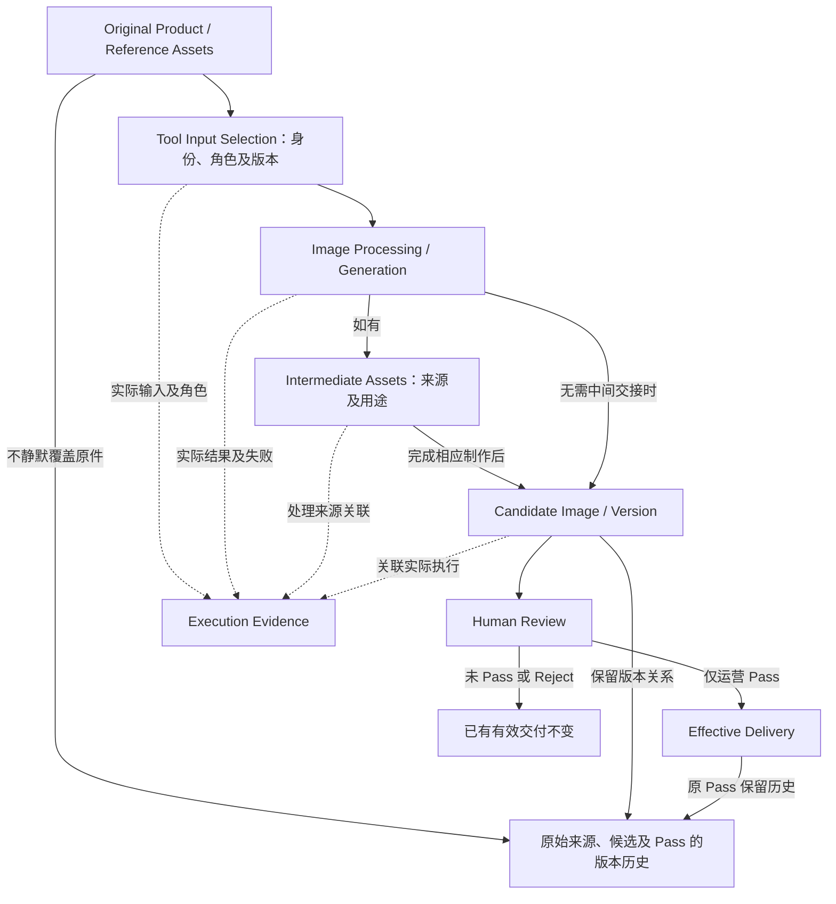

文件存在、执行完成和当前交付有效是不同状态。中间素材可选，保留必要追溯不等于永久保存所有临时文件；原始输入、候选及 Pass 的版本关系不能静默覆盖。图不决定实际目录、存储技术或 T08 生命周期实现。

### 10.11 T07 Evaluation

`PROPOSED / REVIEW PENDING`

| 维度 | 评价重点 |
|---|---|
| Product Fidelity | 实售商品外观、结构及配件是否保持 |
| Marketing Accuracy | 卖点、参数及营销语义是否准确 |
| Text / Diagram Accuracy | 文字、数字、符号、图文及比较关系是否正确 |
| Edit Target Success | 本轮目标修改是否实现 |
| Non-target Changes | 未要求改变的区域或内容是否变化 |
| Visual Quality | 构图、光影、边缘、融合及可读性 |
| Tool Reliability | 实际技术错误、失败情况及后续恢复表现 |
| Execution Traceability | 实际输入、配置、结果及版本能否回查 |
| Operator Effort | 真实人工修改、核对及返工情况 |
| Latency & Cost | 实际执行耗时、工具费用及组合成本 |

三层评价分别成立：

- **Pixel-level Evaluation：** 对原本要求严格保持的像素或区域检查变化，需要明确基础、范围和制作条件。
- **Semantic Evaluation：** 检查商品结构、营销内容、设计语义及重要视觉关系；像素不同不一定业务失败，像素变化很小也不能保证商品事实正确。
- **Business Acceptance：** 运营对具体版本作出 Pass、Revision 或 Reject；AI 自评、工具成功和程序差异检查不能代替业务接受。

后续评价使用真实素材与实际生成或编辑结果，记录明确制作条件、可比较策略、人工核对依据和真实成本耗时。不编造成功率、质量阈值或工具收益；本轮未进行相应图像实验。

### 10.12 后续真实实验方向

`PROPOSED / REVIEW PENDING`，仅记录候选，不在本轮执行。

| 实验 | 候选对照及目标 |
|---|---|
| Experiment G01 | Quick-A 直接整体生成与真实商品主体复用，比较保真、营销保持及视觉质量 |
| Experiment G02 | Quick-B 整体生成、局部编辑及主体合成，比较主商品与局部特写、配件的完整替换 |
| Experiment G03 | Listing 关键数字和比较符号的生成式绘制与确定性排版，比较语义准确及实际设计融合 |
| Experiment G04 | V3 标题修改的生成式局部编辑与可控编辑策略，按真实素材条件比较目标变化和非目标保持 |

各实验同时记录实际返工、视觉质量、延迟及成本，使用已有真实业务素材和可比较条件，不为研究虚构商品案例，也不要求一次开展全部实验。缺少输入、角度或可编辑素材时如实记录限制，不假设工具可以还原未知商品信息。

### 10.13 官方资料与研究证据纪律

`PROPOSED / REVIEW PENDING`

官方资料核对日期：2026-11-04。以下仅支持工具操作及能力边界说明，不构成 Workbench 已接入、已经实测或具有业务收益的证明，不冻结实际 API、版本、供应商及技术栈。

| 资料 | 本轮可支持的有限说明 | 核对状态与限制 |
|---|---|---|
| [OpenAI：Image generation](https://developers.openai.com/api/docs/guides/image-generation) | 文档描述图像生成、参考图及蒙版编辑；蒙版引导不保证严格遵循形状 | 已读取官方正文；具体任务的保真及编辑范围仍待实测，不选定模型 |
| [Pillow：ImageDraw](https://pillow.readthedocs.io/en/stable/reference/ImageDraw.html) | 在指定位置绘制文字和几何图形的文档能力 | 已读取官方正文；不证明自动获得正确数据、优秀布局或商品保真 |
| [Sharp：Compositing images](https://sharp.pixelplumbing.com/api-composite/) | 组合图像及位置、混合等处理的文档能力 | 已读取官方正文；不证明真实素材边缘、透视和光影自然融合 |
| Adobe Photoshop 官方文字与图层编辑资料 | 作为后续可核对的资料类别，不据搜索摘要确定具体 API 能力 | EXTERNAL VERIFICATION PENDING：本轮正文访问失败，未据此记录具体接口或版本能力 |

已有引用保持原样；新增能力或版本说明必须实际核对官方资料，无法核对时保留 `EXTERNAL VERIFICATION PENDING`，不编造链接或操作能力。官方文档支持某种操作，与项目实际效果、独立商品事实及运营接受分别管理。本轮没有调用生图或编辑 API，没有生成图片、运行图像对照实验或新增依赖。

### 10.14 T07-A～T07-G 第一轮候选结论

| 编号 | 候选结论 | 状态 |
|---|---|---|
| T07-A | AI Capability 与具体工具解耦，图片制作不等于单次生图模型调用 | PROPOSED / REVIEW PENDING |
| T07-B | V1 以 G01～G05 研究生成、编辑、确定性处理、主体复用及文件交接能力 | PROPOSED / REVIEW PENDING |
| T07-C | 工具选择依据制作目标、素材条件、准确性及商品保真要求 | PROPOSED / REVIEW PENDING |
| T07-D | 工具执行明确输入资产角色、输出身份及实际 Evidence | PROPOSED / REVIEW PENDING |
| T07-E | 局部修改优先研究受影响内容的可控处理，不默认每次整图重生成 | PROPOSED / REVIEW PENDING |
| T07-F | 原始素材、临时成果、候选版本及有效交付分开识别 | PROPOSED / REVIEW PENDING |
| T07-G | 生成式、混合或可编辑元素策略的取舍，需要真实质量、返工、延迟及成本对照 | PROPOSED / REVIEW PENDING |

上述是候选架构原则，不表示技术实现、真实验证或业务接受；已确认的商品权限和 Pass 关系仍依据 00～04。

### 10.15 第一轮研究记录、待验证事项与边界

`PROPOSED / REVIEW PENDING`

本轮已记录工具能力、三种制作策略、逻辑契约、三模式与修改差异、四个案例、资产及证据关系、执行风险、三张图示、评价及实验建议。完整研究归档不等于工具策略已被证明有效。

待验证内容包括：实际商品与参考角色传递、生成和编辑保真、蒙版及非目标变化、主体提取和合成融合、精确文字图表、扁平及可编辑素材下的修改效果、工具可靠性和真实成本。Adobe 文档细节、三图实际渲染及案例的完整实验和人工评价仍待补证。

本轮不决定正式生图供应商、必须采用 Photoshop／Pillow／Sharp、开发图层编辑器或抠图服务、固定多工具链或 Tool Agent、图像 API Schema、素材存储技术栈、统一图层格式、队列与异步框架、自动图片验收标准、固定模型调用次数或 Python 目录结构。

下一专题为 T08 Orchestration & Runtime。本轮不开始 T08，不提前补全 T09，不开发任何工具、Prompt、Agent、存储或 Runtime。

## 11. T08：Orchestration & Runtime

**研究进度：** `RESEARCHED`

**架构建议状态：** `PROPOSED / REVIEW PENDING`

本节是第一轮候选研究记录，尚未实施、进行真实故障实验或获得正式架构批准。下文的职责、逻辑对象、状态、图示、测试和实现方向均按此状态理解；00～04 中已确认业务规则的权威及适用范围不变。

### 11.1 业务背景、技术目标与核心原则

运营发起商品营销图制作后，模型与工具可能长时间运行，也可能部分成功、超时或中断。浏览器关闭、后台进程重启、多个图位同时执行、运营更新要求或审核不同版本，都不能成为丢失真实状态、混用参考或覆盖有效交付的理由。

T08 回答的是：怎样可靠组织实际执行，并在失败、重试、并发及人工审核过程中保持业务状态和历史版本正确。重点包括启动与排队、页面之外的执行、结果持久保存、远程结果未知、重复操作及费用风险、服务恢复、运行时依据一致性和真实事件回查。执行成功率不能替代图片正确性或运营接受。

候选核心原则：**Persistent Execution + Controlled Recovery + Business State Isolation**，状态为 `PROPOSED`：

- 执行有稳定身份和可持久追踪的状态，能回查输入、成果及失败。
- 根据错误性质和已有结果决定恢复，不把所有异常变成重新生成。
- 执行状态不决定运营审核和 Pass；图位执行及候选结果相互隔离。
- 真实执行依据固定且可追溯，不静默混入后来更新的要求。
- V1 优先满足最小可靠执行，不预设通用 Agent、自主规划循环或复杂 Workflow 平台。

这些原则服务三模式，不能重新定义信息权限：Quick-A 仍以实际商品图保持外观、使用同款营销参考；Quick-B 仍按运营选定参考默认适用的营销信息制作并完整替换目标商品主体及细节；Listing V1 仍由实际商品图片与运营文字资料驱动，设计参考通常提供但可选。Runtime 不将 Listing 改成仅凭文字生成，也不增加逐卖点或整套方案的强制预审。

### 11.2 Business、Execution 与 Review 的状态边界

| 状态视角 | 描述的事实及例子 | 权威与边界 |
|---|---|---|
| Business State | Task 模式、图位与参考绑定、Image Version、有效要求、当前交付和历史关系 | T01 的业务对象及 02 的业务版本规则；由相应业务操作更新 |
| Execution State | 某次执行是否排队、运行、成功、确认失败、结果未知或确认取消 | T08 的执行记录；不代替商品事实、审核或交付状态 |
| Review State | 运营对明确图片版本的等待审核、Revision、Reject 或 Pass | 属于 Business State 的一部分；在责任上与执行区分，不另建矛盾的权威副本 |

**Execution Succeeded ≠ Business Accepted ≠ Effective Delivery Updated。** 不能用一个通用 `status` 混合这些含义。执行记录可以引用业务审核结果供查询，但不得将副本变成另一套审核权威，也不能让后台完成事件直接改写 Pass。

例如 V3 已 Pass，运营选中 V3 修改并产生 V4：即使 V4 的执行成功，它仍只是待审核候选。V3 继续作为当前有效交付；V4 被 Reject、要求 Revision 或生成失败均不改变 V3。只有运营明确 Pass V4，才按 02 切换当前有效交付，V3 保留为历史 Pass。这里不是在 Pass 后增加一次交付审批。

人工审核针对明确 Image Version，不针对“最近完成的 Run”或“最新文件”。只更新审核或交付关系的业务操作，不必启动生成 Run。已完成执行可以结束，等待审核不应被伪装成仍在 Running。

### 11.3 Run、Attempt 与操作身份

Run 是一次业务操作所需的逻辑执行，例如“为主图生成一个候选”或“以选中的 V3 修改标题”。Run 应关联 Task、Image Slot、操作类型、基础图片版本（适用时）、固定的实际业务依据、所需能力及实际 Context、执行状态、成果或失败，并能追溯其执行尝试。

一个 Task 可以包含多个 Run；一个 Run 可以组织多个 AI 或工具操作，而不是必须等于一次模型调用。Run 内部步骤只表达真实依赖，不要求固定串行执行全部 C01～C08，也不要求独立服务或 Agent。

Attempt 表示 Run 中一次具体执行尝试。若 Run 有多项操作，Attempt 还需能定位到实际尝试的那项操作及输入、返回结果；不把一个工具调用、一次网络重试和整次业务制作混成一个事实。Run 可以有一个或多个 Attempt，重试保留旧 Attempt 和失败证据；仅重试受影响的操作，不无条件重做已经成功的付费上游步骤。

| 情况 | 候选处理原则 |
|---|---|
| 用户因页面迟滞重复点击同一操作 | 识别同一逻辑意图，返回已有执行身份或状态，防止意外重复候选 |
| 页面重连或逻辑 Run 被重复提交 | 核对既有 Run 和实际进展，不因再次提交就生成新的业务版本 |
| 一个 Run 内调用不同工具 | 保留各操作的身份、依赖及成果关系，不默认每项工具操作都是新的业务制作 |
| 同一操作确认可安全重试 | 在原 Run 内记录新的 Attempt，关联旧 Attempt、原因和实际输入 |
| 运营主动再次生成或发起新的修改 | 是新的业务意图，可以建立新的 Run；不能被去重逻辑吞掉 |

例如 Attempt 1 已提交图片请求但客户端超时，应先核对原调用；找回结果属于原调用的成果恢复，不是假装又调用一次模型。只有确认适合重新执行才产生新的执行 Attempt。幂等性旨在避免意外重复候选、重复业务状态变更，并尽可能减少重复外部调用；不保证两次生成得到相同像素，也不承诺外部收费绝对恰好一次。

Run / Attempt 在此仅是候选逻辑对象，不冻结数据库表、ID 格式、字段或正式 Schema。

### 11.4 E01～E06 候选 Runtime 职责

| 编号与职责 | 应承担的工作 | 不承担的工作与验证边界 |
|---|---|---|
| E01 — Execution Coordination | 根据 T02 的目标和范围、T04 条件及 T03 有效输入，组织必要的 T05 能力与 T07 工具；处理步骤依赖、传递依据、取得结果 | 不重定商品事实、营销权限或运营要求；不默认自主 Agent 规划循环；协调正确仍需真实执行验证 |
| E02 — Async Job Management | 将耗时制作与前端 HTTP 生命周期解耦；支持必要排队、资源管理、页面重进和各图位分别执行 | 不保证浏览器关闭后任何基础设施都永不停机；不在此决定 Redis、Celery、Temporal 或固定 Worker 部署 |
| E03 — State Persistence | 持久记录稳定身份、已接受及已启动事实、可查询状态、成果与失败、实际 Context 及证据；异常重启后可检查未完成工作 | 不能以进程内变量且重启丢失全部状态的方式声称可靠；不冻结数据库、存储格式或分布式事务方案 |
| E04 — Retry & Recovery | 区分错误类型、远程未知、执行中断及本地保存失败；优先恢复现有成果，控制重试并保留失败和恢复记录 | 不对所有异常无条件 retry=3；不将商品画错归为网络重试；不承诺未知远程副作用已消除 |
| E05 — Concurrency Control | 隔离图位、候选和输入；防重复候选、防基础版本及参考串位、防完成顺序覆盖 Pass；实施必要资源限制 | 不提前设计分布式调度集群、锁或并发数；一个图位失败不自动使整组失败 |
| E06 — Execution Evidence | 保存或准确重建 Run / Attempt、输入角色与版本、实际 Context、指令配置、模型或工具及真实结果、错误和恢复、候选来源 | 不虚构调用、阶段进度、模型内部思考或不可得费用；Evidence 可查不等于图片正确或业务接受 |

E03 保存的是“已接受、已启动、已返回、已可靠接收或保存”等真实事实，不能先展示成功再期待成果最终会保存。E06 的耗时及必要成本信息按实际可得记录；估计值与实际供应商费用分开，未知就保留未知。职责可以由同一模块实现，不要求六个服务。

### 11.5 与 T01～T09 的协作及权威边界

| 专题 | 对本次工作的职责 | T08 的协作方式及限制 |
|---|---|---|
| T01 — Business Objects | Task、图位、素材、图片版本、审核及有效交付 | 关联明确业务身份；执行记录不建立第二套事实或 Pass 权威 |
| T02 — Task Routing | 根据模式、业务操作和作用范围选择必要工作 | 执行选定目标，Revision 返回受影响职责；不重复定义 Routing |
| T03 — Context Engineering | 解析有效状态、信息权限及来源，按需组装每次执行的 Context | 固定并追溯实际依据，交付正确 Context；不擅自改变信息使用权限 |
| T04 — Rules | 必要素材、版本选择、作用范围、确定性条件及 Pass 保护 | 在执行及成果关联处遵守规则；程序检查不证明图像语义正确 |
| T05 — AI Capabilities | 商品及参考理解、制作决定、生成和修改等专业能力 | 组织当前必要能力，允许按有效性复用；不将 C01～C08 固定成调用序列 |
| T06 — Knowledge / Skills | 经需要和验证支持的专业增强 | 使用被选择的增强及其版本，记录实际输入；不自动加载全部知识 |
| T07 — Tool Integration | 具体生成、编辑、合成、确定性处理及文件工具 | 按工具契约传递角色、接收结果并追溯副作用；工具选择仍由目标与条件决定 |
| T08 — Orchestration & Runtime | 执行组织、异步、持久状态、重试、并发及恢复 | 保持执行可靠和业务状态隔离；不替运营决定 Pass |
| T09 — Evaluation & Observability | 后续评价中间判断、成图、修改及业务效果 | 提供真实事件、输入输出和错误供评价；本轮只提出 Runtime 验证输入，不补全 T09 |

T02 仍保持原来的研究进度，本表说明协作职责，不声称其完整方案已经形成。T08 不替 T03 判断新的信息权限，不自动更改运营要求，也不将工具或模型自评作为运营接受。

### 11.6 候选执行流程与架构图

以下是逻辑协作关系，而不是固定平台流水线：

1. 运营发起具体制作或修改操作。
2. T02 识别操作类型、目标图位及影响范围。
3. T04 检查当前必要的确定性条件；缺少必要素材等问题只影响相应工作，不虚构输入。
4. T03 解析本次有效业务依据，为实际执行按需准备 Context。
5. T08 建立可持久追踪的逻辑 Run，关联本次依据与身份。
6. Runtime 组织当前必要步骤、依赖和尝试，复用仍有效成果。
7. T05 / T07 完成所需 AI 和工具操作，各次实际输入及返回可追溯。
8. 可靠接收或保存成果、关联候选和 Evidence；失败及未知按真实情况记录。
9. 成功候选进入业务审核视图，不自动成为有效交付。
10. 运营针对具体版本决定 Pass、Revision 或 Reject。
11. Revision 由 T02 根据实际受影响内容选择后续工作，可形成新的生成或修改 Run。
12. 原有效 Pass 由 T01 / T04 按 02 继续保护；只有运营 Pass 新版本才切换交付。

Human Review 不要求生成 Worker 持续等待，也不要求四业务阶段对应四次调用。纯业务状态操作可以不走 AI 路径；图中的条件检查不新增运营审批节点。

**图 15：Orchestration & Runtime Architecture。** 用途是区分业务依据与审核、执行协调及结果恢复，展示可靠保存后的候选怎样进入已有审核流程。

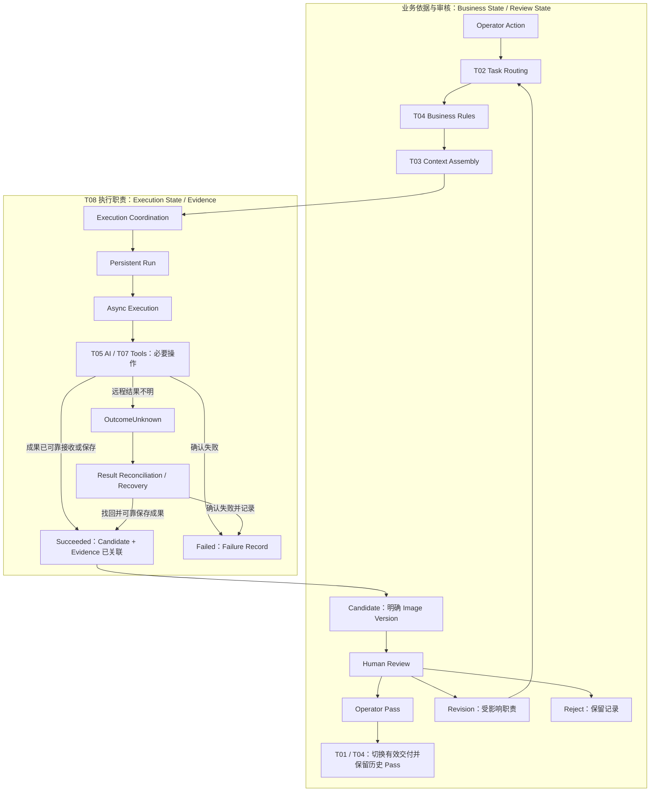

图中业务审核是运营对已产出版本的判断，不是 Runtime 内部状态转换。未知结果先核对，不沿“超时即再生成”的路径执行。局部恢复与安全新 Attempt 见状态机及重试章节；所有节点是候选逻辑职责，不决定独立 Worker、队列框架或固定 Agent Workflow。

### 11.7 Execution 生命周期及候选状态机

下列名称只用于研究，不冻结正式程序枚举；真实系统还需保留远程调用、成果保存和取消请求等具体事实，不能只靠一个状态词掩盖差异。

| 候选状态 | 含义 | 恢复与终止边界 |
|---|---|---|
| Queued | 已接受并有可追踪身份，等待实际执行 | 可开始执行；若确定输入错误可确认失败；未启动工作可在确认取消后终止 |
| Running | 实际执行中，包括完成目标所需的操作与成果交接 | 不凭时间推测进度或成功；按已知结果进入成功、失败或未知处理 |
| Succeeded | 本次逻辑执行的目标成果已经产生且被系统可靠接收或保存，来源关联可查 | 本次执行完成，不自动 Pass；远程只返回成功但成果尚不可可靠取用，不足以声称整个 Run 成功 |
| Failed | 已确认当前执行失败，包括确定输入错误或明确执行失败 | 当前尝试结束；相同业务依据下确认安全策略后可记录新 Attempt，旧失败不删除；改变业务依据则按新操作处理 |
| OutcomeUnknown | 请求已发出，远程可能完成或收费，但本地不能确定最终结果 | 尚未确认成功或失败；优先核对原调用或找回成果，不作为盲目付费重试的依据 |
| Cancelled | 已确认本地任务终止，不再继续本地后续制作 | 取消请求本身不足以成立；远程是否已终止、结果及费用另记，不自动重启 |

Succeeded、Failed、Cancelled 表示本次执行阶段已结束，其中 Failed 的旧 Attempt 保持失败记录；如逻辑 Run 按安全策略恢复，新的执行尝试可重新排队，不能把旧 Attempt 改写成从未失败。Succeeded 后的运营新修改是新的业务意图，不是后台自动复活已完成工作。OutcomeUnknown 不代表执行已确认终止。

请求取消与确认 Cancelled 分别记录：本地可以确认不继续后续步骤，但如果已发出的供应商调用无法取消，仍需追踪其远程结果或未知情况及费用。Cancel 请求不保证外部终止、不回退已产生费用；迟到成果也不能自动使业务 Pass 或改变交付。此类跨边界事实应显式保留，不强塞成一个互相覆盖的状态。

**图 16：Execution State Machine。** 用途是展示六个候选执行状态、结果核对及显式安全重试；图描述当前执行视图，不覆盖各历史 Attempt 的结果。

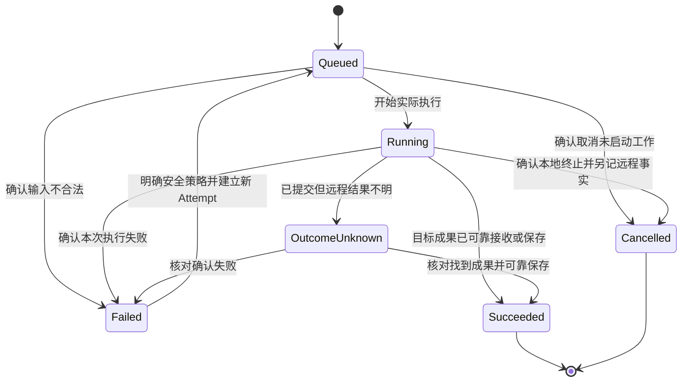

没有 Succeeded 到 Pass 的自动转换。Failed 到 Queued 是保留旧失败后发起新的 Attempt，不是同一 Attempt 的历史清零，也不是所有失败都必须重试。未知状态下不能为了让界面结束等待而假报 Failed；若无法核对则保留未知及明确处理依据。取消后仍可能存在远程未知事实，图中本地终止不抹掉它。

### 11.8 异步执行、页面关闭与服务重启

以 Quick-A 主图为例：运营启动生成，系统先记录可追踪 Run，再执行耗时工作。关闭浏览器不等于取消该 Run，也不能使任务所有状态消失。后台在真实运行条件允许时继续处理并保存成果；如果服务实际中断，则记录可检查的中断事实，不能向前端虚构持续执行或百分比进度。

运营重新进入页面时，应依据持久身份查询真实状态：排队、执行中、确认失败、结果未知或成果可审核，而不是因为页面重新加载再创建生成任务。前端不需要长时间保持 HTTP 连接；已完成候选可供审核，已有 Pass 不因页面关闭或服务重启改变。

服务重启后的候选恢复顺序为：检查已接受及未完成 Run / Attempt → 核对已保存成果和事件 → 区分尚未发起、已提交远程、已明确返回及交接未完成 → 决定继续本地处理、核对远程或安全新 Attempt。不能将所有遗留 Running 一律重发模型请求，也不能只把它们改为成功。

若远程已生成、仅本地保存失败，优先恢复原成果；若提交后的结果不明，按 OutcomeUnknown 处理。简单后台任务机制同样必须考虑服务重启、进程中断和重复恢复竞争，不因方案简单就豁免持久状态与副作用检查。具体队列、调度或进程机制留待工程实验。

### 11.9 Retry、幂等性、外部副作用与安全恢复

| 错误类别 | 应检查的事实 | 候选恢复原则 |
|---|---|---|
| A：输入不合法 | 必要文件是否存在、格式是否支持、来源是否可访问 | 记录具体输入问题，不无条件重试相同坏输入；修正后重新明确执行依据 |
| B：临时服务错误 | 是否明确返回限流、临时过载等；是否仍可能存在已启动远程副作用 | 在具体供应商能力及结果性质允许时研究有限重试和退避；次数和参数未定 |
| C：远程结果未知 | 请求是否已发出、实际请求标识及返回是否留存、远程是否可能已收费 | 优先核对原调用和已有结果；不将客户端超时直接当作失败或再次付费的许可 |
| D：成果保存失败 | 远程是否明确完成、结果是否仍可取得、保存或关联在哪一步失败 | 优先恢复、保存和关联已有成果；远程完成与本地交接失败分别记录，不假装远程未知或直接重新生成 |
| E：业务语义错误 | 商品结构、卖点或设计是否错误，实际输入及制作依据是什么 | 属于 T05 / 后续 T09 及运营定位和制作处理，不是普通网络重试 |

重试基本原则：**确认失败类型 → 判断是否可恢复 → 检查已有结果 → 再决定是否产生新 Attempt。** 临时服务错误的返回也要核对实际语义；无法排除远程已执行时，仍按结果未知处理，而不是仅凭错误名称重试。

候选幂等机制包括逻辑操作稳定身份、Run / Attempt 关联、重复提交识别、成果去重接收、候选及版本关联防重复。对同一结果重复保存或事件重放，不能再创建另一个意外业务候选或触发第二次交付切换。这里不冻结幂等键格式、事务或存储实现。

外部调用是否支持请求幂等键、状态查询、结果找回、取消及其有效期限，须按实际供应商和接口核实。只在确有支持时使用，不能编造统一查询 API、SDK、任务 ID 或费用保证。缺少这些能力时，可能无法排除重复收费；未知状态应保留，后续付费重试须有明确处理依据并记录风险，不把重复生成设为默认恢复。这里不新增全局人工审批流程。

恢复现有文件、重新关联已知成果、核对原调用与重新调用模型是不同动作，应分别记录真实事件和副作用。运行期间的新要求不应混入旧 Attempt 的恢复；若要按新目标重新制作，应按业务意图建立新的 Run，而不是借重试改变原任务。

修复同一文件的访问或保存问题且实际业务输入不变，可以研究在原 Run 内恢复；若修正涉及更换商品素材、基础版本或有效要求，已改变原执行依据，应按新的业务操作及相应 Run 记录，不能静默修改旧 Snapshot。

**图 17：Remote Timeout & Safe Recovery。** 用途是展示一次请求超时后的证据保留、按真实接口能力核对和有条件恢复，不描述任何具体供应商端点。

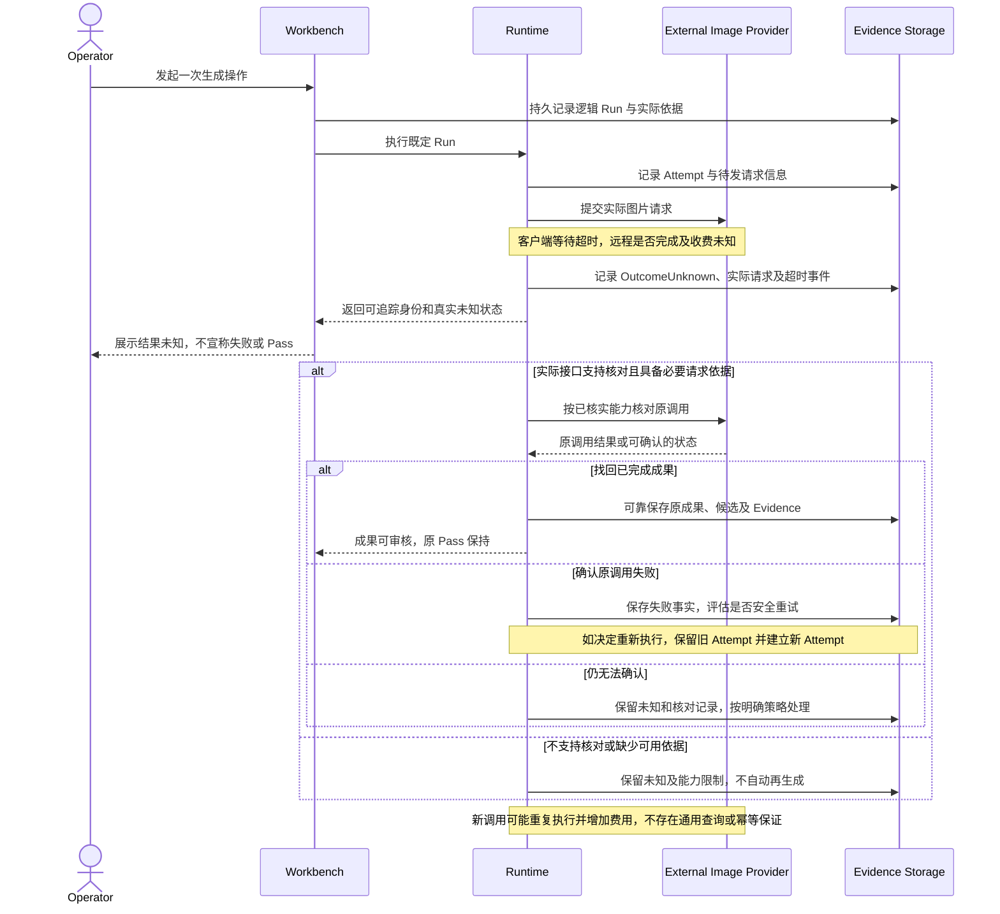

核对原调用不等于再次生成。成功找回后仍要可靠保存，才向业务提供可审核候选；保存失败优先继续原成果交接。确认失败也不等于必须重试，是否新建 Attempt 取决于错误、输入及明确策略。若无法查询，本图没有虚构解决未知结果的能力，更没有把未知改写成“零费用失败”。

### 11.10 多图位并发、结果隔离与审核

Task 是业务图包容器，不等于必须整体成功或失败的一次 Runtime Run。例如一个 Task 有四张启用图片：主图 Succeeded 且等待审核、卖点图 1 Running、卖点图 2 Failed、场景图 Queued。应分别查询真实状态，不因为一个失败就回滚其他候选或整组重生成。

各图位和 Run 需要稳定身份，基础图片、参考绑定、单图要求、操作和实际结果分别关联。可复用仍有效的商品级理解或参考成果，但不能把共享知识误当作共享单图要求，不能把别的图位图片保存到当前图位。不同 Run 即使并发完成，也应区分候选来源、Attempt 和 Evidence。

同一图位的多个候选先后完成时，完成顺序不决定审核结果。每次审核都指向明确 Image Version；后台迟到结果、另一个 Run 的成功或失败均不得静默覆盖已 Pass 版本。运营 Pass 某候选才按 02 更新该图位当前交付，历史 Pass 继续保留。具体并发事务、锁及冲突反馈机制尚未选择。

**图 18：Multi-slot Execution Isolation。** 用途是展示四图位各自的 Run、成果或错误和证据，及按图位保护的业务 Pass；示例是待验证场景，不是实测状态截图。

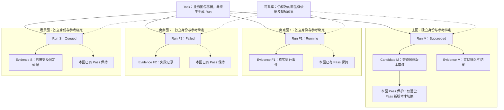

各图位没有“失败传播到其他图位”的依赖；不相互连线不表示忽略共享来源的有效性，而是避免混用成果和要求。其他图位未来成功产出的每个候选也应有其独立 Evidence 和明确审核对象。本图不决定线程数、队列数、集群或锁实现；并发资源限制不得伪造业务上的整组原子成功条件。

### 11.11 Execution Context Snapshot 与运行中要求变化

与 T03 保持一致，Run 应关联其实际使用的 Task / Mode、Image Slot、素材身份与版本、有效整体及单图要求、相关运营确认、当前制作决定、选定基础图片和本轮反馈（修改时），以及指令版本和必要执行配置。实际每次 AI / 工具执行仍需有对应输入记录，不能只保存 Run 的笼统描述。

运行开始后，运营更新整体要求时：

- 既有 Run 保留其原始有效依据，不静默将新要求拼入尚在执行的旧操作。
- Run 内后续必要操作使用该 Run 的固定业务依据；新取得的真实中间成果与该依据及具体操作关联。
- 新要求按业务范围用于后续制作；若运营意图是另起修改，按 T02 明确范围并产生相应工作。
- 历史 Context 不重写，旧 Pass 不因新要求自动失效，不自动取消或重规划全部图位。
- 最终候选能回查当时实际制作依据，而不是只关联“当前最新要求”。

从历史 V3 修改时，实际输入应是运营明确选择的 V3，而非碰巧最新的版本；结合当前有效要求和本轮修改，不重放全部历史指令。若运营主动重改已 Pass 图片，新整体与仍有效旧单图要求存在明确、无法同时满足且影响本次制作的实质冲突，按 02 第 5.5 节只针对冲突确认；没有实质冲突不增加人工步骤，其他图片和内容保持原样。Runtime 不据此建立全局审批。

Snapshot 不要求一个完整大 JSON，也不要求每项能力都有自己的永久商品数据库。可以保存实际输入快照、不可变版本引用或足以准确重建的记录，但必须能核对当时实际提供给模型和工具的内容。只留可变地址或“最新状态”无法满足该目标。敏感素材、访问权限、日志中实际内容及必要留存应保护，不以可追溯为由让所有执行或查看者获得无关资料权限；具体存储和访问方案待工程研究。

### 11.12 四个业务场景与预期

以下 Case E01～E04 均是基于现有业务规则的**待验证可靠性场景**，不是已运行的工程测试，也不是新增运营审批。

| 场景 | 操作及故障条件 | 预期行为与应保留证据 | 当前验证状态 |
|---|---|---|---|
| Case E01：一个 Task 多图并行制作 | 四图位分别排队、运行、失败及待审核 | Task 与各 Run 分开观察；已完成候选保留，单图失败范围可限定，其他图位继续；输入、参考和结果不串位，原 Pass 不变；可查各 Run / Attempt 和证据 | PROPOSED / REVIEW PENDING；NOT TESTED |
| Case E02：浏览器关闭与重新进入 | 启动图片生成后关闭页面，再次进入 | 稳定执行身份及真实状态可查；后台实际成果可恢复查看；前端不虚构进度，不重复创建任务；页面与 HTTP 连接不是唯一执行记录 | PROPOSED / REVIEW PENDING；NOT TESTED |
| Case E03：供应商超时但结果不明 | 请求已发出，客户端超时，远程是否完成或收费未知 | 保留 Run、Attempt、实际请求和未知事实；仅按已核实能力核对原调用；不无条件再次付费，确认失败后再判断安全恢复；没有查询支持就如实保留限制 | PROPOSED / REVIEW PENDING；NOT TESTED |
| Case E04：生成期间运营要求变化 | 主图 Run 已启动，运营更新整体要求 | 原 Run 和候选保留当时固定依据，新要求影响后续适用制作；不重写历史 Context、不使旧 Pass 失效、不默认取消或重规划全部任务；是否新制作按实际意图处理 | PROPOSED / REVIEW PENDING；NOT TESTED |

E01 的执行故障与 T09 后续判断图片商品语义是否正确不同；E02 不承诺停机期间持续执行；E03 不假设统一查询能力；E04 不将“当前依据不同”自动等同于图片应被拒绝。业务审核仍由运营针对实际版本进行。

### 11.13 V1 最小可靠 Runtime 的范围

本表“首轮应满足”是 `PROPOSED / REVIEW PENDING` 的候选验收要求，不表示当前系统已具备这些能力。

| V1 首轮应满足的候选要求 | 暂不作为前置条件 |
|---|---|
| 稳定 Run / Attempt 身份及可持久追踪状态 | 通用多 Agent 平台、自动任务自规划 |
| 后台工作与浏览器生命周期解耦，重启后可检查中断 | 完整分布式工作流系统或大规模 Worker 集群 |
| 真实输入、实际操作、输出、候选及版本关联 | 通用 Workflow DSL 或固定 C01～C08 调用流水线 |
| 失败可定位、未知可识别、已有成果可安全恢复 | 自动重新生成全部失败图片、统一无限重试 |
| 多图位隔离、重复操作控制、版本及 Pass 保护 | 复杂 Saga 补偿框架或预设分布式事务体系 |
| 实际事件可检查并支持后续 Evaluation | 模型内部思考链可视化或任意复杂审批流 |

“模块化 Python 后端 + 最小持久化后台任务机制”可保留为实现候选，须通过后续最小工程实验验证。不能以“最小”为由省去真实状态、结果关联、基本安全恢复和 Pass 保护；也不据此决定 Celery、Temporal、LangGraph、Redis、数据库或具体目录结构。

### 11.14 Runtime Evaluation 与可靠性测试矩阵

以下测试均为后续验证计划，状态 `PROPOSED / REVIEW PENDING；NOT TESTED`。本轮没有 Worker、模型、真实并发、恢复或故障注入实验；矩阵不能当作测试通过记录。

| 测试场景 | 预期结果 | 应核对的执行证据 |
|---|---|---|
| 相同操作重复点击 | 不意外创建重复业务候选，主动新操作仍可区分 | 逻辑意图、Run、实际调用及候选关联 |
| 单图执行失败 | 其他图位与已完成成果不受影响 | 各图位状态、错误范围和历史 Pass |
| 浏览器关闭后重新进入 | 可查看真实任务状态，不因重开重复生成 | 持久身份、后台实际事件及重入查询结果 |
| Worker 中断 | 状态可追溯，核对已有副作用后安全恢复 | 中断前后 Attempt、已发请求、恢复动作 |
| 远程调用结果未知 | 不盲目重复付费，未知不假报失败 | 实际请求、超时、核对能力及结果、后续动作 |
| 输入格式错误 | 记录明确问题，不进行无意义重试 | 素材及格式错误、未启动或实际调用事实 |
| 图片已生成但本地保存失败 | 优先恢复现有成果，不默认重新生成 | 原调用成功事实、保存错误和恢复来源 |
| 修改历史 V3 | 实际使用运营选定的 V3 | 基础图片身份、实际工具输入及新候选来源 |
| 运行中更新整体要求 | 原执行的旧依据仍可追溯，新要求按后续范围生效 | 要求版本、Run 固定依据、各次实际 Context |
| 生成新的 V4 候选 | 原有效 Pass 不自动改变 | V4 执行成果与 V3 当前交付关系 |
| 运营 Pass V4 | 正确切换当前交付，V3 保留历史 Pass | 具体版本的运营审核及业务状态更新 |
| 多图位并发完成 | 结果、参考、基础版本和单图要求不串位，迟到结果不覆盖 Pass | 并发 Run / Attempt、各候选及证据、审核对象 |

候选指标包括执行成功率、任务状态一致性、成果恢复情况、重复执行及重复副作用、错误定位完整性、用户可观察状态准确性、实际耗时、实际可得费用，以及失败对其他图位的影响。统计应区分确认失败、未知和本地交接失败，费用缺失不当作零费用。没有真实实验，不设数值阈值或性能承诺。

T08 验证执行可靠性和事实一致性；T09 后续还需评价商品视觉理解、营销信息、成图是否符合业务要求、修改非目标变化及运营是否接受。**Runtime 测试通过不等于商品营销图片业务成功。** 本节只提供可靠性评价输入，不提前形成 T09 的完整体系。

### 11.15 外部工程参考与验证边界

保留现有专题的有效来源及核对状态。本轮未新增具体 API 能力断言，也未联网核实下表框架；下表是后续应核对的研究方向，不能当作框架能力已经确认或 Workbench 已采用的证据。

| 候选参考 | 拟核对的工程问题 | 当前状态与使用限制 |
|---|---|---|
| Celery | 异步任务、任务确认、重试与重复执行风险应怎样处理 | EXTERNAL VERIFICATION PENDING；不据名称承诺幂等或选择队列 |
| Temporal | 持久执行及恢复与外部副作用之间如何划界 | EXTERNAL VERIFICATION PENDING；不推导外部生成和收费绝对恰好一次 |
| LangGraph | 执行状态、Checkpoint、人工交互及恢复的实际约束 | EXTERNAL VERIFICATION PENDING；不将人工交互机制变成新增业务审批 |
| OpenAI API 的具体模型及接口 | 哪些实际接口支持异步执行、查询、取消或其他恢复手段，适用限制是什么 | EXTERNAL VERIFICATION PENDING；不将某接口功能泛化到所有图片 API，不虚构端点或幂等保证 |

需要落实到具体接口或框架行为时，须核对当时官方文档与实际能力，记录版本、范围及限制；无法核实继续保留待验证状态。即使官方资料确认一种能力，也不表示本项目已经实现、通过恢复测试或获得运营接受。本轮没有安装框架、调用接口或运行后台服务。

### 11.16 T08-A～T08-H 第一轮候选结论

| 编号 | 候选结论 | 状态 |
|---|---|---|
| T08-A | Business State、Execution State 与 Review State 在职责上分离；Review 属于业务状态，不与执行混淆或建立矛盾权威副本 | PROPOSED / REVIEW PENDING |
| T08-B | 一个 Task 可以有多个独立 Run；Run 可以有一个或多个实际 Attempt，并区分内部操作及新的业务意图 | PROPOSED / REVIEW PENDING |
| T08-C | 实际执行具有持久身份、可查询状态及可追溯输入 | PROPOSED / REVIEW PENDING |
| T08-D | 重试必须考虑幂等性、远程副作用、费用及 OutcomeUnknown，优先核对和恢复已有结果 | PROPOSED / REVIEW PENDING |
| T08-E | 多图位执行相互隔离，单图失败不自动破坏其他图位成果或已有 Pass | PROPOSED / REVIEW PENDING |
| T08-F | 每次执行关联固定的实际业务依据，不静默混入运行期间的新要求 | PROPOSED / REVIEW PENDING |
| T08-G | 真实执行事件、工具结果、错误及恢复证据可检查，不虚构内部思考或实际效果 | PROPOSED / REVIEW PENDING |
| T08-H | V1 优先最小可靠 Runtime，不预设通用 Agent 或复杂编排平台 | PROPOSED / REVIEW PENDING |

这些结论不标记为 IMPLEMENTED、VALIDATED 或 BUSINESS ACCEPTED；研究完整性、架构审核、工程验证与业务接受分别管理。它们不改变 00～04 中的已确认规则。

### 11.17 当前不决定的技术事项

本轮不决定 Celery / Temporal / LangGraph、Redis 是否必需、数据库、Python Runtime 目录结构、Run / Attempt 正式 Schema、队列或 Worker 数量、最大并发数、重试次数和退避参数、具体供应商异步 API、自动 Agent Workflow、分布式事务实现、生产部署拓扑、自动取消全部过期任务或未经验证的性能阈值。

尚待验证的问题包括：最小持久机制能否在重复提交及进程中断后准确恢复；供应商实际支持什么查询、幂等或结果找回能力；成果保存与关联如何防重复；多图位完成及人工审核竞争时怎样保护版本；固定输入如何准确回查且符合访问权限；真实恢复、延迟和费用如何量度。具体机制通过后续有边界的最小工程实验选择，不从旧仓 Runtime 反向定义架构。

### 11.18 第一轮研究记录与后续方向

本轮补全三类状态、Run / Attempt、E01～E06、专题协作、候选执行流程、六状态生命周期、页面与重启恢复、重试和外部副作用、多图位隔离、Context Snapshot、四个场景、四张 Mermaid 图、最小 V1 范围、测试矩阵及八条候选结论。研究状态为 `RESEARCHED / PROPOSED / REVIEW PENDING`，不代表实际运行、渲染验证、工程或业务验收已完成。

图 15～18 及候选状态机需审核，并在具备工具时进行真实 Mermaid 语法与渲染验证。可靠性矩阵、远程能力、费用风险及场景均待后续验证。本轮未开发 Runtime、队列、数据库、Prompt、Skill 或 Agent，未调用模型、生成商品图片或执行真实任务。

下一专题为 T09 Evaluation & Observability，本轮不开始。T01～T07 原文及状态保留；此前专题内的“下一专题／本轮不开始”属于各自研究轮次记录，当前总进度及后续方向以第 4、14 节为准，不将历史记录改写成已实现事实。

## 12. T09：Evaluation & Observability

**研究进度：** `RESEARCHED`

**架构建议状态：** `PROPOSED / REVIEW PENDING`

本节记录第一轮候选架构、评价方法、图示及后续实验方向，尚未实现或进行真实 Evaluation。`RESEARCHED` 只表示本轮研究记录已补全，不表示模型能力、自动评价、运营效果或整套架构已经通过验证。已确认业务规则继续以 00～04 中相应状态及作用范围为准。

### 12.1 业务背景、技术目标与核心原则

商品营销图的错误可能发生在原始资料、有效要求选择、模型理解、单图决定、图片制作、修改或版本关联等不同位置。只有最终图片、模型成功响应或一条日志，通常不足以判断该修复哪项能力；反复修改 Prompt 也不能代替失败调查。

T09 要回答：Workbench 怎样通过真实执行证据，判断 AI 是否正确理解、决定、生成和修改商品营销图片，并验证技术调整是否减少运营返工。需要能回查实际 Context、指令、素材及模型和工具结果，分别检查中间能力与最终成图，用真实案例比较 Knowledge、Skills、Prompt、模型、工具或执行组合的收益、代价和适用范围。

候选核心原则：**Evidence-driven Evaluation + End-to-end Traceability + Human Business Acceptance**，状态 `PROPOSED`：

- 重要评价有原始核对依据、实际输出和明确标准，证据不足则保留未知。
- 中间能力和最终成图分层评价，实际输入、输出、版本及审核可关联。
- 真实失败驱动定点改进，再以可比较测试检查收益及回归风险。
- 运营负责最终业务接受，AI 自评不构成图片正确性或 Pass 的充分证明。
- 可观察、可复盘的最小闭环优先，不预设大型平台、统一 Judge 或固定额外调用。

### 12.2 Observability、Evaluation 与 Business Acceptance

| 概念 | 回答的问题 | 实际记录或判断 | 不能据此推导 |
|---|---|---|---|
| Observability | 这次执行实际发生了什么？ | Task / 图位 / 版本、商品图及参考、有效要求、指令版本、实际模型和工具、请求响应、超时、文件位置、耗时及可获得使用量与费用 | 有完整记录不保证商品、营销或设计正确 |
| Evaluation | 实际执行是否符合预期？ | 对照原始依据与标准，判断理解、比较符号、卖点取舍、成图及修改非目标变化，记录评价结果和限制 | 自动评分或错误分析不等于运营接受，更不等于独立性能认证 |
| Business Acceptance | 运营是否接受这张具体图片？ | 按 02～04 对明确 Image Version 作出 Pass、Revision 或 Reject，保留实际反馈与历史 | 单图 Pass 不证明所有调用无错、全部宣称已认证或销售转化已改善 |

**Observability ≠ Evaluation ≠ Business Acceptance。** 三者相互支持，不混成一个通用 `success` 字段。Evaluation Record 可关联 Review Evidence，但不得另建一套矛盾的审核权威或用评价结果自动覆盖运营判断。

运营 Pass V4 后，按 02 更新当前有效交付，V3 保留历史 Pass；V4 在生成成功、自动检查通过、待审核、Revision 或 Reject 时，不能静默替代原有效 V3。评价发现历史图片问题，可以记录观察和修复建议，不自行撤销业务 Pass 或批量重做。

### 12.3 L0～L3 四层评价体系

四层是评价职责和检查对象，不是四个独立系统、四次模型调用或四个强制人工审批节点。评价结果应注明对象、依据、方法、范围和未验证内容，不将一个总分掩盖关键错误。

#### L0 — Engineering & Context Correctness

工程与 Context 正确性优先由确定性程序核对：Task / Mode / Image Slot、实际商品素材、参考绑定、当前有效要求及已失效要求排除、运营选定的修改基础版本、三模式来源权限、尺寸图专项条件、历史 Pass 保护、Run / Attempt 与结果关联，以及重复候选或错误图位关联。

程序可以比较身份、版本和权限规则，并核对实际组装及发送内容。若有效要求本身含语义歧义或资料矛盾，程序记录不能替代所需语义判断或既有关键问题处理。确认 Listing 已传入，不证明 AI 正确理解全部营销内容；文件存在、哈希一致也不证明图像商品语义正确。

尺寸图必须依据运营确认且已标注目标商品真实尺寸的专用白底素材；缺少时不制作尺寸图、不从参考或像素估算尺寸，也不阻断无关图位。

#### L1 — AI Understanding & Creation Decision Quality

主要评价 C01～C05：商品可见外观、配件及连接关系，参考文字、数字、单位、表格和比较语义，跨来源权限及真正重要的矛盾，单图营销目标与内容取舍，视觉设计和商品呈现决定。逐项对照真实商品图、参考、资料、有效要求及实际候选中间结果。

中间结果应能在最终成图前独立评价。例如 C02 将某项比较关系的 `×` 误读为 `✓`，可以通过原图核对，不必等到 C06 生成错误图后才发现。此处是开发调试和实验能力；正式运营不因此必须逐阶段审批。若实际采用综合调用且未产出独立中间结果，就如实记录可观察范围，不能事后虚构一份“当时的 C02 输出”。

#### L2 — Image Creation & Revision Quality

主要评价 C06、C07 的成果，并验证 C08 的检查与诊断是否可靠：

| 维度 | 检查对象与核对依据 |
|---|---|
| Product Fidelity | 对照实售商品图及有效资料检查外观、颜色、结构、配件和连接关系，不补造不可见结构 |
| Marketing Accuracy | 对照模式允许的内容来源，检查卖点、参数、数字、单位、比较关系及限定语义 |
| Design Adherence | 对照适用参考设计和有效运营要求，检查方向、图文关系与内容层级 |
| Visual Quality | 检查构图、光影、可读性、视觉焦点及商业呈现；记录人工判断依据和分歧 |
| Edit Target Success | 对照本轮反馈和实际选定基础版本，检查指定修改是否完成 |
| Non-target Preservation | 与实际基础版本比较未要求改变的商品、文字、背景及设计，识别新错误和意外变化 |
| Group Visual Coordination | 检查适用参考设计语言及整体要求的延续，同时保留各图位内容重点、参考和独立要求 |

不默认所有图片使用相同布局，也不把像素差异直接当作业务错误。允许的设计变化、指定修改和不应改变的内容要分开判断；“图片漂亮”不能抵消商品结构或关键营销错误。

#### L3 — Real Business Outcome

观察具体图片的实际 Pass、修改轮次、图包完成时间、商品错误／卖点错误／设计偏移／非目标变化引起的返工、运营人工投入、实际模型与工具费用及最终采用情况。关联对象、统计窗口与分母应明确，待审核或未完成任务不能默认为通过，参见 12.16。

不预设已经验证的 Pass 率、平均修改次数或成本阈值。Pass 和图片质量评分都不能证明销售转化改善；转化需要另有业务实验和相应数据。

**图 19：Four-level Evaluation Architecture。** 用途是将四层评价对应到不同检查对象，并保留独立运营接受责任。

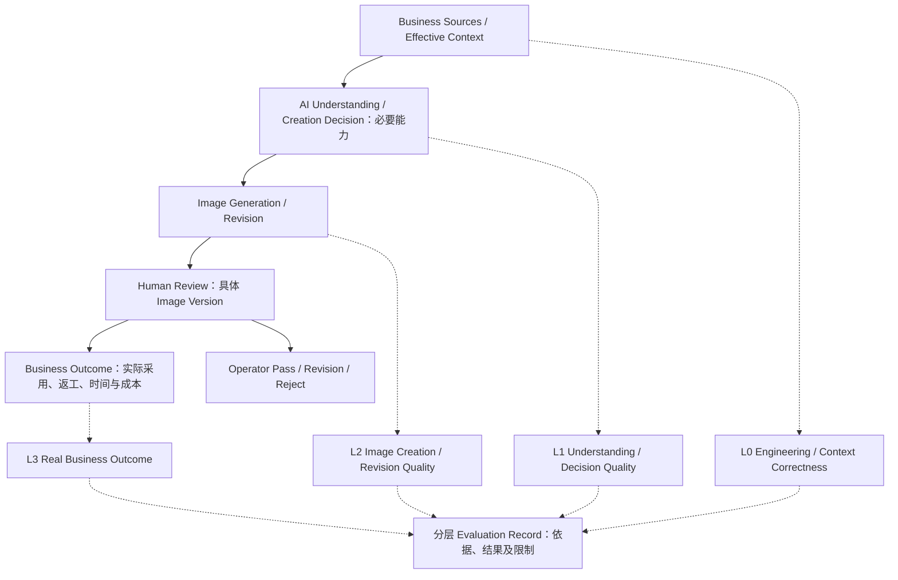

主线是业务职责及结果关系，不是固定模型调用链；各层可独立调试或按需组合。评价记录没有自动通往 Pass 的箭头，人工审核也不是每层新增审批。业务效果包含真实观察，不能从 L0 通过或 L2 分数自动推导。

### 12.4 C01～C08 的独立评价范围

编号、能力名称与 T05 保持一致。评价对象必须是实际产生的候选结果；没有某项独立输出时注明不可独立判断，不要求为满足表格而增加固定调用。

| 能力 | 原始核对依据 | 主要评价问题 | 结果与限制 |
|---|---|---|---|
| C01 Product Visual Understanding | 实际商品图片及相关运营身份／配置确认 | 外观、配件、连接关系是否准确；是否遗漏关键可见特征、补造不可见结构、把推断当观察 | 记录可见事实、声明、推断及未知；图片没拍到不等于不存在 |
| C02 Marketing Reference Understanding | 原始绑定参考、文字和画面关系 | 数字、单位、符号、表格行列、图文指向、比较关系是否忠实；营销语义是否扩大；设计方法有无画面依据 | 不能只核对孤立字符；必须核对所属对象及图例，不独立认证参考宣称 |
| C03 Cross-source Semantic Reconciliation | 当前模式权限、商品图、参考、商品资料及有效确认 | 是否遵守来源权限；重要矛盾是否有依据并影响本次制作；是否无必要阻断其他内容或改变 Quick-A/B 前提 | Quick-A 同款同配置、Quick-B 选图默认适用；不逐条重新审批；Listing 不继承无依据参考参数 |
| C04 Marketing Content Decision | 有效营销来源、图位目标、必保留内容及限制 | 目标、卖点取舍和优先级是否合理；必保留是否遗漏；数字、限制条件和比较语义是否保持 | 本图不展示不等于信息不适用；不重新认证商品性能或无依据扩写承诺 |
| C05 Visual Creation Decision | 实际商品、参考设计、C04 或等价目标、尺寸及有效要求 | 构图、商品呈现、文字层级与图文关系是否可执行；是否设计不存在的结构；Quick-B 替换范围是否完整 | 设计评价要有依据；不把设计偏好包装成全部商品通用的客观标准 |
| C06 Image Generation | 实际制作输入、有效决定、商品与营销来源及候选图片 | Product Fidelity、Marketing Accuracy、Design Adherence、Visual Quality、图文关系及图包协调 | 决定正确不保证成图正确；生成成功不自动成为 Pass |
| C07 Image Revision / Editing | 运营选定基础版本、本轮反馈、有效要求及真实前后图 | 目标是否完成、非目标是否保持、是否引入新错误或参考主体；基础版本和候选来源是否匹配 | 版本匹配属于 L0；视觉修改正确性属于 L2；两者不能互相替代 |
| C08 Result Checking / Failure Diagnosis | 原始资料、决定、候选、修改基础与执行证据，以及独立人工核对 | 报告的错误是否真实、遗漏哪些错误、根因与修复方向是否有证据；误报与漏报是否可接受 | C08 本身需要校准，不是 Ground Truth、不替运营 Pass，也不保证仅凭成图能确定根因 |

对 C01～C05 的中间评价通过，不直接声称 C06／C07 成功；C08 输出诊断也不代表诊断已获证实。能力可以复用同一原始证据，但评价记录需区分观察、推断和已核对判断。

### 12.5 与 T01～T08 的职责关系

| 专题 | 提供的依据或成果 | T09 的责任及边界 |
|---|---|---|
| T01 | 业务对象、原始素材、图片版本、审核及有效交付关系 | 引用权威身份与 Review，不独立管理另一套商品事实或审核状态 |
| T02 | 当前业务操作、目标和作用范围的路由 | 检查实际工作是否匹配操作；不在评价系统重做完整 Routing |
| T03 | Effective State、Execution Context、来源及版本 | 检查组装及实际输入是否正确；不重新定义信息权限或把最新状态替代历史依据 |
| T04 | 确定性规则、语义硬约束及业务权限 | 按已定义规则评价遵守情况，不复制一套相冲突规则；程序通过不证明语义成功 |
| T05 | C01～C08 候选结果 | 分能力、分层评价理解、决定、制作和检查，不固定调用拆分 |
| T06 | 实际采用的 Knowledge / Skills 增强及版本 | 对照验证增益、误判、成本及延迟，不预设专业增强必然有效 |
| T07 | 实际生成、编辑、合成及文件处理输入输出 | 区分模型和工具偏差，评价制作效果与限制，不新增工具实现 |
| T08 | Run、Attempt、执行状态、失败、恢复和事件 | 使用真实执行证据，区分结果未知与失败，不将 Runtime 成功等同业务成功 |
| T09 | 分层标准、评价记录、失败调查和业务效果观察 | 为定点改进和回归提供依据；不替运营决定 Pass，不以 AI 自评覆盖真实反馈 |

表中是候选协作职责，不声称 T01 / T02 的完整第一轮记录已存在，也不改变此前专题的研究状态。

### 12.6 Execution Evidence 的结构与保存原则

目标不是只保存一个模型输出 JSON，而是能从候选回查：哪个 Task、图位和操作，实际基于哪个版本，当时用了什么商品与参考资料、有效要求、Context、指令配置及模型工具，真实返回什么，经历哪些 Attempt 或恢复，运营审核了哪个版本、提出什么反馈。

| 类别 | 候选证据内容 | 核对用途与边界 |
|---|---|---|
| A. Business Identity Evidence | Task、Mode、Image Slot、Operation、Base Image Version（适用时） | 防图位、模式、操作及基础版本串位，引用 T01 权威身份 |
| B. Source Evidence | 原始商品、参考、Listing 及其他运营资料，素材身份、版本或内容哈希，相关运营确认 | 能回查原始核对依据；哈希证明内容身份，不证明商品宣称真实 |
| C. Context Evidence | 当时有效业务状态、适用要求、商品及营销约束、实际 Execution Context、来源和版本 | 区分有效解析结果与实际组装输入，检查遗漏及污染，不只保存最新状态 |
| D. AI Execution Evidence | 实际能力、Prompt / Instruction 版本、可获得模型名称及版本、实际请求输入、原始响应、必要使用量 | 区分原始模型结果与事后解释；内部版本不可得时保留限制，不伪造 |
| E. Tool Execution Evidence | 工具身份、实际操作、输入资产角色与参数、真实输出、错误及必要中间成果 | 能区分生成、局部编辑、确定性处理和成果交接，不将计划操作记作已发生 |
| F. Runtime Evidence | Run、Attempt、状态及真实事件、耗时、失败和恢复、可获得 Token 用量及费用 | 保留重试历史与远程未知，费用不可得不记为零；用量 Token 与访问凭证区分 |
| G. Image Result Evidence | 候选图片、所属图位及 Image Version、实际制作来源、基础版本、必要文件身份 | 候选不是原始事实，也不是当前有效交付；结果文件与 Run / Attempt 可关联 |
| H. Review Evidence | 具体版本的运营 Pass / Revision / Reject、反馈、实际审核结果及历史 | 引用业务审核权威；没有给出理由就不虚构“为什么接受” |

证据关系应区分原始记录、事后人工观察和诊断推断，不静默覆盖原始证据；原始响应不能被后续润色解释替换。记录实际发生的事件，不虚构模型内部思考、没有调用的能力或未产生的中间输出。

与 T03 / T08 一致，Run 的实际依据固定，每次真实 AI／工具操作的输入可回查。可以保存输入快照、不可变版本引用或足以准确重建实际发送内容的记录，不要求完整大 JSON、正式表结构或全部文件永久保存。后续要求变化不重写历史 Context，重试也不暗中换成最新业务依据。

本地请求记录说明客户端实际构建或发出了什么；供应商确认、返回结果及服务端可获得记录按实际留存。它们不能单独证明供应商内部有效 Prompt、全部图片的处理权重、模型确实关注了哪些内容或隐藏推理。无法确认的服务端事实保留未知，不把客户端 Trace 当作完整内部观测。

### 12.7 Log、Trace、Business Evidence 与证据链图

Log 记录一个真实事件，例如请求已发送、工具报错或文件保存成功；Trace 关联某个 Run 内实际操作及其输入输出和来源；Business Evidence 再把这些执行关系与商品、参考、有效要求、图片版本和运营审核相连。供应商 Trace 不能自动代替 Workbench 的业务依据及历史。

Quick-A 主图 Run 可能包含 Context Assembly、理解、制作决定、生成、保存及检查中的若干工作，但只记录实际执行路径。复用已有理解、综合调用、确定性修改或不需要 AI 的审核操作，均不能被伪造成经过全套固定节点。逻辑 Trace 不决定采用 OpenTelemetry、OpenAI Tracing、LangSmith 或其他产品。

**Log 记录事件，Trace 关联执行过程，Business Evidence 关联业务依据和结果。** 三者都不独立创造目标商品事实。

**图 20：End-to-end Execution Evidence Lineage。** 用途是说明候选怎样通过实际来源、执行及审核关系回查制作依据；连线表示逻辑关联，不强制每个 Run 都执行所有能力。

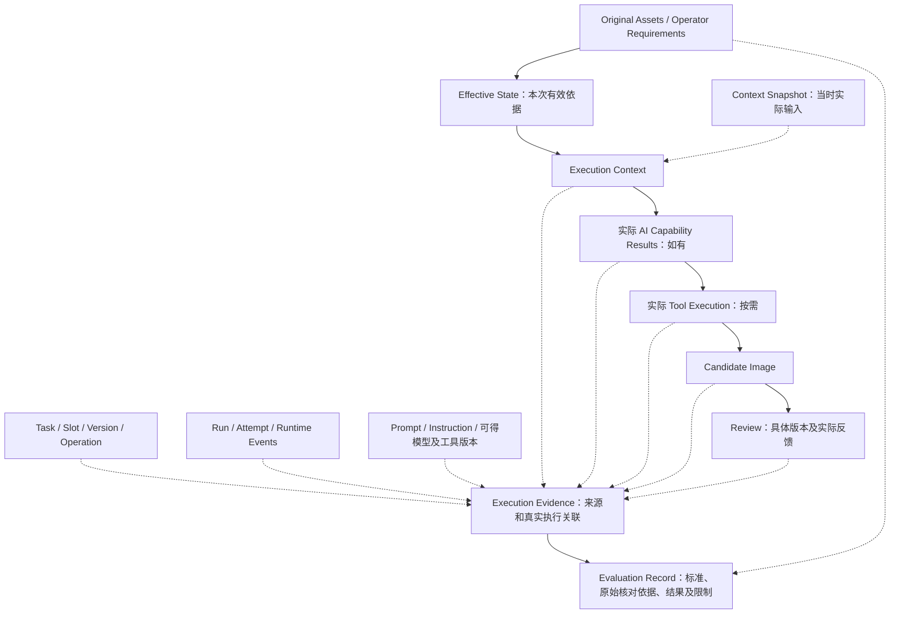

Trace 和 Evidence 是关联及记录，不是与原始商品资料竞争的 Source of Truth。评价输入必须能回查原始素材，不能只拿 AI 的上游解释核对下游 AI。图中没有评价到自动 Pass 的通路，也不要求把全部业务资料上传给第三方平台。

### 12.8 错误分类、调查顺序与诊断图

| 错误类型 | 典型表现 | 优先调查对象 |
|---|---|---|
| Context Omission | 本次实际输入缺少关键商品图或有效要求 | T03 的来源选择、组装及实际请求 |
| Context Contamination | 失效要求、错误来源与当前要求混杂 | T03 / T04 的有效范围与权限 |
| Routing Error | 错误选择图位、版本或工作范围 | T02 的实际操作及目标关联 |
| Source / Permission Error | Listing 继承了无商品资料依据的参考参数 | T03 / T04 / C03 的权限及语义核对 |
| Visual Understanding Error | 商品配件、结构或连接关系识别错误 | C01 实际输出与原商品图 |
| Reference Understanding Error | 数字、符号、图文或比较关系误读 | C02 实际输出与原始参考 |
| Creation Decision Error | 卖点取舍、必保留内容或视觉方向错误 | C04 / C05 及其输入 |
| Generation Error | 决定正确但实际成图偏离 | C06 / T07 的实际输入、工具及成果 |
| Revision Error | 完成目标修改却破坏其他重要内容 | C07 / T07 的实际基础图、反馈及前后成果 |
| Runtime Error | 错误重试、结果丢失、重复候选或状态混乱 | T08 的 Run / Attempt、事件及恢复 |
| Review / Version Error | 审核关联错误、错误改变当前有效 Pass | T01 / T04 / T08 的版本与真实业务操作 |

这些是调查分类，不是凭最终图片自动准确识别根因的承诺。一例可以有多个问题；“观察到商品结构错误”与“推断 C01 错误”必须区分。原始资料自身错误、相互矛盾或缺少依据时，另记 Source Problem / Evidence Insufficient，不把忠实传递坏资料或无法确认的内容直接归咎于模型。

候选诊断顺序：确认评价对象与原始核对依据 → 检查实际业务身份和发送输入 → 检查有效状态及权限 → 对照已实际产生的中间结果 → 检查制作工具及保存版本 → 根据证据提出责任位置、未确定项和定点修复建议。没有中间结果则保留定位限制，不事后补造链条。

**先检查实际输入和中间结果，再决定修复哪项能力。** 不默认全部图片问题都改 Prompt，也不因最终错误直接断言理解错误。业务资料的重要矛盾按已有关键问题规则处理，不升级为全面商品认证或全图包审批。

**图 21：Failure Diagnosis Decision Flow。** 用途是以比较符号错误说明逐段核对证据的方法，不构成自动根因诊断器。

```mermaid
flowchart TD
    ERROR["待调查现象：参考 ×，成图 ✓"] --> REF["实际采用的参考及绑定正确？"]
    REF -->|"否，有实际证据"| ROUTE["调查 T02 / T03：目标或来源选择"]
    REF -->|"是"| CTX["实际 Context 及权限正确？"]
    CTX -->|"否，有实际证据"| CONTEXT["调查 T03 / T04：遗漏、污染或权限"]
    CTX -->|"是"| UNDERSTAND["实际 C02 结果正确？"]
    UNDERSTAND -->|"否，有实际结果"| C02["调查 C02：比较语义理解"]
    UNDERSTAND -->|"是"| DECIDE["实际 C04 / C05 决定正确？"]
    DECIDE -->|"否，有实际结果"| C45["调查 C04 / C05：营销或视觉决定"]
    DECIDE -->|"是"| EXECUTE["C06 / T07 实际执行及结果关联正确？"]
    EXECUTE -->|"否，有实际证据"| C67["调查 C06 / T07 及必要的 Runtime 关联"]
    EXECUTE -->|"是，仍不能解释"| UNKNOWN["Evidence Insufficient：不强行归因"]
    REF -.->|"无法核对"| UNKNOWN
    CTX -.->|"无法核对"| UNKNOWN
    UNDERSTAND -.->|"无独立结果或证据不足"| UNKNOWN
    DECIDE -.->|"无独立结果或证据不足"| UNKNOWN
    EXECUTE -.->|"证据不足"| UNKNOWN
    ROUTE --> CHECK["证据是否足够支持该根因判断？"]
    CONTEXT --> CHECK
    C02 --> CHECK
    C45 --> CHECK
    C67 --> CHECK
    CHECK -->|"否"| UNKNOWN
    CHECK -->|"是，仅在相应范围"| FIX["候选定点修复及可比较复测"]
```

“是／否”需要实际输入、中间输出或成果支持；没有独立 C02 结果时，不能仅从图片反推它一定误读。图示关注一条比较关系，仍须检查符号所属商品、表格行列及图例；实际故障可以有多个来源，不能用最先发现的问题排除其他错误。

### 12.9 四个失败定位案例及证据限制

#### Case D01：Quick-A 比较符号错误

本轮归档任务提供的历史现象是参考某项比较关系为 `×`、历史成图出现 `✓`。04 已将比较符号及归属关系列为专业检查对象，但本仓 03 没有附上这一现象的原始对照图、实际 Context 和调用记录。本轮未查找旧仓，不据此确认某次 Run 的具体根因，状态为 `HISTORICAL REPORT / EVIDENCE TO_VERIFY`。

调查应依次核对实际参考绑定、发送的 Context、C02 是否保留正确比较关系、C04 / C05 是否改变该关系、C06 是否偏离正确决定，以及 T07 文字／图表处理和结果关联是否出错。来源错调查 T02 / T03，理解错调查 C02，决定错调查 C04 / C05，执行错调查 C06 / T07；每个判断都需对应证据。当前不能仅凭最终符号宣布根因，也不把参考营销宣称当独立真实性认证。

#### Case D02：Quick-B 参考主体残留

03 Case B01 记录了已知主体替换失败类型，但尚缺完整目标商品、参考、成图和运营评价。局部特写残留参考结构是需要验证的诊断场景，不虚构具体 SKU 或本轮失败图片。

后续调查 C01 是否正确识别目标商品、C02 是否识别相关特写及配件、C05 是否明确完整替换范围、C06 是否正确执行、T07 是否满足所需局部编辑和交接条件。分别区分理解错误、决定缺失与执行失败；Quick-B 默认适用的营销前提不因诊断而变成逐条重审。状态 `PENDING REAL SAMPLE / NOT TESTED`。

#### Case D03：Listing 洗车设备结构错误风险

依据 03 Case L01 已记录资料：历史任务 `43889e73c53c462da86216ed42f0a1ec`、`reference_002`、五种喷射模式 0°／15°／25°／40°／泡沫、三档水压和三档水量，以及清洗、浇灌及泡沫应用。已识别风险是错误组合喷壶与水枪，产生不存在的结构；这些资料不代表性能已独立检测。

后续须具备可回查的实际商品图、运营文字、设计参考及真实输出，调查 C01 结构理解、商品资料使用、C04 / C05 是否安排错误组合、生成是否偏离正确决定、是否越权继承参考商品内容。不能把已识别风险写成新链路已复现故障或已通过验收。状态沿用 `NOT TESTED / BUSINESS ACCEPTANCE NOT ESTABLISHED`。

#### Case D04：修改破坏非目标内容

候选场景：V3 已 Pass，运营选中 V3 要求放大标题；V4 标题变大，却改变商品外观或背景。应核对实际输入是否 V3、本轮 Context、是否错误重启失效历史要求、实际编辑方法及非目标变化、候选来源及审核关联。标题目标完成与非目标保持分别评价；新 V4 未 Pass 时 V3 继续有效。

本例依据 02～04 的修改及版本规则，没有本轮真实前后图或运营评价，状态 `PROPOSED TEST SCENARIO / NOT TESTED`。不得记录成已发生的成功修复或自动定位结果。

### 12.10 三模式的差异化评价重点

| 模式 | 原始核对依据与高风险错误 | 评价重点与边界 |
|---|---|---|
| Quick-A | 实际商品图、同款同配置营销参考、有效要求；警惕参考外观覆盖实售商品及数字、比较语义失真 | 商品保真、适用营销内容保持、差异化设计、参考方向延续及多轮稳定；不因普通颜色或视角差异重新审定模式，不强求每张展示全部卖点 |
| Quick-B | 实际商品图及运营选定参考；警惕主体换了但特写、配件或场景残留参考商品，混合两款结构 | 完整替换、默认适用营销表达、修改不重新引入参考主体；明确重大冲突定点处理，不新增逐卖点预审 |
| Listing | 实际商品图片 + 运营文字资料；设计参考通常提供但可选；警惕复制参考参数、补造缺失性能及结构错误 | 商品资料使用、真实结构、设计权限、卖点分配、关键问题处理及无关内容继续制作；不是纯文字生图前提，不默认完整方案审批 |

共同检查商品保真、营销准确、设计执行、局部修改、版本保护及运营实际审核。资料未独立检测不自动等于不能按已确认权限使用；评价正确传递营销来源与验证商品性能真实是不同任务。

### 12.11 Longitudinal Intent Preservation

**跨图片、跨修改轮次的运营意图保持评价。** 目标是在持续制作中检查有效意图是否延续，而不只评价最后一张单图的视觉效果。

| 评价范围 | 应核对的内容 | 核对依据与避免误判 |
|---|---|---|
| 同一 Task 的多图制作 | 商品身份、配件与结构、营销语义、参考设计语言、有效整体要求及各图位独立要求是否稳定 | 按各次实际生效版本比较；允许不同卖点及构图，单图未展示不代表信息失效，单图要求不得扩散到别处 |
| 同一图位的多轮修改 | 选定基础版本、有效要求继承、本轮目标、已认可内容保持、失效指令是否重新生效、原 Pass 是否保护 | 使用实际基础图 + 当前有效要求 + 本轮反馈；不要求重放全部历史文字，不把历史版本当作拥有后续所有修改 |
| 要求或方向主动变化 | 新要求是否按范围作用于后续工作，历史 Context 与已 Pass 图片是否保持 | 按当时依据判断历史执行，不用最新要求追溯判错；经授权的变化与无依据漂移分开 |

可设计“同一商品七张图片并进行多轮修改”的 `PROPOSED TEST SCENARIO`，观察商品、营销、设计与要求随图位和轮次的变化。它是未来计划，不表示已有七张合格样本或十次真实修改记录。

评价同时包括单次正确性、跨轮次一致性和实际业务效率。记录每次有效要求变化、修改目标、允许变化、实际成果、非目标变化及返工原因，再比较修改次数、人工投入和总成本；不凭最后一张漂亮图片或一个平均相似度证明长期意图保持。

新整体要求不自动使旧 Pass 失效。运营主动重改已 Pass 图片时，只有新整体要求与仍有效旧单图要求存在明确、无法同时满足且影响本次制作的实质冲突，才按 02 第 5.5 节定点确认；没有冲突不增加确认，也不重新启动无关制作。该规则不是 Evaluation 新增审批节点。

### 12.12 真实案例数据集、核对依据与答案污染

数据集从 03 的可复核案例逐步建立，不通过自动生成答案或虚构完整样本填空：

| 当前案例基础 | 已记录内容 | 缺口与当前状态 |
|---|---|---|
| A01 — Quick-A | 黑色汽车电路测试仪、实际商品及蓝色营销参考、部分理解和制作决定资料，历史任务身份已记录 | 记录中已有资料不代表当前所有素材实体均可访问；缺新链路最终成图及运营验收，NOT_TESTED |
| B01 — Quick-B | 主体替换不完整的已知失败类型及候选验收要求 | 缺完整真实输入、输出及人工评价，PENDING REAL SAMPLE |
| L01 — Listing | 洗车设备文字资料、参考背景及结构组合风险 | 最终成图及运营验收未建立，NOT TESTED / BUSINESS ACCEPTANCE NOT ESTABLISHED |
| Revision Case | 选定版本、当前有效要求、修改和 Pass 规则 | 缺可复核真实前后图、实际修改记录与运营评价，TO_VERIFY |

一个候选评价案例至少关联 Case Identity、Mode、Task / 图位、原始商品与参考或文字资料、有效要求、要评价的能力、真实输出、人工核对依据、观察到的错误、评价结果、适用范围及当前状态。身份或索引不能替代素材和输出本身；访问不到就记录缺口。这是逻辑研究要求，不冻结数据集 Schema。

核对依据要区分三类：

- **客观可核对内容：** 原始数字、比较符号及归属、商品图可见结构、运营明确要求、实际基础版本。注明来源和版本，不能把图片推断当可见事实。
- **人工业务判断：** 卖点适用性、商品呈现可接受性、视觉设计是否符合目标、具体版本 Pass。按相应运营责任记录，主观判断及分歧不包装为独立商品认证。
- **依据不足：** 必然提升转化、未经核实的性能、某设计适用于所有商品等。保留未知，不补造 Ground Truth。

GPT 或其他模型生成的候选解释不能直接作为独立 Ground Truth。人工整理答案也需核对原始依据，注明是参考判断而非无限适用的绝对真值。资料自身有歧义时保留争议和影响范围，不能强造一致答案以计算准确率。

04 引用的旧 Quick-A 专家研究可提供候选方法，但本轮未读取其实体或复制旧仓内容。后续独立模型实验不得把人工参考答案直接注入输入再宣布独立理解成功；使用知识、提示、整理答案线索时明确标注实验条件，将用于调试的材料与保留作独立验证的案例区分，防止以见过答案的结果夸大泛化能力。

### 12.13 确定性、AI 辅助与人工评价的分工

| 方法 | 适用检查 | 需要保存的依据及限制 |
|---|---|---|
| Deterministic Evaluation | 图位绑定、素材身份、版本与有效要求引用、权限规则、Pass 保护、文件输出存在性、可明确匹配的数字或文本关系 | 保存实际检查对象及规则结果；字符串匹配不能覆盖所有营销语义，OCR 结果也可能不准确，不能据存在性证明图片正确 |
| AI-assisted Evaluation | 辅助结构比较、营销语义变化、设计方向、局部编辑差异及错误分类 | 记录评价输入、模型及指令、原始输出、证据和限制，以及与人工核对的差异；可能误报、漏报或错误归因 |
| Human Evaluation | 商品身份和关键适用性、实质营销争议、专业视觉判断、最终 Pass、自动评价校准 | 关联具体版本及原始依据；保存实际反馈，不虚构未提供的理由；人工也可能有分歧，须保留不确定项 |

确定性条件优先程序检查，语义和视觉问题可按需要用 AI 辅助，运营按原有业务责任作最终验收。不把所有评价强交一个 Judge Model，不要求每张图多调用一次模型，也不把开发期间逐能力人工核对变成正式运营逐阶段审批。

### 12.14 C08 及自动评价能力本身的验证

C08 输出“发现错误”只是待核对判断。应对照可复核人工依据，按明确错误类型和对象评价它是否真的发现问题，而不是只评价报告写得是否像专业分析。

| 分类 | 含义 |
|---|---|
| True Positive | 报告某类错误，人工原始核对确认该错误实际存在 |
| False Positive | 报告错误，但相应内容正常或属于允许变化 |
| False Negative | 未报告该类错误，但原始核对发现真实错误 |
| True Negative | 未报告该类错误，且原始核对确认不存在该错误 |

候选示例：评价模型检查 20 张图片并报告 5 张结构有误，不能只复查这 5 张；还需核对其余 15 张以发现漏报。此例不是本轮实际结果或准确率记录。人工依据不足的样本保留无法判定，不强行归入四格；分类单位是某类错误还是整张图片应先说明。

后续可按错误类型研究精确率、召回、误报和漏报，先明确分母、人工依据及样本覆盖；不以单一总体准确率掩盖关键商品错误，也不预设未经验证阈值。若评价模型、指令或输入材料变化，应重新检查相应校准及回归案例。模型自评与生成模型同源时可能共享盲点，需要独立原始依据和人工复核，不据互相赞同宣布成功。

### 12.15 对照实验、回归与可复核性

以下均为 `PROPOSED / REVIEW PENDING / NOT RUN`，本轮不执行：

| 实验方向 | 可比较条件 | 观察目标及限制 |
|---|---|---|
| Experiment A：Context Strategy | 累积完整历史与按当前有效业务状态组装；使用相同业务轨迹、基础版本及核对依据 | 比较遗漏、失效指令干扰、商品和营销偏移、Token 用量及费用；不把历史污染作为正式生产建议 |
| Experiment B：Model-only vs Knowledge | 针对 C02 等具体能力，在相同原始输入下比较原生理解与明确专业材料增强 | 目标错误是否减少、新误判、延迟和成本；记录知识与提示，不暗中提供答案再声称独立理解 |
| Experiment C：Combined vs Staged AI Execution | 相同业务目标与验收依据下比较综合调用和阶段理解、决定、制作 | 中间结果可评价性、最终质量、返工、总成本及延迟；不预设拆分一定更好或固定调用数 |
| Experiment D：Generative Edit vs Controlled Editing | 同一选定 V3 和标题修改目标，比较整图生成式、局部编辑、具备条件时的确定性文字／元素处理 | 目标完成、非目标变化、视觉质量、人工返工及实际成本；缺少可编辑素材时不能假定确定性修改可用 |
| Experiment E：Repeated Generation | 相同业务输入和可比较模型工具配置下重复运行 | 商品保真、营销保持、视觉质量波动和随机性；保存首轮及各次结果，不挑最好一张冒充稳定表现 |

实验需先明确具体能力、问题、原始输入、标准和比较条件，尽可能控制非研究变量。记录实际模型和工具可得版本、Context、指令及专业辅助材料、真实请求响应、输出、耗时和费用；不能用单次偶然成功宣布架构最优，缺证据保留 `TO_VERIFY`。

复现包括能重建当时条件、回查原结果并重新核对评价，不承诺生成式系统在再次调用时输出相同像素。供应商内部版本或不可控变化如不可得，应记为限制；没有实际重跑就不能称回归测试通过。

有价值的真实失败逐步纳入回归案例：保留失败输入、预期及依据、实际错误、定点调整、可比较复测和仍存在的限制。回归要检查目标问题是否改善，也要看商品、营销、其他图位、非目标内容、成本和延迟是否退步。调参使用的案例与独立验证案例应区分，不把单案例改善外推到全部模式。

**图 22：Evaluation Feedback & Regression Loop。** 用途是表示后续开发调试的候选反馈方法：先有真实证据，再定点调整、复测和沉淀案例。

```mermaid
flowchart TD
    CASE["Real Business Case：原始依据及目标"] --> EXEC["Controlled Execution：明确条件"]
    EXEC --> EVIDENCE["Evidence Collection：真实输入输出"]
    EVIDENCE --> EVAL["Deterministic / AI-assisted Evaluation：按需"]
    EVAL --> HUMAN["Human Review：原始依据核对及实际运营反馈"]
    HUMAN --> FAILURE["Failure Classification：证据、观察及未知"]
    FAILURE -->|"证据支持受影响位置"| IMPROVE["Targeted Improvement：候选调整"]
    FAILURE -->|"证据不足"| GAPS["记录缺口，不强行归因或宣布成功"]
    IMPROVE --> RETEST["Comparable Re-test：检查收益和回归"]
    RETEST --> COLLECTION["Regression Case Collection：保留失败与复测结果"]
    COLLECTION -.->|"后续验证，非自动付费循环"| CASE
```

图示是未来实验及学习过程，不是生产任务必须经过的固定调用或新的审批链。Human Review 包括开发核对；只有实际运营对明确版本作出的决定才记作业务 Pass。复测失败同样保留，不把案例入集视为成功，也不因一次成功认定其他商品或模式通过。

### 12.16 真实业务指标与解释边界

| 候选观察指标 | 记录及统计时应明确的口径 | 避免错误结论 |
|---|---|---|
| 实际 Pass 与采用情况 | 明确按候选版本、图位首次通过或最终采用统计，记录时间窗口和已审核／待审核数量 | 不把模型成功、AI 评分或未审核候选算作 Pass；通过不等于实际发布或销售采用 |
| 每张图修改轮次与返工 | 关联基础版本、实际 Revision 和原因，区分错误修复、运营主动改目标及偏好变化 | 不能把所有修改都归为 AI 失败，也不能漏掉 Reject 后重新制作的成本 |
| 图包完成时间 | 说明哪些启用图位和业务条件构成该次完成，关联开始、等待与最终交付事实 | Task 非原子 Runtime Run；未完成及中止任务不能默默排除以美化平均值 |
| 人工投入 | 记录实际审图、资料处理、解释和修改投入，可明确估计与实测 | 墙钟等待不等于全部人工工作时间，无测量不能自动宣称节省 |
| 错误驱动返工 | 区分商品、卖点、设计偏移和非目标变化，可关联多项原因及不确定项 | 不从最终图片独断根因，不将有争议反馈包装成客观认证 |
| 模型及工具实际成本、耗时 | 关联 Run / Attempt、重试和恢复、可得使用量、供应商费用及必要工具费用 | 未知远程结果可能收费，估计与实际分开；费用缺失不为零，不能只计成功调用 |

对照应考虑模式、图位、任务难度、输入完整性及样本范围，报告样本量、缺失和分歧，不预设通过率或成本标准，也不因少量偏选案例宣称因果收益。销售转化数据及业务实验不在本轮范围，质量或 Pass 改善不直接推导转化提升。

### 12.17 V1 最小 Evaluation / Observability 闭环

候选最小调试过程：选择真实案例 → 明确要验证的能力或职责 → 准备原始输入和有效 Context → 执行一次有明确条件的 AI 或工具工作 → 保存真实请求响应及证据 → 人工对照原始资料核对输出 → 记录错误类型与依据 → 定点调整受影响能力 → 进行可比较测试 → 保存前后结果和结论。

这十项是未来开发调试与评价基线建立的方法，不是对本轮模型调用的授权，也不要求正式运营逐阶段审批。本轮仅记录方案。

| V1 优先具备的候选能力 | 暂不作为前置条件 |
|---|---|
| 查看实际组装 Context、真实模型输入及原始输出 | 独立大型 Evaluation 平台或完整实验管理系统 |
| 回查商品、参考、图位、基础版本、候选及实际来源 | 大规模标注平台或统一复杂数据集 Schema |
| 保存原始核对依据、实际人工评价及修改反馈 | 全自动图片评分系统、通用 Judge 集群 |
| 比较不同实验，记录失败、调整及修复结果 | 所有业务任务额外调用 Judge 模型 |
| 追踪必要使用量、成本与耗时，逐步建立回归案例 | 所有结果实时 Dashboard 或复杂因果分析平台 |

可先逐能力学习和定位失败，再根据真实调试需要决定工具。可观察不等于必须无限收集，最小闭环不冻结数据库、SDK、Trace 平台、页面、正式 Schema 或自动质量门槛。

### 12.18 证据安全、访问与保留边界

商品图片、Listing、请求、模型输出和 Trace 可能包含完整商业输入，应按实际职责控制查询与导出权限，不默认将全部明文资料无限上传给第三方 Observability 平台。证据记录还应区分业务内容、使用量 Token 与安全敏感配置，不记录 API Key、访问 Token 或其他凭证。

可追溯性不等于永久保存所有明文请求、图片副本及大体积中间文件。后续需决定关键业务关系、必要原始证据和临时素材的保存、归档、删除及成本策略，兼顾调试价值、业务历史和权限。日志脱敏或保留期限导致某内容无法再核对时，明确评价限制，不能声称证据仍可完整重建；不得以事后补写取代已缺失原始记录。

本节不冻结存储、加密或保留期限，也不创建第三方集成。审核和模型结果的历史关联仍按 02 的业务规则保护，具体实施设计待后续处理。

### 12.19 T09-A～T09-I 第一轮候选结论

| 编号 | 候选结论 | 状态 |
|---|---|---|
| T09-A | 区分 Observability、Evaluation 与 Business Acceptance，不用一个成功字段代替三种责任 | PROPOSED / REVIEW PENDING |
| T09-B | 采用 L0～L3 四层评价，分别检查工程 Context、理解决定、制作修改及真实业务效果 | PROPOSED / REVIEW PENDING |
| T09-C | 实际素材、Context、模型工具输入输出、候选及审核来源可追溯，并保留观测限制 | PROPOSED / REVIEW PENDING |
| T09-D | AI 中间能力与最终成图分别评价，按实际证据调查失败，不虚构自动准确归因 | PROPOSED / REVIEW PENDING |
| T09-E | 三模式共享评价框架，同时保留各自信息权限、高风险错误与验收重点 | PROPOSED / REVIEW PENDING |
| T09-F | 增加跨图片、多轮修改的运营意图保持评价，区分授权变化与无依据偏移 | PROPOSED / REVIEW PENDING |
| T09-G | 结合确定性检查、AI 辅助评价与人工验收，自动评价需独立验证及必要人工校准 | PROPOSED / REVIEW PENDING |
| T09-H | 使用真实案例和可比较条件，验证质量、返工、延迟与成本变化，避免答案污染及单例外推 | PROPOSED / REVIEW PENDING |
| T09-I | V1 优先可观察、可复盘的最小评价闭环，不提前建设大型评测平台 | PROPOSED / REVIEW PENDING |

这些都是研究候选，不标记 IMPLEMENTED、VALIDATED 或 BUSINESS ACCEPTED。评价标准提出、记录补全、架构批准、真实工程验证和运营接受是不同状态。

### 12.20 九专题第一轮研究状态收束

本轮核对结果：九专题均在路线表中，但并非都有完整第一轮研究正文。不能仅因 T09 补全就标记 `FIRST-ROUND ARCHITECTURE RESEARCH COMPLETE`。

| 专题 | 本仓实际记录情况 | 当前研究及结论状态 |
|---|---|---|
| T01 System Boundary & Business Objects | 已讨论核心对象与信息权威，现有候选摘要尚不足以视为完整专题记录 | PROPOSED；第一轮记录待补全 |
| T02 Task Routing | 路线及协作职责有提及，没有完整独立研究记录 | NOT STARTED |
| T03 Context Engineering | 已有第一轮正文与四张图 | RESEARCHED / PROPOSED / REVIEW PENDING |
| T04 Rules | 已有第一轮正文与两张图 | RESEARCHED / PROPOSED / REVIEW PENDING |
| T05 AI Capability Architecture | 已有 C01～C08 等第一轮正文与三张图 | RESEARCHED / PROPOSED / REVIEW PENDING |
| T06 Knowledge / Skills | 已有按需专业增强等第一轮正文与两张图 | RESEARCHED / PROPOSED / REVIEW PENDING |
| T07 Tool Integration | 已有工具能力等第一轮正文与三张图 | RESEARCHED / PROPOSED / REVIEW PENDING |
| T08 Orchestration & Runtime | 已有 E01～E06、状态及恢复等第一轮正文与四张图 | RESEARCHED / PROPOSED / REVIEW PENDING |
| T09 Evaluation & Observability | 本轮补全分层评价、证据、诊断、实验及四张图 | RESEARCHED / PROPOSED / REVIEW PENDING |

整体第一轮记录仍未齐备，技术架构保持 `PROPOSED / REVIEW PENDING / NOT IMPLEMENTED`。这里的 NOT IMPLEMENTED 表示研究归档不等于工程实施，未将本轮文档内容当作已运行系统。即使未来九专题记录全部完成，也不代表正式技术架构批准或 AI 能力通过真实验证。

本轮不补写 T01 / T02，不重设计 T01～T08。后续先处理现有记录缺口，再对 T01～T09 做简短一致性检查、形成必要统一总览、核对职责重复和术语及未经批准前置条件，随后选择真实 Quick-A 案例进行首个最小能力实验，以真实输入、Context、输出和人工评价学习技术。这只是后续方向；本轮不开始总审、新专题、模型调用或工程开发。

### 12.21 本轮归档记录与待验证事项

**研究版本记录：** 2026-11-04，在 05 V0.1 架构研究稿中补全 T09 第一轮正文及图 19～22，更新 T09 进度、九专题实际记录情况和后续方向；保留 `PROPOSED / REVIEW PENDING`，不提升为正式批准或已实现版本。原 T01～T08 研究结论及既有图示保留，仅同步章节编号所需的总进度引用。

待验证包括：原始素材和完整案例的可访问性、D01 对照证据、C01～C08 实际输出、C08 误报漏报校准、真实多图及修改链、非目标变化、Knowledge / Context / 调用组合及工具策略收益、Runtime 与证据链完整性、实际人工投入及成本、回归和独立验证案例，以及四图实际渲染。所有实验和场景均为计划，没有真实 Evaluation 或工程成功记录。

本轮不新增外部 API 或平台能力断言，不安装依赖，不创建评价 Prompt、代码、数据库、SDK、Agent、Knowledge 或 Skills，不调用模型或生图，不修改 Runtime 或业务基线。具体评价工具、模型、采样、评分权重、阈值、保留方案、正式 Schema 及实施选型仍待后续研究。

## 13. 研究与决策纪律

1. 先研究业务要求，再确定技术方案。
2. 区分已确认业务规则、研究建议、验证结果和正式架构决定。
3. 不根据旧项目代码反向定义架构。
4. 不因为某技术流行而强行引入。
5. 不将一次实验成功视为整体能力通过。
6. 重要架构决定需要记录理由、代价及验证依据。
7. 不无限拆解理论问题；达到可实施、可评价程度即收束。
8. 未经确认的研究结论不得直接授权 Codex 开发。

## 14. 下一步

T09 第一轮研究记录已补全；九专题整体仍有 T01 / T02 记录缺口，本轮不继续补写或开始新专题。

后续方向仅作记录：处理已有记录缺口后，对 T01～T09 做简短一致性核对和必要统一总览，检查职责、术语及未经批准的前置条件，再选择真实 Quick-A 案例进行最小能力实验。本轮不开展架构总审、真实调试或工程实施。

保留待审及既有研究待办：

- T01 核心对象与信息权威的收束。
- T02 Task Routing 的任务识别与能力选择。
- T03 候选结论及四张图示的审核，以及后续真实场景验证。
- T04 第一轮候选结论、两张图示及规则评价方法的审核与后续验证。
- T05 第一轮候选能力地图、三张图示及实验建议的审核与后续验证。
- T06 第一轮按需专业增强、两张图示及真实案例对照方案的审核与后续验证。
- T07 第一轮工具策略、三张图示及真实制作对照方案的审核与后续验证。
- T08 第一轮可靠执行、四张图示、状态及恢复策略的审核与后续故障验证。
- T09 第一轮分层评价、四张图示、证据链及真实案例对照方案的审核与后续验证。

其余专题仍依第 3 节四轮顺序推进；T01、T02 的现有研究状态不因此改变。

**本文件是技术架构研究主记录，不代表 V1 技术方案已经批准。**