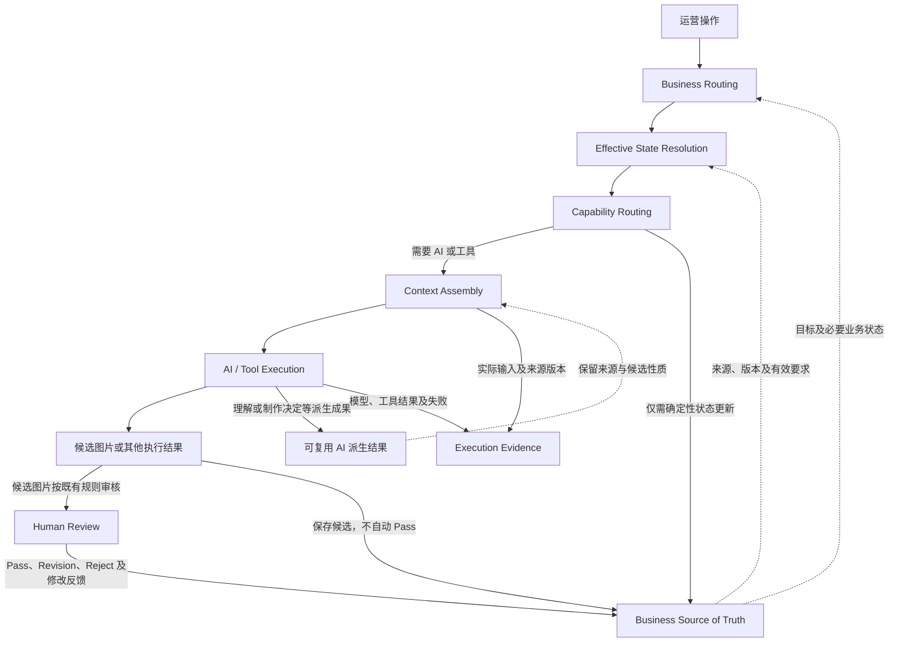

# 05_TECHNICAL_ARCHITECTURE.md

**项目：** AIGC Workbench  
**版本：** V0.1 — ARCHITECTURE RESEARCH  
**状态：** 研究中，架构尚未冻结  
**上位依据：** 00～04 业务文档；具体已确认规则按其来源和作用范围生效。

本文件保留技术架构总入口；专题详细研究分别以 `architecture/Txx_*.md` 为唯一正文位置。00～04 仍是业务规则权威，专题文件不重新定义业务契约。

| 上位业务文档 | 版本 | 关系 |
|---|---|---|
| [00_PRODUCT_CHARTER.md](00_PRODUCT_CHARTER.md) | V0.3 | 产品目标、范围与跨模式要求 |
| [01_BUSINESS_MODES.md](01_BUSINESS_MODES.md) | V0.3 | 三模式流程、输入和信息权限 |
| [02_INTENT_AND_CONTEXT_RULES.md](02_INTENT_AND_CONTEXT_RULES.md) | V0.6 | 有效要求、修改继承、版本及 Pass |
| [03_ACCEPTANCE_CASES.md](03_ACCEPTANCE_CASES.md) | V0.1 | 案例、验收依据和验证缺口 |
| [04_IMAGE_CREATION_WORK_METHOD.md](04_IMAGE_CREATION_WORK_METHOD.md) | V0.2 | 四阶段专业工作方法及状态边界 |

各业务文件仍为 BUSINESS DRAFT；其中已确认条款、候选方法和待验证事项分别按原状态使用。专题详细内容不在本入口重复保存。

## 1. 架构设计目标

围绕 Quick-A、Quick-B、Listing 三模式及统一四阶段业务工作方法，设计可持续保持运营意图的 AI 应用系统。

核心需要解决：

- 商品外观和营销信息在多图制作中发生偏移。
- 参考设计风格不能稳定延续。
- 多轮修改中有效要求被遗漏、混淆或错误覆盖。
- 修改影响已经认可的内容。
- AI 出错后难以判断是资料理解、制作决定、Context 还是生成执行的问题。

坚持业务驱动技术，不将四阶段机械映射为四次模型调用或四个 Agent。

## 2. 九专题导航与核心职责摘要

| 编号 | 专题 | 核心职责摘要 | 优先级 |
|---|---|---|---|
| T01 | 系统边界与业务对象（待补齐） | 核心对象、责任、来源权威与关系 | P0 |
| T02 | Task Routing（讨论未完整归档） | 根据模式、图位、操作决定需要执行的能力 | P0 |
| [T03](architecture/T03_CONTEXT_ENGINEERING.md) | Context Engineering | 有效 Context 的组织、继承、更新与追溯 | P0 |
| [T04](architecture/T04_RULES.md) | Rules | 确定性规则、业务约束和 AI 判断的边界 | P0 |
| [T05](architecture/T05_AI_CAPABILITIES.md) | AI 能力架构 | 专业职责与 AI 能力的映射、复用和验证 | P0 |
| [T06](architecture/T06_KNOWLEDGE_SKILLS.md) | Knowledge / Skills | 什么时候需要专业知识，怎样证明增益 | P1 |
| [T07](architecture/T07_TOOL_INTEGRATION.md) | Tool Integration | 图片生成、编辑、合成及文件工具接入 | P1 |
| [T08](architecture/T08_ORCHESTRATION_RUNTIME.md) | Orchestration & Runtime | 任务执行、异步、状态、重试、失败恢复 | P1 |
| [T09](architecture/T09_EVALUATION_OBSERVABILITY.md) | Evaluation & Observability | 中间判断、最终成图、修改及业务效果评价 | P0 |

P0：首轮架构需要明确核心设计。

P1：需要明确职责及边界，具体实现可以延后。

T01 / T02 暂无独立专题文件，不提供指向不存在文件的链接。

## 3. 当前研究状态与决策索引

| 专题 | 当前进度 | 当前结论状态 |
|---|---|---|
| T01 系统边界 | 已有核心对象与信息权威概要，完整记录待补齐 | PROPOSED / INCOMPLETE RECORD |
| T02 Task Routing | 曾在聊天中讨论，当前仓库未完整归档 | NOT STARTED IN REPOSITORY / PREVIOUS DISCUSSION NOT YET ARCHIVED |
| [T03 Context Engineering](architecture/T03_CONTEXT_ENGINEERING.md) | RESEARCHED：已补全有效状态、按需组装、生命周期、执行证据及四张图示 | PROPOSED / REVIEW PENDING |
| [T04 Rules](architecture/T04_RULES.md) | RESEARCHED：已完成第一轮规则分类、责任边界、场景、评价及两张图示整合 | PROPOSED / REVIEW PENDING |
| [T05 AI 能力架构](architecture/T05_AI_CAPABILITIES.md) | RESEARCHED：已补全 C01～C08、三模式复用、执行策略、评价、实验建议及三张图示 | PROPOSED / REVIEW PENDING |
| [T06 Knowledge / Skills](architecture/T06_KNOWLEDGE_SKILLS.md) | RESEARCHED：已补全按需增强、权威边界、能力映射、案例、评价及两张图示 | PROPOSED / REVIEW PENDING |
| [T07 Tool Integration](architecture/T07_TOOL_INTEGRATION.md) | RESEARCHED：已补全 G01～G05、制作策略、工具契约、资产证据、评价及三张图示 | PROPOSED / REVIEW PENDING |
| [T08 Orchestration & Runtime](architecture/T08_ORCHESTRATION_RUNTIME.md) | RESEARCHED：已补全 E01～E06、执行状态、Run / Attempt、安全恢复、多图位隔离及四张图示 | PROPOSED / REVIEW PENDING |
| [T09 Evaluation](architecture/T09_EVALUATION_OBSERVABILITY.md) | RESEARCHED：已补全 L0～L3、能力评价、证据链、失败定位、长期意图保持、实验与四张图示 | PROPOSED / REVIEW PENDING |

**整体研究状态：第一轮记录尚未齐备；PROPOSED / REVIEW PENDING / NOT IMPLEMENTED。** T01 尚不完整；T02 曾在聊天中讨论，但当前仓库未完整归档。本轮仅作内容迁移，不补写这两项，也不将整体标记为九专题第一轮研究完成。

专题中的“本轮／下一专题”及进度说明保留各自研究轮次含义；当前归档状态以本节为准。T03 的四图研究包含通过链接引用的总入口图 1。

现有记录没有已批准的技术架构决策。A01～A04 及下列专题结论均为候选，不因拆分或 Git 提交成为 DECIDED、IMPLEMENTED、VALIDATED 或 BUSINESS ACCEPTED。

**已确认业务规则索引：** [01 第 3～6 节](01_BUSINESS_MODES.md)、[02 第 5、7、8 节](02_INTENT_AND_CONTEXT_RULES.md)、[04 第 6.7 节](04_IMAGE_CREATION_WORK_METHOD.md)。此处只索引相应业务责任，不将整份业务草稿或候选专业方法标为批准。

| 技术候选结论索引 | 唯一详细记录 |
|---|---|
| T03-A～T03-G | [T03 第 6.10 节](architecture/T03_CONTEXT_ENGINEERING.md) |
| T04-A～T04-F | [T04 第 7.11 节](architecture/T04_RULES.md) |
| T05-A～T05-G | [T05 第 8.12 节](architecture/T05_AI_CAPABILITIES.md) |
| T06-A～T06-G | [T06 第 9.13 节](architecture/T06_KNOWLEDGE_SKILLS.md) |
| T07-A～T07-G | [T07 第 10.14 节](architecture/T07_TOOL_INTEGRATION.md) |
| T08-A～T08-H | [T08 第 11.16 节](architecture/T08_ORCHESTRATION_RUNTIME.md) |
| T09-A～T09-I | [T09 第 12.19 节](architecture/T09_EVALUATION_OBSERVABILITY.md) |

## 4. 整体技术架构总览

### 图 1：AIGC Workbench 核心执行架构图

**解决的问题：** 解释 T01 的业务依据、T02 的操作与能力路由、T03 的有效状态及 Context 如何协作，并区分 AI 执行与确定性状态更新。

Business Routing 先识别操作及目标，Effective State Resolution 再明确有效依据，Capability Routing 选择后续职责。图中 AI 路径的审核对应已有候选结果审核，不新增制作前审批；Pass 等状态操作不必经过 AI 路径。业务更新影响后续操作，已启动执行仍使用本次固定输入。模块均为逻辑职责。

## 5. 重要跨专题架构原则与共享候选

### A01：业务依据与 AI 派生结果分离

原始商品资料、运营要求、人工确认应与 AI 理解、制作决定及生成结果明确区分。

状态：PROPOSED

### A02：Context 按需组装

持久保存业务状态，根据具体 AI 工作组装 Execution Context，而不是不断累积完整历史对话。

状态：PROPOSED

### A03：执行可追溯

保留实际使用的输入、有效要求、素材版本、AI 输出与审核结果，以支持失败定位。

状态：PROPOSED

### A04：模型调用数量由评价决定

业务四阶段不等于四次模型调用。后续通过真实案例比较质量、成本和延迟，再确定能力的实际组合方式。

状态：PROPOSED

以上均未冻结为技术实施决定。

执行、审核及交付状态分开：**Execution Succeeded ≠ Business Accepted ≠ Effective Delivery Updated**。相关职责及限制见 [T08](architecture/T08_ORCHESTRATION_RUNTIME.md)。Observability、Evaluation 与 Business Acceptance 的区别见 [T09](architecture/T09_EVALUATION_OBSERVABILITY.md)。

当前有效依据及按需输入见 [T03](architecture/T03_CONTEXT_ENGINEERING.md)，规则定义和检查责任见 [T04](architecture/T04_RULES.md)，专业能力、按需增强与工具选择分别见 [T05](architecture/T05_AI_CAPABILITIES.md)、[T06](architecture/T06_KNOWLEDGE_SKILLS.md)、[T07](architecture/T07_TOOL_INTEGRATION.md)。这些引用不新增调用、审批或技术前置条件。

## 6. 第一轮研究与后续验证路线

### 第一轮：架构基础

- T01：核心对象与 Source of Truth
- T02：Task Routing
- T03：Context 生命周期与 Context Assembly

目标：明确业务数据、任务执行及上下文的基础关系。

### 第二轮：决策能力

- T04：Rules
- T05：AI 能力架构

目标：明确确定性程序、模型判断及人工责任的边界。

### 第三轮：执行与扩展

- T06：Knowledge / Skills
- T07：Tool Integration
- T08：Orchestration & Runtime

目标：设计最小可运行且能扩展的工程能力。

### 第四轮：评价体系收束

- T09：Evaluation & Observability

目标：形成可检验、可定位失败、可比较业务效果的验证体系。

**T09 的证据与评价要求从第一轮就参与架构设计，不等到第四轮才考虑。**

### 后续验证及既有待办

T09 第一轮研究记录已补全；九专题整体仍有 T01 / T02 记录缺口，本轮不继续补写或开始新专题。

后续方向仅作记录：处理已有记录缺口后，对 T01～T09 做简短一致性核对和必要统一总览，检查职责、术语及未经批准的前置条件，再选择真实 Quick-A 案例进行最小能力实验。本轮不开展架构总审、真实调试或工程实施。

保留待审及既有研究待办：

- T01 核心对象与信息权威的收束。
- T02 Task Routing 的任务识别与能力选择。
- T03 候选结论及四张图示的审核，以及后续真实场景验证。
- T04 第一轮候选结论、两张图示及规则评价方法的审核与后续验证。
- T05 第一轮候选能力地图、三张图示及实验建议的审核与后续验证。
- T06 第一轮按需专业增强、两张图示及真实案例对照方案的审核与后续验证。
- T07 第一轮工具策略、三张图示及真实制作对照方案的审核与后续验证。
- T08 第一轮可靠执行、四张图示、状态及恢复策略的审核与后续故障验证。
- T09 第一轮分层评价、四张图示、证据链及真实案例对照方案的审核与后续验证。

后续仍依本节四轮顺序推进；T01 的不完整记录及 T02 的讨论未归档状态不因拆分改变。

## 7. 研究与决策纪律

1. 先研究业务要求，再确定技术方案。
2. 区分已确认业务规则、研究建议、验证结果和正式架构决定。
3. 不根据旧项目代码反向定义架构。
4. 不因为某技术流行而强行引入。
5. 不将一次实验成功视为整体能力通过。
6. 重要架构决定需要记录理由、代价及验证依据。
7. 不无限拆解理论问题；达到可实施、可评价程度即收束。
8. 未经确认的研究结论不得直接授权 Codex 开发。

## 8. 版本与迁移记录

- **既有基线：** `f7c76a4fdf1aea77bbce404258da2e93d3c71b32`，05 V0.1 架构研究稿；T03～T09 已归档，T01 / T02 未完整归档。
- **2026-11-04 文档组织调整：** 原第 6～12 节迁移至七份独立专题；图 1 及原说明留在总入口，T03 链接引用，图 2～22 随所属专题迁移；保留原章节号、图号、结论编号及研究状态。
- 各专题既有研究记录和来源引用随原文保存。本轮不新增架构结论，不补写 T01 / T02，不修复既有图示 P2 问题，不代表业务批准或技术验证通过。

**本文件是技术架构研究主记录，不代表 V1 技术方案已经批准。**