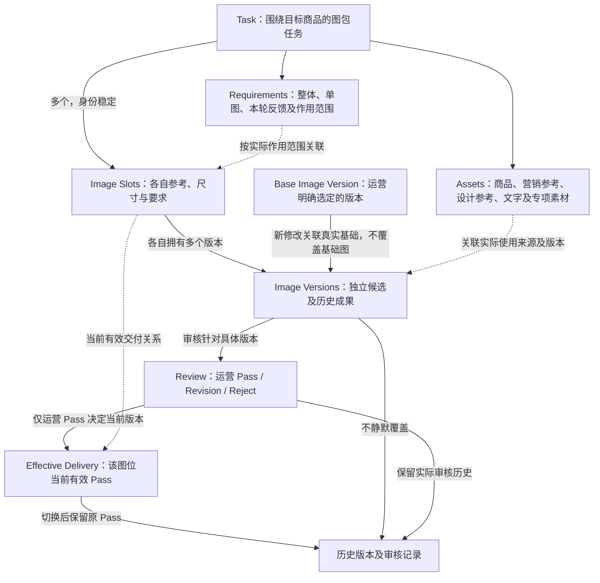
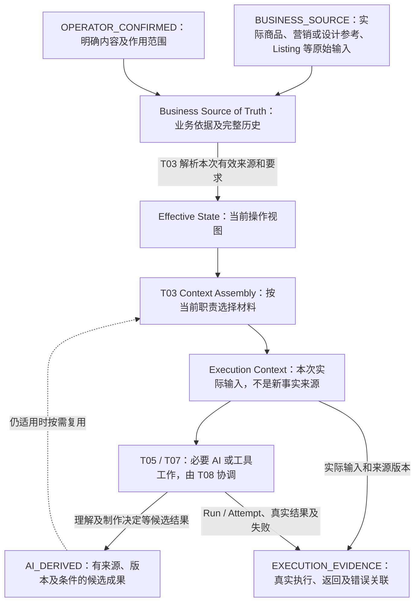

# T01 — System Boundary & Business Objects

[返回技术架构总入口](../05_TECHNICAL_ARCHITECTURE.md)

**研究状态：** `RESEARCHED / PROPOSED / REVIEW PENDING`

**归档来源：** 本轮提供的具体研究内容，结合现有业务基线及架构职责关系核对；不推断未提供的聊天原文。

**业务权威：** [00](../00_PRODUCT_CHARTER.md)、[01](../01_BUSINESS_MODES.md)、[02](../02_INTENT_AND_CONTEXT_RULES.md)、[03](../03_ACCEPTANCE_CASES.md)、[04](../04_IMAGE_CREATION_WORK_METHOD.md) 中相应已确认条款；业务草稿、候选专业方法和真实验证结果分别管理。

**关联专题：** [T02](T02_TASK_ROUTING.md)、[T03](T03_CONTEXT_ENGINEERING.md)、[T04](T04_RULES.md)、[T08](T08_ORCHESTRATION_RUNTIME.md)、[T09](T09_EVALUATION_OBSERVABILITY.md)。

本文件是第一轮研究补录，逻辑对象、职责及图示属于候选设计，不冻结数据库、Schema、Agent 或 Runtime 实现，不代表工程测试通过、业务接受或工程开发授权。

## T01-01：研究目标

T01 需要回答：

**AIGC Workbench 究竟需要长期管理哪些业务对象？这些信息由谁提供、谁拥有权威、如何建立关系，以及怎样避免 AI 派生结果污染商品和运营事实？**

目标：

- 建立统一业务对象边界。
- 确定商品、图包、图位及版本关系。
- 区分原始业务来源和 AI 派生结果。
- 明确信息权威。
- 为 T02 Routing、T03 Context、T08 Runtime、T09 Evaluation 提供可靠基础。

明确：

T01 定义逻辑业务对象及信息权威，不要求立即创建对应数据库表或 Python 类。

## T01-02：核心业务对象

本轮记录以下六类核心业务对象。

### 1. Task

一次围绕目标销售商品进行的营销图包制作任务。

主要职责：

- 关联当前业务模式。
- 关联目标商品素材。
- 管理图包整体要求。
- 关联多个 Image Slot。
- 关联制作及审核历史。

Task 是业务容器，不等于一次模型调用，也不等于一次 Runtime Run。

### 2. Asset

商品、参考和其他实际输入素材。

包括：

- 实售商品图片。
- 营销参考图片。
- 设计参考图片。
- Listing 或其他商品资料。
- 必要的专项制作素材。

需要区分：

- 资产身份。
- 资产角色。
- 来源。
- 对应版本。
- 作用范围。

实际商品素材与参考素材不能因为都属于图片而失去业务角色区别。

替换输入素材不得静默改写历史执行已经使用的版本。

### 3. Requirement

运营的实际业务要求。

包括：

- 整体要求。
- 单图要求。
- 本轮修改反馈。
- 相关禁止事项和明确限制。

必须区分要求的作用范围和生效关系。

不能简单以最新文字覆盖全部历史要求。

修改反馈应与其基础版本和本轮目标关联，不自动变成永久适用于全部图片的整体要求。

### 4. Image Slot

一张待制作图片的业务位置。

需要有稳定身份，能够关联：

- 图位类型。
- 当前参考绑定。
- 输出尺寸。
- 单图制作要求。
- 图片候选及审核历史。

不同图位可以使用不同参考、尺寸、内容重点和要求。

单图的修改不自动改变其他图位。

图位名称不自动代表特定平台的发布规范。

### 5. Image Version

一次实际生成或修改得到的具体图片版本。

需要明确：

- 所属 Image Slot。
- 对应制作执行。
- 实际基础版本（修改时）。
- 具体图片成果。
- 相关审核结果。
- 与其他历史版本的关系。

版本不能被后续候选静默覆盖。

修改应以运营明确选中的版本为基础，而不强制使用最新候选。

### 6. Review

运营对具体图片版本作出的业务评价。

包括：

- Pass。
- Revision。
- Reject。

Review 必须关联实际审核的 Image Version。

当前有效交付由运营 Pass 决定。

生成成功或 AI 自评不能自动形成 Pass。

## T01-03：对象之间的关系

明确：

- 一个 Task 围绕当前目标商品和图包制作展开。
- 一个 Task 可包含多个 Image Slot。
- 一个 Image Slot 可拥有多个 Image Version。
- 一个 Image Version 对应实际生成或修改成果。
- 修改产生的新版本关联其实际基础版本。
- Review 关联具体 Image Version。
- 当前有效 Pass 与历史已通过版本必须区分。
- 业务资料及要求能够关联相关任务、图位和实际执行。

V1 不预先建立独立企业级 Product Master 系统。

只有实际出现跨任务 SKU 共享及维护需求时，再研究独立 Product 对象。

不能因此删除 Task 中目标商品身份及素材关联的必要业务责任。

## T01-04：三类逻辑信息层

记录以下职责划分。

### A. Business State

管理：

- 原始业务输入。
- 运营要求。
- 商品及配置确认。
- 图位与参考绑定。
- 图片版本。
- 运营审核及有效交付。

### B. AI-derived Results

管理候选专业结果，例如：

- 商品视觉理解。
- 参考营销与设计理解。
- 跨来源语义核对。
- 单图营销内容决定。
- 视觉制作决定。

这些结果可能保存和复用，但不自动成为商品事实。

Creation Decision 属于专业工作成果，不等于运营原始要求。

### C. Execution Evidence

记录实际执行过程。

例如：

- Run / Attempt。
- 实际 Execution Context。
- 模型及工具调用。
- 真实输出和错误。
- 成图来源与执行关联。

具体 Runtime 生命周期属于 T08。

Execution Evidence 的评价和使用属于 T09。

三类是逻辑信息职责，不代表三套独立服务或数据库。

## T01-05：信息权威

完整说明以下分类。

### BUSINESS_SOURCE

运营实际提供的商品素材、参考图、Listing 和其他业务输入。

### OPERATOR_CONFIRMED

运营对特定商品、配置、信息适用性或业务问题作出的明确确认。

确认必须有实际作用范围。

例如运营确认某配件属于实售商品，不等于确认该商品的全部性能已获得检测认证。

### AI_DERIVED

模型产生的观察、推断、理解或制作建议。

可以成为有来源的候选结果。

但不能自动覆盖实际商品依据。

### EXECUTION_EVIDENCE

记录某次执行实际使用了什么、返回什么以及如何处理结果。

它是执行发生情况的证据，不自动认证商品事实。

以上名称属于研究分类，不冻结为正式数据库枚举。

## T01-06：Source of Truth

明确候选原则：

**Business Source of Truth + Traceable Derived Results**

系统长期保存可追溯业务依据。

AI 专业结果通过来源关联和有效条件参与后续工作。

不得将完整聊天历史、最新 AI 摘要或单次模型输出，直接视为系统唯一业务事实来源。

同时区分：

- Source of Truth：长期业务依据及权威。
- Effective State：当前操作实际生效的信息，由 T03 解析。
- Execution Context：本次实际执行所需材料，由 T03 组装。
- Execution Evidence：实际执行输入与结果的追溯记录。

不建立四份互相独立的商品事实副本。

## T01-07：版本与 Pass 保护

严格对齐 02。

记录：

1. 修改默认使用运营明确选中的图片版本。
2. 历史版本可以作为新的修改基础。
3. 新候选不覆盖基础图片。
4. 新候选未 Pass 时，原有效 Pass 保持。
5. 新候选 Pass 后，成为当前有效交付。
6. 原 Pass 继续保留历史。
7. 整体要求变化不自动修改已有 Pass。
8. 历史制作依据及审核记录可追溯。

业务状态需要能够表达当前有效版本与历史版本的区别。

具体事务和并发控制方法留待 T08 及实际工程设计。

## T01-08：三模式共用对象

Quick-A、Quick-B、Listing 应共用核心业务对象关系。

模式差异体现为：

- 原始输入条件。
- 营销内容来源权限。
- 参考图片的作用。
- 制作和审核约束。

不因为三种模式存在差异，就建立三套完全重复的 Task、Asset、Version、Review 数据体系。

Listing V1 保留实际商品图和运营文字资料作为基础输入，设计参考通常提供但仍遵守既有可选规则。

纯文字生图不作为当前 V1 主要业务场景。

## T01-09：边界与不负责事项

T01 不负责：

- 重新分析商品图。
- 决定营销卖点取舍。
- 执行图片生成。
- 自行形成运营 Pass。
- 执行模型调用。
- 代替 T03 组装 Context。
- 代替 T08 管理执行状态。

不提前冻结：

- ORM。
- 数据库技术。
- 正式 Schema。
- Product Master。
- 微服务划分。
- Python 项目目录。

## T01-10：最小可评价结果

T01 研究至少能明确：

- 一次 Task 涉及哪些核心业务对象。
- 如何确定商品及素材角色。
- 图位和图片版本怎样关联。
- AI 结果与业务事实怎样区分。
- 历史 Pass 和当前交付怎样区分。
- 一次执行如何回查真实业务来源。

后续验证应结合真实 Task 与版本记录。

目前属于架构逻辑研究，不是已通过工程测试。

## T01-11：Mermaid 可视化

两图均为 `PROPOSED / REVIEW PENDING`，表达候选逻辑关系，不表示数据库结构、独立服务或已实现系统。

### 图 T01-1：Core Business Object Relationships

**用途：** 展示六类业务对象、实际修改基础及审核与有效交付关系。连线表示业务关联，不是固定制作调用链。

Base Image Version 是已有 Image Version 的角色，Effective Delivery 表示当前交付关系，不据此新增强制数据库实体。新候选生成不等于 Pass，Reject 或未 Pass 也不改变旧有效交付。具体事务和并发控制仍属于 T08 及后续工程设计。

### 图 T01-2：Information Authority & Derived Results

**用途：** 区分长期业务来源及历史、当前有效视图、实际执行 Context、AI 候选结果与执行证据，防止形成独立商品事实副本。

业务来源和运营确认按各自范围构成依据；AI 派生结果保留候选性质，图中没有把它自动写回商品事实的路径。完整历史与当前有效状态分开，Context 是按需输入，Evidence 证明执行发生情况而不认证商品性能。派生结果回到后续组装表示有条件复用，不表示自动持续执行循环，也不要求四套数据库或独立部署。

## T01-12：研究结论

记录：

**T01-A**

业务状态、AI 派生结果和执行证据分离。

`PROPOSED`

**T01-B**

核心业务对象应具有稳定身份，版本和历史可追溯。

`PROPOSED`

**T01-C**

当前有效业务状态与完整历史记录分开管理。

`PROPOSED`

**T01-D**

以业务来源及明确的运营确认作为相应权威，AI 派生结果不得自动覆盖商品事实。

`PROPOSED`，相关业务边界已确认。

**T01-E**

三模式共用核心对象关系，通过信息来源和业务权限体现差异。

`PROPOSED`

以上编号作为本次补录的候选结论索引，不要求与既有其他专题重新编号。
