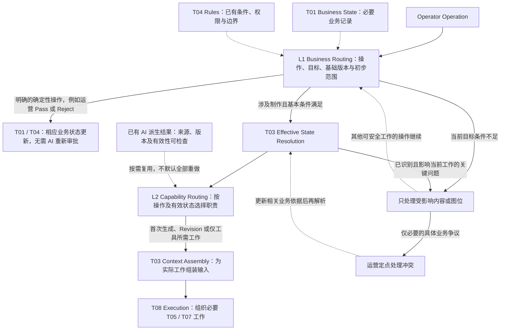
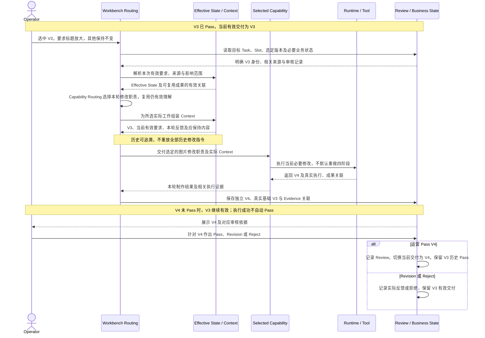

# T02 — Task Routing

[返回技术架构总入口](../05_TECHNICAL_ARCHITECTURE.md)

**研究状态：** `RESEARCHED / PROPOSED / REVIEW PENDING`

**归档来源：** 本轮提供的具体研究内容，结合现有业务基线及架构职责关系核对；不推断未提供的聊天原文。

**业务权威：** [00](../00_PRODUCT_CHARTER.md)、[01](../01_BUSINESS_MODES.md)、[02](../02_INTENT_AND_CONTEXT_RULES.md)、[03](../03_ACCEPTANCE_CASES.md)、[04](../04_IMAGE_CREATION_WORK_METHOD.md) 中相应已确认条款；业务草稿、候选专业方法和真实验证结果分别管理。

**关联专题：** [T01](T01_SYSTEM_BOUNDARY.md)、[T03](T03_CONTEXT_ENGINEERING.md)、[T04](T04_RULES.md)、[T05](T05_AI_CAPABILITIES.md)、[T07](T07_TOOL_INTEGRATION.md)、[T08](T08_ORCHESTRATION_RUNTIME.md)、[T09](T09_EVALUATION_OBSERVABILITY.md)。

本文件是第一轮研究补录，逻辑对象、职责及图示属于候选设计，不冻结数据库、Schema、Agent 或 Runtime 实现，不代表工程测试通过、业务接受或工程开发授权。

## T02-01：研究目标

T02 回答：

**当运营进行一次操作时，系统如何识别操作目标、作用范围和必要执行职责，并确定哪些已有能力结果可复用，哪些内容需要重新处理？**

Task Routing 不只是判断：

Quick-A → Agent A
Quick-B → Agent B
Listing → Agent C

也不应该为三种模式建立三条完全独立的通用 Agent Workflow。

需要根据实际操作和当前状态决定执行职责。

## T02-02：两个逻辑职责

### L1 — Business Routing

负责：

- 识别业务操作。
- 确定目标 Task、Slot 或 Image Version。
- 识别运营实际选中的基础版本。
- 检查相关业务状态和操作前提。
- 确定初步影响范围。
- 识别无需 AI 的确定性操作。
- 发现需要定点处理的业务阻断。

Business Routing 应优先依靠确定性业务规则。

但并不是所有涉及商品语义的问题都能通过程序检查解决。

### L2 — Capability Routing

负责根据当前操作及有效业务依据判断：

- 需要哪些 AI 专业能力。
- 哪些既有理解结果可复用。
- 是否需要重新处理部分业务依据。
- 是首次生成还是修改。
- 是否只需要工具执行。
- 是否不需要 AI，仅执行状态更新。

Capability Routing 不预先决定固定模型调用次数。

它选择逻辑工作职责，实际能力组合和执行方式由后续 T05/T08 研究及实验决定。

本节 L1 / L2 是 Routing 逻辑职责标签，与 [T09](T09_EVALUATION_OBSERVABILITY.md) 的 Evaluation 层次编号含义不同，不代表两个独立部署层。

## T02-03：Routing 与 Effective State 的关系

必须对齐现有 05 和 T03。

候选逻辑关系：

**Business Routing → Effective State Resolution → Capability Routing → Context Assembly**

说明：

- Business Routing 先识别用户操作和目标，并读取必要的已有状态进行基本检查。
- T03 Effective State Resolution 解析本次操作实际生效的业务依据。
- Capability Routing 依据操作与有效状态选择必要专业能力。
- T03 Context Assembly 为实际执行的能力组织输入。
- T08 负责后续实际执行协调。

这是逻辑职责关系，不要求分别启动四个服务。

Business Routing 可能需要读取业务状态，不意味着必须先执行完整 Context Assembly。

避免产生 T02 和 T03 之间无法解释的循环依赖。

## T02-04：Routing 的最小业务输入

至少包括：

- 当前 Task。
- 当前 Mode。
- Operation。
- 当前目标 Image Slot。
- 指定 Image Version（适用时）。
- 运营本轮反馈（适用时）。
- 相关素材、要求和已有结果的实际状态。

这是逻辑输入，不冻结 API Schema。

## T02-05：Routing 的最小业务输出

形成当前 Execution Intent。

应明确：

- 当前操作是什么。
- 操作作用于哪些业务对象。
- 当前必要条件是否满足。
- 哪些内容可以继续制作。
- 哪些内容需要定点处理。
- 需要执行哪些专业职责。
- 可复用哪些已有成果。
- 需要 T03 组装什么类型的 Context。
- 是否只需要确定性状态更新。

不要求每次都产出完整 Planning 文档。

## T02-06：三模式首次制作

### Quick-A

运营提供：

- 实售商品图。
- 同款营销参考。
- 图位和绑定关系。
- 可选整体及逐图要求。

Routing 应识别：

- 同款参考驱动业务。
- 当前目标图位。
- 需要的商品及参考理解。
- 当前制作决定和生成职责。
- 已有有效结果可否复用。

不得因普通外观差异自动切换 Quick-B。

不要求完整 Listing 或额外逐项卖点确认。

### Quick-B

运营提供：

- 实售商品图。
- 外观不同的营销参考。
- 当前图位及要求。

Routing 应保留：

- 运营选定参考营销内容默认适用的前提。
- 最终外观必须使用实售商品。
- 参考主体及相关细节必须完整替换。

不得让 Routing 默认启动逐条商品营销认证流程。

### Listing

运营提供：

- 实售商品图。
- 运营商品文字资料。
- 通常提供的设计参考。
- 当前图位及要求。

Routing 应：

- 采用商品资料作为营销内容主要依据。
- 将参考作为主要视觉设计来源。
- 只对真正影响制作的关键矛盾进行定点处理。
- 不增加完整单图方案人工预审。

不将纯文字生图作为当前 V1 的必需任务路径。

Listing 设计参考仍按 [01](../01_BUSINESS_MODES.md)及 [04 第 2.4 节](../04_IMAGE_CREATION_WORK_METHOD.md)的可选规则使用；“通常提供”不等于必须提供。Quick-A 继续采用同款同配置前提，实际商品图决定最终外观，参考同时提供营销与设计依据。

## T02-07：重要业务操作对照

以下 Routing Matrix 表达候选职责与作用范围，不规定固定模型调用链；适用规则仍以 T04 和上位业务文档为准。

| 业务操作 | Routing 职责及业务边界 |
|---|---|
| 首次生成 | 选择当前图位并执行必要理解、决定和制作。 |
| 新增图位 | 使用仍有效的商品与图包依据，为新图位处理对应参考和制作要求。 不自动改变其他图位。 |
| 修改候选 | 使用运营选定基础版本、当前有效要求及本轮目标。 |
| 修改历史已 Pass 图片 | 创建新候选，保留原有效 Pass。 |
| 重新制作某张图片 | 明确目标和实际基础条件，不能自动覆盖历史候选或旧 Pass。 |
| 更新整体要求 | 记录新整体要求的生效范围。 已 Pass 图片不自动重做或失效。 |
| 更新单图要求 | 只影响对应图位后续相关制作，不默认重做整组。 |
| 替换参考素材 | 检查受影响图位和实际依赖旧参考的专业结果。 不默认重新执行所有图位。 |
| Pass | 确定性审核与版本状态操作。 不需要调用 AI 重新审批。 |
| Reject | 记录候选被拒绝，不删除有效交付和历史记录。 |
| 尺寸图未提供合规专项素材 | 当前尺寸图不制作，其他满足条件的图位继续。 不能由 AI 猜测目标商品真实尺寸。 |

合规尺寸图专项素材遵守 [01 第 6.5 节](../01_BUSINESS_MODES.md)及 [04 第 4.8 节](../04_IMAGE_CREATION_WORK_METHOD.md)：须由运营确认且已标注目标商品真实尺寸的专用白底素材；不得按参考或像素猜测真实尺寸，缺少时不制作该尺寸图，其他不受影响图位继续。

## T02-08：能力选择与复用原则

重要原则：

**Routing 根据实际工作需要选择能力，而不是默认每次执行 C01～C08。**

例如：

- 首次商品理解：可能需要 C01。
- 更换某张参考：可能需要重新处理对应 C02 结果。
- 单图卖点变化：可能只需要重新处理 C04。
- 背景修改：可能复用已有理解和决定，仅处理实际变化。
- Pass：不需要 AI 能力。

但不能仅根据操作文字认定所有上游信息必然正确。

如果实际发现重要商品理解错误，必须允许返回受影响的理解职责。

T03 负责判断派生结果是否仍与有效来源一致。

T05 定义 AI 能力边界。

T08 负责组织实际执行。

来源及版本一致不等于语义结果已获验证；已知错误及实际变化应按 [T03](T03_CONTEXT_ENGINEERING.md)、[T05](T05_AI_CAPABILITIES.md)和 [T09](T09_EVALUATION_OBSERVABILITY.md)的既有边界核对，不让 Routing 建立另一套商品事实或正确性认证。

## T02-09：定点阻断与无关工作隔离

必须遵守：

- 非关键未知不默认阻断图包。
- 重大冲突限制受影响内容和图位。
- 尺寸图素材不满足规则时仅不制作该尺寸图。
- Quick-A/B 不默认逐条卖点确认。
- Listing 不默认完整制作方案预审。
- 不为 Routing 新增多层人工审批。

当运营必须处理重要冲突时，应明确：

- 具体冲突是什么。
- 来源和作用范围。
- 影响当前哪些内容。
- 需要确认什么。

Routing 不擅自创造商品事实解决矛盾。

重改已 Pass 图片的整体／单图实质冲突按 [02 第 5.5 节](../02_INTENT_AND_CONTEXT_RULES.md)处理；只针对实际冲突确认，不新增无实质冲突时的人工步骤，也不启动无关制作。

## T02-10：V3 → V4 修改案例

使用已确认业务规则下的示例。

V3 已 Pass。

运营选中 V3，并要求：

“把标题放大，其他内容保持不变。”

正确 Routing 应当：

1. 识别单图修改操作。
2. 绑定运营选定的 V3。
3. 保留当前有效业务要求。
4. 限定本次修改目标。
5. 识别未要求改变的内容。
6. 复用仍有效的商品及参考理解成果。
7. 不默认重新执行全部四阶段。
8. 不重放所有历史修改文字。
9. 选择需要的图片修改职责。
10. 生成新候选 V4。
11. V4 未 Pass 前继续保留 V3 有效交付。
12. V4 仅在运营 Pass 后成为当前有效交付版本。

这里 Routing 决定需要执行什么。

T03 组装实际 Context。

T07/T08 负责工具和实际执行。

T01/T04 保证版本及状态规则。

运营负责最终审核。

该案例是逻辑验收样例，不是已经完成的 Runtime 测试。

## T02-11：Routing 不负责什么

T02 不负责：

- 建立第二套商品事实。
- 重新定义 Quick-A/B/Listing 业务规则。
- 独立理解全部图像语义。
- 创建单图完整视觉方案。
- 执行图片生成。
- 自行决定图片 Pass。
- 固定模型调用数量。
- 管理完整执行 Trace。

不提前决定：

- Agent Framework。
- Workflow DSL。
- Python Router 类型。
- 独立 Routing Service。
- 固定模型调用拓扑。

## T02-12：最小评价方法

以下为候选路由测试矩阵，状态 `TO_VERIFY / NOT TESTED`；本轮未运行相应工程或模型测试。

| 操作 | 正确的路由结果 |
|---|---|
| Quick-A 首次生成 | 正确选择模式及图位所需职责 |
| Quick-B 首次生成 | 传递完整主体替换约束 |
| Listing 首次生成 | 保持商品资料与设计参考权限 |
| 新增图位 | 不影响其他图位 |
| 从 V3 修改 | 实际采用 V3 |
| 仅修改标题 | 不默认重新执行全部商品理解 |
| 更新整体要求 | 不自动重做已有 Pass |
| Pass V4 | 正确切换有效交付 |
| 拒绝 V4 | 不影响原有效 Pass |
| 尺寸图条件不足 | 仅不制作该图位 |

必须区分：

Routing Correctness 与最终生成图片的业务正确性。

路由正确不等于模型生成一定正确。

## T02-13：Mermaid 可视化

两图均为 `PROPOSED / REVIEW PENDING`，只表达逻辑协作与业务样例，不是已运行的 Router、Agent Workflow 或 Runtime 测试。

### 图 T02-1：Business Routing & Capability Routing

**用途：** 展示先识别操作和目标、再解析有效依据、选择必要职责并组装输入的顺序，同时保留确定性操作、复用及定点处理路径。

状态更新分支只执行已有业务意图，不由 AI 替运营产生 Pass。首次生成与 Revision 可以选择不同职责；复用需有有效来源，不能只凭操作文字假定上游永远正确。定点处理不是全局审批，图中返回 Business Routing 的虚线针对其他可继续工作，不是对失败操作无条件重试。逻辑职责不要求独立服务，也不固定串行 C01～C08 或模型调用次数。

### 图 T02-2：V3 → V4 Revision Routing

**用途：** 以运营选中已 Pass 的 V3 放大标题为例，展示 Routing、Context、制作执行及版本审核之间的责任，保护旧交付。

参与者代表逻辑职责，不决定部署或实际调用拆分。Routing 选择做什么，T03 提供实际输入，T07 / T08 承担工具及执行，T01 / T04 保护版本关系；运营决定接受。图示是逻辑验收样例，没有宣称已执行 Runtime 测试、自动诊断或局部编辑保真验证。

## T02-14：研究结论

记录：

**T02-A**

区分 Business Routing 与 Capability Routing。

`PROPOSED`

**T02-B**

Business Routing 优先使用确定性规则识别操作、目标及业务边界。

`PROPOSED`

**T02-C**

根据操作、目标、有效状态及影响范围决定后续执行职责。

`PROPOSED`

**T02-D**

业务操作不一定需要模型调用，Revision 不默认重做完整四阶段。

`PROPOSED`

**T02-E**

Routing 应支持受影响范围限定、有效专业结果复用及关键问题定点处理。

`PROPOSED`

**T02-F**

Routing 与 Effective State、Context Assembly 分工明确，不应产生重复信息权威或固定 Agent 链。

`PROPOSED`
