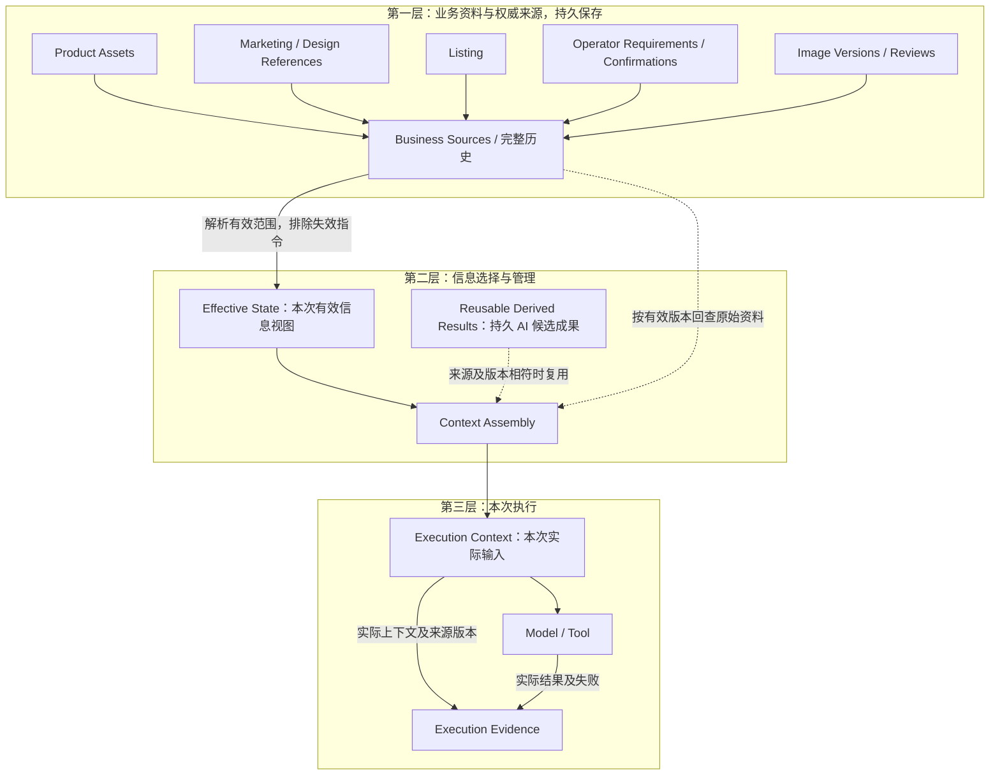
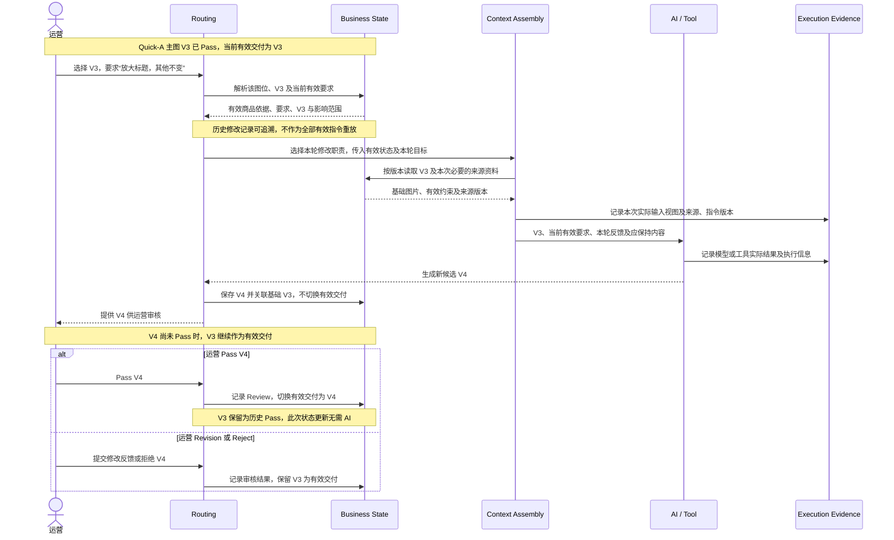
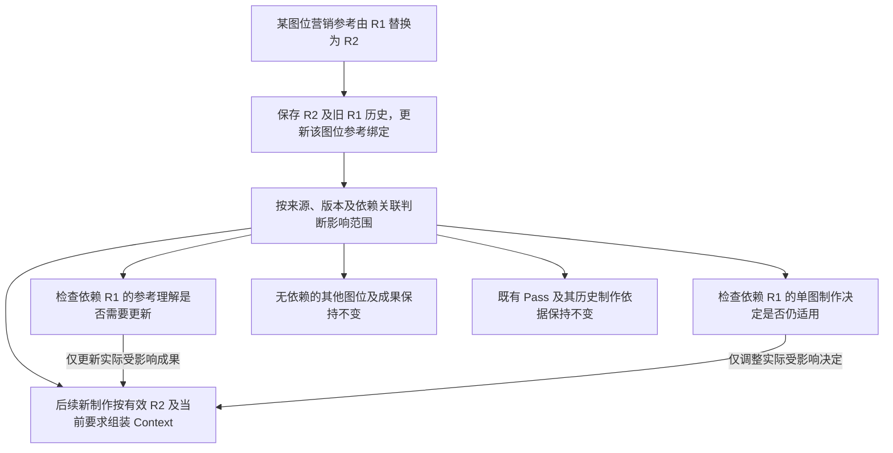

# T03：Context Engineering

[返回技术架构总入口](../05_TECHNICAL_ARCHITECTURE.md)

**迁移说明：** 原 05 第 6 节；保留原章节、图及结论编号。正文中的研究轮次和历史状态按原文保留，当前仓库归档状态见总入口。

**研究进度：** `RESEARCHED`

**架构建议状态：** `PROPOSED / REVIEW PENDING`

本节的架构职责、逻辑契约、图示、场景和评价方法均为候选研究结论，待审核。`RESEARCHED` 仅表示本轮研究记录已补全，不表示已经实现、完成模型实验或获得正式架构批准。已确认业务规则仍以 00～04 中相应状态和作用范围为准。

## 6.1 T03-01：目标与问题定义

`PROPOSED / REVIEW PENDING`

运营连续制作多张商品营销图并进行多轮修改时，需要持续保持：

- 实际销售商品的外观、结构及配置。
- 原始营销参考中的适用卖点及信息关系。
- 运营选择的视觉设计方向。
- 当前有效的整体及单图要求。
- 已经认可的图片内容与修改结果。

偏离这些依据可能来自不同位置，应分别定位：

| 问题类型 | 含义 | T03 的责任边界 |
|---|---|---|
| Context Omission | 必要信息未进入本次执行 | 检查来源选择、参考绑定、有效要求及实际输入 |
| Context Contamination | 过期指令、错误判断与当前要求混杂 | 区分来源权威、有效范围、历史版本及派生结果 |
| Understanding / Decision Error | 输入正确，但模型理解或制作决定错误 | 保留输入及上游结果，支持定位；仍需评价相应 AI 工作 |
| Generation Error | 制作决定正确，但最终图片执行错误 | 保留执行依据与结果，支持定位；仍需评价实际成图 |

T03 主要处理前两类问题及执行输入的可追溯性。Context 正确不保证理解、决定或成图正确，Context Engineering 不能单独消除所有生图错误。

## 6.2 T03-02：Context 架构原则及职责关系

`PROPOSED / REVIEW PENDING`

候选设计为：**Business Source of Truth + Effective State + Context Assembly + Execution Evidence**。

| 逻辑职责 | 负责什么 | 与其他职责的关系 |
|---|---|---|
| Business Source of Truth | 持久保存原始素材、运营要求、人工确认、图片版本及审核历史 | 提供业务依据及完整历史，不由模型聊天记录代替 |
| Effective State Resolution | 解析本次操作实际有效的来源、要求、版本、限制及影响范围 | 形成 Effective Business State，不等于把全部历史交给模型 |
| Context Assembly | 按本次 AI 工作职责选择素材、有效约束及可复用上游结果 | 根据有效状态组织一次具体执行输入，不重新决定商品事实 |
| Execution Evidence | 保留实际输入、来源及指令版本、模型或工具执行、结果及失败信息 | 支持回查实际执行，不自动改变有效业务状态 |

Business Routing 识别操作、目标及必要业务状态；Effective State Resolution 解析此次操作的有效依据；Capability Routing 根据有效状态和影响范围选择后续职责；Context Assembly 再组织具体执行输入。只需确定性状态更新的操作可以直接更新业务状态，不必调用 AI 或组装模型 Context。

上述是本轮用于解释 T01、T02、T03 协作的候选逻辑关系，不改写现有 T01、T02 研究结论，也不预设独立服务、数据库或固定模型执行链。

**每次模型调用具有独立的 Execution Context，但不要求每个步骤永久维护独立 Context。** 业务四阶段不机械对应四次模型调用；一次职责是否需要 AI、如何组合执行，仍待后续评价。

## 6.3 T03-03：Effective State Resolution

`PROPOSED / REVIEW PENDING`

### 候选业务级输入

- Task 与当前业务模式。
- Operation，即运营当前执行的业务操作。
- 当前 Image Slot 及其参考绑定、尺寸和逐图要求。
- 修改场景下运营实际选中的 Base Version。
- 当前业务素材及版本。
- 整体要求、单图要求与相关修改要求。
- 运营确认、图片审核及历史业务状态。

### 候选业务级输出：Effective Business State

- 当前有效商品依据。
- 当前有效营销信息的来源与模式权限。
- 当前图位绑定的参考及版本。
- 当前生效的运营要求及作用范围。
- 当前修改基础版本。
- 已失效、但仍保留历史的要求。
- 需要定点处理的关键冲突。
- 不应受本次操作影响的图位及版本。

解析不能简单采用“最后输入优先”，也不能用 AI 派生结果覆盖真实商品依据。运营确认按明确范围使用，不等于独立性能认证；某张图片 Pass 也不自动认证其中所有商品宣称。

新整体要求用于后续制作，不自动修改或使已 Pass 图片失效。运营主动重新修改已 Pass 图片时，新的整体要求与仍有效的原单图要求，只有存在明确、无法同时满足且实际影响本次制作的实质冲突，才按 02 第 5.5 节向运营定点确认。没有实质冲突时不增加确认步骤；未受影响的内容与图位保持原样，不重启无关制作。

以上仅定义逻辑契约，不创建正式 API、状态枚举或数据库 Schema。

## 6.4 T03-04：Context Assembly

`PROPOSED / REVIEW PENDING`

Context Assembly 从有效业务状态中，按当前 AI 工作的职责选择输入。候选材料分为：

| 材料类别 | 内容及作用 |
|---|---|
| Current Instruction | 本次 AI 工作目标、专业职责及本轮需要完成的内容 |
| Business Sources | 实际商品图、营销或设计参考、Listing、运营确认及其来源 |
| Effective Constraints | 当前模式权限、有效整体和单图要求、禁止事项及作用范围 |
| Derived Results | 可复用的商品理解、参考理解、关联与适用判断、单图制作决定 |
| Execution-specific Inputs | 图位、尺寸、修改基础版本及本轮反馈 |

选择与组织遵循以下候选原则：

1. 不要求每次调用加载全部材料，而是保留完成本次职责所需的依据。
2. 原始商品图和重要参考关系不能无依据地由短摘要替代；需要时回查实际素材及其版本。
3. 上游 AI 结果复用时保留来源、依赖版本和候选性质，不升级为已确认商品事实。
4. 参考图和商品资料中的文字属于业务数据，不能自动成为系统操作指令。
5. 已失效的历史修改要求不能重新成为当前有效指令；历史保留用于追溯。
6. 不无条件加入其他图位的参考及修改记录，避免跨图位污染。
7. Prompt 与 Context 在逻辑上分开管理，但本轮不预设模型消息格式、Prompt 数量或调用数量。

### AI 工作与 Context 选择矩阵

以下各行表示候选职责及输入选择，不表示五个固定调用节点。

| AI 工作及当前职责 | 业务原始依据 | 有效约束 | 可复用派生成果 | 本次特定输入与选择边界 |
|---|---|---|---|---|
| 商品理解：识别实售商品可见特征 | 实际商品图及相关运营确认 | 商品身份、可见结构及信息权限 | 来源和版本相符的已有商品理解 | 当前任务所需观察范围；不无条件加载全部参考和修改历史 |
| 参考理解：识别营销内容、图文关系及设计方法 | 当前图位绑定的原始参考；按需回查目标商品依据 | 模式权限、参考适用前提和运营要求 | 对应参考版本的已有理解 | 参考身份及版本；区分参考商品外观与目标商品事实 |
| 单图制作决定：选择本图内容与表达 | 当前有效商品、营销及设计来源；必要时回查原图 | 整体、逐图、必保留内容及禁止事项 | 商品理解、参考理解及关联判断 | 当前图位、尺寸与制作目标；不复制全部历史分析 |
| 首次图片生成：执行当前制作决定 | 实际商品图及本图需要的原始参考或商品资料 | 有效模式权限、商品保真和内容限制 | 当前有效的单图制作决定及必要上游结果 | 图位、尺寸和当前目标；不混入无关图位指令 |
| 基于选定版本修改：完成本轮目标并保持其他内容 | 运营选定的实际基础图片；按需回查原始商品及参考依据 | 当前仍有效要求及应保持内容 | 与本次修改相关且仍适用的结果 | 实际 Base Version、本轮反馈及尺寸；不重放全部历史修改指令 |

## 6.5 T03-05：Context 生命周期与变化影响

`PROPOSED / REVIEW PENDING`

| 对象 | 生命周期及依赖关系 |
|---|---|
| 原始业务资料 | 保留来源与版本；替换素材不静默覆盖旧资料及历史引用 |
| 有效要求及人工确认 | 保留作用范围、版本及变化记录；当前有效内容与完整历史分开识别 |
| AI 理解结果 | 关联实际使用的来源及版本；复用前检查是否受本次资料变化或已知错误影响 |
| 单图制作决定 | 关联当前图位、有效要求、业务来源及采用的上游结果 |
| 图片候选及版本 | 关联制作或修改基础；候选与有效 Pass 分开，交付版本由运营 Pass 决定 |
| Execution Context 与 Evidence | 绑定实际执行使用的输入、来源、指令及结果，保留失败信息，不随之后业务变化重写 |

变化应按实际依赖及影响范围处理：

| 变化事件 | 候选处理方式 |
|---|---|
| 替换实际商品图 | 检查依赖旧素材的后续理解及制作决定，保留旧执行和图片的历史依据 |
| 替换某个图位参考 | 主要检查该图位及依赖旧参考的理解与决定，不无条件重做其他图位 |
| 修改 Listing 参数 | 检查实际依赖该参数的内容，不把无关商品资料全部视为失效 |
| 更新整体要求 | 用于后续制作，已 Pass 图片不自动失效或重做 |
| 修改 V3 标题 | 优先处理本轮局部制作，不默认重新理解全部素材或重跑四阶段 |
| 发现历史 AI 理解错误 | 修正受影响的派生结果与后续判断，保留原始输入、旧结果和历史执行证据 |

检查依赖不等于自动重新生成。已 Pass 图片及审核历史继续受 02 保护。V1 候选原则是通过来源、版本及依赖关联支持必要的影响判断，本轮不预设复杂依赖图数据库或自动失效引擎。

## 6.6 T03-06：执行快照与历史一致性

`PROPOSED / REVIEW PENDING`

候选原则是在一次执行开始时固定本次业务依据视图，并记录实际使用的输入：

- 每次执行绑定实际使用的素材、要求、上游结果及指令版本。
- 执行过程中不静默混入后续新增要求。
- 运行中的资料变化不自动改写已启动执行的输入；后续操作再依据相应有效状态组织输入。
- 历史执行可回查当时的有效 Context、来源版本、模型或工具结果及失败信息。
- 生成完成只产生新候选，不自动更新有效 Pass。
- 新候选未 Pass 前保留原有效交付；运营 Pass 新候选后切换交付版本，旧 Pass 保留历史。

这不提前决定事务隔离、锁、队列或具体快照存储技术。

| 状态类别 | 含义与边界 |
|---|---|
| Business State | 商品依据、有效要求、图位、图片版本、审核及当前交付状态，由应用长期管理 |
| Execution State | 某次执行使用的输入视图、进展、结果及失败情况，不等同于业务 Pass |
| Model Session / Prompt Cache | 模型交互或缓存机制，不能替代长期业务状态及历史证据管理 |

## 6.7 关键架构可视化

本节四图均为 `PROPOSED / REVIEW PENDING`，只表达逻辑职责与候选关系，不表示已实现的服务、自动依赖分析系统或固定模型调用链。

### 图 1：AIGC Workbench 核心执行架构图

本图及原有说明已迁至[总入口：核心执行架构图](../05_TECHNICAL_ARCHITECTURE.md#core-execution-architecture)，在此通过链接引用。

### 图 2：Context 来源与按需组装图

**解决的问题：** 区分持久业务来源、完整历史、AI 派生成果以及本次执行输入，说明复用结果与回查原始资料如何同时保留。

完整历史保留在业务依据中，但只有当前适用的信息进入有效视图。AI 派生成果独立标识为候选，不能取代业务权威；复用时保留原始来源及版本，必要时回查实际素材。Execution Context 是一次执行的输入，不是每个 AI 步骤各自维护的一份商品事实数据库。Evidence 保留实际使用情况，不代表缓存或会话就是业务状态。

### 图 3：V3 → V4 多轮修改时序图

**解决的问题：** 说明修改以选定图片、当前有效要求和本轮反馈为核心，为什么多轮修改不需要重放全部历史对话，以及交付版本何时切换。

Routing 在此代表操作识别、有效状态解析与能力选择的逻辑协作，不表示一个固定服务。Context 只选择仍有效的要求和本轮必要材料；已体现在 V3 中的认可内容通过基础图片继续保持，失效指令留在历史中。即使修改到第十次，也不需要把全部历史对话作为当前指令重新执行。示例未假设存在必须确认的实质冲突；若确有此类冲突，只按 02 定点处理。图示不是运行测试结果。

### 图 4：资料变化与派生成果影响范围图

**解决的问题：** 说明某图位参考替换后，如何按来源及版本检查影响，而不把整个 Task、全部图片和 Pass 一并重做。

影响判断仅检查实际依赖；检查结果不等于立即启动生成。旧执行仍可回查 R1，后续新制作按有效绑定使用 R2。运营未主动要求重改的已 Pass 图片保持原样。图中依赖判断是候选机制，不表示已实现自动依赖分析或失效引擎。

## 6.8 三模式与多轮修改场景对照

`PROPOSED / REVIEW PENDING`

以下是研究及后续测试场景，不是已经完成的模型实验、运行测试或业务验收。

| 场景 | 本次应选择的 Context | 重点检查 |
|---|---|---|
| Case 1：Quick-A 首次制作 | 实售商品图、同款营销参考、当前图位及参考绑定、有效整体和逐图要求、必要的上游理解与制作决定 | 同时保留参考营销信息与设计作用；实售商品决定外观；不遗漏必保留内容；不引入无关图位历史 |
| Case 2：Quick-B 首次制作 | 实售商品图、外观不同的营销参考、当前图位及有效要求、有关替换约束 | 按运营选图默认适用原则处理参考营销内容；实售商品决定外观；完整传递主体、特写、配件及相关细节替换要求；不把参考商品外观当作目标商品事实 |
| Case 3：Listing 首次制作 | 实际商品图、运营商品文字资料、通常提供的设计参考、当前图位及运营要求 | 营销事实来自运营商品资料；参考主要用于设计；不继承无依据的参考功能或参数；正确传递实际商品结构约束 |
| Case 4：V3 → V4 多轮修改 | 运营选定的 V3、当前有效商品和运营要求、本轮“放大标题，其他不变”、相关必要来源 | 使用实际基础版本；保持已认可内容；排除失效指令；不重放全部历史；新候选未 Pass 前继续交付 V3 |

Listing V1 仍以实际商品图片和文字资料为基本输入，不以纯文字生图作为当前主要业务场景。设计参考继续遵守 01 的可选规则，“通常提供”不等于新增必填条件。

三模式均继承尺寸图专项规则：没有运营确认且已标注目标商品真实尺寸的专用白底素材，不制作受影响尺寸图，不从参考估算尺寸，也不因此阻断其他可制作图位。

## 6.9 Context Engineering 的两层评价

`PROPOSED / REVIEW PENDING`

### 第一层：Context Correctness

后续可先用确定性测试，对照原始来源、版本及业务规则检查：

- Source Selection 是否正确。
- Reference Binding 是否正确。
- Effective Requirements 是否完整。
- Base Version 是否为运营实际选中版本。
- 过期要求是否排除，历史是否仍可追溯。
- 三模式的信息权限是否正确。
- 无关图位是否被误影响。
- 实际执行输入、来源及版本是否可回查。

这是候选评价方法，本轮未创建或运行相应程序测试。

### 第二层：AI Outcome Quality

后续通过真实输入、成图、修改结果及运营评价检查：

- 商品保真与营销语义保持。
- 参考设计延续及实际设计质量。
- 单图修改准确性与非目标内容变化。
- 运营 Pass 情况。
- 修改次数、耗时和实际成本。

Context 正确性与 AI 结果正确性分别评价，前者通过不代表后者通过，更不等于运营接受。不提前设定未经真实验证的阈值；03 中已有案例的成图及运营验收缺口继续保留。

## 6.10 T03 候选研究结论

| 编号 | 候选结论 | 状态 |
|---|---|---|
| T03-A | 应用长期持久管理业务状态，不依赖模型聊天历史作为 Source of Truth | PROPOSED / REVIEW PENDING |
| T03-B | Effective State Resolution 负责当前有效信息、范围和版本的解析 | PROPOSED / REVIEW PENDING |
| T03-C | Context Assembly 按本次 AI 工作职责选择执行输入 | PROPOSED / REVIEW PENDING |
| T03-D | AI 派生结果可以复用，但保留原始依据、依赖版本及来源状态 | PROPOSED / REVIEW PENDING |
| T03-E | 多轮修改以选定基础版本、当前有效要求及本轮修改目标为核心 | PROPOSED / REVIEW PENDING |
| T03-F | 每次执行可追溯实际使用的输入、来源版本和结果 | PROPOSED / REVIEW PENDING |
| T03-G | Context Correctness 与最终 AI Outcome Quality 分别评价 | PROPOSED / REVIEW PENDING |

本轮不决定 Prompt 数量、固定模型调用链、Agent、数据库、服务拆分或具体 Context Manager 技术实现，也不形成技术实施授权。

## 6.11 架构图文档规范及待审事项

`PROPOSED / REVIEW PENDING`

从 T03 开始，后续架构记录采用以下图文规范：

1. 流程关系使用 Mermaid `flowchart`，多角色或多步骤交互使用 `sequenceDiagram`；确需表达状态转换时再使用 `stateDiagram`。
2. 简单字段比较和职责对照继续使用 Markdown 表格，不机械地将全部内容画成流程图。
3. 每张图前说明要解决的问题，图后解释关键节点及设计取舍，节点名称与正文一致。
4. 图保持适当规模，减少交叉线，使用常见 GitHub Markdown 支持的 Mermaid 写法。
5. 图以内嵌 Markdown 为准，不使用外部图片链接作为关键依据，不产生独立图片文件。
6. 图示不得表达尚未确认的正式实现或新增人工审批；本次限于上述四图，不扩展修改 T01、T02。

后续待审及待验证事项：

- 本节候选职责、输入选择矩阵及变化影响规则是否足以支持真实运营案例。
- 用 Quick-A、Quick-B、Listing 和多轮修改的真实输入检查 Context 正确性，再独立评价成图、修改及运营接受情况。
- 四图在实际 GitHub Markdown 环境中的渲染和可读性，仍需相应工具或页面检查。
- 当前主文档 T01 仅有既存概要及候选，T02 仍标为尚未正式研究；本节的协作图不表示两者已完成研究或批准，也不补写其章节。
