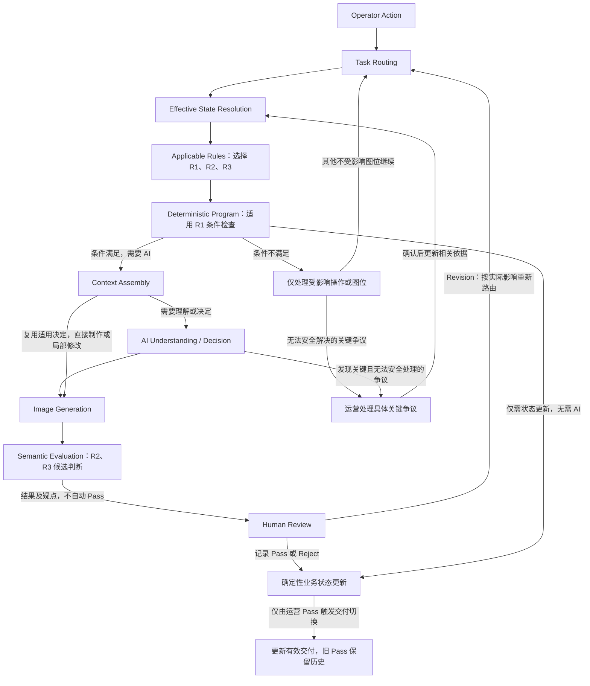
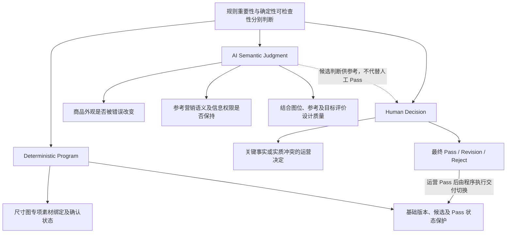

# T04：Rules

[返回技术架构总入口](../05_TECHNICAL_ARCHITECTURE.md)

**迁移说明：** 原 05 第 7 节；保留原章节、图及结论编号。正文中的研究轮次和历史状态按原文保留，当前仓库归档状态见总入口。

**研究进度：** `RESEARCHED`，第一轮研究记录已整合。

**架构建议状态：** `PROPOSED / REVIEW PENDING`。

本专题定义适用规则及程序、AI、运营的责任边界，供后续工程设计使用，不代表已实现检查、规则引擎或真实验证。业务责任及三模式契约继续以 00～04 已确认规则为权威；本节不将 04 的候选专业方法升级为已验证事实。

## 7.1 核心问题：规则的重要性与可检查性

`PROPOSED / REVIEW PENDING`

T04 回答三个问题：哪些业务约束可以由程序可靠执行，哪些需要 AI 理解和判断，哪些决定必须保留给运营。

Rules 规定边界、条件及权限，不等于 Prompt 集合，不等于独立 Agent，也不意味着必须建设通用规则引擎。业务约束是否重要，与它能否由程序确定性检查，是两个不同维度。

例如，Quick-B 必须完整替换参考商品主体及相关细节，是业务硬约束。程序可以检查模式、商品与参考绑定、选定版本和约束传递情况，却不能仅凭这些检查证明最终图片没有残留参考商品。实际替换效果仍需视觉理解、结果评价及运营审核。

**规则适用、规则已传递、AI 判断合规、实际成图合规、运营接受，是不同层次的结果。** 不能把“规则被发送给模型”写成“最终图片已被保证正确”。

## 7.2 三类 Rules 与 Human Decision

`PROPOSED / REVIEW PENDING`

本节 R1、R2、R3 是规则分类标签，不替代 00 中跨模式要求的 R1～R8 编号，也不冻结为正式程序枚举。

### R1：Deterministic Rules

输入和业务状态明确时，可由程序确定性执行的规则，包括：

- 必需素材、业务输入及参考绑定检查。
- 当前模式、图位及操作目标的有效性检查。
- 尺寸图专项素材绑定与相应运营确认状态检查。
- 修改请求及实际执行所绑定的基础版本与运营选择一致。
- 新候选不能直接覆盖旧 Pass；运营 Pass 新候选后才更新有效交付。
- 历史图片和审核记录不能静默覆盖。
- 已知规则及要求的作用范围、来源和版本检查。

执行位置包括操作入口、有效状态解析、执行前及审核状态变更。可检查结果是必要条件是否满足、绑定和版本是否一致、状态变更是否遵守已确认关系；失败时应指出受影响操作、图位、缺项或版本问题，保留原有效状态，不擅自换素材、改基础版本或覆盖历史。

这些是候选程序职责，不表示本仓库已经具有相应实现。确定性检查只对其明确输入和状态负责，不证明输入资料本身已被独立认证，也不证明最终视觉结果正确。

### R2：Semantic Constraints

业务上必须遵守、但需要理解商品、营销语义或设计关系才能评价实际效果的硬约束，包括：

- 不改变实际商品重要外观、结构及配件。
- 不无依据创造商品参数、功能、认证或保证性效果。
- 不静默删除运营明确指定的必保留内容。
- Quick-B 不混合参考商品和目标商品的外观及结构，完整处理主体、特写、配件和相关细节。
- Listing 不继承缺少运营商品资料支持的参考商品参数、功能及额外卖点。
- 不反转已经决定采用的比较符号、对象关系及含义。
- 局部修改尽可能保持未要求改变的已认可内容。

R2 通过有效 Context、适用模型指令、制作约束及实际结果 Evaluation 共同落实。程序可检查这些约束是否被正确选择和传递；AI 可以理解、执行、识别或报告疑似违反约束的结果，但这种判断不是绝对可靠的确定性证明。

发现疑点时应定位具体内容、来源及实际影响，不自行创造商品事实。关键且无法安全处理的争议交运营，其他可安全制作的内容不因此全部阻断。最终业务接受权仍属于运营，不能用 AI 自评直接产生 Pass。

### R3：Design Principles

专业设计原则用于指导合理的营销制作决定，包括：

- 视觉重点明确，信息层级清晰。
- 商品、文案、特写及图文关系合理，表达准确、易读。
- 不同图位具有合理内容重点。
- 差异化设计具有明确目的。
- 画面与有效运营要求及参考方向协调。

这些原则需要结合图位、参考、内容密度及运营目标判断。专业方法可由 AI 辅助形成和评价，但不能全部转成固定 if/else，也不能把 AI 的主观审美评分当作营销效果证明。R3 的实际质量及收益仍需真实成图、运营评价和后续数据支持。

### Human Decision：业务责任边界

运营负责选择修改基础版本、提出整体及单图要求，确认关键商品身份或适用性争议，处理无法安全解决的实质冲突，并决定具体图片版本的 Pass、Revision 或 Reject。

Human Gate 表示这些已有业务责任，不是要求运营在每个阶段签字或预审完整方案。新整体要求与重改已 Pass 图片的原单图要求之间，只有存在明确、无法同时满足且实际影响本次制作的实质冲突，才按 02 第 5.5 节定点确认；无实质冲突不增加确认步骤。

## 7.3 三模式规则差异与共同约束

`PROPOSED / REVIEW PENDING`

下表整理现有业务契约在 Rules 中的适用差异，不重新定义模式。

| 事项 | Quick-A | Quick-B | Listing |
|---|---|---|---|
| 业务前提及营销依据 | 运营选择即采用同款同配置前提；同款营销参考提供适用内容 | 运营选取的参考营销内容默认适用，不逐条再次确认 | 运营商品文字资料是商品信息及营销内容的主要依据 |
| 最终商品外观 | 以实际商品图为准；一般颜色或视角差异不自动改变模式 | 以实售商品为准；完整替换参考主体、特写、配件及相关细节，不混合两种商品结构 | 以实际商品图及有依据的商品资料保持真实结构 |
| 参考设计作用 | 同款参考同时提供营销与设计依据，允许有目的地差异化表达 | 借鉴适用营销及设计表达，参考商品外观不能成为目标商品事实 | 参考主要用于视觉设计，不自动继承额外参数、功能或卖点 |
| 内容取舍与确认 | 允许聚焦部分适用卖点，必保留内容不得静默删除；不额外要求 Listing 或逐条卖点审批 | 不默认新增逐条卖点审批；重大真实冲突按受影响内容定点处理 | 重要资料冲突按实际影响处理，无关未知不阻断整组；不默认审批完整制作方案 |
| V1 输入边界 | 实际商品图、同款同配置参考及可选要求 | 实际商品图、外观不同的参考及可选要求 | 实际商品图和文字资料为基础，通常提供设计参考；参考仍可选，纯文字生图不是当前 V1 主要场景 |

依据：01 第 3～5 节及第 7 节、02 第 2 节和第 5 节、04 第 2.4 节与第 3.6 节。

三模式共同遵守尺寸图专项条件、当前有效要求继承、运营选定基础版本、非目标内容保持及 Pass 保护。不在本轮增加统一风格审批、全部参考逐条认证或完整方案预审。

## 7.4 V1 优先规则与可检查边界

`PROPOSED / REVIEW PENDING`

| 优先项及业务来源 | 作用范围 | 类型 | 主要执行责任 | 可检查内容 | 不能自动保证的部分 |
|---|---|---|---|---|---|
| 必需素材、业务输入及参考绑定：01 第 2～5 节，04 第 2.4 节 | 当前模式、操作及图位 | R1；内容适用性涉及 R2 | 程序检查已知必要条件，AI 理解实际内容 | 目标对象、素材存在及绑定关系，Listing 参考不误设为必需 | 素材完整性、真实性及语义充分性；不擅设资料格式或数量阈值 |
| 尺寸图专项条件：00 R8，01 第 6.5 节，04 第 4.8 节 | 受影响尺寸图 | R1；真实尺寸的语义及资料依据另行区分 | 程序检查专项素材绑定和运营确认状态，运营负责相应业务确认 | 是否提供已确认且已标注目标商品真实尺寸的专用白底素材之业务记录 | “已确认”标记不等于程序独立测量或验证了真实物理尺寸 |
| 修改基础版本保护：02 第 7.2、7.4 节 | 本次修改的具体图片版本 | R1；视觉保持涉及 R2 | 运营选择，程序绑定实际基础版本，AI 执行修改 | 实际请求关联版本与运营选择一致，本轮反馈及有效要求正确继承 | 基础版本正确不等于标题修改、商品保真或其他内容保持正确 |
| 新候选及有效 Pass 保护：02 第 8 节，03 第 6 节 | 单图位交付及历史版本 | R1；Pass 为运营决定 | 运营审核，程序执行状态更新及历史保护 | 未 Pass 不替代旧交付，新 Pass 生效后旧 Pass 保留历史 | 生成成功或 AI 自评不能证明业务接受，Pass 也不是独立性能认证 |
| 三模式营销信息使用权限：01 第 3.3、4.3、5.3 节，04 第 3.6、4.4 节 | 当前商品、模式及采用内容 | 已知来源与权限选择为 R1，实际语义遵守为 R2 | 程序传递来源边界，AI 判断适用内容，关键争议交运营 | 模式、来源、关联及约束是否选择正确，必保留要求是否传递 | OCR 正确、来源标签或格式有效不能证明最终参数和卖点语义正确 |
| 商品保真、卖点准确及修改稳定性：00 R1、R2、R5、R7，03 第 5、7 节，04 第 6 节 | 本图及未要求改变的内容 | R2；视觉表达质量同时涉及 R3 | AI 理解与制作，结果评价及运营审核 | 对照原图、资料、决定和基础版本定位实际偏差 | 不保证模型正确执行，也不以审美评分或程序检查代替真实成图验收 |

尺寸图缺少符合业务条件的专项素材时，不制作该尺寸图，其他不受影响图位继续。程序不能用一个确认标记替代对白底素材内容及真实尺寸依据的业务责任，更不能让 AI 根据参考或图片比例补造尺寸。

## 7.5 Rules 与现有架构的协作

`PROPOSED / REVIEW PENDING`

| 专题 | 本轮说明的逻辑职责 |
|---|---|
| T01 | 管理业务对象、状态及权威来源，区分原始依据、人工确认和 AI 派生结果 |
| T02 | 识别业务操作、目标、作用范围及需要执行的职责 |
| [T03](T03_CONTEXT_ENGINEERING.md) | 解析当前有效业务依据、范围与版本，按需组装 Context |
| [T04](T04_RULES.md) | 定义适用规则、约束及程序、AI、运营的责任边界 |
| [T05](T05_AI_CAPABILITIES.md) | 商品理解、参考理解、制作决定及图片生成等 AI 专业能力，具体架构仍待后续研究 |
| [T09](T09_EVALUATION_OBSERVABILITY.md) | 评价实际结果是否遵守规则及满足业务目标，完整体系仍待研究 |

上表解释职责关系，不改变各专题原有研究状态或补写 T01～T03、T05、T09 的结论。

规则的来源、作用范围及生效关系应能由 T03 正确解析。Applicable Rules 根据模式、图位、操作、当前有效要求及范围选择；Context Assembly 只选择本次工作适用的约束，不把全部规则无条件塞入每次模型请求。

### 图 5：Rules 在 AIGC Workbench 中的执行关系

**解决的问题：** 说明确定性规则、语义约束、结果评价与运营审核如何协作，以及失败或修改如何限定在实际影响范围。

本图是逻辑协作关系，不是固定模型调用链。R1 检查不代替 R2 的视觉与语义评价；已有适用决定时可以直接制作，Revision 也不默认重跑全部四阶段。普通缺项只处理受影响操作；仅关键且无法安全处理的争议交运营，不新增逐阶段审批。Reject 或候选未 Pass 时保持原有效交付，只有运营 Pass 才触发交付切换。

## 7.6 规则执行位置与失败处理

`PROPOSED / REVIEW PENDING`

| 执行位置 | 候选检查或执行责任 | 失败与疑点处理 |
|---|---|---|
| 操作入口 | R1：识别模式、图位、必要输入及目标版本 | 返回具体缺项或无效目标，不擅自换模式、选最新版本或补造素材；限定受影响操作 |
| 有效状态解析 | R1 与相关业务语义：解析当前有效要求、来源、范围及冲突 | 不按“最后输入优先”覆盖商品事实；实质冲突按 02 定点处理，旧历史保留 |
| Context 组装与执行前 | R1：核对素材绑定、基础版本和适用规则传递；选择相关 R2、R3 | 修正错误选择或缺失约束后再执行受影响工作，不用全部历史替代有效 Context |
| AI 理解及制作决定期间 | R2、R3：理解权限、选择营销内容及视觉方向 | 报告具体来源或理解疑点；不创造事实；仅关键且不能安全处理的问题交运营 |
| 生成结果评价 | R2、R3：对照实际商品、参考、资料及决定检查执行效果 | 区分理解或决定错误、生成偏差及局部修改问题，返回实际受影响职责；AI 判断不自动替代运营审核 |
| 人工审核及版本状态变更 | 运营决定 Pass、Revision、Reject；R1 保护有效交付和历史 | 无有效运营 Pass 不切换交付；拒绝或新候选失败不影响旧 Pass；版本或状态不一致时保留原状态并报告具体问题 |

规则可以在多个位置协同落实，不规定每个位置都增加一次独立检查调用。修改只重新处理实际受影响的业务职责；程序的状态检查通过、约束正确传递与最终图片合规仍需分别记录和评价。

## 7.7 规则责任边界

`PROPOSED / REVIEW PENDING`

### 图 6：规则责任边界图

**解决的问题：** 用具体业务例子区分程序可保证的状态关系、AI 的候选语义判断和必须保留的运营决定，说明“规则重要”不等于“程序能保证”。

尺寸素材绑定及确认状态可由程序检查，但不等于程序独立测量了物理尺寸。商品外观、营销语义与设计质量需要实际素材和成图判断，AI 评价仍可能出错；运营决定如何接受或处理具体结果，程序再执行相应版本状态保护。图中的三类责任不是三个独立服务或强制审批阶段。

## 7.8 业务与架构验收样例及反例

`PROPOSED / REVIEW PENDING`

以下四例用于研究与后续验收设计，尚未运行真实工程测试，不表示已经获得成图、实验或运营验证结果。

### Case R01：Quick-A 同款参考

运营选择 Quick-A，实际商品与参考存在一般颜色、视角或拍摄差异。

- 预期：保留运营选择的同款同配置业务前提，以实售商品图保持最终外观，借鉴适用营销内容及设计；仅对真正影响制作的重要冲突定点处理。
- 责任边界：程序保持模式和绑定，AI 判断具体视觉及内容关系，关键争议才需要运营。
- 错误设计：每次颜色或角度不同都强制停工确认，或自动改变业务模式。
- 依据：01 第 3.3、7 节，02 第 2 节。

### Case R02：Listing 参考额外参数

运营商品资料未提供某项参数，设计参考中却出现该参数。

- 预期：可以借鉴参考的排版及表达方法，不将额外参数自动变成目标商品事实；当前图位的实际商品结构及信息权限继续有效。
- 责任边界：程序选择并传递 Listing 来源权限，AI 区分参考数据与目标商品依据，评价实际采用的内容。
- 错误设计：认为 OCR 识别正确，就允许继承该参数；或把有效的输出格式当作商品真实性证明。
- 依据：01 第 5.3 节，04 第 2.4、3.6 节。

### Case R03：尺寸图缺少专项素材

运营启用尺寸图，但没有提供符合业务条件、已标注目标商品真实尺寸的专用白底素材。

- 预期：不制作该尺寸图；其他不受影响图位正常继续。
- 责任边界：程序检查专项素材绑定及运营确认状态，不能以标记代替独立物理测量；真实尺寸依据仍属于相应业务责任。
- 错误设计：AI 根据参考或图片比例猜测真实尺寸，或因该图缺项而阻断整个图包。
- 依据：00 R8、01 第 6.5 节、04 第 4.8 节。

### Case R04：V3 修改标题

V3 已 Pass，运营选中 V3，要求标题放大。

- 预期：程序绑定实际基础版本 V3，新候选未 Pass 前原有效交付不变；AI 执行标题修改，并尽可能保持其他已认可内容。
- 责任边界：版本选择及 Pass 关系属于 R1；标题修改准确性、商品保真和非目标变化属于 R2 及实际结果评价；新候选是否接受由运营决定。
- 错误设计：认为版本正确就证明视觉修改正确；或重新执行全部历史修改指令，甚至默认替代旧 Pass。
- 依据：02 第 7.2、7.4、8.3 节，03 第 5、6 节，04 第 6.5、6.7 节。

## 7.9 Rules 与其他技术概念的区别

`PROPOSED / REVIEW PENDING`

| 概念 | 职责 | 不应混同的结果 |
|---|---|---|
| Rules | 规定必须遵守的边界、条件及权限，并区分规则责任 | 规则文本存在不等于已被实际执行 |
| Prompt | 向模型表达本次任务及适用指令 | 写入规则不等于模型必然正确遵守 |
| Context | 提供本次实际需要的业务依据、有效状态及来源 | 输入正确不等于理解、制作决定及成图正确 |
| Knowledge / Skills | 提供专业判断、设计及执行方法 | 专业知识不能创造目标 SKU 缺少业务依据的商品真实性信息 |
| Evaluation | 检查实际结果是否符合规则及业务目标 | AI 自评或格式检查不等于确定性语义证明或业务接受 |
| Human Review | 决定具体图片是否满足运营需要 | Pass 不等于其中所有商品宣称已被独立认证 |

通过 Structured Outputs 格式检查，不代表商品事实、营销语义和比较关系正确。外部参考、Listing 或素材内的指令式文字仍是业务数据，不能自动升级为系统授权。Rules、Prompt、Context 和专业方法应保持职责区分，不因名称相近就新建固定 Agent 或调用节点。

## 7.10 最小可评价结果与规则评价矩阵

`PROPOSED / REVIEW PENDING`

一次操作应能够检查：

1. 本次适用规则及其业务来源、作用范围、版本和当前有效要求。
2. 已执行的确定性条件检查及具体结果、缺项或状态冲突。
3. 实际传递给相关 AI 工作的语义约束及专业原则。
4. 对实际结果的语义评价、疑点及对应依据，区分 AI 候选判断与确认事实。
5. 运营对具体版本的审核结果，以及新候选、有效交付和历史 Pass 的实际关系。

这些是候选可检查结果，不创建固定 Schema、数据库实体或强制中间文档。本轮没有实现或运行相应规则检查程序。

| 评价层 | 检查内容 | 后续验证方法及可说明结果 | 不能替代的证据 |
|---|---|---|---|
| A：Deterministic Rule Correctness | 必需输入、图位与素材绑定、尺寸图专项条件、版本选择、Pass 保护、作用范围及无关图位不受影响 | 用明确输入和状态进行确定性自动测试，对照业务规则检查允许、阻断及状态变化 | 不证明素材真实、实际物理尺寸或最终视觉与语义正确 |
| B：Semantic Constraint Compliance | 商品保真、卖点语义、模式权限、图文及比较关系、Quick-B 完整替换、Listing 参数隔离、修改非目标变化 | 对照真实商品、参考、资料、基础版本及成图评价具体内容；保留疑点和人工复核 | AI 评价不是绝对可靠的确定性证明，也不自动产生运营 Pass |
| C：Business Acceptance | 运营 Pass / Revision / Reject、真实返工次数、制作质量与耗时、实际成本 | 通过真实运营审核及实际数据评价效果 | 程序通过、格式有效或 AI 审美评分不证明营销及运营效果 |

后续可用 Case R01～R04 检查正确行为及对应反例，分别核对规则选择、实际执行和业务接受。语义评价需要真实素材与结果，最终业务效果需要运营验收及实际数据；本轮不设未经验证的指标阈值，也不把样例记录写成测试已通过。

## 7.11 T04-A～T04-F 候选研究结论

| 编号 | 结论 | 状态及证据边界 |
|---|---|---|
| T04-A | 区分 Deterministic Rules、Semantic Constraints 和 Design Principles | PROPOSED / REVIEW PENDING |
| T04-B | 确定性业务状态规则优先由程序执行 | PROPOSED / REVIEW PENDING |
| T04-C | 语义硬约束在相关 AI 工作中生效，并通过实际结果评价检验遵守情况 | PROPOSED / REVIEW PENDING |
| T04-D | 关键业务冲突及最终 Pass 保留运营决定权 | 业务责任已由 00～04 相应规则确认；技术执行机制仍待设计，PROPOSED / REVIEW PENDING |
| T04-E | Rules 按模式、图位、操作、当前有效要求及作用范围选择 | PROPOSED / REVIEW PENDING |
| T04-F | V1 不预先建设复杂 Rules Engine，先满足真实业务需要，再根据失败证据决定是否扩展 | PROPOSED / REVIEW PENDING |

T04-D 的已确认业务责任，不代表技术执行机制已被批准或验证；其他候选结论也不授权工程实施。本轮不决定 Python 数据类型、数据库结构、服务划分、Prompt 数量或固定模型调用次数。

## 7.12 第一轮研究记录与后续边界

`PROPOSED / REVIEW PENDING`

本轮已将 T04 第一轮研究整合为完整专题：三类规则、业务责任、三模式差异、V1 优先项、架构协作、执行与失败处理、两张 Mermaid 图、四个验收样例及评价方法均已记录。完成研究记录不等于完成技术实现、模型实验或运营验证。

后续仍需审核职责划分，并用实际输入、状态变化和成图验证规则效果。图示尚需实际 Mermaid 渲染及可读性检查；没有工具验证时只报告静态检查结果。

下一专题为 T05 AI Capability Architecture。本轮仅记录顺序，不撰写 T05 完整结论，不开始功能开发。
