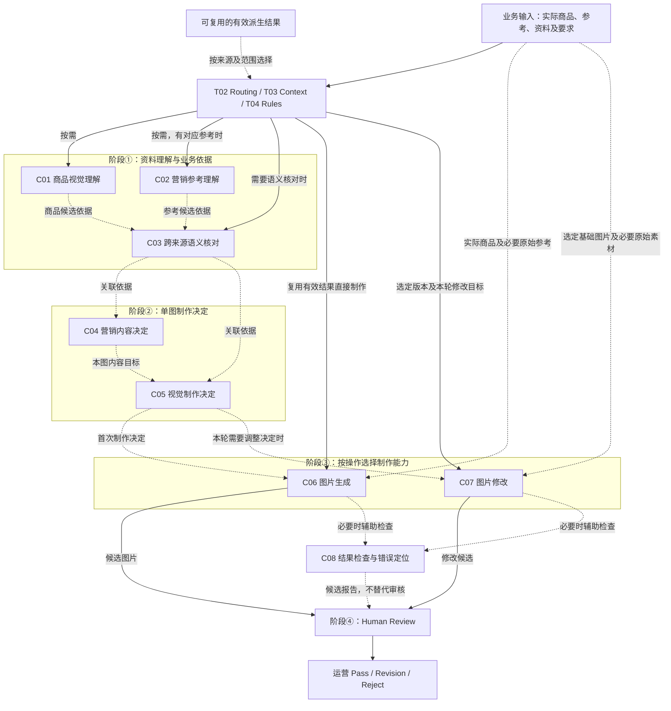
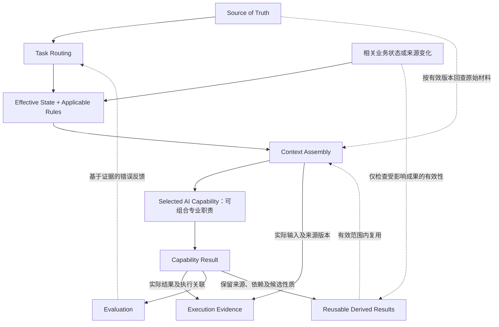
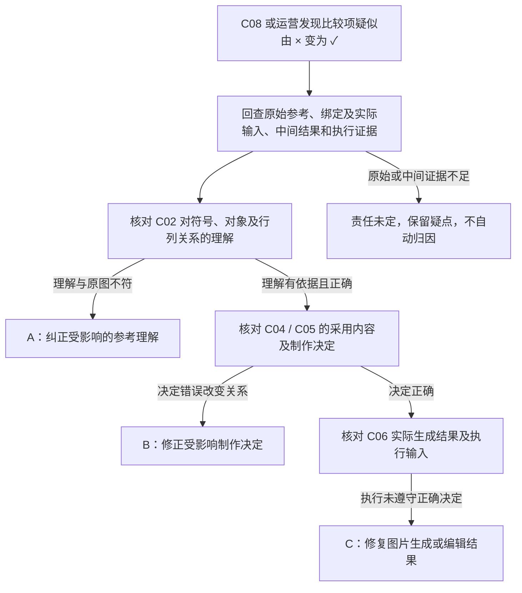

# T05：AI Capability Architecture

[返回技术架构总入口](../05_TECHNICAL_ARCHITECTURE.md)

**迁移说明：** 原 05 第 8 节；保留原章节、图及结论编号。正文中的研究轮次和历史状态按原文保留，当前仓库归档状态见总入口。

**研究进度：** `RESEARCHED`，第一轮研究记录已补全。

**架构建议状态：** `PROPOSED / REVIEW PENDING`。

本节是候选专业能力、输入输出、复用及评价边界的研究记录，供后续工程设计和真实实验参考，不授权开发。三模式信息权限、修改及 Pass 的业务责任仍以 00～04 已确认规则为权威；能力实现、专业方法效果和调用组合尚待验证。

本轮依据现有 00～04、T03／T04 研究及任务提供的能力与案例内容整理。仓库中未发现 `QUICK_A_EXPERT_WORKFLOW_RESEARCH_R02_R07_V0.1.md` 和 `QUICK_A_SINGLE_IMAGE_DECISION_RULES_V0.1.md`，不据其名称补造研究内容，也不从旧仓实现反向决定能力架构。

## 8.1 业务目标与概念区别

`PROPOSED / REVIEW PENDING`

AI 能力架构需要回答：完成商品营销图片制作需要哪些专业能力，如何共享业务依据、传递候选结果、复用已有成果并定位错误；三种模式怎样复用能力；何时值得拆分模型工作，何时可以由强模型直接综合完成。

业务目标是持续保持实际商品、营销内容、参考设计和有效运营要求，改善连续制作与修改的准确性、稳定性及效率。增加能力编号或模型步骤本身不是业务成功。

| 概念 | 含义及关系 |
|---|---|
| Business Stage | 04 定义的业务职责阶段：理解依据、单图决定、制作、人工审核与修改 |
| Capability | 一类可说明职责、输入、候选输出、边界和评价方法的 AI 专业能力 |
| Prompt | 向模型表达本次工作的目标、职责及适用指令，不等于完整能力 |
| Context / Execution Context | 本次执行实际需要的来源、有效状态、约束及上游结果；由 T03 按职责选择，不等于 Prompt |
| Model Call | 一次实际模型执行，可以承担多项能力；同一能力也可能以不同执行组合实现 |
| Agent | 可能的工程组织方式；一次模型调用或一项能力并不自动构成独立 Agent |

**业务阶段 ≠ AI 能力；AI 能力 ≠ Prompt；Prompt ≠ Context；AI 能力 ≠ Model Call；模型调用 ≠ Agent。**

四阶段不等于四次调用，八项能力也不意味着八次调用、八个服务、八个 Agent 或八份永久独立 Context。能力划分首先是职责、输入输出及评价的划分，具体执行方式由后续实验决定。

## 8.2 能力与业务阶段的关系

`PROPOSED / REVIEW PENDING`

| 业务阶段 | 主要相关能力 | 责任边界 |
|---|---|---|
| ① 资料理解与业务依据 | C01 商品理解、C02 参考理解、C03 跨来源语义核对 | 理解与关联均保留来源、权限及不确定性，不独立认证全部商品事实 |
| ② 单图制作决定 | C04 营销内容决定、C05 视觉制作决定 | 为当前图位确定采用内容及呈现方式，不直接生成图片或替运营 Pass |
| ③ 图片生成 | C06 图片生成、C07 图片修改，必要时 C08 辅助检查 | 执行当前制作目标，产生独立候选，生成成功不自动改变有效交付 |
| ④ 人工审核与修改 | 运营 Review 为核心，C08 可以辅助结果检查与失败定位 | 不是自动审批 Agent；运营决定 Pass、Revision 或 Reject |

模型辅助评价、确定性规则检查、运营最终 Pass 是三种不同责任。必要判断可以合并执行，修改也只返回实际受影响职责，不要求重新运行全部能力或全部四阶段。

## 8.3 C01～C08 候选能力地图

`PROPOSED / REVIEW PENDING`

C01～C08 是本轮研究编号，不要求对应旧仓 S1～S6，不冻结代码模块、正式 Schema 或调用节点。以下输出均须保留实际来源及候选性质。

### C01：Product Visual Understanding｜商品视觉理解

**业务阶段：** ①。

**职责：** 理解实际商品主体，识别可见外观、结构、颜色及配件，识别按钮、接口、标识和连接关系；区分可见内容、运营声明、推断和未知，为后续商品保真提供视觉依据。

**主要输入：** 实际商品图片、必要的运营商品身份与配置确认、当前任务相关商品约束。

**候选输出：** 可见商品特征、重要部件及关系、必须保持的视觉特征、当前相关不确定性及对应来源。

**边界：** 不补造不可见结构，不把未拍到理解为不存在，不独立认证商品性能和参数，不将视觉观察升级为运营确认。

**评价重点：** 对照原图检查特征准确性、重要配件遗漏、附件或连接关系混淆及不可见结构编造。

### C02：Marketing Reference Understanding｜营销参考理解

**业务阶段：** ①。

**职责：** 理解参考的文字、数字、单位及符号，营销主题、功能与卖点，图文对应、表格行列和比较关系，商品整体与局部特写关系，以及构图、层级、阅读顺序和设计方法；记录重要歧义。

**主要输入：** 当前绑定的原始营销或设计参考、业务模式、相关运营要求及必要的来源说明。

**候选输出：** 参考营销内容、重要内容与对象关系、营销语义、视觉设计方法、来源及不确定性。

**边界：** 识别参考宣称不等于确认其已独立认证。Listing 参考主要提供设计依据，参考商品参数不能因此升级为目标商品事实；不能只识别孤立符号而忽略所属对象和图例。

**评价重点：** 原始文字、数字、单位、符号、行列和引线关系是否忠实，营销语义是否误读，设计解释是否有画面依据。

### C03：Cross-source Semantic Reconciliation｜跨来源语义核对

**业务阶段：** ①。

**职责：** 按模式理解商品、参考和文字资料的关系，识别实际影响制作的重要矛盾，区分适用性、来源和事实认证，提出必须由运营处理的具体关键问题，并识别可安全继续的内容范围。

**主要输入：** 当前有效商品图、参考、Listing 或其他商品资料、相关运营确认、模式权限及来源关联；可使用来源和版本明确的 C01／C02 结果。

**候选输出：** 当前制作可用的关联依据、重要语义冲突及影响范围、必要的定点确认问题、可安全继续的内容范围。

**边界：** Quick-A 已采用同款同配置前提；Quick-B 选定参考的营销内容默认适用，不逐条重新审批；Listing 以运营商品资料为营销主要依据，不自动继承参考额外事实。C03 不承担全面商品认证，不能用无关未知阻断其他图位。

**评价重点：** 关联判断是否遵守模式权限，冲突是否重要且有来源依据，确认问题是否限于实际影响，是否产生不必要阻断。确定性权限由 T04 规定、有效范围由 T03 解析；C03 只承担需要语义理解的关联和冲突判断。

### C04：Marketing Content Decision｜单图营销内容决定

**业务阶段：** ②。

**职责：** 确定当前图位营销目标，按有效依据选择卖点，区分必保留、重点、辅助、暂不展示及待处理内容，保持数字、单位、比较关系和限定条件，不静默删除运营指定的必保留内容。

**主要输入：** 当前模式的有效营销来源及关联判断、商品依据、图位目标、整体及逐图要求、必保留内容和相关限制。

**候选输出：** 本图营销目标、采用信息、内容重点与优先级、暂不展示内容及必要理由、关键内容约束。

**边界：** 不在本图展示不等于卖点不适用，也不从原始业务依据中删除该信息。C04 不重新认证商品事实，不生成图片，不无依据新增营销承诺。

**评价重点：** 目标是否符合图位和运营要求，取舍是否有依据，必保留内容是否遗漏，数字、比较关系和限定条件是否被改变。

### C05：Visual Creation Decision｜视觉制作决定

**业务阶段：** ②。

**职责：** 决定视觉方向、商品展示与构图、文字及卖点层级、合理背景和场景表达、整体与局部特写关系；明确不可改变的商品和内容约束，形成足以支持实际制作的决定。

**主要输入：** 商品及参考设计依据、C04 营销内容决定或等价的当前内容目标、图位与输出尺寸、有效运营要求、修改场景的基础图片和本轮目标。

**候选输出：** 单图视觉方向、商品与文案的呈现关系、设计借鉴及变化说明、必须保持的约束、当前制作疑点。

**边界：** Quick-A 关注同款营销图差异化改版；Quick-B 同时覆盖主体、特写、配件和相关细节完整替换；Listing 根据商品资料及参考组织营销视觉。不能决定不存在的商品结构，不预设独立全局风格审批。

**评价重点：** 方向是否具体且有参考或运营依据，商品及图文关系是否合理，替换和保真限制是否完整，当前素材能否支持所需呈现。C04／C05 是逻辑能力，不要求分别调用模型。

### C06：Image Generation｜图片生成

**业务阶段：** ③。

**职责：** 使用实际商品素材及必要参考，按当前有效制作决定生成候选图片，尽可能保持商品外观、卖点和设计约束，避免无依据的商品特征及营销事实。

**主要输入：** 实际商品图、必要的原始参考和商品资料、当前有效营销及视觉决定、适用约束、图位和输出尺寸。

**候选输出：** 新候选图片、实际执行关联、模型或工具实际结果及相关错误信息；执行关联以真实执行证据为准。

**边界：** 不预设具体生图模型。生成成功不等于制作正确或运营通过，新候选不自动成为有效 Pass，也不自动成为其他图片的制作标准。

**评价重点：** 实售商品保真、营销内容、参考设计执行、图文关系和商业视觉质量，对照真实输入及实际决定分别检查。

### C07：Image Revision / Editing｜图片修改

**业务阶段：** ③。

**职责：** 以运营实际选中的图片为基础，执行本轮目标，尽可能保持非目标内容，避免重新引入历史错误或参考商品主体，形成独立新候选。

**主要输入：** 选定基础图片、当前有效业务依据、本轮修改目标、必须保持的内容、必要的商品与参考素材。

**候选输出：** 修改候选图片、实际基础版本关联、本次执行证据及相关结果。

**边界：** 不默认使用最新版本，不重放全部历史修改文字，不要求每次重跑全部四阶段；Pass 及有效版本切换属于业务规则和运营责任，不属于 C07 自动决定。

**评价重点：** 实际基础版本是否匹配、目标修改是否实现、商品与未要求改变的内容是否保持、是否出现新错误或参考主体残留。基础版本正确与视觉修改正确分开评价。

### C08：Result Checking / Failure Diagnosis｜结果检查与错误定位

**业务阶段：** ③～④之间的辅助工作。

**职责：** 对照原始依据和制作决定检查候选，识别商品保真、营销文字、比较关系、设计执行、目标修改及非目标变化问题；依据可见证据尝试区分理解、决定和执行错误。

**主要输入：** 具体候选图片、对应商品和参考原始资料、有效要求、实际制作决定，以及修改基础版本、反馈和可用执行证据。

**候选输出：** 可观察错误及对应证据、可能的失败责任位置、候选修复方向、尚不能确定的问题。

**边界：** 可能误判或漏判，不保证所有图片正确，不仅凭最终错误图认定上游责任，不自动替运营 Pass，也不要求固定增加一次评价模型调用。

**评价重点：** 发现的错误是否真实、遗漏和误报有哪些、定位及修复建议是否有来源与中间结果支持；诊断推断与直接观察分开，运营 Review 仍为独立业务责任。

## 8.4 C01～C08 的三模式复用矩阵

`PROPOSED / REVIEW PENDING`

| 能力 | Quick-A | Quick-B | Listing |
|---|---|---|---|
| C01 商品理解 | 以实际商品图识别外观，普通颜色或视角差异不推翻同款前提 | 以实售商品图识别目标外观和配件，不能混入参考商品结构 | 以实际商品图提供外观、结构及配件依据，与文字资料各自保留来源 |
| C02 参考理解 | 同款参考同时提供营销内容、比较关系及设计方法 | 参考同时提供默认适用的营销内容和设计，识别需替换的商品及相关细节 | 参考主要提供视觉设计，不将额外商品参数直接授权给目标商品 |
| C03 语义核对 | 遵守运营已选择的同款同配置前提，定点处理重要实际冲突 | 保持选图默认适用，不逐条再确认；识别真正影响制作的重大冲突 | 以运营资料为营销依据，识别资料与实物的重要矛盾，隔离参考额外事实 |
| C04 内容决定 | 从适用参考营销信息中取舍，保持必保留内容和比较关系 | 从默认适用的参考营销信息中合理取舍，不无依据改写卖点 | 从运营商品资料中按图位取舍，不能用参考参数补全目标商品事实 |
| C05 视觉决定 | 同款营销图差异化表达，保持实售商品及有效设计方向 | 差异化改版并完整处理参考主体、局部特写、配件和相关细节替换 | 根据商品资料与可选参考组织营销内容及真实商品呈现 |
| C06 图片生成 | 执行实售商品、适用营销内容及差异化决定 | 执行实际商品保真、完整主体替换及适用营销约束 | 执行商品资料、实际结构及设计决定，避免无依据功能和参数 |
| C07 图片修改 | 使用选定基础版本、当前有效要求和本轮目标，保持其他认可内容 | 同样遵守版本和有效要求，特别避免修改后重新出现参考商品 | 同样遵守版本和有效要求，保持有资料依据的文字、参数及结构 |
| C08 结果检查 | 检查商品、营销语义、比较关系及设计保持 | 特别检查主体、接口、局部特写及配件是否仍残留参考商品 | 特别检查资料准确性、结构组合及无依据宣称 |

**三模式共用专业 AI 能力，但不共用无差别的营销信息授权规则。** 不建立三套完全重复的 AI 系统，也不预设一个统一 Prompt 足以满足全部模式。

Listing V1 保留实际商品图片和文字资料驱动，设计参考通常提供但仍可选，不以纯文字生图作为当前主要场景。各模式继续遵守尺寸图专项素材条件、有效要求继承及 Pass 保护；能力选择不能绕过这些业务边界。

## 8.5 与其他架构专题的协作

`PROPOSED / REVIEW PENDING`

| 专题 | 与 T05 的逻辑职责关系 |
|---|---|
| T01 Business State / Source of Truth | 保存原始业务输入、运营确认、版本和审核，提供权威业务依据 |
| T02 Task Routing | 根据本次操作、有效状态和影响范围选择所需职责与能力 |
| [T03 Context Engineering](T03_CONTEXT_ENGINEERING.md) | 解析有效来源、要求及版本，按本次 AI 工作需要组装实际执行 Context |
| [T04 Rules](T04_RULES.md) | 定义适用信息权限、语义约束、确定性条件及操作边界 |
| [T05 AI Capability](T05_AI_CAPABILITIES.md) | 承担具体语义理解、专业决定和图片制作，不独立管理商品事实权威 |
| [T07 Tool Integration](T07_TOOL_INTEGRATION.md) | 承接需要外部图片、文件或编辑工具的执行，具体工具仍待研究 |
| [T08 Orchestration](T08_ORCHESTRATION_RUNTIME.md) | 组织实际任务执行、重试与失败恢复，具体机制仍待研究 |
| [T09 Evaluation](T09_EVALUATION_OBSERVABILITY.md) | 评价理解、决定、实际执行和业务结果，不将模型成功等同业务接受 |

T03 提供对应执行 Context，T04 规定适用规则，T05 承担专业执行，T09 评价真实结果。上述均是逻辑职责，不预设分别部署，也不表示 T07～T09 已完成研究或实现。

## 8.6 AI 派生结果的保存、复用与有效性

`PROPOSED / REVIEW PENDING`

| 能力结果 | 候选复用边界 | 需要重新检查适用性的变化 |
|---|---|---|
| C01 | 相同有效商品素材及配置范围内可复用视觉理解 | 商品素材、配置确认变化，或发现原理解错误 |
| C02 | 相同有效参考素材及用途下可复用理解 | 参考版本、用途、绑定关系变化，或发现内容和关系误读 |
| C03 | 相关来源及适用条件未改变时可复用关联判断 | 关键商品资料、参考、模式权限或运营确认变化 |
| C04 | 对应特定图位、营销目标及有效要求的内容决定 | 目标、采用信息、必保留要求或相关业务来源变化 |
| C05 | 对应特定图位、视觉目标、素材和有效要求的制作决定 | 参考、商品展示条件、内容目标或视觉要求变化 |
| C06 | 保存具体生成候选及执行关联供查看、比较和审核 | 不自动成为其他图位的有效决定；新制作按当前有效依据选择 |
| C07 | 保存具体基础版本、本轮目标、修改候选及执行关联 | 更换基础版本、反馈或有效要求时重新判断相关复用范围 |
| C08 | 检查结果对应具体候选版本及评价依据 | 候选图片、核对依据或已知错误变化时检查是否需重新评价 |

可复用结果应保留：原始依据、实际输入及版本、对应能力职责、候选判断性质，以及可能使其不再适用的变化。保存结果不代表永久有效，AI 观察也不自动升级为运营确认事实。

这不要求每个结果独立建立数据库实体。原始素材必要时仍由下游能力直接使用，不由短摘要无依据地替代；变化只检查实际受影响结果，不自动重做整个 Task 或既有 Pass。

## 8.7 能力组合与模型执行策略

`PROPOSED / REVIEW PENDING`

| 候选方案 | 执行思路 | 候选优势 | 风险及待验证点 |
|---|---|---|---|
| A：单次综合执行 | 尽可能在一次或少量调用中完成多项必要专业工作 | 执行结构简单，调用及状态管理少，可能降低延迟和协调成本 | 中间判断不易独立观察，错误来源较难定位，长任务可能遗漏关键约束 |
| B：分阶段执行 | 按实际专业判断拆分工作，形成可观察的理解及制作决定 | 中间判断可独立评价，部分成果可复用，较易区分理解、决定和执行错误 | 调用、成本和延迟可能增加，上游错误仍可能传递给下游 |
| C：按需组合 | 依据任务复杂度、有效已有结果、规则及实际能力评价选择合并或拆分 | 有机会平衡质量、效率和可观察性，复用有效成果，不必完整执行能力序列 | 依赖可靠选择及状态管理，可能增加路由和测试复杂度，收益不能预先保证 |

研究倾向是将 C 作为待验证方向、A 作为基础对照，B 用于比较可观察的分阶段工作。当前不能宣称 C 已被证明最佳，也不能仅因存在八个能力编号就采用八次调用。强模型能否直接综合完成、哪些拆分有实际增益及正式调用拓扑，留给真实实验决定。

## 8.8 三张能力架构图

本节图示均为 `PROPOSED / REVIEW PENDING`，表示业务依赖、来源选择及候选职责，不表示已实现系统或固定模型执行顺序。

### 图 7：AI Capability Map

**用途：** 展示四阶段中的八项能力如何共享依据、按需选用和复用，同时保留原始素材直达制作及运营最终审核。

C01／C02 可按需选用，C04／C05 可合并完成，C06／C07 按首次制作或修改操作选择。虚线表示来源、候选依赖、复用或可选检查，不表示独立调用；已有适用结果时可直接制作。原始图片仍参与实际生成或修改，C08 并非强制额外调用，且不能代替 Human Review。Revision 由 Routing 重新选择受影响职责，不默认重新走完整图。

### 图 8：AI 能力与 Context / Rules / Evaluation 的协作

**用途：** 回答每项能力是否需要永久独立 Context，说明实际执行输入、结果来源、复用及错误反馈的关系。

每次独立模型执行都有对应的 Execution Context，但一次执行可以承担多项能力，多项能力不需要永久各自维护商品事实。派生结果保留原始来源及依赖，由有效状态及变化范围决定能否复用；Evidence 记录实际输入和结果，Evaluation 作出可复核的评价，两者不混同。错误反馈和资料变化不自动授权整组重做，也不自动更改 Pass。

### 图 9：生成失败的责任定位

**用途：** 以 Quick-A 已采用的比较项由 `×` 错成 `✓` 为例，说明为什么必须回查真实依据和中间结果，不能仅凭最终图片归因。

三条路径是可能的责任位置，不是已经完成的独立实验结论。先核对实际来源和输入，再比较理解、决定与成图；若上游已正确，应修复实际制作偏差，而非无限重复理解。缺少中间证据时不强行选定某一路径；修复只涉及相应职责及真实受影响成果。

## 8.9 历史业务案例与责任定位

`PROPOSED / REVIEW PENDING`

下列 Case 编号与能力编号分开使用。Case C01、Case C02 的具体历史失败描述来自本轮任务，仓库未提供与该描述绑定的完整原图、成图及各阶段证据，本轮不声称已独立复核，也不虚构模型实验或关联到未指明的历史 Run。Case C03 的资料及验收状态以 03 为准。

### Case C01：Quick-A 比较关系错误

本轮提供的历史描述是：参考中的某比较关系为 `×`，成图中出现 `✓`。需先核对原图的行列、对象及图例，以及实际执行使用的参考和对应制作内容。

- 若 C02 已误读符号、对象或行列关系，应修正受影响参考理解，再检查其下游依赖。
- 若 C02 理解正确，而 C04／C05 改变已采用的比较内容或表达关系，应修正相应制作决定。
- 若理解与决定都正确，而 C06 把符号制作错误，应优先修复生成或编辑结果。
- 若缺少原图、实际输入或中间结果，只能记录候选原因，不能从最终错误断言哪项能力失败。

04 第 3.4、5.7 节支持图文关系理解与执行偏差的责任区分，但不证明本例已完成独立定位或真实验收。

### Case C02：Quick-B 参考主体残留

本轮提供的历史描述是：目标与参考外观不同，成图的某个局部特写仍保留参考商品接口或配件。03 Case B01 已记录主体替换失败类型，但状态仍是 `PENDING REAL SAMPLE`，缺少完整可复核样本。

应依次核对 C01／C02 是否识别了目标与参考的部件关系，C05 是否覆盖局部替换及相关配件，C06 是否执行了正确替换决定；修改场景再检查 C07 是否重新引入参考主体。

上游理解及决定已经正确且实际输入匹配时，不应无限重新执行商品理解。应针对生成或修改偏差修复受影响部位，随后评价目标商品一致性及非目标变化。当前不能凭残留描述确定唯一责任，也不能宣称已验证修复效果。

### Case C03：Listing 洗车设备

依据 03 Case L01，业务资料为实际商品图、运营商品文字资料及设计参考。已记录内容包括五种喷射模式：0°、15°、25°、40°、泡沫，三档水压、三档水量，以及清洗、浇灌、泡沫等场景；这些是运营案例资料，不代表独立性能检测。

已知风险是错误组合喷壶与水枪，生成不存在的商品结构。应分别检查：

- C01 是否忠实识别实物结构及部件关系。
- C04 是否从运营资料正确选择喷射模式、参数及场景，没有引入参考额外事实。
- C05 是否作出不合理的商品呈现或结构组合决定。
- C06 是否在正确输入及决定下仍生成错误结构。

最终结构错误不能直接证明 C01 失败，必须对照各阶段实际依据。03 的实际验收状态仍为 `NOT TESTED / BUSINESS ACCEPTANCE NOT ESTABLISHED`，本轮不改变此状态或补造最终成图与运营评价。

## 8.10 C01～C08 独立评价矩阵

`PROPOSED / REVIEW PENDING`

| 能力 | 实际输入 | 可检查候选结果 | 核对依据 | 主要失败类型 | 需要人工评价的部分 |
|---|---|---|---|---|---|
| C01 | 实际商品原图、相关身份及配置声明 | 可见特征、配件关系、保持项及未知 | 原始商品素材与明确运营确认 | 编造结构、漏配件、混淆连接或把推断当事实 | 可见关系是否忠实，无法观察的内容是否正确保留不确定性 |
| C02 | 本图绑定的原始参考及用途 | 文字、符号、对象关系、营销语义和设计方法 | 原始参考、图例、行列及指向关系 | OCR 或数字错误、关系错位、语义扩写、无依据设计解释 | 营销与视觉关系的忠实性及重要歧义 |
| C03 | 相关商品、参考、资料、确认及模式权限 | 关联依据、重要冲突、确认问题和可继续范围 | 01／02 权限规则及原始资料 | 越权继承、遗漏关键冲突、把一般未知升级为阻断 | 冲突是否真实重要、确认是否必要且范围适当 |
| C04 | 有效营销依据、图位目标及必保留要求 | 采用内容、重点、暂不展示内容及限制 | 运营要求、商品资料或适用参考 | 丢必保留、改数字含义、无依据卖点、不合理取舍 | 营销重点及信息取舍是否符合运营目标 |
| C05 | 内容目标、商品及设计依据、图位与有效要求 | 视觉方向、商品展示、图文关系及约束 | 原始商品、参考、内容目标和运营要求 | 决定不存在结构、局部替换遗漏、方向偏离、约束不足 | 设计合理性、商品呈现和差异化质量 |
| C06 | 原始素材、当前制作决定、有效约束及尺寸 | 候选图片及实际执行关联 | 实售商品、营销来源、参考和制作决定 | 改形、错参数或比较关系、未执行正确决定 | 真实保真、营销及商业视觉质量，仍由运营决定是否接受 |
| C07 | 选定基础图、有效要求、本轮反馈及必要来源 | 修改候选、基础版本及执行证据 | 实际基础图片、反馈和保持要求 | 基础版本错误、目标未完成、非目标变化、新增商品错误 | 修改是否准确，其他已认可内容是否保持 |
| C08 | 具体候选、原始依据、决定及可用执行证据 | 错误报告、候选责任位置、修复方向和未知 | 原始资料、阶段成果、执行结果及人工核对 | 漏判、误判、无证据归因、修复建议偏离 | 报告是否真实，定位证据是否充分，是否仍有未发现错误 |

各项能力可独立观察和评价，但评价拆分不决定生产执行必须按同样方式调用。JSON 格式正确不等于业务语义正确，AI 自评不等于运营接受；不设置当前尚无真实依据的评分阈值。

## 8.11 第一轮真实实验研究方案

`PROPOSED / REVIEW PENDING`，仅记录建议，本轮不执行实验、不调用付费 API、不生成商品图。

需要研究的问题：

1. 强模型直接综合制作的实际质量如何。
2. 单独商品理解能否改善商品保真。
3. 单独参考理解能否减少卖点和比较关系错误。
4. 单图制作决定能否改善最终图片质量。
5. 分阶段执行能否减少返工。
6. 多次调用实际增加多少成本及延迟。
7. 复用有效理解结果能否提高效率。
8. C08 能否发现真实错误，其漏判、误判及定位质量如何。

建议先固定同一组真实 Quick-A 商品、参考和有效要求，比较：

| 实验候选 | 输入与工作安排 | 主要比较内容 |
|---|---|---|
| 方案 A | 原始商品图、参考及有效要求，直接完成必要综合 AI 工作 | 直接执行质量、实际结果、成本及延迟，作为基础对照 |
| 方案 B | 相同原始业务输入，先形成可评价的商品和参考理解，再形成制作决定并生图 | 中间判断、最终成图、错误定位及返工变化，以及额外成本和延迟 |

条件包括：相同原始业务输入，同样模式权限与有效约束；明确各方案实际模型及执行条件，记录实际输入、输出、耗时和成本；由人工依据原始资料核对商品、营销及设计结果，分别评价阶段性判断与最终成图。

为减少成本，可先仅研究 C01／C02，不强制第一轮完成整套生图。单项理解结果改善不能直接证明最终成图或运营收益改善；方案 C 的按需组合收益也必须另行验证。以上不构成已完成实验、最佳方案或正式调用拓扑结论。

## 8.12 T05-A～T05-G 第一轮候选结论

| 编号 | 候选结论 | 状态及边界 |
|---|---|---|
| T05-A | AI 能力、业务阶段、Prompt、Execution Context 和模型调用分别建模 | PROPOSED / REVIEW PENDING |
| T05-B | V1 先以 C01～C08 建立候选能力地图 | PROPOSED / REVIEW PENDING |
| T05-C | 三模式复用专业 AI 能力，但严格遵守各自营销信息使用权限 | 业务权限已确认；具体能力实现仍待验证，PROPOSED / REVIEW PENDING |
| T05-D | 中间 AI 结果保留来源、依赖及候选性质，在有效边界内复用 | PROPOSED / REVIEW PENDING |
| T05-E | 按需合并或拆分 AI 工作是研究方向，不预设固定调用数量 | PROPOSED / REVIEW PENDING |
| T05-F | 重要能力具有可检查结果，支持独立评价和失败定位 | PROPOSED / REVIEW PENDING |
| T05-G | AI 辅助检查不能代替运营最终 Pass | 业务责任已确认；技术实现尚未完成，PROPOSED / REVIEW PENDING |

业务权限及运营责任已确认，与候选能力是否有效、技术机制是否完成分别管理。上述研究结论不代表工程实现、真实验证或正式架构批准。

## 8.13 第一轮记录、待验证问题与实施边界

`PROPOSED / REVIEW PENDING`

本轮已补全能力职责、阶段关系、三模式复用、来源及复用边界、执行策略、三张架构图、三个案例、独立评价矩阵和实验建议。T01～T04 原有结论及 T06～T09 研究路线保持不变。

后续待验证：C01／C02 的独立理解质量，C03 冲突判断是否避免不必要阻断，C04／C05 对实际成图的增益，C06／C07 的保真和修改稳定性，C08 的漏判、误判及证据支持，以及方案 A／B／C 的质量、复用、成本和延迟差异。历史案例仍需实际输入、中间结果、成图及运营评价形成可复核证据；Mermaid 仍需实际渲染与可读性检查。

本次不决定模型供应商或具体模型、Prompt 模板及数量、固定 S1～S6 工作流、正式 JSON Schema、Python 类或模块、Agent 数量、多 Agent 框架、LangGraph 等 Workflow 技术、Knowledge／Skills 正式组织、图像合成或修图工具、生产 Runtime、自动评价模型及阈值。八个能力编号不授权创建八个目录、Prompt 或独立执行节点。

下一研究专题为 T06 Knowledge / Skills。本轮不开始 T06，也不开展功能开发。
