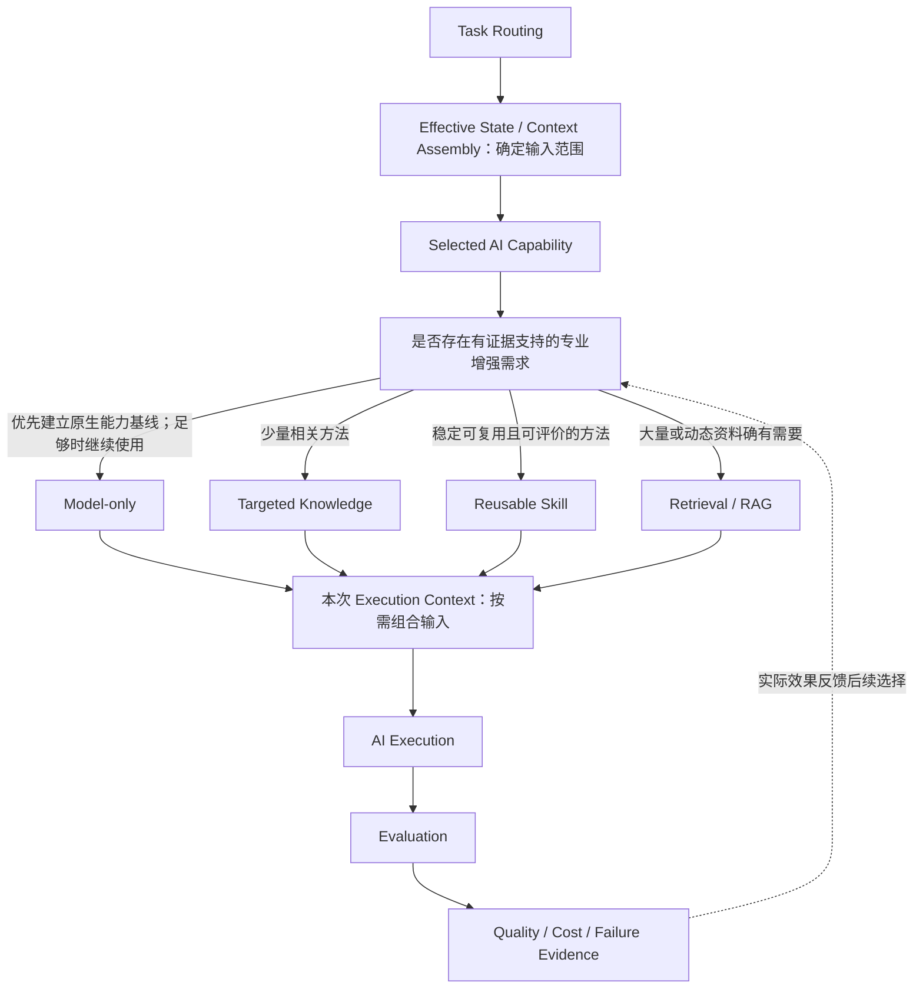
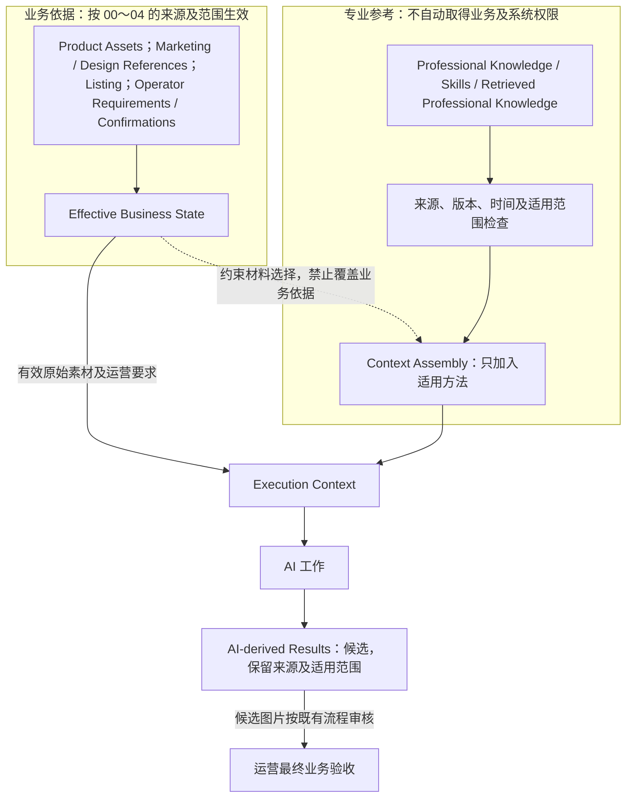

# T06：Knowledge / Skills

[返回技术架构总入口](../05_TECHNICAL_ARCHITECTURE.md)

**迁移说明：** 原 05 第 9 节；保留原章节、图及结论编号。正文中的研究轮次和历史状态按原文保留，当前仓库归档状态见总入口。

**研究进度：** `RESEARCHED`，第一轮研究记录已补全。

**技术设计状态：** `PROPOSED / REVIEW PENDING`。

本节记录专业知识及可复用方法何时值得参与 AI 工作、如何进入本次 Context，以及如何评价收益。业务事实和运营责任继续以 00～04 相应已确认规则为准；候选专业方法不因写入本文而成为已验证事实、强制业务规则或技术实施授权。

## 9.1 研究目标与 Model-first 原则

`PROPOSED / REVIEW PENDING`

本专题需要回答：

1. 在模型已具备多种理解和制作能力的前提下，专业增强还可能解决什么具体缺口。
2. Knowledge、Skills、Retrieval / RAG、Rules、Prompt、Context、Tools 与 Evaluation 分别承担什么职责。
3. C01～C08 中哪些专业能力可能需要知识增强。
4. 何时模型原生能力已足够，无须额外增强。
5. 何时只需少量针对性知识或示例。
6. 何时稳定、重复使用的方法值得形成 Skill。
7. 何时资料规模及变化频率使 Retrieval / RAG 有必要。
8. 专业材料怎样按当前能力需要进入 Execution Context。
9. 怎样避免专业知识覆盖商品事实、模式权限及有效运营要求。
10. 怎样用真实案例证明质量收益，并核对新增复杂度、延迟及成本。

核心候选原则：**Model-first, Knowledge on demand, Evidence-driven.**

- 首先用模型原生能力建立基线，不先假定必须补充知识或 Skill。
- 根据真实失败定位专业能力缺口，不把所有制作错误都归因于缺少知识。
- 只在存在具体需要时补充相关知识或方法。
- 通过真实案例评价目标错误、成图或判断质量，以及耗时和成本变化。
- 不因为某项技术存在，就要求业务必须使用。
- 不提前建设完整 Knowledge Base、RAG 或通用 Skill Runtime。

该原则是 `PROPOSED` 技术方向，不表示模型原生能力已经满足所有任务，也不表示增强方案已经被证明有效。

## 9.2 概念与职责边界

`PROPOSED / REVIEW PENDING`

| 概念 | 职责与示例 | 权限或效果边界 |
|---|---|---|
| Rules | 规定业务条件、权限和约束，例如 Listing 参数来源、尺寸图专项条件、新候选与 Pass 保护 | 已确认业务规则按其来源和范围生效，不能由专业建议替换 |
| Knowledge | 提供商品摄影、结构观察、复杂表格关系、营销内容组织、视觉层级、排版、编辑及合成知识 | 帮助理解和选择方法，不证明某个 SKU 必然具有通用类别中常见的功能、附件、认证或性能 |
| Skills | 提供输入、输出和目标明确、可复用的专业工作方法，例如复杂比较营销图解读 | 方法仍为候选，不能保证执行结果正确，也不获得改写商品事实及运营要求的权限 |
| Retrieval / RAG | 从大量或动态资料中检索当前任务需要的信息，例如指定平台规范、目标市场广告资料或相关设计方法 | 不等于必须建设向量数据库；资料少且稳定时直接提供可能更合理；检索命中不等于有效业务授权 |
| Prompt | 说明本次工作目标、职责及适用的规则和方法 | 不等于 Knowledge Base，也不保证模型正确执行 |
| Context | 为一次执行组织有效业务依据、必要约束、专业资料及上游结果 | Knowledge 或 Skill 可以是其中一部分，不默认加载全部材料 |
| Tools | 实际读取或处理图片、生成或编辑图像、提取主体、排版文字和图表、存储或导出文件 | Skill 可描述工具使用方法，但不等于工具已执行或执行成功 |
| Evaluation | 检查模型及专业增强是否改善实际任务 | 增加 Knowledge 或 Skill 本身不构成质量提升证据 |

候选“复杂比较营销图解读 Skill”可以描述以下方法，而不在本轮创建实际 Skill：

1. 识别参与比较的对象。
2. 判断表格行、列、标题和单元格关系。
3. 识别图例、符号及所属对象。
4. 标出模糊单元格和不能确定的关系，不猜测填充。
5. 保留关键数字、单位、限定词及相关条件。
6. 对照原始参考核对理解结果。

这些步骤是否改善 C02，仍需与模型原生理解对照，不要求运营新增逐步骤审批。

## 9.3 Knowledge 的来源与权威边界

`PROPOSED / REVIEW PENDING`

| 信息性质 | 来源及用途 | 权威边界 |
|---|---|---|
| A：Product / Business Truth | 实际商品素材、运营商品资料、有效要求及运营确认，构成相应业务依据 | 按 00～04 的模式权限和作用范围使用，不把业务声明或 Pass 视为独立性能认证 |
| B：Professional Knowledge | 行业设计、营销表达、商品摄影和图片制作知识，帮助理解、判断和表达 | 提供方法或候选判断，不能自行改变目标商品事实或运营要求 |
| C：AI-derived Results | 模型基于业务材料及专业知识形成的观察、分析和制作建议 | 保留候选性质、来源及适用范围，不自动升级为运营确认 |

**Professional Knowledge 不是 Product Truth。** 通用资料说明某类洗车机常见五种喷射模式，不能证明目标商品具备这些模式。03 中洗车设备案例的相应营销信息依据是运营提供的具体商品资料，而不是对商品类别的推断。

参考营销图仍按三模式既有权限参与，不能因“专业资料”标签改变其来源性质。不应把运营没有要求的额外商品规格凭通用知识补入最终图片，也不能借专业知识补造不可见结构、配件、认证或真实尺寸。

以上是逻辑来源区分，不建立新的事实认证系统，也不冻结正式状态枚举。

## 9.4 C01～C08 的专业增强映射

`PROPOSED / REVIEW PENDING`

| 能力及模型基础职责 | 可能需要的专业知识或方法 | 候选引入条件 | 不可突破的边界 |
|---|---|---|---|
| C01：识别可见结构、配件、标识及关系 | 商品摄影与视角、光线反光和材质表现、结构部件识别方法、可见内容与推断的区别 | 真实案例反复出现结构或部件理解错误，且证据支持主要缺口在专业识别方法 | 不能凭知识创造不可见结构或把类别常识当作目标商品事实 |
| C02：理解营销内容、文字、符号、图文关系及设计 | 复杂比较表结构、数字与单位关联、箭头和特写对应、视觉层级及信息设计 | 优先研究复杂比较图的关系理解；先确认错误确在理解而非决定或生成 | 不用正确 OCR 代替关系理解，不擅自反转图例和比较含义 |
| C03：跨来源关联与重要语义冲突判断 | 适用性判断、营销宣称语义范围、变体及配置差异识别方法 | 真实冲突识别存在遗漏或误判，且需要语义方法帮助 | 遵守 Quick-A 同款前提、Quick-B 默认适用和 Listing 资料权限，不新增逐项确认 |
| C04：确定本图营销目标及内容取舍 | 卖点排序、特征与消费者利益表达、信息密度和可读性、不同图位的内容组织 | 原生内容决定出现有证据的重点或组织问题，再比较针对性方法 | 不能静默删除必保留信息，也不能以通用营销知识创造商品承诺 |
| C05：形成视觉方向、商品展示与图文关系 | 视觉层级、构图与信息组织、主体及特写呈现、色彩对比留白、阅读顺序和电商设计原则 | 优先评价模型原生设计判断，再验证专业方法是否改善真实决定及成图 | 不默认认定设计 Skill 提升商业视觉质量，不覆盖有效运营要求 |
| C06：按有效决定制作候选图 | 商品视觉保真、图像合成及制作、文字与图表精确表达方法 | 定位执行问题后比较知识是否有帮助；若模型无法精确制作数字或复杂图表，优先研究 T07 的工具能力 | 不以无限增加生成知识代替工具与执行能力研究，不把生成成功当作正确 |
| C07：基于选定版本执行本轮修改 | 局部修改、非破坏性编辑、素材复用与局部合成、修改范围及非目标变化控制 | 基础版本和有效要求正确后，研究实际局部执行方法是否改善稳定性 | 仍由 T03 确保真实基础版本、当前要求和反馈，不重放全部历史或自动改 Pass |
| C08：检查结果及定位错误 | 商品保真、图文对应、数字参数和比较核对、前后差异分析、错误分类及修复判断 | 已有真实失败可供人工核对，评价方法能否减少漏判、误判及无依据归因 | AI 自评不是运营 Pass，专业检查方法也不保证发现全部错误 |

**每项能力可能使用专业 Knowledge，不代表每项能力必须拥有独立 Skill。** 本轮不创建八个 Skill、固定增强节点或对应代码目录。

## 9.5 三模式的专业知识使用差异

`PROPOSED / REVIEW PENDING`

| 模式 | 重点考虑的专业方法 | 信息权限与业务边界 |
|---|---|---|
| Quick-A | 同款商品保真、参考营销解读、设计方法提取、适用卖点取舍及有目的的视觉差异化 | 不用专业知识重新质疑已选择的同款同配置前提，不把全部参考卖点变成逐项审批 |
| Quick-B | 参考与实售商品的结构差异、主体和特写完整替换、配件及相关场景细节、营销表达迁移 | 选图默认营销内容适用，不逐条再确认；不混入参考商品结构，重大实际冲突定点处理 |
| Listing | 商品资料理解、卖点组织、图文及视觉表达、真实结构与营销内容一致性 | V1 由实际商品图和运营文字资料驱动；参考通常提供但仍可选，主要用于设计；不继承无依据的参考商品事实，不以纯文字生图为当前主要场景 |

三模式可复用专业知识和方法，但不得突破各自信息权限。实际商品素材仍提供最终外观依据，运营明确必保留内容、尺寸图专项条件、有效要求继承及 Pass 保护继续生效。

## 9.6 何时采用 Model-only、Knowledge、Skill 或 Retrieval

`PROPOSED / REVIEW PENDING`

| 情况 | 候选选择 | 需要满足或核对的条件 | 选择边界 |
|---|---|---|---|
| A：原生能力足够 | Model-only | 原始业务输入、有效约束和当前能力基线足以完成目标 | 不为了技术完整性增加专业增强 |
| B：缺少少量判断方法 | 简短 Targeted Knowledge 或示例 | 有具体缺口，少量相关材料可直接说明方法并可评价 | 不必额外建设 Skill 系统或检索平台 |
| C：稳定且重复使用的方法 | 研究 Reusable Skill | 方法有重复价值，输入输出明确，目标可评价，额外步骤有实际收益 | 方法仍需验证，不保证执行结果，也不要求每项能力各一个 Skill |
| D：资料规模较大 | 研究 Retrieval / RAG | 无法合理完整提供，每次需要不同片段，并有来源和适用范围管理需要 | 不预设向量数据库；知识少且稳定时直接提供可能更合理 |
| E：资料经常变化 | 研究带来源、时间及条件的检索 | 明确指定的平台、市场、地区和时间范围，核对资料是否仍适用 | 未验证、过期或不适用资料不自动升级为发布规则，不自动抓取全部平台 |
| F：理解正确但制作失败 | 排查 C05、C06／C07 及 T07 工具能力 | 回查实际决定和执行输入，判断问题发生在决定、生成或编辑 | 不默认继续堆叠 Knowledge / Skills |

这些是按实际需要选择的候选方式，不是全任务固定互斥的四种 Runtime，也不是强制串行增强链。不同 AI 工作可以选用不同方式，适用的知识、Skill 和检索材料也可组合；应由真实失败与收益证据决定取舍。

## 9.7 按需参与与 Execution Context

`PROPOSED / REVIEW PENDING`

| 专题 | 与 T06 的逻辑协作 |
|---|---|
| T02 Task Routing | 识别本次 AI 工作、目标和实际影响范围 |
| [T03 Context Engineering](T03_CONTEXT_ENGINEERING.md) | 解析有效业务状态，选择商品依据、要求、规则及必要专业材料，组织实际执行 Context |
| [T04 Rules](T04_RULES.md) | 规定信息权限、业务条件及不可突破的约束 |
| [T05 AI Capabilities](T05_AI_CAPABILITIES.md) | 承担本次语义理解、专业决定及制作工作 |
| [T06 Knowledge / Skills](T06_KNOWLEDGE_SKILLS.md) | 仅在需要时提供相关专业增强，不独立管理商品事实或代替 Rules |
| [T09 Evaluation](T09_EVALUATION_OBSERVABILITY.md) | 对比增强前后的质量、错误、输入规模、延迟及成本 |

专业材料参与时，应保留来源、版本或时间、用途与适用范围，并按本次能力需要组织。检索命中的材料仍需核对其来源和当前适用性，不能因为存在“平台规范”或“专业 Skill”字样就获得更高业务权威。

T03 将选中的材料与原始商品依据、有效要求和必要上游结果共同组织成实际 Execution Context，保留本次使用情况供回查。资料后续变化不静默改写历史执行。专业方法可进入当前指令及上下文的适用部分，但外部资料本身不取得改变业务规则或系统行为的权限。

不要求独立 Knowledge Agent、通用 Skill Runtime 或每次固定增加一次检索／模型调用。本节只说明候选职责及材料选择，不决定服务、数据库、消息格式或调用数量。

## 9.8 两张 Knowledge / Skills 架构图

两图均为 `PROPOSED / REVIEW PENDING`，表示按需增强与权威边界，不表示已实现的知识平台或执行链。

### 图 10：Knowledge / Skills 按需参与架构

**用途：** 说明先建立模型原生能力基线，再根据真实缺口选择专业增强，并将实际质量和成本反馈到后续技术取舍。

Model-only 不加载专业增强；其他候选材料可按任务组合，不要求整个 Task 固定选择唯一路径。前部确定输入范围与后部形成实际 Context 属于 T03 的逻辑工作，不表示两次独立模型调用。Knowledge、Skill、Retrieval 不是每次必经节点，不存在默认 Knowledge Agent，评价结果也不自动证明增强方案更好。

### 图 11：业务事实与专业知识的权威边界

**用途：** 区分业务依据路径和专业参考路径，说明专业材料可以辅助执行，却不能覆盖商品事实、有效要求或取得系统授权。

Marketing / Design References 属于业务参考，按 00～04 的三模式权限使用；检索得到的专业知识提供适用方法，不与业务参考混为一类。专业资料通过来源和适用范围检查参与 Context，但不成为目标 SKU 的事实证明，也不改写有效运营要求。AI 派生成果保持候选性质，不自动成为运营确认。资料中的指令式文本仍按业务数据或专业参考处理，不能改变系统访问权限和行为。图中的运营验收对应已有图片审核，不新增上游阶段审批或自动 Pass。

## 9.9 历史案例、失败定位与反例

`PROPOSED / REVIEW PENDING`

沿用 T05 已记录的历史失败描述及 03 的案例状态。本轮没有对应原图、成图和阶段成果的完整独立复核，也未运行知识增强实验；下列分析是待验证的责任定位及技术选择，不是已确认根因。

### Case K01：Quick-A 复杂比较图

历史描述为参考比较关系 `×` 在成图中变为 `✓`。先核对实际参考、对象、行列、图例、输入和中间结果，再区分：

| 可能失败位置 | 需要核对的证据 | 候选处理方向 |
|---|---|---|
| A：C02 参考理解错误 | 原图关系与实际 C02 结果是否一致 | 可测试针对性表格解读 Knowledge 或可复用方法，检查关系理解是否改善 |
| B：C04 制作决定错误 | 理解已正确，但内容决定是否错误改变比较含义 | 修正信息取舍和语义保护，不把问题默认归为缺少 C02 Skill |
| C：C06 图片生成错误 | 上游理解及决定正确，实际成图是否仍错误生成符号 | 研究生成能力或 T07 精确文字和图表工具，不无限增加理解知识 |

不能看到最终符号错误就认定必须新增 C02 Skill。缺少真实输入或中间证据时保留责任未定，不宣称增强已经有效。

### Case K02：Quick-B 参考商品残留

历史描述为实售商品与参考外观不同，成图某个局部特写仍保留参考商品接口或配件。需要分别核对：

- C01 是否识别错目标商品或相关部件。
- C02 是否遗漏参考商品的局部特征及关联。
- C05 是否没有覆盖完整主体、特写、配件及相关细节替换。
- C06 是否未执行正确的替换决定。

若上游理解和决定已正确、实际执行输入也匹配，继续堆叠商品知识可能无效，应检查图像执行及 T07 工具能力边界。03 Case B01 仍缺少完整可复核样本，状态为 `PENDING REAL SAMPLE`；本轮不虚构已定位或已修复结果。

### Case K03：Listing 商品营销图

依据 03 Case L01，洗车设备案例已有运营商品文字资料、实际商品图及设计参考背景。资料包含五种喷射模式、三档水压、三档水量和清洗、浇灌、泡沫等场景，已有风险包括错误组合喷壶与水枪结构；这些不是凭通用知识补出的规格。

应研究模型能否直接组织营销内容，原设计参考是否足以指导画面，专业视觉方法能否改善 C04／C05 决定，以及增强是否反而引入额外商品事实幻觉或错误结构组合。实际问题仍须区分理解、决定及生成执行，不能只看到错误结构就判定缺少商品知识。

事实来源及验收状态以 03 为准，仍为 `NOT TESTED / BUSINESS ACCEPTANCE NOT ESTABLISHED`。本轮不新增成图评价、独立性能验证或业务接受结论。

## 9.10 主要风险与控制原则

`PROPOSED / REVIEW PENDING`

| 风险 | 可能表现 | 候选控制原则 |
|---|---|---|
| Product Truth Contamination | 将行业常见配置或知识建议升级为目标商品事实 | 保留来源及信息性质；专业材料只提供方法或候选判断，不无依据补参数、功能及附件 |
| Operator Intent Override | 设计 Skill 自动覆盖运营要求或必保留内容 | 专业原则按实际任务使用，不转为无条件硬规则；不能擅自修改已确认要求 |
| Prompt / Context Pollution | 每次加载大量无关知识和方法，引入相互干扰的指令 | 由本次能力及任务选择必要材料，不默认加载全部知识或 Skill |
| Prompt Injection / Untrusted Sources | 检索资料、图片或外部文档中的指令式文字改变业务规则、权限或系统行为 | 区分业务数据、专业参考及真正授权的执行指令；外部文本不自动取得系统指令权限 |
| Unverified Improvement | 系统复杂度增加，但质量不变或引入新误判 | 通过同一真实任务的对照和人工核对判断收益，不用模型自评宣布成功 |

例如，某方法建议每张图最多三个卖点，不能自动覆盖运营明确要求展示四个卖点的决定。这是专业建议与业务要求的权威边界示例，不新增“三个卖点”的业务限制或审批环节。

## 9.11 Knowledge / Skills 增强评价

`PROPOSED / REVIEW PENDING`

| 维度 | 需要回答的问题 |
|---|---|
| Baseline Quality | 不加专业增强时，原生能力在真实输入上表现如何 |
| Enhanced Quality | 加入知识或方法后，哪些具体判断或实际结果改善 |
| Error Reduction | 被定位的目标错误是否减少 |
| New Errors | 是否新增误判、遗漏、事实幻觉或过度阻断 |
| Source Integrity | 是否正确区分商品事实、专业知识和 AI 候选结果 |
| Context Cost | 输入规模是否明显增加，新增材料是否与任务相关 |
| Latency | 实际执行时间及额外检索或步骤是否增加 |
| Monetary Cost | 实际模型和检索成本如何变化 |
| Business Acceptance | 运营是否更容易接受实际结果，返工是否改善 |

候选对照方案：

| 方案 | 输入及方法 | 适用条件 |
|---|---|---|
| A：Model-only Baseline | 原始业务输入、有效约束及当前模型，不添加专业增强 | 先建立可核对的原生能力基线 |
| B：Targeted Knowledge | 在 A 的基础上加入针对目标缺口的简短专业知识 | 有具体缺口，少量知识可直接提供 |
| C：Reusable Skill | 使用输入输出及目标明确的专业步骤和检查方法 | 稳定、重复使用的方法确有评价和复用价值 |
| D：Retrieval | 在必要时检索适用专业资料，并保留来源及条件 | 资料规模或动态变化确有检索需求 |

不要求四种方案全部执行，第一轮可以只比较 A 与 B。使用同一真实业务输入、同样权限及可比较执行条件；由原始素材和人工评价建立核对依据，记录实际耗时、成本、输入规模和错误变化，不让模型自行宣布增强方案更好，也不提前设置未经验证的阈值。

中间判断改善、最终成图质量及运营接受分别评价。如果目标能力没有改善，不能仅因未来已经投入 Skill 开发就继续保留其复杂性。以上仅为实验建议，本轮未执行模型实验、检索、付费调用或商品图制作。

## 9.12 V1 实施边界与开发工具 Skill 的区别

`PROPOSED / REVIEW PENDING`

以下不作为 V1 前置条件：完整专业 Knowledge Base、企业级 RAG、大规模向量数据库、通用 Skill Registry、Skill 自动发现和复杂调度、知识图谱、知识驱动的通用多 Agent 系统、为 C01～C08 分别开发固定 Skill、自动抓取全部平台规范，以及未经实际验证的专业 Prompt 集合。

架构只预留专业材料按需参与的位置。具体实现由真实能力缺口及实验收益决定，不因本节分类而创建知识库、Skill 文件、Prompt 模板、Agent 或 Runtime 框架，也不决定正式模型调用次数。

**开发工具的 Skill 机制与产品 Runtime 能力必须区分。** Codex 等开发工具已有的 `SKILL.md` 机制，不等于 AIGC Workbench 未来的运行时 Skill 能力；不能因开发工具支持 Skill，就宣称产品已拥有相同的发现、调度或执行能力。

## 9.13 T06-A～T06-G 第一轮候选结论

| 编号 | 候选结论 | 状态 |
|---|---|---|
| T06-A | 采用 Model-first，仅在实际能力缺口获得证据支持时考虑专业增强 | PROPOSED / REVIEW PENDING |
| T06-B | Knowledge、Skills、Retrieval、Rules、Prompt 和 Tools 分别承担不同职责 | PROPOSED / REVIEW PENDING |
| T06-C | 专业知识提供方法，不无依据生成目标商品事实，也不擅自覆盖运营确认 | BUSINESS CONSTRAINT CONFIRMED / TECHNICAL DESIGN PROPOSED |
| T06-D | 专业材料由 T03 按当前任务及能力需要组织，不默认全部加载 | PROPOSED / REVIEW PENDING |
| T06-E | 根据资料规模、任务特点及验证效果选择少量知识、可复用 Skill 或 Retrieval | PROPOSED / REVIEW PENDING |
| T06-F | 用真实案例比较增强前后的正确性、返工、延迟及成本 | PROPOSED / REVIEW PENDING |
| T06-G | V1 不提前建设完整 Knowledge Base、RAG 或通用 Skill 调度系统 | PROPOSED / REVIEW PENDING |

T06-C 的业务约束依据 00 R7、01 的模式权限、02 第 4 节及 04 第 11.3 节；相应技术选择与执行机制仍为 `PROPOSED / REVIEW PENDING`。本轮所有候选方案均未获得工程实现、真实验证或业务接受的结论。

## 9.14 第一轮研究记录与后续专题

`PROPOSED / REVIEW PENDING`

本轮已完整记录 Model-first 原则、八类概念、三类来源权威、C01～C08 映射、三模式差异、技术选择矩阵、按需参与机制、两张 Mermaid 图、三个案例、五类风险及对照评价方案。研究记录完成不等于增强收益已经验证。

| 后续专题 | 与本节的关系及边界 |
|---|---|
| [T07 Tool Integration](T07_TOOL_INTEGRATION.md) | 研究图片生成、局部编辑、主体复用及文字图表工具；理解正确而执行失败时优先检查工具和制作能力，不无限增加 Skill |
| [T08 Orchestration & Runtime](T08_ORCHESTRATION_RUNTIME.md) | 后续研究任务执行、状态、重试、恢复及工具组织；本节不提前设计复杂 Skill 调度引擎 |
| [T09 Evaluation & Observability](T09_EVALUATION_OBSERVABILITY.md) | 后续研究统一评价，本节增强对照可作为候选场景，不代表评价体系已完成 |

待验证事项包括：原生能力基线是否足够，真实失败是否确属专业方法缺口，少量知识或稳定方法是否改善目标错误，是否引入事实污染及意图覆盖，以及收益是否足以抵消输入规模、延迟、成本和复杂度。案例仍需原始输入、中间结果、成图及人工评价支持；两图仍待实际渲染和可读性检查。

下一专题为 T07 Tool Integration。本轮不开始 T07，不提前补全 T08／T09，不开展代码、知识库或 Skill 实施。
