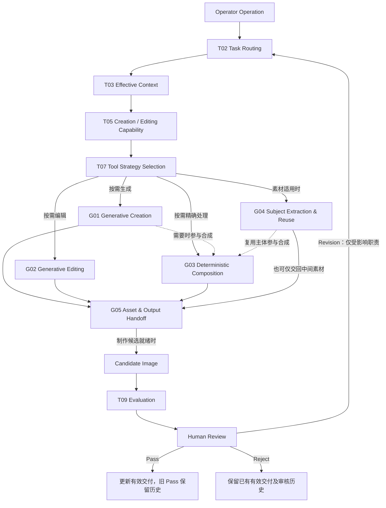
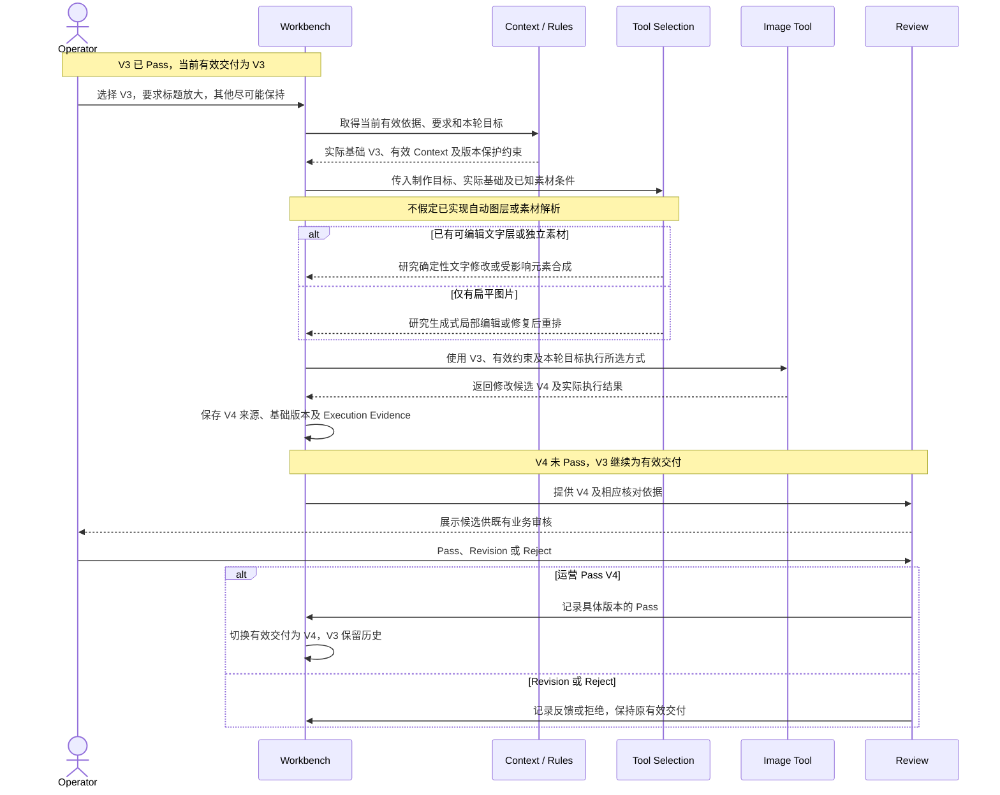
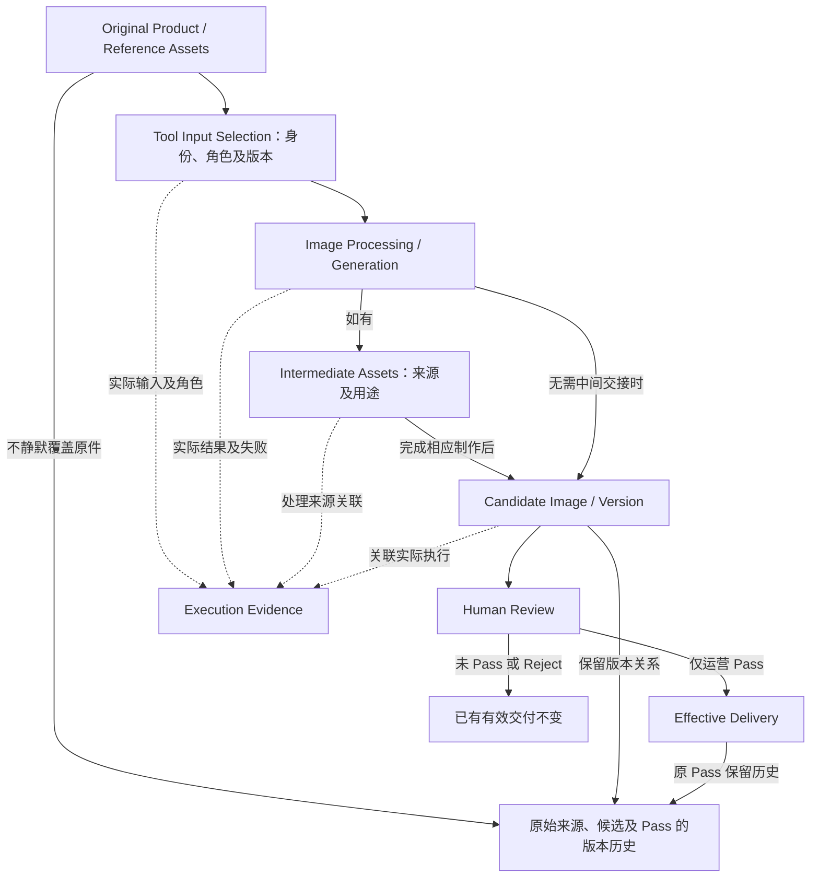

# T07：Tool Integration

[返回技术架构总入口](../05_TECHNICAL_ARCHITECTURE.md)

**迁移说明：** 原 05 第 10 节；保留原章节、图及结论编号。正文中的研究轮次和历史状态按原文保留，当前仓库归档状态见总入口。

**研究进度：** `RESEARCHED`，第一轮研究记录已补全。

**技术设计状态：** `PROPOSED / REVIEW PENDING`。

本节研究在商品、参考、运营意图和制作决定明确后，如何选择、组合和交接实际制作工具，尽可能准确完成图片并支持可控修改。能力地图、制作策略、契约、图示和实验均为研究建议，不表示已实现工具接入、自动素材解析、生成能力或实际业务收益。

## 10.1 业务目标与工具责任

`PROPOSED / REVIEW PENDING`

图片制作不能等同于一次生图模型调用。理解和决定正确后，实际制作仍可能改变商品、配件、文字及比较关系；“其他不变”的指令也不构成非目标区域必然保持的证明。需要分别评价制作决定、实际工具执行及运营接受。

本专题回答：何时生成新图、何时局部编辑、何时复用真实主体、何时采用确定性文字或图表处理；扁平图片与可编辑成果对修改有何影响；如何提供正确素材与 Context，记录实际输入、输出和失败，并比较质量、延迟、成本及运营返工。

核心候选原则：**AI Capability 与 Tool Capability 解耦。** T05 定义需要完成什么专业工作，T07 研究采用什么工具或组合方式完成。不规定 `C06 = 固定某个生图 API` 或 `C07 = 固定某个编辑 API`。

工具选择依据当前制作目标、原始素材条件、商品保真要求、文字及图表精度、修改区域、视觉质量、成本、延迟和实际可行性。本轮不冻结供应商或技术栈，也不因分类而创建固定 Tool Agent 或执行链。

## 10.2 G01～G05 候选工具能力地图

`PROPOSED / REVIEW PENDING`

G01～G05 是研究编号，不代表五个服务、Agent 或固定执行节点。工具成功与结果合规、运营 Pass 分开管理。

### G01：Generative Image Creation｜生成式图片制作

**职责：** 支持 C06 生成新候选，创作营销场景、背景及视觉元素，实现新构图或较大视觉改版，服务 Quick-A／B 差异化设计及 Listing 营销视觉。

**主要输入：** 实际销售商品图、必要参考、当前有效制作决定、商品与营销约束、输出尺寸及制作条件。

**主要输出：** 候选图片、工具实际结果、对应输入及执行记录。

**局限与风险：** 商品结构和配件变化、参考主体误入、文字数字及符号失真、营销语义改变、视觉方向偏离。图片成功生成不等于业务正确，不能仅靠 Prompt 承诺完全避免偏移。

### G02：Generative Image Editing｜生成式图片编辑

**职责：** 支持 C07 根据现有图片及本轮要求产生新候选，改变背景、场景、对象或局部内容，并尝试保持未修改内容。

**主要输入：** 运营实际选定的基础图片版本、本轮反馈、当前有效业务约束、必要商品与参考素材，以及可用时的编辑区域或蒙版。

**主要输出：** 修改候选、实际基础版本及输入关联、工具结果与相关错误信息。

**局限与风险：** 非目标区域、商品细节或其他文字可能被重绘，编辑边界可能偏移，也可能引入新的事实及设计错误。**生成式编辑的 Mask 不应默认视为严格像素级修改边界。** 已读取的 [OpenAI 图像生成与编辑官方说明](https://developers.openai.com/api/docs/guides/image-generation)将相关蒙版描述为编辑引导，不能保证完全遵循其形状；具体模型和工具的控制效果仍需分别实测，不将一个工具的说明泛化为所有工具的保证。

### G03：Deterministic Image Processing & Composition｜确定性处理与合成

**职责：** 研究裁剪、缩放、格式转换、多素材叠加、精确文字排版、表格及符号绘制、指定位置对象处理，以及已有可编辑元素的确定性修改。

**主要输入：** 明确的真实素材、正确的文字或表格数据、位置及布局条件、必要字体、可用蒙版或图层、输出要求。

**主要输出：** 处理或合成结果、必要中间成果及实际执行关联。

**候选价值：** 对明确且可操作的输入提供更可控的处理，例如绘制 `0° / 15° / 25° / 40°`，保留已决定采用的比较项 `×`，或调整独立文字层的标题字号。

**局限与风险：** 正确绘制不等于正确设计；输入数据错误时程序仍会绘制错误内容。缺少合适素材、蒙版或图层时不能保证完成复杂编辑，简单覆盖文字可能破坏背景及布局；合成仍需处理透视、边缘、光影与视觉协调。本轮不决定使用 Pillow、Sharp、Photoshop 或其他工具。

### G04：Product Subject Extraction & Reuse｜真实商品主体提取与复用

**职责：** 研究从实际商品图提取主体、保留真实结构及配件，将其用于新视觉设计，按需组合前景、背景及局部素材，减少不必要的商品重新生成。

**主要输入：** 实际商品原始素材及来源、可用视角和部件依据、当前呈现目标及必要区域信息。

**主要输出：** 主体或局部提取成果、来源及用途关联、后续制作可用素材和实际处理结果。

**候选价值：** 有机会减少真实细节变化，分开处理商品与场景，并支持部分局部修改和可控合成。

**局限与风险：** 边缘、透明、反光及复杂结构可能提取不佳，新场景的光影和透视仍需协调。遮挡区域没有真实信息时不能凭空还原；缺少某个原始角度，不代表可以安全生成真实的新角度。主体复用是否改善保真必须对照评价，不设为所有图片的强制方式。

### G05：File & Asset Operations｜文件素材及成果交接

**职责：** 获取正确输入，区分商品、营销参考、设计参考、基础图片及临时素材角色，保持身份和来源，交接必要临时文件，将候选结果交回系统，支持保存及后续处理。

**主要输入：** 当前操作的素材身份、版本、角色及使用边界，以及工具实际返回的结果和必要中间成果。

**主要输出：** 可供工具使用的实际输入、交回的候选或中间成果、输入输出关联及可追溯信息。

**局限与边界：** T01 定义业务对象与版本权威，T07 定义工具素材及结果交接，T08 后续负责执行生命周期与失败恢复。G05 不决定 Pass，不因文件已保存就改变有效交付，也不自行冻结存储布局或永久保留全部临时文件。

## 10.3 三种候选图片制作策略

`PROPOSED / REVIEW PENDING`

| 策略 | 候选制作方式与适用范围 | 可能优势 | 主要风险及条件 |
|---|---|---|---|
| A：Generative-first | 商品图、参考、制作决定和有效要求进入生成工具；研究首次制作、新场景、大构图改版及复杂视觉创意 | 流程较简单，创意自由度较高，不必预建完整图层或合成系统 | 商品细节、文字及复杂关系可能出错，局部修改可能影响其他内容 |
| B：Hybrid Generation & Composition | 生成场景或背景，复用实际商品主体，确定性绘制关键文字及比较图表，再合成协调 | 有机会加强主体和关键信息控制，减少数字符号错误并支持部分定点修改 | 依赖抠图及素材条件，需处理遮挡、光影和融合；复杂度和成本增加，不一定适合每图 |
| C：Editable Composition | 尽可能保留独立商品、背景、标题、卖点文字、表格图标等可修改元素 | 已有可编辑文字可直接调整，部分修改不必整图重新生成，影响范围可能更可控 | 需可编辑素材或中间表示，生产维护成本可能增加；生成图不一定能可靠拆成正确图层，创意场景也未必能简单元素化 |

**扁平 PNG/JPEG 不会因为接入编辑工具，就自动拥有可编辑文字层和商品层。** 只有扁平图时，仍可能需要局部修复、背景重建、文字重排或重新制作；不能假设接入某工具就能精确编辑任意元素。

三种策略可组合，例如先生成场景，再复用商品并精确排版，最后保留部分可编辑元素。但这不是 V1 强制流程。建议先建立 Generative-first 的真实业务基线，再依据明确失败证据评价混合及可编辑策略，不预设后两者优于基线。

## 10.4 工具选择与架构协作

`PROPOSED / REVIEW PENDING`

| 专题 | 与 T07 的逻辑职责关系 |
|---|---|
| T01 | 定义业务对象、素材及版本身份、当前有效交付和历史关系 |
| T02 Task Routing | 识别首次生成、选定版本修改、新增图位、重新制作、审核及 Pass 等操作和影响范围 |
| [T03 Context Engineering](T03_CONTEXT_ENGINEERING.md) | 选择有效商品依据、参考、制作决定、要求、实际基础版本与本轮目标，组织执行 Context |
| [T04 Rules](T04_RULES.md) | 提供适用信息权限、业务条件、工具操作及版本保护约束 |
| [T05 AI Capability](T05_AI_CAPABILITIES.md) | 定义需完成的专业工作，例如 C06 生成或 C07 修改候选，不绑定单一工具 |
| [T06 Knowledge / Skills](T06_KNOWLEDGE_SKILLS.md) | 必要时提供专业制作方法，不因执行失败就无限增加知识，也不代替工具实际能力 |
| [T07 Tool Integration](T07_TOOL_INTEGRATION.md) | 按目标及素材条件选择候选工具方式，执行或交接制作操作及实际结果 |
| [T08 Orchestration](T08_ORCHESTRATION_RUNTIME.md) | 后续研究执行组织、状态、等待、重试、取消及恢复，不在本节冻结机制 |
| [T09 Evaluation](T09_EVALUATION_OBSERVABILITY.md) | 评价实际制作质量、修改准确性、返工、延迟及成本 |

T07 不替代 T03 组装 Context，不自行修改运营要求，不将工具成功转为 Pass。组合工具不等于需要自主决策的 Tool Agent，各项逻辑职责也不要求分别部署。

## 10.5 Tool Execution Contract：最小逻辑契约

`PROPOSED / REVIEW PENDING`

以下是候选职责约定，不是正式 JSON Schema、API 或代码类型。

| 类别 | 应明确的信息 |
|---|---|
| Operation | 生成、编辑、合成、排版或素材处理 |
| Target | 本次 Task、Image Slot 或指定图片版本 |
| Input Assets | 实际参与执行的素材及版本 |
| Asset Roles | 实售商品、营销参考、设计参考、基础图片、临时素材等角色 |
| Creation Intent | 当前制作目标及必要的实际制作决定 |
| Constraints | 必须保持的商品、营销和设计约束及适用范围 |
| Edit Scope | 修改目标、基础图片及应保持内容 |
| Output Conditions | 输出尺寸、格式及其他实际条件 |
| Tool Identity | 实际使用的工具、模型或处理方式及可取得的版本信息 |
| Execution Result | 实际结果、失败信息及必要成果 |
| Evidence | 实际使用的素材、指令、配置与输出关联 |

工具调用成功只说明完成相应技术执行，不证明业务内容正确。即便图像 API 支持多张输入图，也不能据此假定它天然知道哪个是真实商品权威、哪个只是设计参考；资产角色及业务权限由 Workbench 应用层提供和检查。

执行证据记录实际可取得的输入、结果与关联；无法取得的信息保留未知，不捏造工具内部采用情况或版本。请求中包含约束与素材，也不等于最终图片已正确遵守。

## 10.6 三模式及多轮修改的工具使用差异

`PROPOSED / REVIEW PENDING`

| 模式或操作 | 目标与候选工具方向 | 主要风险及检查重点 |
|---|---|---|
| Quick-A | 同款参考差异化改版，保持实售商品及适用营销内容；研究生成式改版、真实主体复用、精确文字与比较关系处理及必要局部编辑 | 参考商品外观覆盖实售商品、卖点或比较关系改变、差异化不足或过度；一般颜色与视角差异不自动改变模式 |
| Quick-B | 参考营销内容默认适用，完整替换参考商品；研究整体替换、相关区域编辑、主体配件和特写复用，以及必要合成或重新制作 | 主体替换而局部残留、配件接口混合、结构失真或修改后参考商品再次出现；不新增逐条卖点确认 |
| Listing | 实际商品图和运营文字资料驱动，通常结合仍可选的设计参考；研究创意生成、真实主体保真、精确参数图表排版及局部修改 | 参数被改写、无依据参考参数进入成图、结构错误组合，或文字准确但设计不足；参考主要用于视觉设计 |
| 修改选定版本 | 实际基础图片、当前有效要求和本轮目标共同决定工具方式；根据已知可编辑元素、独立素材或仅有扁平图的条件选择 | 不默认最新版本、不重放全部历史；检查目标修改与非目标变化，新候选未 Pass 前不替代原交付 |

三模式共享商品事实和版本保护规则，但可选择不同工具组合。缺少符合业务条件的专项白底尺寸素材时，不制作该尺寸图，不用生成或合成工具猜尺寸，其他不受影响图位继续。

## 10.7 真实案例、候选比较与待验证假设

`PROPOSED / REVIEW PENDING`

以下保留 03 的来源及验收缺口，四个案例不等于已经完成的工具对照实验；Case 编号也不等于同编号 G 工具能力的实现记录。

### Case G01：Quick-A 同款商品改版

03 Case A01 记录黑色实售汽车电路测试仪及蓝色主体营销参考。制作须保持黑色商品和实际配件，借鉴参考营销主题及设计方法，有目的地差异化，不编造或改变性能。

候选 A 是直接生成式制作；候选 B 是真实商品主体复用与背景、文字合成。比较商品保真、营销信息保持、视觉质量、人工修改轮次、成本及延迟，不预设 B 更好。03 的该链路最终成图验收仍为 `NOT_TESTED`，本轮未新增任何成图或运营评价。

### Case G02：Quick-B 主体完整替换

以目标商品 A 与参考商品 B 表示当前输入角色，不虚构具体 SKU 或已有完整实验。目标是同时替换主体、局部特写、配件和相关细节。

候选比较包括整体生成、局部生成式编辑、主体提取合成及必要混合方式。逐项检查主商品、特写中是否仍有 B、配件是否混合、场景结构是否真实，以及缺少实售商品角度时是否无法安全完成某种呈现。

03 Case B01 仍为 `PENDING REAL SAMPLE`，缺少完整可复核输入、输出及人工评价；本例用于后续检验保真和替换完整性，不宣称任何工具已经解决问题。

### Case G03：Listing 洗车设备营销图

03 Case L01 的运营资料包含五种喷射模式：0°、15°、25°、40°、泡沫，三档水压、三档水量，以及清洗、浇灌、泡沫等场景；已记录风险是喷壶与水枪错误结构组合。

研究生成工具完成场景和设计、确定性工具处理关键数字及图表、真实素材保持商品结构的组合是否减少错误，同时评价是否新增视觉融合问题、成本或维护负担。上述参数依据运营案例资料，不是由通用商品知识或参考额外参数补入。

具体事实与验收状态以 03 为准，仍为 `NOT TESTED / BUSINESS ACCEPTANCE NOT ESTABLISHED`，不虚构已完成生成及人工评价。

### Case G04：V3 → V4 标题修改

验收场景为 V3 已 Pass，运营选中 V3，要求标题放大、其他内容尽可能保持。按素材实际条件比较：

| 素材条件 | 候选处理方式 | 必须核对的限制 |
|---|---|---|
| A：已有可编辑文字层 | 修改字号及必要布局 | 文字层、字体及可编辑条件实际可用，不能假定任意扁平图已有文字层 |
| B：仅有扁平 PNG/JPEG | 研究生成式局部编辑，或清除原文字后重新排版 | 可能需要修复背景及布局；蒙版不自动保证非目标像素保持 |
| C：商品、背景及文字已有独立素材 | 修改受影响元素后重新合成 | 需要可用素材及正确关联，仍需检查融合与非目标变化 |

评价标题是否改变、商品结构、背景及其他卖点是否保持、有无新增文字或布局问题，以及 V4 未 Pass 前 V3 是否仍为有效交付。版本正确性是 T01／T04 的候选程序责任；视觉编辑正确性由 T07 实际能力与 T09 评价检验，两者不能相互替代。这里不声称仓库已有图层解析或相应编辑功能。

## 10.8 文件资产角色与版本关系

`PROPOSED / REVIEW PENDING`

| 文件角色 | 内容与交接要求 | 与业务权威和历史的关系 |
|---|---|---|
| Original Assets | 实售商品图、营销及设计参考、运营资料；保留来源并关联任务及相应版本 | 加工结果不静默覆盖原件，不改变各类素材的业务权限 |
| Intermediate Assets | 抠图、蒙版、裁剪、合成中间结果及其他临时制作素材；记录来源和用途，保留必要调试证据 | 不升级为原始商品事实，不要求所有临时文件永久保存 |
| Candidate & Editable Outputs | 生成、修改候选，以及存在时的可编辑成果；关联实际执行、图位、基础版本及新版本 | 不覆盖历史有效版本，可编辑成果的存在和正确性均需核对 |
| Effective Delivery | 运营 Pass 确定的当前有效交付版本 | 不能因工具成功、文件保存或 AI 自评自动产生；新 Pass 生效后旧 Pass 保留历史 |

素材身份、访问权限、来源、完整性和结果交接是后续设计要求。本轮不决定本地或 NAS 目录、对象存储供应商、数据库类型、文件服务技术栈和图层格式；T07 不代替 T01 的版本权威或 T08 的执行生命周期管理。

## 10.9 执行限制、失败处理与 Evidence

`PROPOSED / REVIEW PENDING`

| 风险或限制 | 候选处理及证据要求 |
|---|---|
| Generative Drift | 对照商品、参考、资料和制作决定评价实际偏移，不仅凭 Prompt 承诺无变化 |
| Edit Scope Drift | 检查目标修改与非目标变化；保留基础图、反馈及实际编辑条件，不假定蒙版是严格像素边界 |
| Flat Image Limitation | 先核对真实素材条件；没有图层时研究修复、重排或重做，不假定所有元素均可精确编辑 |
| Subject Fidelity Risk | 检查结构、边缘、遮挡、透视、配件与光影；提取、复用和合成都不是自动保真证明 |
| Text & Symbol Error | 对照原始业务数据检查数字、文字、图标和复杂关系，研究更可控方式但不把错误输入画成正确事实 |
| Tool Failure & Recovery | 记录格式、权限、大小、超时或供应商错误及可取得成果；保留具体失败信息，重试、取消和恢复机制留给 T08 |
| Third-party Data Boundary | 核对素材传给第三方时的使用权限、隐私、数据处理条件和成本，不能因支持上传就忽略既有边界 |

Evidence 应能关联实际输入身份与角色、基础版本、使用的指令和可取得配置、实际工具或模型信息、输出及失败结果。临时成果按实际需要保留来源和调试关联，不把所有中间文件永久保留作为前置条件。

技术执行失败与内容执行错误分别记录。理解或决定正确而制作出错时，优先处理受影响制作；发现上游依据或决定有误时返回相应职责，不默认重做整个图包。工具失败、新候选失败或未通过不覆盖旧 Pass，不在本节擅自规定自动重试策略。

## 10.10 三张工具集成架构图

以下均为 `PROPOSED / REVIEW PENDING`，表示候选职责、条件选择和状态关系，不表示已经实现的工具、素材自动解析或固定调用链。

### 图 12：Tool Integration Architecture

**用途：** 说明 AI 制作职责怎样按实际条件选择及组合工具，并通过素材交接、评价和运营审核形成候选及交付。

分支按目标及素材条件选择，不要求 G01～G04 全部依次执行，也不设置强制优先级。G04 中间素材不自动成为成图候选；G05 交接后，只有实际制作候选进入相应审核。Evaluation 不要求额外固定模型调用，工具成功不直接产生 Pass，Revision 返回实际受影响职责。

### 图 13：V3 → V4 修改工具选择时序图

**用途：** 展示同一标题修改怎样依据已有素材条件选工具，并保护选定基础、执行证据及当前交付版本。

图示为候选成功路径和业务状态关系，不是运行测试；具体失败信息按 10.9 节保留，执行恢复留待 T08。工具选择不新增人工预审，素材条件需基于实际可取得记录或核查，不能把未实现的自动解析当作已验证能力。实际基础版本正确仍不保证视觉修改正确。

### 图 14：Asset Lifecycle & Evidence

**用途：** 区分资产身份、实际执行证据、候选版本和业务有效交付，说明原件保护及可选中间成果的来源关系。

文件存在、执行完成和当前交付有效是不同状态。中间素材可选，保留必要追溯不等于永久保存所有临时文件；原始输入、候选及 Pass 的版本关系不能静默覆盖。图不决定实际目录、存储技术或 T08 生命周期实现。

## 10.11 T07 Evaluation

`PROPOSED / REVIEW PENDING`

| 维度 | 评价重点 |
|---|---|
| Product Fidelity | 实售商品外观、结构及配件是否保持 |
| Marketing Accuracy | 卖点、参数及营销语义是否准确 |
| Text / Diagram Accuracy | 文字、数字、符号、图文及比较关系是否正确 |
| Edit Target Success | 本轮目标修改是否实现 |
| Non-target Changes | 未要求改变的区域或内容是否变化 |
| Visual Quality | 构图、光影、边缘、融合及可读性 |
| Tool Reliability | 实际技术错误、失败情况及后续恢复表现 |
| Execution Traceability | 实际输入、配置、结果及版本能否回查 |
| Operator Effort | 真实人工修改、核对及返工情况 |
| Latency & Cost | 实际执行耗时、工具费用及组合成本 |

三层评价分别成立：

- **Pixel-level Evaluation：** 对原本要求严格保持的像素或区域检查变化，需要明确基础、范围和制作条件。
- **Semantic Evaluation：** 检查商品结构、营销内容、设计语义及重要视觉关系；像素不同不一定业务失败，像素变化很小也不能保证商品事实正确。
- **Business Acceptance：** 运营对具体版本作出 Pass、Revision 或 Reject；AI 自评、工具成功和程序差异检查不能代替业务接受。

后续评价使用真实素材与实际生成或编辑结果，记录明确制作条件、可比较策略、人工核对依据和真实成本耗时。不编造成功率、质量阈值或工具收益；本轮未进行相应图像实验。

## 10.12 后续真实实验方向

`PROPOSED / REVIEW PENDING`，仅记录候选，不在本轮执行。

| 实验 | 候选对照及目标 |
|---|---|
| Experiment G01 | Quick-A 直接整体生成与真实商品主体复用，比较保真、营销保持及视觉质量 |
| Experiment G02 | Quick-B 整体生成、局部编辑及主体合成，比较主商品与局部特写、配件的完整替换 |
| Experiment G03 | Listing 关键数字和比较符号的生成式绘制与确定性排版，比较语义准确及实际设计融合 |
| Experiment G04 | V3 标题修改的生成式局部编辑与可控编辑策略，按真实素材条件比较目标变化和非目标保持 |

各实验同时记录实际返工、视觉质量、延迟及成本，使用已有真实业务素材和可比较条件，不为研究虚构商品案例，也不要求一次开展全部实验。缺少输入、角度或可编辑素材时如实记录限制，不假设工具可以还原未知商品信息。

## 10.13 官方资料与研究证据纪律

`PROPOSED / REVIEW PENDING`

官方资料核对日期：2026-11-04。以下仅支持工具操作及能力边界说明，不构成 Workbench 已接入、已经实测或具有业务收益的证明，不冻结实际 API、版本、供应商及技术栈。

| 资料 | 本轮可支持的有限说明 | 核对状态与限制 |
|---|---|---|
| [OpenAI：Image generation](https://developers.openai.com/api/docs/guides/image-generation) | 文档描述图像生成、参考图及蒙版编辑；蒙版引导不保证严格遵循形状 | 已读取官方正文；具体任务的保真及编辑范围仍待实测，不选定模型 |
| [Pillow：ImageDraw](https://pillow.readthedocs.io/en/stable/reference/ImageDraw.html) | 在指定位置绘制文字和几何图形的文档能力 | 已读取官方正文；不证明自动获得正确数据、优秀布局或商品保真 |
| [Sharp：Compositing images](https://sharp.pixelplumbing.com/api-composite/) | 组合图像及位置、混合等处理的文档能力 | 已读取官方正文；不证明真实素材边缘、透视和光影自然融合 |
| Adobe Photoshop 官方文字与图层编辑资料 | 作为后续可核对的资料类别，不据搜索摘要确定具体 API 能力 | EXTERNAL VERIFICATION PENDING：本轮正文访问失败，未据此记录具体接口或版本能力 |

已有引用保持原样；新增能力或版本说明必须实际核对官方资料，无法核对时保留 `EXTERNAL VERIFICATION PENDING`，不编造链接或操作能力。官方文档支持某种操作，与项目实际效果、独立商品事实及运营接受分别管理。本轮没有调用生图或编辑 API，没有生成图片、运行图像对照实验或新增依赖。

## 10.14 T07-A～T07-G 第一轮候选结论

| 编号 | 候选结论 | 状态 |
|---|---|---|
| T07-A | AI Capability 与具体工具解耦，图片制作不等于单次生图模型调用 | PROPOSED / REVIEW PENDING |
| T07-B | V1 以 G01～G05 研究生成、编辑、确定性处理、主体复用及文件交接能力 | PROPOSED / REVIEW PENDING |
| T07-C | 工具选择依据制作目标、素材条件、准确性及商品保真要求 | PROPOSED / REVIEW PENDING |
| T07-D | 工具执行明确输入资产角色、输出身份及实际 Evidence | PROPOSED / REVIEW PENDING |
| T07-E | 局部修改优先研究受影响内容的可控处理，不默认每次整图重生成 | PROPOSED / REVIEW PENDING |
| T07-F | 原始素材、临时成果、候选版本及有效交付分开识别 | PROPOSED / REVIEW PENDING |
| T07-G | 生成式、混合或可编辑元素策略的取舍，需要真实质量、返工、延迟及成本对照 | PROPOSED / REVIEW PENDING |

上述是候选架构原则，不表示技术实现、真实验证或业务接受；已确认的商品权限和 Pass 关系仍依据 00～04。

## 10.15 第一轮研究记录、待验证事项与边界

`PROPOSED / REVIEW PENDING`

本轮已记录工具能力、三种制作策略、逻辑契约、三模式与修改差异、四个案例、资产及证据关系、执行风险、三张图示、评价及实验建议。完整研究归档不等于工具策略已被证明有效。

待验证内容包括：实际商品与参考角色传递、生成和编辑保真、蒙版及非目标变化、主体提取和合成融合、精确文字图表、扁平及可编辑素材下的修改效果、工具可靠性和真实成本。Adobe 文档细节、三图实际渲染及案例的完整实验和人工评价仍待补证。

本轮不决定正式生图供应商、必须采用 Photoshop／Pillow／Sharp、开发图层编辑器或抠图服务、固定多工具链或 Tool Agent、图像 API Schema、素材存储技术栈、统一图层格式、队列与异步框架、自动图片验收标准、固定模型调用次数或 Python 目录结构。

下一专题为 T08 Orchestration & Runtime。本轮不开始 T08，不提前补全 T09，不开发任何工具、Prompt、Agent、存储或 Runtime。
