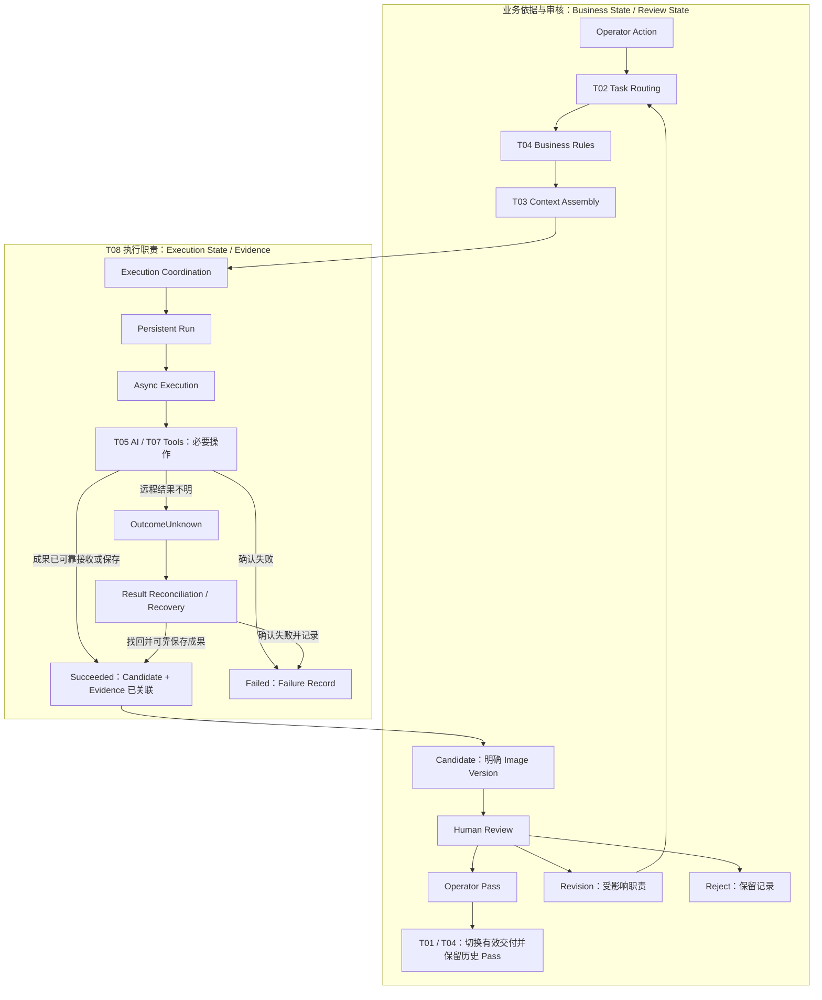
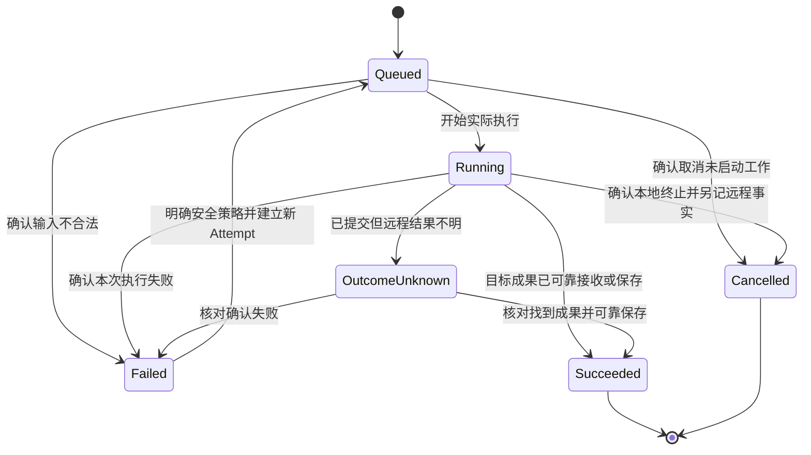
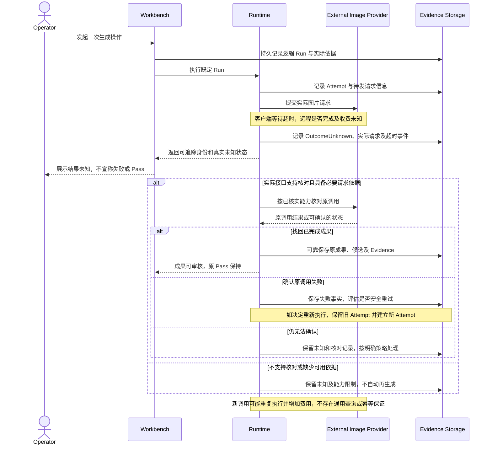
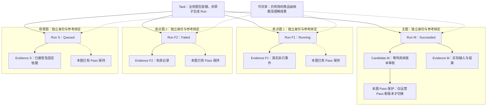

# T08：Orchestration & Runtime

[返回技术架构总入口](../05_TECHNICAL_ARCHITECTURE.md)

**迁移说明：** 原 05 第 11 节；保留原章节、图及结论编号。正文中的研究轮次和历史状态按原文保留，当前仓库归档状态见总入口。

**研究进度：** `RESEARCHED`

**架构建议状态：** `PROPOSED / REVIEW PENDING`

本节是第一轮候选研究记录，尚未实施、进行真实故障实验或获得正式架构批准。下文的职责、逻辑对象、状态、图示、测试和实现方向均按此状态理解；00～04 中已确认业务规则的权威及适用范围不变。

## 11.1 业务背景、技术目标与核心原则

运营发起商品营销图制作后，模型与工具可能长时间运行，也可能部分成功、超时或中断。浏览器关闭、后台进程重启、多个图位同时执行、运营更新要求或审核不同版本，都不能成为丢失真实状态、混用参考或覆盖有效交付的理由。

T08 回答的是：怎样可靠组织实际执行，并在失败、重试、并发及人工审核过程中保持业务状态和历史版本正确。重点包括启动与排队、页面之外的执行、结果持久保存、远程结果未知、重复操作及费用风险、服务恢复、运行时依据一致性和真实事件回查。执行成功率不能替代图片正确性或运营接受。

候选核心原则：**Persistent Execution + Controlled Recovery + Business State Isolation**，状态为 `PROPOSED`：

- 执行有稳定身份和可持久追踪的状态，能回查输入、成果及失败。
- 根据错误性质和已有结果决定恢复，不把所有异常变成重新生成。
- 执行状态不决定运营审核和 Pass；图位执行及候选结果相互隔离。
- 真实执行依据固定且可追溯，不静默混入后来更新的要求。
- V1 优先满足最小可靠执行，不预设通用 Agent、自主规划循环或复杂 Workflow 平台。

这些原则服务三模式，不能重新定义信息权限：Quick-A 仍以实际商品图保持外观、使用同款营销参考；Quick-B 仍按运营选定参考默认适用的营销信息制作并完整替换目标商品主体及细节；Listing V1 仍由实际商品图片与运营文字资料驱动，设计参考通常提供但可选。Runtime 不将 Listing 改成仅凭文字生成，也不增加逐卖点或整套方案的强制预审。

## 11.2 Business、Execution 与 Review 的状态边界

| 状态视角 | 描述的事实及例子 | 权威与边界 |
|---|---|---|
| Business State | Task 模式、图位与参考绑定、Image Version、有效要求、当前交付和历史关系 | T01 的业务对象及 02 的业务版本规则；由相应业务操作更新 |
| Execution State | 某次执行是否排队、运行、成功、确认失败、结果未知或确认取消 | T08 的执行记录；不代替商品事实、审核或交付状态 |
| Review State | 运营对明确图片版本的等待审核、Revision、Reject 或 Pass | 属于 Business State 的一部分；在责任上与执行区分，不另建矛盾的权威副本 |

**Execution Succeeded ≠ Business Accepted ≠ Effective Delivery Updated。** 不能用一个通用 `status` 混合这些含义。执行记录可以引用业务审核结果供查询，但不得将副本变成另一套审核权威，也不能让后台完成事件直接改写 Pass。

例如 V3 已 Pass，运营选中 V3 修改并产生 V4：即使 V4 的执行成功，它仍只是待审核候选。V3 继续作为当前有效交付；V4 被 Reject、要求 Revision 或生成失败均不改变 V3。只有运营明确 Pass V4，才按 02 切换当前有效交付，V3 保留为历史 Pass。这里不是在 Pass 后增加一次交付审批。

人工审核针对明确 Image Version，不针对“最近完成的 Run”或“最新文件”。只更新审核或交付关系的业务操作，不必启动生成 Run。已完成执行可以结束，等待审核不应被伪装成仍在 Running。

## 11.3 Run、Attempt 与操作身份

Run 是一次业务操作所需的逻辑执行，例如“为主图生成一个候选”或“以选中的 V3 修改标题”。Run 应关联 Task、Image Slot、操作类型、基础图片版本（适用时）、固定的实际业务依据、所需能力及实际 Context、执行状态、成果或失败，并能追溯其执行尝试。

一个 Task 可以包含多个 Run；一个 Run 可以组织多个 AI 或工具操作，而不是必须等于一次模型调用。Run 内部步骤只表达真实依赖，不要求固定串行执行全部 C01～C08，也不要求独立服务或 Agent。

Attempt 表示 Run 中一次具体执行尝试。若 Run 有多项操作，Attempt 还需能定位到实际尝试的那项操作及输入、返回结果；不把一个工具调用、一次网络重试和整次业务制作混成一个事实。Run 可以有一个或多个 Attempt，重试保留旧 Attempt 和失败证据；仅重试受影响的操作，不无条件重做已经成功的付费上游步骤。

| 情况 | 候选处理原则 |
|---|---|
| 用户因页面迟滞重复点击同一操作 | 识别同一逻辑意图，返回已有执行身份或状态，防止意外重复候选 |
| 页面重连或逻辑 Run 被重复提交 | 核对既有 Run 和实际进展，不因再次提交就生成新的业务版本 |
| 一个 Run 内调用不同工具 | 保留各操作的身份、依赖及成果关系，不默认每项工具操作都是新的业务制作 |
| 同一操作确认可安全重试 | 在原 Run 内记录新的 Attempt，关联旧 Attempt、原因和实际输入 |
| 运营主动再次生成或发起新的修改 | 是新的业务意图，可以建立新的 Run；不能被去重逻辑吞掉 |

例如 Attempt 1 已提交图片请求但客户端超时，应先核对原调用；找回结果属于原调用的成果恢复，不是假装又调用一次模型。只有确认适合重新执行才产生新的执行 Attempt。幂等性旨在避免意外重复候选、重复业务状态变更，并尽可能减少重复外部调用；不保证两次生成得到相同像素，也不承诺外部收费绝对恰好一次。

Run / Attempt 在此仅是候选逻辑对象，不冻结数据库表、ID 格式、字段或正式 Schema。

## 11.4 E01～E06 候选 Runtime 职责

| 编号与职责 | 应承担的工作 | 不承担的工作与验证边界 |
|---|---|---|
| E01 — Execution Coordination | 根据 T02 的目标和范围、T04 条件及 T03 有效输入，组织必要的 T05 能力与 T07 工具；处理步骤依赖、传递依据、取得结果 | 不重定商品事实、营销权限或运营要求；不默认自主 Agent 规划循环；协调正确仍需真实执行验证 |
| E02 — Async Job Management | 将耗时制作与前端 HTTP 生命周期解耦；支持必要排队、资源管理、页面重进和各图位分别执行 | 不保证浏览器关闭后任何基础设施都永不停机；不在此决定 Redis、Celery、Temporal 或固定 Worker 部署 |
| E03 — State Persistence | 持久记录稳定身份、已接受及已启动事实、可查询状态、成果与失败、实际 Context 及证据；异常重启后可检查未完成工作 | 不能以进程内变量且重启丢失全部状态的方式声称可靠；不冻结数据库、存储格式或分布式事务方案 |
| E04 — Retry & Recovery | 区分错误类型、远程未知、执行中断及本地保存失败；优先恢复现有成果，控制重试并保留失败和恢复记录 | 不对所有异常无条件 retry=3；不将商品画错归为网络重试；不承诺未知远程副作用已消除 |
| E05 — Concurrency Control | 隔离图位、候选和输入；防重复候选、防基础版本及参考串位、防完成顺序覆盖 Pass；实施必要资源限制 | 不提前设计分布式调度集群、锁或并发数；一个图位失败不自动使整组失败 |
| E06 — Execution Evidence | 保存或准确重建 Run / Attempt、输入角色与版本、实际 Context、指令配置、模型或工具及真实结果、错误和恢复、候选来源 | 不虚构调用、阶段进度、模型内部思考或不可得费用；Evidence 可查不等于图片正确或业务接受 |

E03 保存的是“已接受、已启动、已返回、已可靠接收或保存”等真实事实，不能先展示成功再期待成果最终会保存。E06 的耗时及必要成本信息按实际可得记录；估计值与实际供应商费用分开，未知就保留未知。职责可以由同一模块实现，不要求六个服务。

## 11.5 与 T01～T09 的协作及权威边界

| 专题 | 对本次工作的职责 | T08 的协作方式及限制 |
|---|---|---|
| T01 — Business Objects | Task、图位、素材、图片版本、审核及有效交付 | 关联明确业务身份；执行记录不建立第二套事实或 Pass 权威 |
| T02 — Task Routing | 根据模式、业务操作和作用范围选择必要工作 | 执行选定目标，Revision 返回受影响职责；不重复定义 Routing |
| [T03 — Context Engineering](T03_CONTEXT_ENGINEERING.md) | 解析有效状态、信息权限及来源，按需组装每次执行的 Context | 固定并追溯实际依据，交付正确 Context；不擅自改变信息使用权限 |
| [T04 — Rules](T04_RULES.md) | 必要素材、版本选择、作用范围、确定性条件及 Pass 保护 | 在执行及成果关联处遵守规则；程序检查不证明图像语义正确 |
| [T05 — AI Capabilities](T05_AI_CAPABILITIES.md) | 商品及参考理解、制作决定、生成和修改等专业能力 | 组织当前必要能力，允许按有效性复用；不将 C01～C08 固定成调用序列 |
| [T06 — Knowledge / Skills](T06_KNOWLEDGE_SKILLS.md) | 经需要和验证支持的专业增强 | 使用被选择的增强及其版本，记录实际输入；不自动加载全部知识 |
| [T07 — Tool Integration](T07_TOOL_INTEGRATION.md) | 具体生成、编辑、合成、确定性处理及文件工具 | 按工具契约传递角色、接收结果并追溯副作用；工具选择仍由目标与条件决定 |
| [T08 — Orchestration & Runtime](T08_ORCHESTRATION_RUNTIME.md) | 执行组织、异步、持久状态、重试、并发及恢复 | 保持执行可靠和业务状态隔离；不替运营决定 Pass |
| [T09 — Evaluation & Observability](T09_EVALUATION_OBSERVABILITY.md) | 后续评价中间判断、成图、修改及业务效果 | 提供真实事件、输入输出和错误供评价；本轮只提出 Runtime 验证输入，不补全 T09 |

T02 仍保持原来的研究进度，本表说明协作职责，不声称其完整方案已经形成。T08 不替 T03 判断新的信息权限，不自动更改运营要求，也不将工具或模型自评作为运营接受。

## 11.6 候选执行流程与架构图

以下是逻辑协作关系，而不是固定平台流水线：

1. 运营发起具体制作或修改操作。
2. T02 识别操作类型、目标图位及影响范围。
3. T04 检查当前必要的确定性条件；缺少必要素材等问题只影响相应工作，不虚构输入。
4. T03 解析本次有效业务依据，为实际执行按需准备 Context。
5. T08 建立可持久追踪的逻辑 Run，关联本次依据与身份。
6. Runtime 组织当前必要步骤、依赖和尝试，复用仍有效成果。
7. T05 / T07 完成所需 AI 和工具操作，各次实际输入及返回可追溯。
8. 可靠接收或保存成果、关联候选和 Evidence；失败及未知按真实情况记录。
9. 成功候选进入业务审核视图，不自动成为有效交付。
10. 运营针对具体版本决定 Pass、Revision 或 Reject。
11. Revision 由 T02 根据实际受影响内容选择后续工作，可形成新的生成或修改 Run。
12. 原有效 Pass 由 T01 / T04 按 02 继续保护；只有运营 Pass 新版本才切换交付。

Human Review 不要求生成 Worker 持续等待，也不要求四业务阶段对应四次调用。纯业务状态操作可以不走 AI 路径；图中的条件检查不新增运营审批节点。

**图 15：Orchestration & Runtime Architecture。** 用途是区分业务依据与审核、执行协调及结果恢复，展示可靠保存后的候选怎样进入已有审核流程。

图中业务审核是运营对已产出版本的判断，不是 Runtime 内部状态转换。未知结果先核对，不沿“超时即再生成”的路径执行。局部恢复与安全新 Attempt 见状态机及重试章节；所有节点是候选逻辑职责，不决定独立 Worker、队列框架或固定 Agent Workflow。

## 11.7 Execution 生命周期及候选状态机

下列名称只用于研究，不冻结正式程序枚举；真实系统还需保留远程调用、成果保存和取消请求等具体事实，不能只靠一个状态词掩盖差异。

| 候选状态 | 含义 | 恢复与终止边界 |
|---|---|---|
| Queued | 已接受并有可追踪身份，等待实际执行 | 可开始执行；若确定输入错误可确认失败；未启动工作可在确认取消后终止 |
| Running | 实际执行中，包括完成目标所需的操作与成果交接 | 不凭时间推测进度或成功；按已知结果进入成功、失败或未知处理 |
| Succeeded | 本次逻辑执行的目标成果已经产生且被系统可靠接收或保存，来源关联可查 | 本次执行完成，不自动 Pass；远程只返回成功但成果尚不可可靠取用，不足以声称整个 Run 成功 |
| Failed | 已确认当前执行失败，包括确定输入错误或明确执行失败 | 当前尝试结束；相同业务依据下确认安全策略后可记录新 Attempt，旧失败不删除；改变业务依据则按新操作处理 |
| OutcomeUnknown | 请求已发出，远程可能完成或收费，但本地不能确定最终结果 | 尚未确认成功或失败；优先核对原调用或找回成果，不作为盲目付费重试的依据 |
| Cancelled | 已确认本地任务终止，不再继续本地后续制作 | 取消请求本身不足以成立；远程是否已终止、结果及费用另记，不自动重启 |

Succeeded、Failed、Cancelled 表示本次执行阶段已结束，其中 Failed 的旧 Attempt 保持失败记录；如逻辑 Run 按安全策略恢复，新的执行尝试可重新排队，不能把旧 Attempt 改写成从未失败。Succeeded 后的运营新修改是新的业务意图，不是后台自动复活已完成工作。OutcomeUnknown 不代表执行已确认终止。

请求取消与确认 Cancelled 分别记录：本地可以确认不继续后续步骤，但如果已发出的供应商调用无法取消，仍需追踪其远程结果或未知情况及费用。Cancel 请求不保证外部终止、不回退已产生费用；迟到成果也不能自动使业务 Pass 或改变交付。此类跨边界事实应显式保留，不强塞成一个互相覆盖的状态。

**图 16：Execution State Machine。** 用途是展示六个候选执行状态、结果核对及显式安全重试；图描述当前执行视图，不覆盖各历史 Attempt 的结果。

没有 Succeeded 到 Pass 的自动转换。Failed 到 Queued 是保留旧失败后发起新的 Attempt，不是同一 Attempt 的历史清零，也不是所有失败都必须重试。未知状态下不能为了让界面结束等待而假报 Failed；若无法核对则保留未知及明确处理依据。取消后仍可能存在远程未知事实，图中本地终止不抹掉它。

## 11.8 异步执行、页面关闭与服务重启

以 Quick-A 主图为例：运营启动生成，系统先记录可追踪 Run，再执行耗时工作。关闭浏览器不等于取消该 Run，也不能使任务所有状态消失。后台在真实运行条件允许时继续处理并保存成果；如果服务实际中断，则记录可检查的中断事实，不能向前端虚构持续执行或百分比进度。

运营重新进入页面时，应依据持久身份查询真实状态：排队、执行中、确认失败、结果未知或成果可审核，而不是因为页面重新加载再创建生成任务。前端不需要长时间保持 HTTP 连接；已完成候选可供审核，已有 Pass 不因页面关闭或服务重启改变。

服务重启后的候选恢复顺序为：检查已接受及未完成 Run / Attempt → 核对已保存成果和事件 → 区分尚未发起、已提交远程、已明确返回及交接未完成 → 决定继续本地处理、核对远程或安全新 Attempt。不能将所有遗留 Running 一律重发模型请求，也不能只把它们改为成功。

若远程已生成、仅本地保存失败，优先恢复原成果；若提交后的结果不明，按 OutcomeUnknown 处理。简单后台任务机制同样必须考虑服务重启、进程中断和重复恢复竞争，不因方案简单就豁免持久状态与副作用检查。具体队列、调度或进程机制留待工程实验。

## 11.9 Retry、幂等性、外部副作用与安全恢复

| 错误类别 | 应检查的事实 | 候选恢复原则 |
|---|---|---|
| A：输入不合法 | 必要文件是否存在、格式是否支持、来源是否可访问 | 记录具体输入问题，不无条件重试相同坏输入；修正后重新明确执行依据 |
| B：临时服务错误 | 是否明确返回限流、临时过载等；是否仍可能存在已启动远程副作用 | 在具体供应商能力及结果性质允许时研究有限重试和退避；次数和参数未定 |
| C：远程结果未知 | 请求是否已发出、实际请求标识及返回是否留存、远程是否可能已收费 | 优先核对原调用和已有结果；不将客户端超时直接当作失败或再次付费的许可 |
| D：成果保存失败 | 远程是否明确完成、结果是否仍可取得、保存或关联在哪一步失败 | 优先恢复、保存和关联已有成果；远程完成与本地交接失败分别记录，不假装远程未知或直接重新生成 |
| E：业务语义错误 | 商品结构、卖点或设计是否错误，实际输入及制作依据是什么 | 属于 T05 / 后续 T09 及运营定位和制作处理，不是普通网络重试 |

重试基本原则：**确认失败类型 → 判断是否可恢复 → 检查已有结果 → 再决定是否产生新 Attempt。** 临时服务错误的返回也要核对实际语义；无法排除远程已执行时，仍按结果未知处理，而不是仅凭错误名称重试。

候选幂等机制包括逻辑操作稳定身份、Run / Attempt 关联、重复提交识别、成果去重接收、候选及版本关联防重复。对同一结果重复保存或事件重放，不能再创建另一个意外业务候选或触发第二次交付切换。这里不冻结幂等键格式、事务或存储实现。

外部调用是否支持请求幂等键、状态查询、结果找回、取消及其有效期限，须按实际供应商和接口核实。只在确有支持时使用，不能编造统一查询 API、SDK、任务 ID 或费用保证。缺少这些能力时，可能无法排除重复收费；未知状态应保留，后续付费重试须有明确处理依据并记录风险，不把重复生成设为默认恢复。这里不新增全局人工审批流程。

恢复现有文件、重新关联已知成果、核对原调用与重新调用模型是不同动作，应分别记录真实事件和副作用。运行期间的新要求不应混入旧 Attempt 的恢复；若要按新目标重新制作，应按业务意图建立新的 Run，而不是借重试改变原任务。

修复同一文件的访问或保存问题且实际业务输入不变，可以研究在原 Run 内恢复；若修正涉及更换商品素材、基础版本或有效要求，已改变原执行依据，应按新的业务操作及相应 Run 记录，不能静默修改旧 Snapshot。

**图 17：Remote Timeout & Safe Recovery。** 用途是展示一次请求超时后的证据保留、按真实接口能力核对和有条件恢复，不描述任何具体供应商端点。

核对原调用不等于再次生成。成功找回后仍要可靠保存，才向业务提供可审核候选；保存失败优先继续原成果交接。确认失败也不等于必须重试，是否新建 Attempt 取决于错误、输入及明确策略。若无法查询，本图没有虚构解决未知结果的能力，更没有把未知改写成“零费用失败”。

## 11.10 多图位并发、结果隔离与审核

Task 是业务图包容器，不等于必须整体成功或失败的一次 Runtime Run。例如一个 Task 有四张启用图片：主图 Succeeded 且等待审核、卖点图 1 Running、卖点图 2 Failed、场景图 Queued。应分别查询真实状态，不因为一个失败就回滚其他候选或整组重生成。

各图位和 Run 需要稳定身份，基础图片、参考绑定、单图要求、操作和实际结果分别关联。可复用仍有效的商品级理解或参考成果，但不能把共享知识误当作共享单图要求，不能把别的图位图片保存到当前图位。不同 Run 即使并发完成，也应区分候选来源、Attempt 和 Evidence。

同一图位的多个候选先后完成时，完成顺序不决定审核结果。每次审核都指向明确 Image Version；后台迟到结果、另一个 Run 的成功或失败均不得静默覆盖已 Pass 版本。运营 Pass 某候选才按 02 更新该图位当前交付，历史 Pass 继续保留。具体并发事务、锁及冲突反馈机制尚未选择。

**图 18：Multi-slot Execution Isolation。** 用途是展示四图位各自的 Run、成果或错误和证据，及按图位保护的业务 Pass；示例是待验证场景，不是实测状态截图。

各图位没有“失败传播到其他图位”的依赖；不相互连线不表示忽略共享来源的有效性，而是避免混用成果和要求。其他图位未来成功产出的每个候选也应有其独立 Evidence 和明确审核对象。本图不决定线程数、队列数、集群或锁实现；并发资源限制不得伪造业务上的整组原子成功条件。

## 11.11 Execution Context Snapshot 与运行中要求变化

与 T03 保持一致，Run 应关联其实际使用的 Task / Mode、Image Slot、素材身份与版本、有效整体及单图要求、相关运营确认、当前制作决定、选定基础图片和本轮反馈（修改时），以及指令版本和必要执行配置。实际每次 AI / 工具执行仍需有对应输入记录，不能只保存 Run 的笼统描述。

运行开始后，运营更新整体要求时：

- 既有 Run 保留其原始有效依据，不静默将新要求拼入尚在执行的旧操作。
- Run 内后续必要操作使用该 Run 的固定业务依据；新取得的真实中间成果与该依据及具体操作关联。
- 新要求按业务范围用于后续制作；若运营意图是另起修改，按 T02 明确范围并产生相应工作。
- 历史 Context 不重写，旧 Pass 不因新要求自动失效，不自动取消或重规划全部图位。
- 最终候选能回查当时实际制作依据，而不是只关联“当前最新要求”。

从历史 V3 修改时，实际输入应是运营明确选择的 V3，而非碰巧最新的版本；结合当前有效要求和本轮修改，不重放全部历史指令。若运营主动重改已 Pass 图片，新整体与仍有效旧单图要求存在明确、无法同时满足且影响本次制作的实质冲突，按 02 第 5.5 节只针对冲突确认；没有实质冲突不增加人工步骤，其他图片和内容保持原样。Runtime 不据此建立全局审批。

Snapshot 不要求一个完整大 JSON，也不要求每项能力都有自己的永久商品数据库。可以保存实际输入快照、不可变版本引用或足以准确重建的记录，但必须能核对当时实际提供给模型和工具的内容。只留可变地址或“最新状态”无法满足该目标。敏感素材、访问权限、日志中实际内容及必要留存应保护，不以可追溯为由让所有执行或查看者获得无关资料权限；具体存储和访问方案待工程研究。

## 11.12 四个业务场景与预期

以下 Case E01～E04 均是基于现有业务规则的**待验证可靠性场景**，不是已运行的工程测试，也不是新增运营审批。

| 场景 | 操作及故障条件 | 预期行为与应保留证据 | 当前验证状态 |
|---|---|---|---|
| Case E01：一个 Task 多图并行制作 | 四图位分别排队、运行、失败及待审核 | Task 与各 Run 分开观察；已完成候选保留，单图失败范围可限定，其他图位继续；输入、参考和结果不串位，原 Pass 不变；可查各 Run / Attempt 和证据 | PROPOSED / REVIEW PENDING；NOT TESTED |
| Case E02：浏览器关闭与重新进入 | 启动图片生成后关闭页面，再次进入 | 稳定执行身份及真实状态可查；后台实际成果可恢复查看；前端不虚构进度，不重复创建任务；页面与 HTTP 连接不是唯一执行记录 | PROPOSED / REVIEW PENDING；NOT TESTED |
| Case E03：供应商超时但结果不明 | 请求已发出，客户端超时，远程是否完成或收费未知 | 保留 Run、Attempt、实际请求和未知事实；仅按已核实能力核对原调用；不无条件再次付费，确认失败后再判断安全恢复；没有查询支持就如实保留限制 | PROPOSED / REVIEW PENDING；NOT TESTED |
| Case E04：生成期间运营要求变化 | 主图 Run 已启动，运营更新整体要求 | 原 Run 和候选保留当时固定依据，新要求影响后续适用制作；不重写历史 Context、不使旧 Pass 失效、不默认取消或重规划全部任务；是否新制作按实际意图处理 | PROPOSED / REVIEW PENDING；NOT TESTED |

E01 的执行故障与 T09 后续判断图片商品语义是否正确不同；E02 不承诺停机期间持续执行；E03 不假设统一查询能力；E04 不将“当前依据不同”自动等同于图片应被拒绝。业务审核仍由运营针对实际版本进行。

## 11.13 V1 最小可靠 Runtime 的范围

本表“首轮应满足”是 `PROPOSED / REVIEW PENDING` 的候选验收要求，不表示当前系统已具备这些能力。

| V1 首轮应满足的候选要求 | 暂不作为前置条件 |
|---|---|
| 稳定 Run / Attempt 身份及可持久追踪状态 | 通用多 Agent 平台、自动任务自规划 |
| 后台工作与浏览器生命周期解耦，重启后可检查中断 | 完整分布式工作流系统或大规模 Worker 集群 |
| 真实输入、实际操作、输出、候选及版本关联 | 通用 Workflow DSL 或固定 C01～C08 调用流水线 |
| 失败可定位、未知可识别、已有成果可安全恢复 | 自动重新生成全部失败图片、统一无限重试 |
| 多图位隔离、重复操作控制、版本及 Pass 保护 | 复杂 Saga 补偿框架或预设分布式事务体系 |
| 实际事件可检查并支持后续 Evaluation | 模型内部思考链可视化或任意复杂审批流 |

“模块化 Python 后端 + 最小持久化后台任务机制”可保留为实现候选，须通过后续最小工程实验验证。不能以“最小”为由省去真实状态、结果关联、基本安全恢复和 Pass 保护；也不据此决定 Celery、Temporal、LangGraph、Redis、数据库或具体目录结构。

## 11.14 Runtime Evaluation 与可靠性测试矩阵

以下测试均为后续验证计划，状态 `PROPOSED / REVIEW PENDING；NOT TESTED`。本轮没有 Worker、模型、真实并发、恢复或故障注入实验；矩阵不能当作测试通过记录。

| 测试场景 | 预期结果 | 应核对的执行证据 |
|---|---|---|
| 相同操作重复点击 | 不意外创建重复业务候选，主动新操作仍可区分 | 逻辑意图、Run、实际调用及候选关联 |
| 单图执行失败 | 其他图位与已完成成果不受影响 | 各图位状态、错误范围和历史 Pass |
| 浏览器关闭后重新进入 | 可查看真实任务状态，不因重开重复生成 | 持久身份、后台实际事件及重入查询结果 |
| Worker 中断 | 状态可追溯，核对已有副作用后安全恢复 | 中断前后 Attempt、已发请求、恢复动作 |
| 远程调用结果未知 | 不盲目重复付费，未知不假报失败 | 实际请求、超时、核对能力及结果、后续动作 |
| 输入格式错误 | 记录明确问题，不进行无意义重试 | 素材及格式错误、未启动或实际调用事实 |
| 图片已生成但本地保存失败 | 优先恢复现有成果，不默认重新生成 | 原调用成功事实、保存错误和恢复来源 |
| 修改历史 V3 | 实际使用运营选定的 V3 | 基础图片身份、实际工具输入及新候选来源 |
| 运行中更新整体要求 | 原执行的旧依据仍可追溯，新要求按后续范围生效 | 要求版本、Run 固定依据、各次实际 Context |
| 生成新的 V4 候选 | 原有效 Pass 不自动改变 | V4 执行成果与 V3 当前交付关系 |
| 运营 Pass V4 | 正确切换当前交付，V3 保留历史 Pass | 具体版本的运营审核及业务状态更新 |
| 多图位并发完成 | 结果、参考、基础版本和单图要求不串位，迟到结果不覆盖 Pass | 并发 Run / Attempt、各候选及证据、审核对象 |

候选指标包括执行成功率、任务状态一致性、成果恢复情况、重复执行及重复副作用、错误定位完整性、用户可观察状态准确性、实际耗时、实际可得费用，以及失败对其他图位的影响。统计应区分确认失败、未知和本地交接失败，费用缺失不当作零费用。没有真实实验，不设数值阈值或性能承诺。

T08 验证执行可靠性和事实一致性；T09 后续还需评价商品视觉理解、营销信息、成图是否符合业务要求、修改非目标变化及运营是否接受。**Runtime 测试通过不等于商品营销图片业务成功。** 本节只提供可靠性评价输入，不提前形成 T09 的完整体系。

## 11.15 外部工程参考与验证边界

保留现有专题的有效来源及核对状态。本轮未新增具体 API 能力断言，也未联网核实下表框架；下表是后续应核对的研究方向，不能当作框架能力已经确认或 Workbench 已采用的证据。

| 候选参考 | 拟核对的工程问题 | 当前状态与使用限制 |
|---|---|---|
| Celery | 异步任务、任务确认、重试与重复执行风险应怎样处理 | EXTERNAL VERIFICATION PENDING；不据名称承诺幂等或选择队列 |
| Temporal | 持久执行及恢复与外部副作用之间如何划界 | EXTERNAL VERIFICATION PENDING；不推导外部生成和收费绝对恰好一次 |
| LangGraph | 执行状态、Checkpoint、人工交互及恢复的实际约束 | EXTERNAL VERIFICATION PENDING；不将人工交互机制变成新增业务审批 |
| OpenAI API 的具体模型及接口 | 哪些实际接口支持异步执行、查询、取消或其他恢复手段，适用限制是什么 | EXTERNAL VERIFICATION PENDING；不将某接口功能泛化到所有图片 API，不虚构端点或幂等保证 |

需要落实到具体接口或框架行为时，须核对当时官方文档与实际能力，记录版本、范围及限制；无法核实继续保留待验证状态。即使官方资料确认一种能力，也不表示本项目已经实现、通过恢复测试或获得运营接受。本轮没有安装框架、调用接口或运行后台服务。

## 11.16 T08-A～T08-H 第一轮候选结论

| 编号 | 候选结论 | 状态 |
|---|---|---|
| T08-A | Business State、Execution State 与 Review State 在职责上分离；Review 属于业务状态，不与执行混淆或建立矛盾权威副本 | PROPOSED / REVIEW PENDING |
| T08-B | 一个 Task 可以有多个独立 Run；Run 可以有一个或多个实际 Attempt，并区分内部操作及新的业务意图 | PROPOSED / REVIEW PENDING |
| T08-C | 实际执行具有持久身份、可查询状态及可追溯输入 | PROPOSED / REVIEW PENDING |
| T08-D | 重试必须考虑幂等性、远程副作用、费用及 OutcomeUnknown，优先核对和恢复已有结果 | PROPOSED / REVIEW PENDING |
| T08-E | 多图位执行相互隔离，单图失败不自动破坏其他图位成果或已有 Pass | PROPOSED / REVIEW PENDING |
| T08-F | 每次执行关联固定的实际业务依据，不静默混入运行期间的新要求 | PROPOSED / REVIEW PENDING |
| T08-G | 真实执行事件、工具结果、错误及恢复证据可检查，不虚构内部思考或实际效果 | PROPOSED / REVIEW PENDING |
| T08-H | V1 优先最小可靠 Runtime，不预设通用 Agent 或复杂编排平台 | PROPOSED / REVIEW PENDING |

这些结论不标记为 IMPLEMENTED、VALIDATED 或 BUSINESS ACCEPTED；研究完整性、架构审核、工程验证与业务接受分别管理。它们不改变 00～04 中的已确认规则。

## 11.17 当前不决定的技术事项

本轮不决定 Celery / Temporal / LangGraph、Redis 是否必需、数据库、Python Runtime 目录结构、Run / Attempt 正式 Schema、队列或 Worker 数量、最大并发数、重试次数和退避参数、具体供应商异步 API、自动 Agent Workflow、分布式事务实现、生产部署拓扑、自动取消全部过期任务或未经验证的性能阈值。

尚待验证的问题包括：最小持久机制能否在重复提交及进程中断后准确恢复；供应商实际支持什么查询、幂等或结果找回能力；成果保存与关联如何防重复；多图位完成及人工审核竞争时怎样保护版本；固定输入如何准确回查且符合访问权限；真实恢复、延迟和费用如何量度。具体机制通过后续有边界的最小工程实验选择，不从旧仓 Runtime 反向定义架构。

## 11.18 第一轮研究记录与后续方向

本轮补全三类状态、Run / Attempt、E01～E06、专题协作、候选执行流程、六状态生命周期、页面与重启恢复、重试和外部副作用、多图位隔离、Context Snapshot、四个场景、四张 Mermaid 图、最小 V1 范围、测试矩阵及八条候选结论。研究状态为 `RESEARCHED / PROPOSED / REVIEW PENDING`，不代表实际运行、渲染验证、工程或业务验收已完成。

图 15～18 及候选状态机需审核，并在具备工具时进行真实 Mermaid 语法与渲染验证。可靠性矩阵、远程能力、费用风险及场景均待后续验证。本轮未开发 Runtime、队列、数据库、Prompt、Skill 或 Agent，未调用模型、生成商品图片或执行真实任务。

下一专题为 T09 Evaluation & Observability，本轮不开始。T01～T07 原文及状态保留；此前专题内的“下一专题／本轮不开始”属于各自研究轮次记录，当前总进度及后续方向以[总入口研究状态](../05_TECHNICAL_ARCHITECTURE.md#research-status)及[后续验证路线](../05_TECHNICAL_ARCHITECTURE.md#validation-roadmap)为准，不将历史记录改写成已实现事实。
