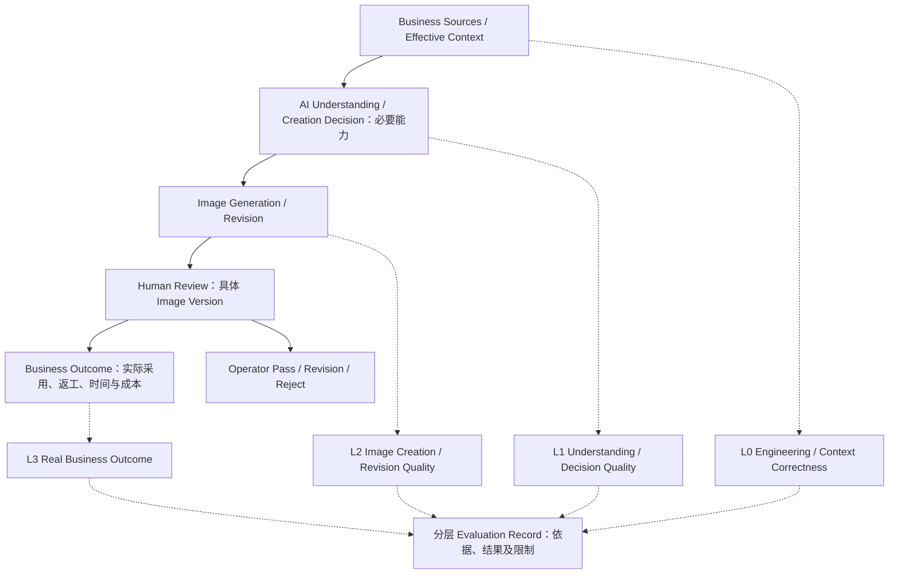
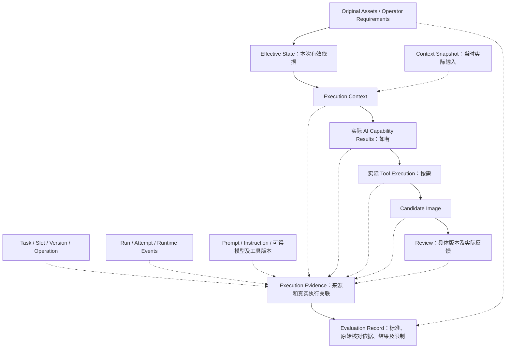
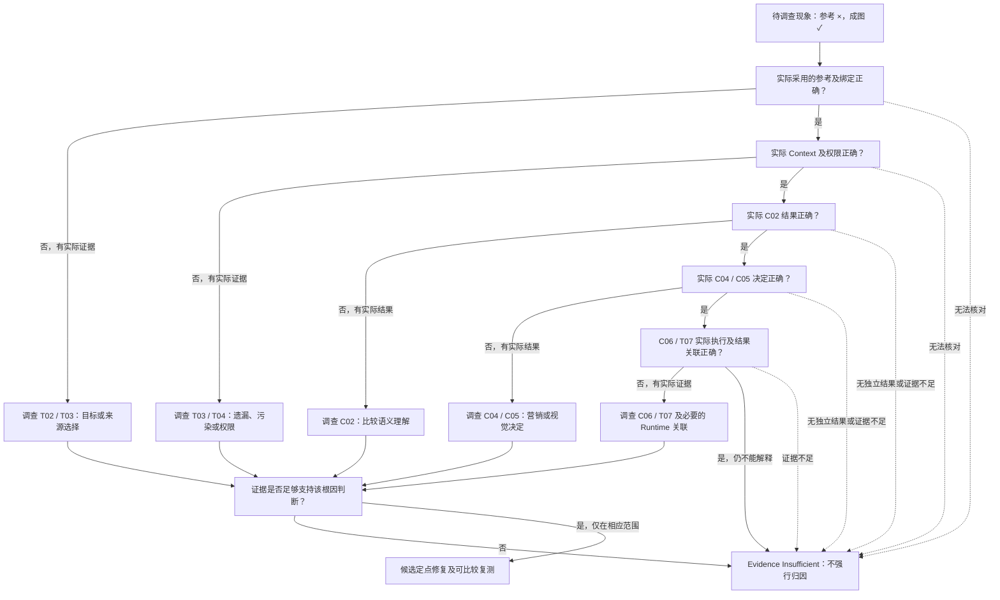
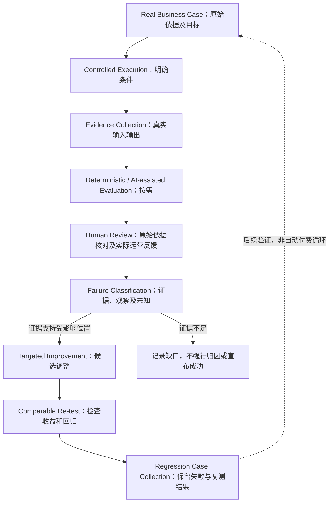

# T09：Evaluation & Observability

[返回技术架构总入口](../05_TECHNICAL_ARCHITECTURE.md)

**迁移说明：** 原 05 第 12 节；保留原章节、图及结论编号。正文中的研究轮次和历史状态按原文保留，当前仓库归档状态见总入口。

**研究进度：** `RESEARCHED`

**架构建议状态：** `PROPOSED / REVIEW PENDING`

本节记录第一轮候选架构、评价方法、图示及后续实验方向，尚未实现或进行真实 Evaluation。`RESEARCHED` 只表示本轮研究记录已补全，不表示模型能力、自动评价、运营效果或整套架构已经通过验证。已确认业务规则继续以 00～04 中相应状态及作用范围为准。

## 12.1 业务背景、技术目标与核心原则

商品营销图的错误可能发生在原始资料、有效要求选择、模型理解、单图决定、图片制作、修改或版本关联等不同位置。只有最终图片、模型成功响应或一条日志，通常不足以判断该修复哪项能力；反复修改 Prompt 也不能代替失败调查。

T09 要回答：Workbench 怎样通过真实执行证据，判断 AI 是否正确理解、决定、生成和修改商品营销图片，并验证技术调整是否减少运营返工。需要能回查实际 Context、指令、素材及模型和工具结果，分别检查中间能力与最终成图，用真实案例比较 Knowledge、Skills、Prompt、模型、工具或执行组合的收益、代价和适用范围。

候选核心原则：**Evidence-driven Evaluation + End-to-end Traceability + Human Business Acceptance**，状态 `PROPOSED`：

- 重要评价有原始核对依据、实际输出和明确标准，证据不足则保留未知。
- 中间能力和最终成图分层评价，实际输入、输出、版本及审核可关联。
- 真实失败驱动定点改进，再以可比较测试检查收益及回归风险。
- 运营负责最终业务接受，AI 自评不构成图片正确性或 Pass 的充分证明。
- 可观察、可复盘的最小闭环优先，不预设大型平台、统一 Judge 或固定额外调用。

## 12.2 Observability、Evaluation 与 Business Acceptance

| 概念 | 回答的问题 | 实际记录或判断 | 不能据此推导 |
|---|---|---|---|
| Observability | 这次执行实际发生了什么？ | Task / 图位 / 版本、商品图及参考、有效要求、指令版本、实际模型和工具、请求响应、超时、文件位置、耗时及可获得使用量与费用 | 有完整记录不保证商品、营销或设计正确 |
| Evaluation | 实际执行是否符合预期？ | 对照原始依据与标准，判断理解、比较符号、卖点取舍、成图及修改非目标变化，记录评价结果和限制 | 自动评分或错误分析不等于运营接受，更不等于独立性能认证 |
| Business Acceptance | 运营是否接受这张具体图片？ | 按 02～04 对明确 Image Version 作出 Pass、Revision 或 Reject，保留实际反馈与历史 | 单图 Pass 不证明所有调用无错、全部宣称已认证或销售转化已改善 |

**Observability ≠ Evaluation ≠ Business Acceptance。** 三者相互支持，不混成一个通用 `success` 字段。Evaluation Record 可关联 Review Evidence，但不得另建一套矛盾的审核权威或用评价结果自动覆盖运营判断。

运营 Pass V4 后，按 02 更新当前有效交付，V3 保留历史 Pass；V4 在生成成功、自动检查通过、待审核、Revision 或 Reject 时，不能静默替代原有效 V3。评价发现历史图片问题，可以记录观察和修复建议，不自行撤销业务 Pass 或批量重做。

## 12.3 L0～L3 四层评价体系

四层是评价职责和检查对象，不是四个独立系统、四次模型调用或四个强制人工审批节点。评价结果应注明对象、依据、方法、范围和未验证内容，不将一个总分掩盖关键错误。

### L0 — Engineering & Context Correctness

工程与 Context 正确性优先由确定性程序核对：Task / Mode / Image Slot、实际商品素材、参考绑定、当前有效要求及已失效要求排除、运营选定的修改基础版本、三模式来源权限、尺寸图专项条件、历史 Pass 保护、Run / Attempt 与结果关联，以及重复候选或错误图位关联。

程序可以比较身份、版本和权限规则，并核对实际组装及发送内容。若有效要求本身含语义歧义或资料矛盾，程序记录不能替代所需语义判断或既有关键问题处理。确认 Listing 已传入，不证明 AI 正确理解全部营销内容；文件存在、哈希一致也不证明图像商品语义正确。

尺寸图必须依据运营确认且已标注目标商品真实尺寸的专用白底素材；缺少时不制作尺寸图、不从参考或像素估算尺寸，也不阻断无关图位。

### L1 — AI Understanding & Creation Decision Quality

主要评价 C01～C05：商品可见外观、配件及连接关系，参考文字、数字、单位、表格和比较语义，跨来源权限及真正重要的矛盾，单图营销目标与内容取舍，视觉设计和商品呈现决定。逐项对照真实商品图、参考、资料、有效要求及实际候选中间结果。

中间结果应能在最终成图前独立评价。例如 C02 将某项比较关系的 `×` 误读为 `✓`，可以通过原图核对，不必等到 C06 生成错误图后才发现。此处是开发调试和实验能力；正式运营不因此必须逐阶段审批。若实际采用综合调用且未产出独立中间结果，就如实记录可观察范围，不能事后虚构一份“当时的 C02 输出”。

### L2 — Image Creation & Revision Quality

主要评价 C06、C07 的成果，并验证 C08 的检查与诊断是否可靠：

| 维度 | 检查对象与核对依据 |
|---|---|
| Product Fidelity | 对照实售商品图及有效资料检查外观、颜色、结构、配件和连接关系，不补造不可见结构 |
| Marketing Accuracy | 对照模式允许的内容来源，检查卖点、参数、数字、单位、比较关系及限定语义 |
| Design Adherence | 对照适用参考设计和有效运营要求，检查方向、图文关系与内容层级 |
| Visual Quality | 检查构图、光影、可读性、视觉焦点及商业呈现；记录人工判断依据和分歧 |
| Edit Target Success | 对照本轮反馈和实际选定基础版本，检查指定修改是否完成 |
| Non-target Preservation | 与实际基础版本比较未要求改变的商品、文字、背景及设计，识别新错误和意外变化 |
| Group Visual Coordination | 检查适用参考设计语言及整体要求的延续，同时保留各图位内容重点、参考和独立要求 |

不默认所有图片使用相同布局，也不把像素差异直接当作业务错误。允许的设计变化、指定修改和不应改变的内容要分开判断；“图片漂亮”不能抵消商品结构或关键营销错误。

### L3 — Real Business Outcome

观察具体图片的实际 Pass、修改轮次、图包完成时间、商品错误／卖点错误／设计偏移／非目标变化引起的返工、运营人工投入、实际模型与工具费用及最终采用情况。关联对象、统计窗口与分母应明确，待审核或未完成任务不能默认为通过，参见 12.16。

不预设已经验证的 Pass 率、平均修改次数或成本阈值。Pass 和图片质量评分都不能证明销售转化改善；转化需要另有业务实验和相应数据。

**图 19：Four-level Evaluation Architecture。** 用途是将四层评价对应到不同检查对象，并保留独立运营接受责任。

主线是业务职责及结果关系，不是固定模型调用链；各层可独立调试或按需组合。评价记录没有自动通往 Pass 的箭头，人工审核也不是每层新增审批。业务效果包含真实观察，不能从 L0 通过或 L2 分数自动推导。

## 12.4 C01～C08 的独立评价范围

编号、能力名称与 T05 保持一致。评价对象必须是实际产生的候选结果；没有某项独立输出时注明不可独立判断，不要求为满足表格而增加固定调用。

| 能力 | 原始核对依据 | 主要评价问题 | 结果与限制 |
|---|---|---|---|
| C01 Product Visual Understanding | 实际商品图片及相关运营身份／配置确认 | 外观、配件、连接关系是否准确；是否遗漏关键可见特征、补造不可见结构、把推断当观察 | 记录可见事实、声明、推断及未知；图片没拍到不等于不存在 |
| C02 Marketing Reference Understanding | 原始绑定参考、文字和画面关系 | 数字、单位、符号、表格行列、图文指向、比较关系是否忠实；营销语义是否扩大；设计方法有无画面依据 | 不能只核对孤立字符；必须核对所属对象及图例，不独立认证参考宣称 |
| C03 Cross-source Semantic Reconciliation | 当前模式权限、商品图、参考、商品资料及有效确认 | 是否遵守来源权限；重要矛盾是否有依据并影响本次制作；是否无必要阻断其他内容或改变 Quick-A/B 前提 | Quick-A 同款同配置、Quick-B 选图默认适用；不逐条重新审批；Listing 不继承无依据参考参数 |
| C04 Marketing Content Decision | 有效营销来源、图位目标、必保留内容及限制 | 目标、卖点取舍和优先级是否合理；必保留是否遗漏；数字、限制条件和比较语义是否保持 | 本图不展示不等于信息不适用；不重新认证商品性能或无依据扩写承诺 |
| C05 Visual Creation Decision | 实际商品、参考设计、C04 或等价目标、尺寸及有效要求 | 构图、商品呈现、文字层级与图文关系是否可执行；是否设计不存在的结构；Quick-B 替换范围是否完整 | 设计评价要有依据；不把设计偏好包装成全部商品通用的客观标准 |
| C06 Image Generation | 实际制作输入、有效决定、商品与营销来源及候选图片 | Product Fidelity、Marketing Accuracy、Design Adherence、Visual Quality、图文关系及图包协调 | 决定正确不保证成图正确；生成成功不自动成为 Pass |
| C07 Image Revision / Editing | 运营选定基础版本、本轮反馈、有效要求及真实前后图 | 目标是否完成、非目标是否保持、是否引入新错误或参考主体；基础版本和候选来源是否匹配 | 版本匹配属于 L0；视觉修改正确性属于 L2；两者不能互相替代 |
| C08 Result Checking / Failure Diagnosis | 原始资料、决定、候选、修改基础与执行证据，以及独立人工核对 | 报告的错误是否真实、遗漏哪些错误、根因与修复方向是否有证据；误报与漏报是否可接受 | C08 本身需要校准，不是 Ground Truth、不替运营 Pass，也不保证仅凭成图能确定根因 |

对 C01～C05 的中间评价通过，不直接声称 C06／C07 成功；C08 输出诊断也不代表诊断已获证实。能力可以复用同一原始证据，但评价记录需区分观察、推断和已核对判断。

## 12.5 与 T01～T08 的职责关系

| 专题 | 提供的依据或成果 | T09 的责任及边界 |
|---|---|---|
| T01 | 业务对象、原始素材、图片版本、审核及有效交付关系 | 引用权威身份与 Review，不独立管理另一套商品事实或审核状态 |
| T02 | 当前业务操作、目标和作用范围的路由 | 检查实际工作是否匹配操作；不在评价系统重做完整 Routing |
| [T03](T03_CONTEXT_ENGINEERING.md) | Effective State、Execution Context、来源及版本 | 检查组装及实际输入是否正确；不重新定义信息权限或把最新状态替代历史依据 |
| [T04](T04_RULES.md) | 确定性规则、语义硬约束及业务权限 | 按已定义规则评价遵守情况，不复制一套相冲突规则；程序通过不证明语义成功 |
| [T05](T05_AI_CAPABILITIES.md) | C01～C08 候选结果 | 分能力、分层评价理解、决定、制作和检查，不固定调用拆分 |
| [T06](T06_KNOWLEDGE_SKILLS.md) | 实际采用的 Knowledge / Skills 增强及版本 | 对照验证增益、误判、成本及延迟，不预设专业增强必然有效 |
| [T07](T07_TOOL_INTEGRATION.md) | 实际生成、编辑、合成及文件处理输入输出 | 区分模型和工具偏差，评价制作效果与限制，不新增工具实现 |
| [T08](T08_ORCHESTRATION_RUNTIME.md) | Run、Attempt、执行状态、失败、恢复和事件 | 使用真实执行证据，区分结果未知与失败，不将 Runtime 成功等同业务成功 |
| [T09](T09_EVALUATION_OBSERVABILITY.md) | 分层标准、评价记录、失败调查和业务效果观察 | 为定点改进和回归提供依据；不替运营决定 Pass，不以 AI 自评覆盖真实反馈 |

表中是候选协作职责，不声称 T01 / T02 的完整第一轮记录已存在，也不改变此前专题的研究状态。

## 12.6 Execution Evidence 的结构与保存原则

目标不是只保存一个模型输出 JSON，而是能从候选回查：哪个 Task、图位和操作，实际基于哪个版本，当时用了什么商品与参考资料、有效要求、Context、指令配置及模型工具，真实返回什么，经历哪些 Attempt 或恢复，运营审核了哪个版本、提出什么反馈。

| 类别 | 候选证据内容 | 核对用途与边界 |
|---|---|---|
| A. Business Identity Evidence | Task、Mode、Image Slot、Operation、Base Image Version（适用时） | 防图位、模式、操作及基础版本串位，引用 T01 权威身份 |
| B. Source Evidence | 原始商品、参考、Listing 及其他运营资料，素材身份、版本或内容哈希，相关运营确认 | 能回查原始核对依据；哈希证明内容身份，不证明商品宣称真实 |
| C. Context Evidence | 当时有效业务状态、适用要求、商品及营销约束、实际 Execution Context、来源和版本 | 区分有效解析结果与实际组装输入，检查遗漏及污染，不只保存最新状态 |
| D. AI Execution Evidence | 实际能力、Prompt / Instruction 版本、可获得模型名称及版本、实际请求输入、原始响应、必要使用量 | 区分原始模型结果与事后解释；内部版本不可得时保留限制，不伪造 |
| E. Tool Execution Evidence | 工具身份、实际操作、输入资产角色与参数、真实输出、错误及必要中间成果 | 能区分生成、局部编辑、确定性处理和成果交接，不将计划操作记作已发生 |
| F. Runtime Evidence | Run、Attempt、状态及真实事件、耗时、失败和恢复、可获得 Token 用量及费用 | 保留重试历史与远程未知，费用不可得不记为零；用量 Token 与访问凭证区分 |
| G. Image Result Evidence | 候选图片、所属图位及 Image Version、实际制作来源、基础版本、必要文件身份 | 候选不是原始事实，也不是当前有效交付；结果文件与 Run / Attempt 可关联 |
| H. Review Evidence | 具体版本的运营 Pass / Revision / Reject、反馈、实际审核结果及历史 | 引用业务审核权威；没有给出理由就不虚构“为什么接受” |

证据关系应区分原始记录、事后人工观察和诊断推断，不静默覆盖原始证据；原始响应不能被后续润色解释替换。记录实际发生的事件，不虚构模型内部思考、没有调用的能力或未产生的中间输出。

与 T03 / T08 一致，Run 的实际依据固定，每次真实 AI／工具操作的输入可回查。可以保存输入快照、不可变版本引用或足以准确重建实际发送内容的记录，不要求完整大 JSON、正式表结构或全部文件永久保存。后续要求变化不重写历史 Context，重试也不暗中换成最新业务依据。

本地请求记录说明客户端实际构建或发出了什么；供应商确认、返回结果及服务端可获得记录按实际留存。它们不能单独证明供应商内部有效 Prompt、全部图片的处理权重、模型确实关注了哪些内容或隐藏推理。无法确认的服务端事实保留未知，不把客户端 Trace 当作完整内部观测。

## 12.7 Log、Trace、Business Evidence 与证据链图

Log 记录一个真实事件，例如请求已发送、工具报错或文件保存成功；Trace 关联某个 Run 内实际操作及其输入输出和来源；Business Evidence 再把这些执行关系与商品、参考、有效要求、图片版本和运营审核相连。供应商 Trace 不能自动代替 Workbench 的业务依据及历史。

Quick-A 主图 Run 可能包含 Context Assembly、理解、制作决定、生成、保存及检查中的若干工作，但只记录实际执行路径。复用已有理解、综合调用、确定性修改或不需要 AI 的审核操作，均不能被伪造成经过全套固定节点。逻辑 Trace 不决定采用 OpenTelemetry、OpenAI Tracing、LangSmith 或其他产品。

**Log 记录事件，Trace 关联执行过程，Business Evidence 关联业务依据和结果。** 三者都不独立创造目标商品事实。

**图 20：End-to-end Execution Evidence Lineage。** 用途是说明候选怎样通过实际来源、执行及审核关系回查制作依据；连线表示逻辑关联，不强制每个 Run 都执行所有能力。

Trace 和 Evidence 是关联及记录，不是与原始商品资料竞争的 Source of Truth。评价输入必须能回查原始素材，不能只拿 AI 的上游解释核对下游 AI。图中没有评价到自动 Pass 的通路，也不要求把全部业务资料上传给第三方平台。

## 12.8 错误分类、调查顺序与诊断图

| 错误类型 | 典型表现 | 优先调查对象 |
|---|---|---|
| Context Omission | 本次实际输入缺少关键商品图或有效要求 | T03 的来源选择、组装及实际请求 |
| Context Contamination | 失效要求、错误来源与当前要求混杂 | T03 / T04 的有效范围与权限 |
| Routing Error | 错误选择图位、版本或工作范围 | T02 的实际操作及目标关联 |
| Source / Permission Error | Listing 继承了无商品资料依据的参考参数 | T03 / T04 / C03 的权限及语义核对 |
| Visual Understanding Error | 商品配件、结构或连接关系识别错误 | C01 实际输出与原商品图 |
| Reference Understanding Error | 数字、符号、图文或比较关系误读 | C02 实际输出与原始参考 |
| Creation Decision Error | 卖点取舍、必保留内容或视觉方向错误 | C04 / C05 及其输入 |
| Generation Error | 决定正确但实际成图偏离 | C06 / T07 的实际输入、工具及成果 |
| Revision Error | 完成目标修改却破坏其他重要内容 | C07 / T07 的实际基础图、反馈及前后成果 |
| Runtime Error | 错误重试、结果丢失、重复候选或状态混乱 | T08 的 Run / Attempt、事件及恢复 |
| Review / Version Error | 审核关联错误、错误改变当前有效 Pass | T01 / T04 / T08 的版本与真实业务操作 |

这些是调查分类，不是凭最终图片自动准确识别根因的承诺。一例可以有多个问题；“观察到商品结构错误”与“推断 C01 错误”必须区分。原始资料自身错误、相互矛盾或缺少依据时，另记 Source Problem / Evidence Insufficient，不把忠实传递坏资料或无法确认的内容直接归咎于模型。

候选诊断顺序：确认评价对象与原始核对依据 → 检查实际业务身份和发送输入 → 检查有效状态及权限 → 对照已实际产生的中间结果 → 检查制作工具及保存版本 → 根据证据提出责任位置、未确定项和定点修复建议。没有中间结果则保留定位限制，不事后补造链条。

**先检查实际输入和中间结果，再决定修复哪项能力。** 不默认全部图片问题都改 Prompt，也不因最终错误直接断言理解错误。业务资料的重要矛盾按已有关键问题规则处理，不升级为全面商品认证或全图包审批。

**图 21：Failure Diagnosis Decision Flow。** 用途是以比较符号错误说明逐段核对证据的方法，不构成自动根因诊断器。

“是／否”需要实际输入、中间输出或成果支持；没有独立 C02 结果时，不能仅从图片反推它一定误读。图示关注一条比较关系，仍须检查符号所属商品、表格行列及图例；实际故障可以有多个来源，不能用最先发现的问题排除其他错误。

## 12.9 四个失败定位案例及证据限制

### Case D01：Quick-A 比较符号错误

本轮归档任务提供的历史现象是参考某项比较关系为 `×`、历史成图出现 `✓`。04 已将比较符号及归属关系列为专业检查对象，但本仓 03 没有附上这一现象的原始对照图、实际 Context 和调用记录。本轮未查找旧仓，不据此确认某次 Run 的具体根因，状态为 `HISTORICAL REPORT / EVIDENCE TO_VERIFY`。

调查应依次核对实际参考绑定、发送的 Context、C02 是否保留正确比较关系、C04 / C05 是否改变该关系、C06 是否偏离正确决定，以及 T07 文字／图表处理和结果关联是否出错。来源错调查 T02 / T03，理解错调查 C02，决定错调查 C04 / C05，执行错调查 C06 / T07；每个判断都需对应证据。当前不能仅凭最终符号宣布根因，也不把参考营销宣称当独立真实性认证。

### Case D02：Quick-B 参考主体残留

03 Case B01 记录了已知主体替换失败类型，但尚缺完整目标商品、参考、成图和运营评价。局部特写残留参考结构是需要验证的诊断场景，不虚构具体 SKU 或本轮失败图片。

后续调查 C01 是否正确识别目标商品、C02 是否识别相关特写及配件、C05 是否明确完整替换范围、C06 是否正确执行、T07 是否满足所需局部编辑和交接条件。分别区分理解错误、决定缺失与执行失败；Quick-B 默认适用的营销前提不因诊断而变成逐条重审。状态 `PENDING REAL SAMPLE / NOT TESTED`。

### Case D03：Listing 洗车设备结构错误风险

依据 03 Case L01 已记录资料：历史任务 `43889e73c53c462da86216ed42f0a1ec`、`reference_002`、五种喷射模式 0°／15°／25°／40°／泡沫、三档水压和三档水量，以及清洗、浇灌及泡沫应用。已识别风险是错误组合喷壶与水枪，产生不存在的结构；这些资料不代表性能已独立检测。

后续须具备可回查的实际商品图、运营文字、设计参考及真实输出，调查 C01 结构理解、商品资料使用、C04 / C05 是否安排错误组合、生成是否偏离正确决定、是否越权继承参考商品内容。不能把已识别风险写成新链路已复现故障或已通过验收。状态沿用 `NOT TESTED / BUSINESS ACCEPTANCE NOT ESTABLISHED`。

### Case D04：修改破坏非目标内容

候选场景：V3 已 Pass，运营选中 V3 要求放大标题；V4 标题变大，却改变商品外观或背景。应核对实际输入是否 V3、本轮 Context、是否错误重启失效历史要求、实际编辑方法及非目标变化、候选来源及审核关联。标题目标完成与非目标保持分别评价；新 V4 未 Pass 时 V3 继续有效。

本例依据 02～04 的修改及版本规则，没有本轮真实前后图或运营评价，状态 `PROPOSED TEST SCENARIO / NOT TESTED`。不得记录成已发生的成功修复或自动定位结果。

## 12.10 三模式的差异化评价重点

| 模式 | 原始核对依据与高风险错误 | 评价重点与边界 |
|---|---|---|
| Quick-A | 实际商品图、同款同配置营销参考、有效要求；警惕参考外观覆盖实售商品及数字、比较语义失真 | 商品保真、适用营销内容保持、差异化设计、参考方向延续及多轮稳定；不因普通颜色或视角差异重新审定模式，不强求每张展示全部卖点 |
| Quick-B | 实际商品图及运营选定参考；警惕主体换了但特写、配件或场景残留参考商品，混合两款结构 | 完整替换、默认适用营销表达、修改不重新引入参考主体；明确重大冲突定点处理，不新增逐卖点预审 |
| Listing | 实际商品图片 + 运营文字资料；设计参考通常提供但可选；警惕复制参考参数、补造缺失性能及结构错误 | 商品资料使用、真实结构、设计权限、卖点分配、关键问题处理及无关内容继续制作；不是纯文字生图前提，不默认完整方案审批 |

共同检查商品保真、营销准确、设计执行、局部修改、版本保护及运营实际审核。资料未独立检测不自动等于不能按已确认权限使用；评价正确传递营销来源与验证商品性能真实是不同任务。

## 12.11 Longitudinal Intent Preservation

**跨图片、跨修改轮次的运营意图保持评价。** 目标是在持续制作中检查有效意图是否延续，而不只评价最后一张单图的视觉效果。

| 评价范围 | 应核对的内容 | 核对依据与避免误判 |
|---|---|---|
| 同一 Task 的多图制作 | 商品身份、配件与结构、营销语义、参考设计语言、有效整体要求及各图位独立要求是否稳定 | 按各次实际生效版本比较；允许不同卖点及构图，单图未展示不代表信息失效，单图要求不得扩散到别处 |
| 同一图位的多轮修改 | 选定基础版本、有效要求继承、本轮目标、已认可内容保持、失效指令是否重新生效、原 Pass 是否保护 | 使用实际基础图 + 当前有效要求 + 本轮反馈；不要求重放全部历史文字，不把历史版本当作拥有后续所有修改 |
| 要求或方向主动变化 | 新要求是否按范围作用于后续工作，历史 Context 与已 Pass 图片是否保持 | 按当时依据判断历史执行，不用最新要求追溯判错；经授权的变化与无依据漂移分开 |

可设计“同一商品七张图片并进行多轮修改”的 `PROPOSED TEST SCENARIO`，观察商品、营销、设计与要求随图位和轮次的变化。它是未来计划，不表示已有七张合格样本或十次真实修改记录。

评价同时包括单次正确性、跨轮次一致性和实际业务效率。记录每次有效要求变化、修改目标、允许变化、实际成果、非目标变化及返工原因，再比较修改次数、人工投入和总成本；不凭最后一张漂亮图片或一个平均相似度证明长期意图保持。

新整体要求不自动使旧 Pass 失效。运营主动重改已 Pass 图片时，只有新整体要求与仍有效旧单图要求存在明确、无法同时满足且影响本次制作的实质冲突，才按 02 第 5.5 节定点确认；没有冲突不增加确认，也不重新启动无关制作。该规则不是 Evaluation 新增审批节点。

## 12.12 真实案例数据集、核对依据与答案污染

数据集从 03 的可复核案例逐步建立，不通过自动生成答案或虚构完整样本填空：

| 当前案例基础 | 已记录内容 | 缺口与当前状态 |
|---|---|---|
| A01 — Quick-A | 黑色汽车电路测试仪、实际商品及蓝色营销参考、部分理解和制作决定资料，历史任务身份已记录 | 记录中已有资料不代表当前所有素材实体均可访问；缺新链路最终成图及运营验收，NOT_TESTED |
| B01 — Quick-B | 主体替换不完整的已知失败类型及候选验收要求 | 缺完整真实输入、输出及人工评价，PENDING REAL SAMPLE |
| L01 — Listing | 洗车设备文字资料、参考背景及结构组合风险 | 最终成图及运营验收未建立，NOT TESTED / BUSINESS ACCEPTANCE NOT ESTABLISHED |
| Revision Case | 选定版本、当前有效要求、修改和 Pass 规则 | 缺可复核真实前后图、实际修改记录与运营评价，TO_VERIFY |

一个候选评价案例至少关联 Case Identity、Mode、Task / 图位、原始商品与参考或文字资料、有效要求、要评价的能力、真实输出、人工核对依据、观察到的错误、评价结果、适用范围及当前状态。身份或索引不能替代素材和输出本身；访问不到就记录缺口。这是逻辑研究要求，不冻结数据集 Schema。

核对依据要区分三类：

- **客观可核对内容：** 原始数字、比较符号及归属、商品图可见结构、运营明确要求、实际基础版本。注明来源和版本，不能把图片推断当可见事实。
- **人工业务判断：** 卖点适用性、商品呈现可接受性、视觉设计是否符合目标、具体版本 Pass。按相应运营责任记录，主观判断及分歧不包装为独立商品认证。
- **依据不足：** 必然提升转化、未经核实的性能、某设计适用于所有商品等。保留未知，不补造 Ground Truth。

GPT 或其他模型生成的候选解释不能直接作为独立 Ground Truth。人工整理答案也需核对原始依据，注明是参考判断而非无限适用的绝对真值。资料自身有歧义时保留争议和影响范围，不能强造一致答案以计算准确率。

04 引用的旧 Quick-A 专家研究可提供候选方法，但本轮未读取其实体或复制旧仓内容。后续独立模型实验不得把人工参考答案直接注入输入再宣布独立理解成功；使用知识、提示、整理答案线索时明确标注实验条件，将用于调试的材料与保留作独立验证的案例区分，防止以见过答案的结果夸大泛化能力。

## 12.13 确定性、AI 辅助与人工评价的分工

| 方法 | 适用检查 | 需要保存的依据及限制 |
|---|---|---|
| Deterministic Evaluation | 图位绑定、素材身份、版本与有效要求引用、权限规则、Pass 保护、文件输出存在性、可明确匹配的数字或文本关系 | 保存实际检查对象及规则结果；字符串匹配不能覆盖所有营销语义，OCR 结果也可能不准确，不能据存在性证明图片正确 |
| AI-assisted Evaluation | 辅助结构比较、营销语义变化、设计方向、局部编辑差异及错误分类 | 记录评价输入、模型及指令、原始输出、证据和限制，以及与人工核对的差异；可能误报、漏报或错误归因 |
| Human Evaluation | 商品身份和关键适用性、实质营销争议、专业视觉判断、最终 Pass、自动评价校准 | 关联具体版本及原始依据；保存实际反馈，不虚构未提供的理由；人工也可能有分歧，须保留不确定项 |

确定性条件优先程序检查，语义和视觉问题可按需要用 AI 辅助，运营按原有业务责任作最终验收。不把所有评价强交一个 Judge Model，不要求每张图多调用一次模型，也不把开发期间逐能力人工核对变成正式运营逐阶段审批。

## 12.14 C08 及自动评价能力本身的验证

C08 输出“发现错误”只是待核对判断。应对照可复核人工依据，按明确错误类型和对象评价它是否真的发现问题，而不是只评价报告写得是否像专业分析。

| 分类 | 含义 |
|---|---|
| True Positive | 报告某类错误，人工原始核对确认该错误实际存在 |
| False Positive | 报告错误，但相应内容正常或属于允许变化 |
| False Negative | 未报告该类错误，但原始核对发现真实错误 |
| True Negative | 未报告该类错误，且原始核对确认不存在该错误 |

候选示例：评价模型检查 20 张图片并报告 5 张结构有误，不能只复查这 5 张；还需核对其余 15 张以发现漏报。此例不是本轮实际结果或准确率记录。人工依据不足的样本保留无法判定，不强行归入四格；分类单位是某类错误还是整张图片应先说明。

后续可按错误类型研究精确率、召回、误报和漏报，先明确分母、人工依据及样本覆盖；不以单一总体准确率掩盖关键商品错误，也不预设未经验证阈值。若评价模型、指令或输入材料变化，应重新检查相应校准及回归案例。模型自评与生成模型同源时可能共享盲点，需要独立原始依据和人工复核，不据互相赞同宣布成功。

## 12.15 对照实验、回归与可复核性

以下均为 `PROPOSED / REVIEW PENDING / NOT RUN`，本轮不执行：

| 实验方向 | 可比较条件 | 观察目标及限制 |
|---|---|---|
| Experiment A：Context Strategy | 累积完整历史与按当前有效业务状态组装；使用相同业务轨迹、基础版本及核对依据 | 比较遗漏、失效指令干扰、商品和营销偏移、Token 用量及费用；不把历史污染作为正式生产建议 |
| Experiment B：Model-only vs Knowledge | 针对 C02 等具体能力，在相同原始输入下比较原生理解与明确专业材料增强 | 目标错误是否减少、新误判、延迟和成本；记录知识与提示，不暗中提供答案再声称独立理解 |
| Experiment C：Combined vs Staged AI Execution | 相同业务目标与验收依据下比较综合调用和阶段理解、决定、制作 | 中间结果可评价性、最终质量、返工、总成本及延迟；不预设拆分一定更好或固定调用数 |
| Experiment D：Generative Edit vs Controlled Editing | 同一选定 V3 和标题修改目标，比较整图生成式、局部编辑、具备条件时的确定性文字／元素处理 | 目标完成、非目标变化、视觉质量、人工返工及实际成本；缺少可编辑素材时不能假定确定性修改可用 |
| Experiment E：Repeated Generation | 相同业务输入和可比较模型工具配置下重复运行 | 商品保真、营销保持、视觉质量波动和随机性；保存首轮及各次结果，不挑最好一张冒充稳定表现 |

实验需先明确具体能力、问题、原始输入、标准和比较条件，尽可能控制非研究变量。记录实际模型和工具可得版本、Context、指令及专业辅助材料、真实请求响应、输出、耗时和费用；不能用单次偶然成功宣布架构最优，缺证据保留 `TO_VERIFY`。

复现包括能重建当时条件、回查原结果并重新核对评价，不承诺生成式系统在再次调用时输出相同像素。供应商内部版本或不可控变化如不可得，应记为限制；没有实际重跑就不能称回归测试通过。

有价值的真实失败逐步纳入回归案例：保留失败输入、预期及依据、实际错误、定点调整、可比较复测和仍存在的限制。回归要检查目标问题是否改善，也要看商品、营销、其他图位、非目标内容、成本和延迟是否退步。调参使用的案例与独立验证案例应区分，不把单案例改善外推到全部模式。

**图 22：Evaluation Feedback & Regression Loop。** 用途是表示后续开发调试的候选反馈方法：先有真实证据，再定点调整、复测和沉淀案例。

图示是未来实验及学习过程，不是生产任务必须经过的固定调用或新的审批链。Human Review 包括开发核对；只有实际运营对明确版本作出的决定才记作业务 Pass。复测失败同样保留，不把案例入集视为成功，也不因一次成功认定其他商品或模式通过。

## 12.16 真实业务指标与解释边界

| 候选观察指标 | 记录及统计时应明确的口径 | 避免错误结论 |
|---|---|---|
| 实际 Pass 与采用情况 | 明确按候选版本、图位首次通过或最终采用统计，记录时间窗口和已审核／待审核数量 | 不把模型成功、AI 评分或未审核候选算作 Pass；通过不等于实际发布或销售采用 |
| 每张图修改轮次与返工 | 关联基础版本、实际 Revision 和原因，区分错误修复、运营主动改目标及偏好变化 | 不能把所有修改都归为 AI 失败，也不能漏掉 Reject 后重新制作的成本 |
| 图包完成时间 | 说明哪些启用图位和业务条件构成该次完成，关联开始、等待与最终交付事实 | Task 非原子 Runtime Run；未完成及中止任务不能默默排除以美化平均值 |
| 人工投入 | 记录实际审图、资料处理、解释和修改投入，可明确估计与实测 | 墙钟等待不等于全部人工工作时间，无测量不能自动宣称节省 |
| 错误驱动返工 | 区分商品、卖点、设计偏移和非目标变化，可关联多项原因及不确定项 | 不从最终图片独断根因，不将有争议反馈包装成客观认证 |
| 模型及工具实际成本、耗时 | 关联 Run / Attempt、重试和恢复、可得使用量、供应商费用及必要工具费用 | 未知远程结果可能收费，估计与实际分开；费用缺失不为零，不能只计成功调用 |

对照应考虑模式、图位、任务难度、输入完整性及样本范围，报告样本量、缺失和分歧，不预设通过率或成本标准，也不因少量偏选案例宣称因果收益。销售转化数据及业务实验不在本轮范围，质量或 Pass 改善不直接推导转化提升。

## 12.17 V1 最小 Evaluation / Observability 闭环

候选最小调试过程：选择真实案例 → 明确要验证的能力或职责 → 准备原始输入和有效 Context → 执行一次有明确条件的 AI 或工具工作 → 保存真实请求响应及证据 → 人工对照原始资料核对输出 → 记录错误类型与依据 → 定点调整受影响能力 → 进行可比较测试 → 保存前后结果和结论。

这十项是未来开发调试与评价基线建立的方法，不是对本轮模型调用的授权，也不要求正式运营逐阶段审批。本轮仅记录方案。

| V1 优先具备的候选能力 | 暂不作为前置条件 |
|---|---|
| 查看实际组装 Context、真实模型输入及原始输出 | 独立大型 Evaluation 平台或完整实验管理系统 |
| 回查商品、参考、图位、基础版本、候选及实际来源 | 大规模标注平台或统一复杂数据集 Schema |
| 保存原始核对依据、实际人工评价及修改反馈 | 全自动图片评分系统、通用 Judge 集群 |
| 比较不同实验，记录失败、调整及修复结果 | 所有业务任务额外调用 Judge 模型 |
| 追踪必要使用量、成本与耗时，逐步建立回归案例 | 所有结果实时 Dashboard 或复杂因果分析平台 |

可先逐能力学习和定位失败，再根据真实调试需要决定工具。可观察不等于必须无限收集，最小闭环不冻结数据库、SDK、Trace 平台、页面、正式 Schema 或自动质量门槛。

## 12.18 证据安全、访问与保留边界

商品图片、Listing、请求、模型输出和 Trace 可能包含完整商业输入，应按实际职责控制查询与导出权限，不默认将全部明文资料无限上传给第三方 Observability 平台。证据记录还应区分业务内容、使用量 Token 与安全敏感配置，不记录 API Key、访问 Token 或其他凭证。

可追溯性不等于永久保存所有明文请求、图片副本及大体积中间文件。后续需决定关键业务关系、必要原始证据和临时素材的保存、归档、删除及成本策略，兼顾调试价值、业务历史和权限。日志脱敏或保留期限导致某内容无法再核对时，明确评价限制，不能声称证据仍可完整重建；不得以事后补写取代已缺失原始记录。

本节不冻结存储、加密或保留期限，也不创建第三方集成。审核和模型结果的历史关联仍按 02 的业务规则保护，具体实施设计待后续处理。

## 12.19 T09-A～T09-I 第一轮候选结论

| 编号 | 候选结论 | 状态 |
|---|---|---|
| T09-A | 区分 Observability、Evaluation 与 Business Acceptance，不用一个成功字段代替三种责任 | PROPOSED / REVIEW PENDING |
| T09-B | 采用 L0～L3 四层评价，分别检查工程 Context、理解决定、制作修改及真实业务效果 | PROPOSED / REVIEW PENDING |
| T09-C | 实际素材、Context、模型工具输入输出、候选及审核来源可追溯，并保留观测限制 | PROPOSED / REVIEW PENDING |
| T09-D | AI 中间能力与最终成图分别评价，按实际证据调查失败，不虚构自动准确归因 | PROPOSED / REVIEW PENDING |
| T09-E | 三模式共享评价框架，同时保留各自信息权限、高风险错误与验收重点 | PROPOSED / REVIEW PENDING |
| T09-F | 增加跨图片、多轮修改的运营意图保持评价，区分授权变化与无依据偏移 | PROPOSED / REVIEW PENDING |
| T09-G | 结合确定性检查、AI 辅助评价与人工验收，自动评价需独立验证及必要人工校准 | PROPOSED / REVIEW PENDING |
| T09-H | 使用真实案例和可比较条件，验证质量、返工、延迟与成本变化，避免答案污染及单例外推 | PROPOSED / REVIEW PENDING |
| T09-I | V1 优先可观察、可复盘的最小评价闭环，不提前建设大型评测平台 | PROPOSED / REVIEW PENDING |

这些都是研究候选，不标记 IMPLEMENTED、VALIDATED 或 BUSINESS ACCEPTED。评价标准提出、记录补全、架构批准、真实工程验证和运营接受是不同状态。

## 12.20 九专题第一轮研究状态收束

本轮核对结果：九专题均在路线表中，但并非都有完整第一轮研究正文。不能仅因 T09 补全就标记 `FIRST-ROUND ARCHITECTURE RESEARCH COMPLETE`。

| 专题 | 本仓实际记录情况 | 当前研究及结论状态 |
|---|---|---|
| T01 System Boundary & Business Objects | 已讨论核心对象与信息权威，现有候选摘要尚不足以视为完整专题记录 | PROPOSED；第一轮记录待补全 |
| T02 Task Routing | 路线及协作职责有提及，没有完整独立研究记录 | NOT STARTED |
| [T03 Context Engineering](T03_CONTEXT_ENGINEERING.md) | 已有第一轮正文与四张图 | RESEARCHED / PROPOSED / REVIEW PENDING |
| [T04 Rules](T04_RULES.md) | 已有第一轮正文与两张图 | RESEARCHED / PROPOSED / REVIEW PENDING |
| [T05 AI Capability Architecture](T05_AI_CAPABILITIES.md) | 已有 C01～C08 等第一轮正文与三张图 | RESEARCHED / PROPOSED / REVIEW PENDING |
| [T06 Knowledge / Skills](T06_KNOWLEDGE_SKILLS.md) | 已有按需专业增强等第一轮正文与两张图 | RESEARCHED / PROPOSED / REVIEW PENDING |
| [T07 Tool Integration](T07_TOOL_INTEGRATION.md) | 已有工具能力等第一轮正文与三张图 | RESEARCHED / PROPOSED / REVIEW PENDING |
| [T08 Orchestration & Runtime](T08_ORCHESTRATION_RUNTIME.md) | 已有 E01～E06、状态及恢复等第一轮正文与四张图 | RESEARCHED / PROPOSED / REVIEW PENDING |
| [T09 Evaluation & Observability](T09_EVALUATION_OBSERVABILITY.md) | 本轮补全分层评价、证据、诊断、实验及四张图 | RESEARCHED / PROPOSED / REVIEW PENDING |

整体第一轮记录仍未齐备，技术架构保持 `PROPOSED / REVIEW PENDING / NOT IMPLEMENTED`。这里的 NOT IMPLEMENTED 表示研究归档不等于工程实施，未将本轮文档内容当作已运行系统。即使未来九专题记录全部完成，也不代表正式技术架构批准或 AI 能力通过真实验证。

本轮不补写 T01 / T02，不重设计 T01～T08。后续先处理现有记录缺口，再对 T01～T09 做简短一致性检查、形成必要统一总览、核对职责重复和术语及未经批准前置条件，随后选择真实 Quick-A 案例进行首个最小能力实验，以真实输入、Context、输出和人工评价学习技术。这只是后续方向；本轮不开始总审、新专题、模型调用或工程开发。

## 12.21 本轮归档记录与待验证事项

**研究版本记录：** 2026-11-04，在 05 V0.1 架构研究稿中补全 T09 第一轮正文及图 19～22，更新 T09 进度、九专题实际记录情况和后续方向；保留 `PROPOSED / REVIEW PENDING`，不提升为正式批准或已实现版本。原 T01～T08 研究结论及既有图示保留，仅同步章节编号所需的总进度引用。

待验证包括：原始素材和完整案例的可访问性、D01 对照证据、C01～C08 实际输出、C08 误报漏报校准、真实多图及修改链、非目标变化、Knowledge / Context / 调用组合及工具策略收益、Runtime 与证据链完整性、实际人工投入及成本、回归和独立验证案例，以及四图实际渲染。所有实验和场景均为计划，没有真实 Evaluation 或工程成功记录。

本轮不新增外部 API 或平台能力断言，不安装依赖，不创建评价 Prompt、代码、数据库、SDK、Agent、Knowledge 或 Skills，不调用模型或生图，不修改 Runtime 或业务基线。具体评价工具、模型、采样、评分权重、阈值、保留方案、正式 Schema 及实施选型仍待后续研究。
