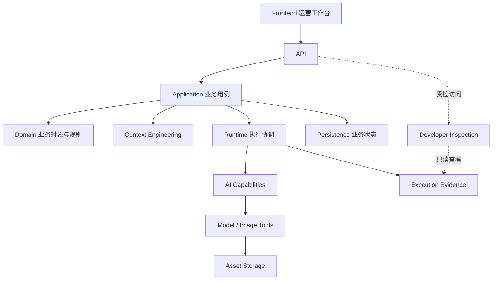

# 06_V1_IMPLEMENTATION_BLUEPRINT.md

**项目：** AIGC Workbench  
**版本：** V0.2 — IMPLEMENTATION DRAFT  
**状态：** PROPOSED / REVIEW PENDING / NOT IMPLEMENTED

## 1. 文档职责

本文件是 V1 工程实施总入口。

- [00](../business/00_PRODUCT_CHARTER.md)、[01](../business/01_BUSINESS_MODES.md)、[02](../business/02_INTENT_AND_CONTEXT_RULES.md)、[03](../business/03_ACCEPTANCE_CASES.md)、[04](../business/04_IMAGE_CREATION_WORK_METHOD.md)：已确认的业务要求及候选业务方法。
- [05 技术架构总入口](../business/05_TECHNICAL_ARCHITECTURE.md)及其 T01～T09 专题：技术架构研究及候选原则。
- `06`：V1 的工程实施方向、决策、边界和开发路线。
- [I01](./I01_FRONTEND_WORKBENCH.md)、[I02](./I02_ENGINEERING_BOUNDARIES.md)：具体实施设计草稿。
- [I03_DELIVERY_PLAN.md](./I03_DELIVERY_PLAN.md)：已形成 V0.1 交付计划草稿，待审核、未实施。

不在本文件重复九个技术研究专题的完整内容。

## 2. V1 产品目标

建设能够服务真实电商运营的商品营销图片制作工作台。

支持：

- Quick-A、Quick-B、Listing 三模式。
- 实际商品及参考素材。
- 图位、尺寸和运营要求。
- AI 理解、制作决定及图片生成。
- 单图修改、审核和 Pass。
- 有效要求与历史版本保护。
- 真实 AI 执行证据及开发者调试。

**首要目标：保持运营意图，减少图片制作和修改中的偏移与返工。**

## 3. 技术方向

| 方面 | 优先方案 | 状态 |
|---|---|---|
| 前端 | React + TypeScript + Vite | PROPOSED |
| 后端 | Python + FastAPI | PROPOSED |
| 整体组织 | 模块化单体，前后端分离 | PROPOSED |
| 业务持久化 | 初期 SQLite 候选 | PROPOSED |
| 素材存储 | 初期本地文件系统 | PROPOSED |
| 长任务 | 持久化执行记录与后台执行 | 职责明确，具体实现待定 |
| 测试 | pytest、Vitest、Playwright | PROPOSED |

选择这些技术的目的是降低耦合、提高可读性和调试能力，而不是追求复杂架构。

具体依赖只在实施切片需要时引入。

## 4. 工程总体架构

图中是逻辑职责，不要求各模块独立部署。

## 5. 核心工程约束

1. **服务器掌握业务权威。** 前端不得独立决定有效 Pass、商品事实和持久业务状态。
2. **业务逻辑与外部工具分离。** Domain 不依赖具体 Web 框架、模型 SDK 或图片工具。
3. **Context 按需组装。** 不把全部历史对话重新发送给模型。
4. **能力可独立调试。** 商品理解、参考理解等能够在开发环境独立观察和评价。
5. **执行结果可追溯。** 保存实际输入来源、Context、模型输出及关联结果。
6. **代码职责明确。** 不继承旧仓跨脚本全局状态和混杂业务逻辑。
7. **按纵向切片开发。** 不提前创建九套技术服务或大量空模块。
8. **运营最终审核。** 模型成功、工具成功和业务 Pass 必须区分。
9. **继承旧工作台产品设计。** V1 前端以旧仓有效工作台 UI 设计为优先继承基线；工程实现可重构，但不得无业务依据重新设计操作流程。具体来源、调整边界及待完成的 UI 检查见 [I01](./I01_FRONTEND_WORKBENCH.md#legacy-ui-baseline)。

## 6. 实施文档分工

| 文档 | 唯一主要职责 |
|---|---|
| [I01_FRONTEND_WORKBENCH.md](./I01_FRONTEND_WORKBENCH.md) | 运营交互、组件和前端状态 |
| [I02_ENGINEERING_BOUNDARIES.md](./I02_ENGINEERING_BOUNDARIES.md) | 后端模块、数据流、接口边界与工程质量 |
| [I03_DELIVERY_PLAN.md](./I03_DELIVERY_PLAN.md)（V0.1 草稿，待审核、未实施） | 纵向开发切片、验收、测试与交付进度 |

具体细节以对应专题文件为唯一实施说明来源，06 不维护第二份完整副本。

## 7. 初期开发方向

优先建立一个能够真实运行的 Quick-A 最小纵向切片：

运营选择模式、提交实际商品与参考素材、配置图位、保存业务资料，然后在受控开发入口执行一项真实 AI 理解能力，查看实际 Context、原始响应及人工评价。

这项实验不要求首次就完成全部图片生成。

后续逐步加入参考理解、单图制作决定、真实图片生成、修改与 Pass，再扩展 Quick-B、Listing 和多图。

具体开发顺序及验收见 [I03 交付计划草稿](./I03_DELIVERY_PLAN.md)，不表示各切片已经批准或开始实施。

## 8. 当前不实施

- 通用 Agent 框架。
- 完整 RAG / Skill 系统。
- 大型 Workflow 平台。
- 完整图片图层编辑器。
- 未实际需要的通用 Adapter 和 Registry。
- 全部能力一次性开发。
- 未经验证的自动图片审核。
- 无商品图片的纯文字营销生图。

## 9. 当前决策状态

**业务已确认：** 三模式、图位、商品与营销来源、版本继承、Pass 及人工责任。

**工程候选：** 技术栈、模块化单体、具体代码组织、持久化和测试方案。

**待实际验证：** 模型调用组合、工具选择、Context 效果、图片保真、修改稳定性及运营收益。

本文件中的技术选型和实施方案仍待业务负责人审核，审核后才可作为 Codex 的实施设计依据。

---

**版本记录**

- V0.1：此前完整实施蓝图草稿。
- V0.2：精简为实施总入口，I01、I02 形成独立设计草稿；本次补充 UI 继承原则及 I03 V0.1 交付计划草稿导航。技术选型和实施方案仍待业务负责人审核，尚未实施。

**当前状态：REVIEW PENDING / NOT IMPLEMENTED**