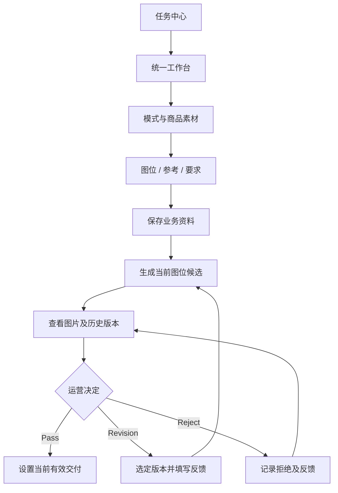

# I01_FRONTEND_WORKBENCH.md

**项目：** AIGC Workbench  
**版本：** V0.1 — DESIGN DRAFT  
**状态：** PROPOSED / REVIEW PENDING

**上位依据：** [01_BUSINESS_MODES.md](../business/01_BUSINESS_MODES.md)、[02_INTENT_AND_CONTEXT_RULES.md](../business/02_INTENT_AND_CONTEXT_RULES.md)、[04_IMAGE_CREATION_WORK_METHOD.md](../business/04_IMAGE_CREATION_WORK_METHOD.md)、[06_V1_IMPLEMENTATION_BLUEPRINT.md](./06_V1_IMPLEMENTATION_BLUEPRINT.md)

**相关实施文档：** [I02_ENGINEERING_BOUNDARIES.md](./I02_ENGINEERING_BOUNDARIES.md)

## 1. 设计目标

建设一个可用于 Quick-A、Quick-B、Listing 的统一电商图片制作工作台。

核心要求：

- 运营操作直接、清楚。
- 当前商品、参考和图位关系明确。
- 图片历史与当前有效 Pass 可区分。
- 修改草稿不因切换版本错误继承。
- 运行状态真实。
- UI 与业务规则解耦。
- 后续可逐步加入 AI 能力，而不需要重建界面。

不将旧仓前端代码作为新架构的权威来源。

## 2. 页面范围

### 2.1 Task Center

支持：

- 新建图片制作任务。
- 查看已有任务。
- 查看业务模式与必要进度。
- 进入对应工作台。

不展示虚构的 AI 进度。

### 2.2 Unified Workspace

三种模式共用一套工作台。

主要操作区：

| 区域 | 职责 |
|---|---|
| Mode | 选择 Quick-A、Quick-B 或 Listing |
| Product Assets | 上传、预览和管理实际商品图 |
| Listing Inputs | Listing 模式录入商品资料 |
| Reference Assets | 上传与管理营销或设计参考 |
| Image Slots | 图位增删、独立参考绑定和设置 |
| Requirements | 整体及逐图要求 |
| Image Results | 当前候选、参考对照及历史 |
| Revision | 选定基础版本和填写本轮反馈 |
| Review | Pass、Revision、Reject |
| Execution Status | 查看真实执行状态与错误 |

以上是界面职责，不预先规定每项必须拥有独立页面或组件文件。

### 2.3 Developer Inspection

独立于普通运营主流程。

用于查看：

- 实际业务素材及其来源。
- 有效 Context。
- AI 的实际请求和原始输出。
- 生成及修改执行证据。
- 人工评价结果。

开发调试操作和普通运营权限必须在服务端隔离。

## 3. 工作台交互关系

这是正式业务交互关系，不规定 AI 内部模型调用顺序。

开发调试时可以通过独立入口执行和观察某项 AI 能力。

## 4. 图位与素材交互

### 4.1 稳定图位身份

- 新增图位生成稳定身份。
- 删除中间图位不导致其他图位身份改变。
- 显示顺序与图位 ID 分开。
- 每个图位独立保存参考绑定、尺寸和逐图要求。

### 4.2 三模式差异

**Quick-A / Quick-B**

实际商品图和对应营销参考是基础输入。

不要求额外提供完整 Listing。

**Listing**

实际商品图与商品文字资料是基础输入。

设计参考通常提供，但并非必须。

没有设计参考不应导致图位无法创建或保存。

### 4.3 尺寸图

只有满足已经确认的专用尺寸素材条件才可进入尺寸图制作。

不要求为了这一张图的素材不足而禁用所有其他图位。

## 5. 前端 State 归属

| 状态 | 权威 |
|---|---|
| Task、模式、已保存素材 | Server |
| 图位 ID、绑定、尺寸及要求 | Server |
| 图片候选和历史版本 | Server |
| 运营审核和有效 Pass | Server |
| Run 的实际执行状态 | Server |
| 当前查看的图位和版本 | Local UI |
| 未提交的修改文字 | Local UI |
| 本地待上传文件与预览 | Local UI |
| 展开面板、显示偏好 | Local UI |

Server State 通过统一数据访问层获取和刷新。

不在多个组件中维护独立的有效 Pass 真相。

## 6. 修改草稿保护

这是旧仓值得保留的重要交互行为。

当运营选择 V3 并输入修改意见时：

- 草稿明确归属于当前图位和选定基础版本。
- 切换到 V1 或其他图位时，不得把 V3 草稿静默应用过去。
- 如果要继续使用旧草稿，应由界面进行明确选择。
- 提交修改前清楚显示基础版本。
- 提交后由后端再次验证版本身份。

前端只负责交互保护；真正的版本合法性由后端保证。

## 7. 前端组件边界

建议先按实际业务功能组织：

- `tasks`
- `workspace`
- `assets`
- `slots`
- `images`
- `review`
- `shared`

只有存在真实复用或独立变化需求时，再拆成更细的组件。

约束：

1. 展示组件不直接调用模型或管理业务版本规则。
2. API 调用集中在明确的数据访问层或操作入口。
3. 不通过跨脚本全局对象传播隐式状态。
4. 上传预览和已保存素材明确区分。
5. 组件卸载时正确释放本地 Object URL。
6. 修改、审核、生成等副作用必须显式触发。
7. 不因渲染或切换选中项自动提交业务修改。

## 8. 旧仓复用边界

### 保留交互

- 三模式统一入口。
- 动态图位。
- 逐图参考绑定。
- 图片尺寸。
- 候选与历史展示。
- 修改基础版本选择。
- 草稿保护。
- Pass / Reject。

### 可选择提取

- 少量颜色变量与视觉样式。
- 无旧业务依赖的纯工具函数。

### 不继承

- 完整 `prepare.js`、`generate.js`。
- 全局对象启动与隐式回调链。
- 旧 Listing 完整 Planning 审批门禁。
- 以参考图身份决定输出图身份。
- 旧实验 Runtime 和兼容逻辑。

旧仓未提交部分如需复用，必须明确具体来源快照。

## 9. 前端验收

首轮重点验证：

- 三模式输入展示正确。
- 素材能预览并保存。
- 刷新后真实数据正确恢复。
- 图位增删不串位。
- Listing 不强制上传设计参考。
- 当前查看版本与有效 Pass 正确区分。
- 修改草稿不会串到其他版本。
- 页面显示真实执行状态。
- 开发者入口不会向未授权运营暴露原始 Evidence。

使用浏览器真实操作验证关键路径，不能只依靠模拟 DOM 单元测试。

## 10. 待确认事项

- 工作台最终布局与响应式细节。
- 组件样式和 UI 库。
- 批量制作入口的具体呈现。
- 开发者 Inspector 的最终视觉与权限设计。
- 前端状态管理是否需要额外工具。

这些不阻断最小业务界面的建设。

**当前状态：PROPOSED / REVIEW PENDING**