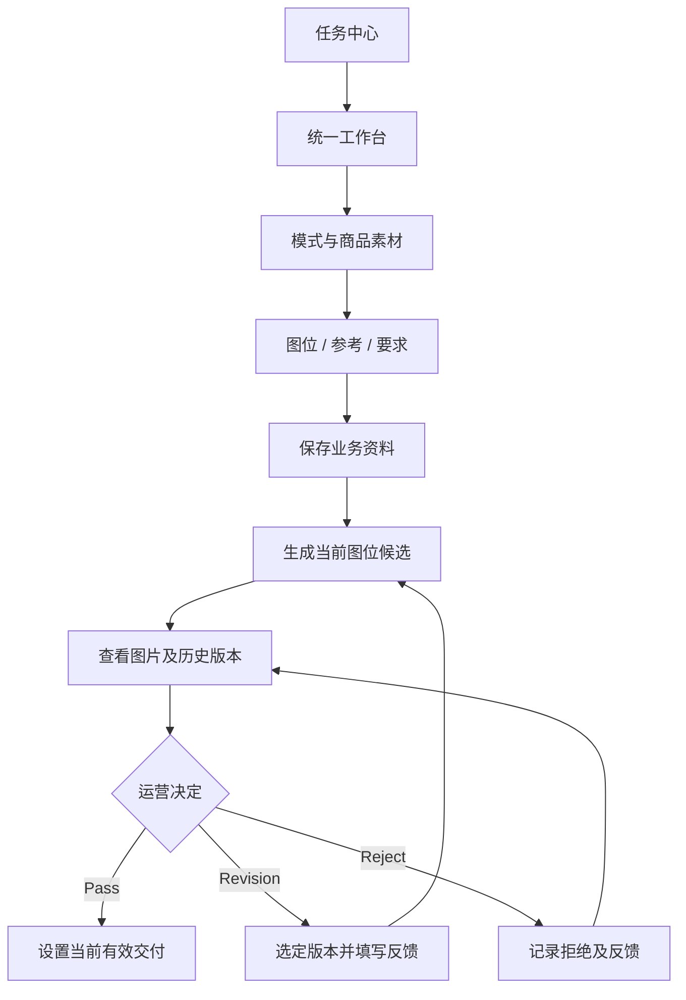

# I01_FRONTEND_WORKBENCH.md

**项目：** AIGC Workbench  
**版本：** V0.2 — DESIGN DRAFT  
**状态：** PROPOSED / REVIEW PENDING / NOT IMPLEMENTED

**上位依据：** [01_BUSINESS_MODES.md](../business/01_BUSINESS_MODES.md)、[02_INTENT_AND_CONTEXT_RULES.md](../business/02_INTENT_AND_CONTEXT_RULES.md)、[04_IMAGE_CREATION_WORK_METHOD.md](../business/04_IMAGE_CREATION_WORK_METHOD.md)、[06_V1_IMPLEMENTATION_BLUEPRINT.md](./06_V1_IMPLEMENTATION_BLUEPRINT.md)

**相关实施文档：** [I02_ENGINEERING_BOUNDARIES.md](./I02_ENGINEERING_BOUNDARIES.md)、[I03_DELIVERY_PLAN.md](./I03_DELIVERY_PLAN.md)

## 1. 设计目标

建设一个可用于 Quick-A、Quick-B、Listing 的统一电商图片制作工作台。

核心要求：

- 运营操作直接、清楚。
- 当前商品、参考和图位关系明确。
- 图片历史与当前有效 Pass 可区分。
- 修改草稿不因切换版本错误继承。
- 运行状态真实。
- UI 与业务规则解耦。
- 后续可逐步加入 AI 能力，而不需要重建界面。

旧仓前端代码用于核对产品设计来源，不作为业务规则或新工程架构的权威来源。

### 1.1 Legacy UI Inheritance Baseline

**产品层继承决定：用户已确认。** `commerce-image-poc` 当前有效的页面布局、信息组织、核心操作路径和交互行为，是 V1 前端产品设计的优先继承基线。此决定不表示旧仓全部行为符合新业务，也不表示本文件的工程方案已经实施或验证。

1. 不因改用 React + TypeScript + Vite 而重新设计工作台。
2. 保留有效页面布局、信息层次和主要区域之间的关系。
3. 保留有效核心操作路径，优先沿用已积累的交互习惯；哪些行为已实际验证，必须有对应证据。
4. 可以重新组织组件、状态、数据访问和 API 边界，不强制整文件迁移旧 JavaScript。
5. 与业务规则冲突的交互按 [01](../business/01_BUSINESS_MODES.md)、[02](../business/02_INTENT_AND_CONTEXT_RULES.md)、[04](../business/04_IMAGE_CREATION_WORK_METHOD.md) 定点调整，不从旧代码重新定义业务。
6. 产品设计继承不要求逐像素复制。真实业务、易用性、适配或工程可维护性需要的调整可以进行，但不得随意简化成熟交互。
7. 新 UI 的显著变化必须说明具体业务理由；由适配、易用性或可维护性引起的变化应记录原因和对原操作路径的影响。
8. 正式迁移工作台交互前完成本文件的 UI BASELINE CHECKPOINT 迁移前核对，迁移后的对应功能必须经过真实浏览器对照。

## 2. 页面范围

### 2.1 Task Center

支持：

- 新建图片制作任务。
- 查看已有任务。
- 查看业务模式与必要进度。
- 进入对应工作台。

不展示虚构的 AI 进度。

### 2.2 Unified Workspace

三种模式共用一套工作台。

主要操作区：

| 区域 | 职责 |
|---|---|
| Mode | 选择 Quick-A、Quick-B 或 Listing |
| Product Assets | 上传、预览和管理实际商品图 |
| Listing Inputs | Listing 模式录入商品资料 |
| Reference Assets | 上传与管理营销或设计参考 |
| Image Slots | 图位增删、独立参考绑定和设置 |
| Requirements | 整体及逐图要求 |
| Image Results | 当前候选、参考对照及历史 |
| Revision | 选定基础版本和填写本轮反馈 |
| Review | Pass、Revision、Reject |
| Execution Status | 查看真实执行状态与错误 |

以上是界面职责，不预先规定每项必须拥有独立页面或组件文件。

默认沿用旧仓顶部导航与任务摘要、可折叠 INPUT 资料区、OUTPUT 图位缩略图列表、所选图片详情与共享修改区、大图查看及受控 Inspector 侧栏的信息组织；具体布局以第 8 节来源核对和浏览器基线为准。

### 2.3 Developer Inspection

独立于普通运营主流程。

用于查看：

- 实际业务素材及其来源。
- 有效 Context。
- AI 的实际请求和原始输出。
- 生成及修改执行证据。
- 人工评价结果。

开发调试操作和普通运营权限必须在服务端隔离。

## 3. 工作台交互关系

这是正式业务交互关系，不规定 AI 内部模型调用顺序。

开发调试时可以通过独立入口执行和观察某项 AI 能力。

## 4. 图位与素材交互

### 4.1 稳定图位身份

- 新增图位生成稳定身份。
- 删除中间图位不导致其他图位身份改变。
- 显示顺序与图位 ID 分开。
- 每个图位独立保存参考绑定、尺寸和逐图要求。

### 4.2 三模式差异

**Quick-A / Quick-B**

实际商品图和对应营销参考是基础输入。

不要求额外提供完整 Listing。

**Listing**

实际商品图与商品文字资料是基础输入。

设计参考通常提供，但并非必须。

没有设计参考不应导致图位无法创建或保存。

### 4.3 尺寸图

只有满足已经确认的专用尺寸素材条件才可进入尺寸图制作。

不要求为了这一张图的素材不足而禁用所有其他图位。

## 5. 前端 State 归属

| 状态 | 权威 |
|---|---|
| Task、模式、已保存素材 | Server |
| 图位 ID、绑定、尺寸及要求 | Server |
| 图片候选和历史版本 | Server |
| 运营审核和有效 Pass | Server |
| Run 的实际执行状态 | Server |
| 当前查看的图位和版本 | Local UI |
| 未提交的修改文字 | Local UI |
| 本地待上传文件与预览 | Local UI |
| 展开面板、显示偏好 | Local UI |

Server State 通过统一数据访问层获取和刷新。

Task、Asset、Slot、Version、Review、Run 的持久业务及执行状态仍由服务器管理。当前选中项、未提交草稿、待上传文件和临时预览属于 Local UI State；React 组件化不改变这些权威边界。

不在多个组件中维护独立的有效 Pass 真相。

## 6. 修改草稿保护

这是旧仓值得保留的重要交互行为。

当运营选择 V3 并输入修改意见时：

- 草稿明确归属于当前图位和选定基础版本。
- 切换到 V1 或其他图位时，不得把 V3 草稿静默应用过去。
- 如果要继续使用旧草稿，应由界面进行明确选择。
- 提交修改前清楚显示基础版本。
- 提交后由后端再次验证版本身份。

前端只负责交互保护；真正的版本合法性由后端保证。

## 7. 前端组件边界

建议先按实际业务功能组织：

- `tasks`
- `workspace`
- `assets`
- `slots`
- `images`
- `review`
- `shared`

只有存在真实复用或独立变化需求时，再拆成更细的组件。

约束：

1. 展示组件不直接调用模型或管理业务版本规则。
2. API 调用集中在明确的数据访问层或操作入口。
3. 不通过跨脚本全局对象传播隐式状态。
4. 上传预览和已保存素材明确区分。
5. 组件卸载时正确释放本地 Object URL。
6. 修改、审核、生成等副作用必须显式触发。
7. 不因渲染或切换选中项自动提交业务修改。

## 8. 旧仓复用边界

### 8.1 实际来源与核查范围

旧仓路径：`/Users/andy/projects/commerce-image-poc`。首次来源核查时分支为 `main`，HEAD 为 `371e377412b2fecf846f636994cfb43a13f08e8c`。以下结论来自实际模板、脚本、样式及少量页面路由，不是仅根据文件名推断；首次核查仅静态阅读。本轮 F00 的真实页面补充证据及限制见 §8.3。

| 来源状态 | 已核查资产及必要版本依据 |
|---|---|
| 已提交，工作区字节与上述 HEAD 一致 | `src/templates/tasks.html`、`src/templates/prepare.html`、`src/templates/generate.html`；`src/static/prepare.js`、`generate.js`、`workspace.js`、`tasks.js`、`visual.css`、`workspace.css`、`prepare.css`、`generate.css`、`debug_sidebar.js`、`debug_sidebar.css`；`src/api/routes.py`、`src/api/inspector.py` 的相关页面及访问边界 |
| 已跟踪但未提交修改 | `src/templates/workspace.html` 当前 SHA-256：`6a95002c72c93cc4f41b5705b22b43359a78372cb9dd9a6a3b07fc7fd8b8a9d4`；HEAD 版本 SHA-256：`15637d0e31c1c92a5d9689aea4a73a559aa19f5e4a0a1c2eb21d4a4e2303ff2d`。实际差异为条件加载 Stage 调试脚本和包含调试模板，不将这部分当作已提交的普通运营 UI |
| 未提交的调试接线及未跟踪依赖 | `src/app.py` 的本地调试组装有修改，当前 SHA-256：`5cef6bda0551f8a216f8831796e340c230b88425419837f934b462541e0bb34e`；模板引用的 `src/templates/stage01_debug.html`、`src/static/stage01_debug.css`、`stage01_debug.js`、`stage02_debug.js`、`stage0202_debug.js`、`stage03_debug.js` 为未跟踪资产。本轮仅核对引用及状态，不展开实验实现，不纳入普通运营 UI 继承 |

`src/api/routes.py:53–87` 将任务中心连接到 `tasks.html`，工作台路由经 `prepare.html` / `generate.html` 继承 `workspace.html`。来源状态是本轮静态快照，不能用旧 HEAD 代替未提交文件的具体版本；正式迁移前应重新核对并记录当时来源。

### 8.2 UI Inheritance Matrix

A = **KEEP PRODUCT DESIGN**；B = **KEEP WITH BUSINESS ADJUSTMENT**；C = **DO NOT INHERIT**。A 表示保留设计的决定，不表示本轮已完成视觉或业务验收。以下路径均相对于上述旧仓。

| 区域 / 交互 | 实际来源及职责依据 | 分类与继承决定 | 必要调整及上位依据 |
|---|---|---|---|
| 任务中心 | `src/templates/tasks.html:5–10`、`src/static/tasks.js:2–11`：创建、任务列表、进度、打开 / 继续任务 | A：保留任务中心和进入独立工作台的路径 | 模式和真实状态按新服务器数据展示；不复制旧模式显示映射为新业务定义 |
| 三模式入口 | `src/templates/workspace.html:31`、`src/static/prepare.js:100–111`：模式选择及输入区显隐 | B：保留统一入口与模式相关信息组织 | 按 01 / 04 调整 Listing 行为，Quick-A/B 不要求 Listing，不引入制作前逐项卖点审批 |
| 商品素材区域 | `src/templates/workspace.html:34–39`、`src/static/prepare.js:131–137,269`：上传、缩略预览、移除 | A：保留素材区、预览和管理操作 | 保持实际商品来源，区分待上传预览与已保存 Asset；按 04 的实际商品图前提执行 |
| 营销 / 设计参考区域 | `src/templates/workspace.html:36–38`、`src/static/prepare.js:65–79`：参考展示、绑定和替换 | B：保留参考管理与按图位选择的交互 | Quick-A/B 和 Listing 的参考权限分别引用 01 / 04；Listing 设计参考可选 |
| 图位列表 | `src/static/prepare.js:33–49,51–98`、`src/static/workspace.css:6–8`：稳定标识、动态添加和删除 | B：保留图位分组、添加 / 删除及独立参考关系 | 不把旧 `reference_*` 命名或参考资产 ID 当成新 Slot 权威；Listing 无参考也能创建、保存图位，见 01 及本文件 §4 |
| 单图配置 | `src/static/prepare.js:80–92`：尺寸素材、确认声明、输出尺寸及逐图要求 | B：保留就地图位配置 | 尺寸图严格引用 04 §4.8；素材不足只影响该工作，不由 UI 重新定义条件 |
| 候选图片与大图 | `src/static/generate.js:66–69,89–100,126–140`、`src/static/visual.css:82–99`：缩略图选择、详情与参考对照、大图 | A：保留列表 → 详情 → 大图的路径及信息层次 | 未生成或尚未接通的能力须明确标识，不能用占位图冒充真实候选 |
| 历史版本 | `src/static/generate.js:168–174`：版本下拉及当前图片显示 | B：保留历史选择与查看，区别查看版本和有效 Pass | 旧可写分支会提交 `reviewOne(...,'select',...)`；新仓查看选择属 Local UI，明确修改 / 审核时再提交目标版本，按 02 及本文件 §5 / §6 执行 |
| 修改草稿与基础版本 | `src/static/generate.js:38–57,215–238,264–281,309–337`：保存草稿基础、过期提示、显式重用、提交固定目标 | A：保留防串图、防静默换基础版本的交互 | 保持 §6；服务器再次验证基础版本与权限。旧客户端 Map 和 Run 字段不成为新数据 Schema |
| Pass / Reject | `src/static/generate.js:173–174,200–212,321–326`：针对版本接受、拒绝和反馈 | A：保留显式审核操作、原因及历史显示 | 按 02 / 04 保留旧 Pass 和历史，新候选不自动替代交付；最终状态由服务器管理 |
| 执行状态 | `src/static/prepare.js:14,208–212`、`src/static/generate.js:240–247,277–295,379–381`：等待、失败、未知及状态查询 | B：保留真实状态反馈和结果未知提示 | 不把客户端集合、计时或会话批次当成可靠 Runtime；执行权威和恢复遵守 I02，不展示伪造进度或自动付费重试 |
| Inspector | `src/templates/workspace.html:13,78–83`、`src/static/debug_sidebar.js:36–65,80–104`、`src/api/inspector.py:20–75,145–151`：受控侧栏、选图联动、只读证据 | B：保留侧栏、展开 / 收起及随所选图片查看 Evidence | 服务端区分运营与开发权限；不继承本机地址、旧白名单或实验接线为新权限设计，见 I02 §11 |
| 旧 Listing 门禁 | `src/static/prepare.js:105,222–223`、`src/static/generate.js:160–166`：强制参考及逐图计划确认 | C：不继承这些业务门禁 | 根据 01 / 04，设计参考可选，不强制完整 Planning 预审；关键冲突定点处理 |
| 旧工程兼容与实验面板 | `src/static/workspace.js:4,40–48` 的跨脚本全局协作，`src/templates/workspace.html:10,21` 和 `src/app.py:158–168` 的未提交实验接线 | C：不整体搬入新运营工作台 | 重组明确的状态 / API 边界；实验与调试权限独立，不能据此增加普通运营步骤 |

### 保留交互

- 三模式统一入口。
- 动态图位。
- 逐图参考绑定。
- 图片尺寸。
- 候选与历史展示。
- 修改基础版本选择。
- 草稿保护。
- Pass / Reject。

### 可选择提取

- 经依赖和作用域核对的有效布局样式、颜色变量与视觉细节，保留产品设计效果。
- 无旧业务依赖的纯工具函数。

### Legacy Behavior Exclusions

- 完整 `prepare.js`、`generate.js`。
- 全局对象启动与隐式回调链。
- 旧 Listing 完整 Planning 审批门禁。
- Listing 必须上传设计参考的限制。
- 以参考图身份决定输出图身份。
- 前端直接承担复杂 Runtime 协调。
- 旧实验与调试权限混入普通运营入口。
- 旧实验 Runtime 和兼容逻辑。

旧仓未提交部分如需复用，必须明确具体来源快照。

### 8.3 UI BASELINE CHECKPOINT

**当前完整基线结果：UI Baseline NOT VISUALLY VERIFIED。** 已有源码核查和部分真实页面观察，但不能声称整个工作台、带数据交互或响应式验收通过。

此检查点是正式 UI 迁移的前置工作，目前未完成，由 [I03 的 F00](./I03_DELIVERY_PLAN.md#ui-baseline) 安排。未完成完整视觉基线时，F01 可以准备非 UI 工程基础，但不得据猜测完成正式 UI 迁移。

**本轮 F00 真实页面证据：** 浏览器连接接口报告 `The browser access host is unavailable`，随后通过现有 Microsoft Edge 原生窗口完成部分核对，没有启动、重启服务或安装依赖。既有 `127.0.0.1:8013`（PID 26346）及 `127.0.0.1:8015`（PID 56565）进程的工作目录均为旧仓；本轮磁盘 HEAD、源码哈希及未提交状态与 §8.1 记录一致。未验证运行进程加载的全部 Python 代码版本，不把工作目录或磁盘 HEAD 当成运行代码精确重放的证明。

| 真实页面及范围 | 实际观察 | 未验证或排除的内容 |
|---|---|---|
| `http://127.0.0.1:8015/` 任务中心 | 有真实截图；显示顶部导航、任务中心层次和“匿名只读预览” | 列表报“准备任务不存在，请重新加载资料”，未取得可用的带数据只读任务，不判断错误根因，不修复旧环境 |
| `http://127.0.0.1:8013/workspace/new` Listing 新建页 | 有真实截图；商品上传、逐图参考、单图配置及 Listing 文字区域可见；模式菜单实际提供三模式 | 未上传文件或保存任务；旧 Listing 门禁仍按 §8.2 排除，不因页面可见而认可其业务规则 |
| 同一新建页 Quick-A / Quick-B 本地切换 | 真实界面和可访问性状态确认模式说明、输入区显隐；Quick-B 输入页有真实截图 | 只改变未保存的 Local UI State，没有提交表单或执行模型 |
| Quick-A 未保存动态图位及单图配置 | 有真实截图；卖点图从 0 添加为 1，再删除恢复为 0；尺寸来源、输出尺寸和逐图要求控件可见 | 没有保存、绑定实际素材或验证服务端恢复，不能据此确认完整图位闭环 |
| 新建页 OUTPUT 区域及 Inspector 入口 | 有真实截图；OUTPUT 空态、禁用操作及等待选图提示可见；未保存任务的 Inspector 入口禁用 | 候选成图、历史版本、修改草稿基础保护、Pass / Reject、Inspector 内容仍仅有源码依据，未完成带数据视觉核对；没有执行审核、导出或付费操作 |

上述五张真实截图来自本轮工具会话，不是设计示意；未保存为仓库文件，也未提交 Git，不能描述为已归档截图集。截图包含浏览器标签等上下文，后续如需文件归档仍应先检查内容与敏感信息。临时核对页已关闭，未保存本地表单，原工作台 Listing 标签已恢复。后续需提供可用的只读带数据环境，补齐未覆盖区域、实际来源版本、可检查材料和浏览器对照；本轮不写业务数据或调用模型来制造样本。

迁移前应完成：

1. 实际查看旧仓页面，记录布局、各主要区域的位置与关系。
2. 保存必要的真实基线截图或等效可检查材料，注明来源版本、运行环境与页面状态；未经实际核对的示意图不得冒充基线。
3. 记录任务进入、素材与图位配置、候选查看、历史选择、草稿保护、审核和 Inspector 等主要操作路径。
4. 对照继承矩阵，明确保留、调整、删除项；业务冲突按上位文档调整，不要求为确认界面而调用付费模型。
5. 对未提交的旧前端文件记录 HEAD、工作区状态、具体文件及内容哈希；来源变化时重新核对。
6. 如运行环境不可用，记录具体原因、可检查材料及后续浏览器验证方法，继续标记 BASELINE NOT VISUALLY VERIFIED；不得因缺少截图而擅自重新设计界面。

迁移前阶段完成后才能按明确基线迁移主要 UI。新仓完成对应功能后，再以真实浏览器对照原基线，记录实际差异、业务或工程调整原因及未验证项；这项迁移后检查随相应切片验收完成，不反过来要求未实现的新 UI 成为迁移前提。

## 9. 前端验收

首轮重点验证：

- 三模式输入展示正确。
- 素材能预览并保存。
- 刷新后真实数据正确恢复。
- 图位增删不串位。
- Listing 不强制上传设计参考。
- 当前查看版本与有效 Pass 正确区分。
- 修改草稿不会串到其他版本。
- 页面显示真实执行状态。
- 开发者入口不会向未授权运营暴露原始 Evidence。
- 已接通区域与旧 UI 基线有真实浏览器对照；显著差异有明确原因，未接通的操作明确不可用。

使用浏览器真实操作验证关键路径，不能只依靠模拟 DOM 单元测试。

## 10. 待确认事项

- 继承基线上的必要布局和响应式调整；显著变化需说明原因，不重新从空白设计工作台。
- 组件样式和 UI 库。
- 批量制作入口的具体呈现。
- 开发者 Inspector 的最终视觉与权限设计。
- 前端状态管理是否需要额外工具。

这些不阻断最小业务界面的建设。

**修订记录：** V0.2 明确用户确认的产品层 UI 继承决定，补充实际来源、分类矩阵和待完成的 UI 基线检查；工程实现及浏览器对照尚未完成。

**当前状态：PROPOSED / REVIEW PENDING / NOT IMPLEMENTED**