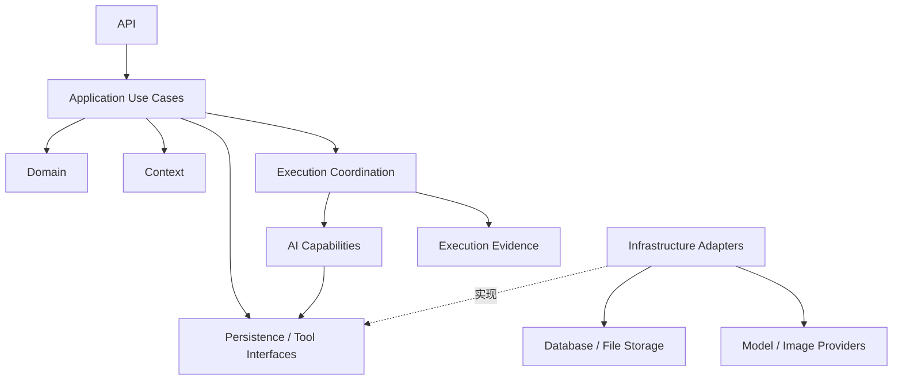
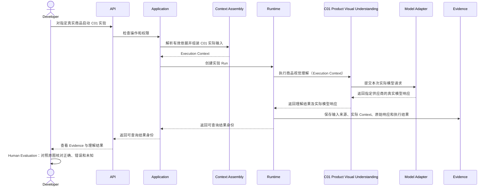

# I02_ENGINEERING_BOUNDARIES.md

**项目：** AIGC Workbench  
**版本：** V0.1 — DESIGN DRAFT  
**状态：** PROPOSED / REVIEW PENDING

**上位依据：** [06_V1_IMPLEMENTATION_BLUEPRINT.md](./06_V1_IMPLEMENTATION_BLUEPRINT.md)、[05_TECHNICAL_ARCHITECTURE.md](../business/05_TECHNICAL_ARCHITECTURE.md)、[T01_SYSTEM_BOUNDARY.md](../business/architecture/T01_SYSTEM_BOUNDARY.md)、[T02_TASK_ROUTING.md](../business/architecture/T02_TASK_ROUTING.md)、[T03_CONTEXT_ENGINEERING.md](../business/architecture/T03_CONTEXT_ENGINEERING.md)、[T05_AI_CAPABILITIES.md](../business/architecture/T05_AI_CAPABILITIES.md)

**相关实施文档：** [I01_FRONTEND_WORKBENCH.md](./I01_FRONTEND_WORKBENCH.md)

## 1. 设计目标

采用 Python 模块化单体后端。

要求：

1. 各模块具有明确职责。
2. 模块依赖方向清楚。
3. 业务逻辑不依赖具体模型供应商。
4. 业务状态具有单一权威。
5. AI 能力可以独立调试。
6. 真实执行输入、输出和失败可追溯。
7. 新功能不需要理解或修改大量无关模块。

不提前建设微服务、通用 Agent Runtime 或复杂插件框架。

## 2. 模块职责

| 逻辑模块 | 负责 | 不负责 |
|---|---|---|
| API | 请求校验、权限、响应 | 复杂业务流程与模型 Prompt |
| Application | 业务操作用例协调 | 具体模型推理与图片渲染 |
| Domain | 业务对象、状态不变量和确定性规则 | 具体数据库及模型 SDK |
| Context | 有效状态解析、执行输入组装 | 创建第二套商品事实 |
| AI Capabilities | 商品理解、参考理解、制作决定等 | 自行改变业务审核状态 |
| Tool Adapters | 对接模型、图像和文件工具 | 决定商品信息使用权限 |
| Runtime | Run、Attempt、异步、重试与恢复 | 运营最终 Pass |
| Persistence | 保存与读取业务及执行记录 | 重新定义业务规则 |
| Evidence | 关联真实执行输入、输出和评价记录 | 虚构模型执行过程 |

这些是逻辑模块，不意味着每一项必须是独立 Python 包或服务。

## 3. 依赖方向

**关键约束：**

- Domain 不导入 FastAPI、数据库 ORM 或模型 SDK。
- API 不直接拼装生产模型 Prompt。
- AI 模型调用不直接更新有效 Pass。
- 具体模型供应商 SDK 不进入业务领域规则。
- Application 显式组织业务用例与必要依赖。
- 接口抽象只在确实需要隔离外部依赖或支持测试时引入。

不要求所有简单函数都拥有 Interface、Factory 和 Adapter。

## 4. 核心业务用例

V1 逐步实现：

| 用例 | 主要责任 |
|---|---|
| CreateTask | 创建任务及业务模式 |
| SaveAssets | 校验并持久化素材 |
| ConfigureSlot | 保存图位、参考绑定及制作条件 |
| UpdateRequirements | 保存要求及有效范围 |
| StartCreation | 检查当前条件并发起制作 |
| ReviseImage | 使用运营选定版本发起修改 |
| ReviewImage | 保存人工审核并处理 Pass |
| ExportImages | 导出当前有效交付 |

这些是逻辑用例名称，不要求每个用例创建一个独立类。

## 5. 核心状态权威

### Business State

由应用持久化管理：

- Task。
- Asset。
- Requirement。
- Image Slot。
- Image Version。
- Review 与当前有效 Pass。

### AI-derived Results

包括商品理解、参考理解、制作决定及候选评价。

必须保留来源和候选性质。

不自动成为运营确认的商品事实。

### Execution State

由 Runtime 负责记录实际 Run、Attempt 及执行结果。

### Context

Context 是针对当前 AI 工作组装的执行输入，而不是独立维护的永久商品事实副本。

## 6. 最小数据流：创建真实业务输入

首次 Quick-A：

1. 前端选择模式和提交实际素材。
2. API 校验请求和访问权限。
3. Application 创建或更新 Task。
4. Domain 检查图位与素材关联合法性。
5. Persistence 保存素材身份与业务对象。
6. 返回可恢复的工作台状态。

明确区分：

- 本地文件预览。
- 已持久保存的实际素材。
- 当前图位绑定的参考。
- 生成或处理后的素材。

输出图位身份不得依赖参考素材 ID。

Listing 可以不提供设计参考图，但仍须遵守实际商品图及文字资料要求。

## 7. 最小数据流：C01 商品理解实验

C01 Product Visual Understanding 负责商品视觉理解的专业工作；Model Adapter 负责将实际请求交给指定模型供应商，并取得真实响应。图中区分的是逻辑职责，不要求新增 Python 类、独立服务或固定模型调用步骤。

这一链路需要能够回答：

- 使用了哪张商品图？
- 使用了什么模型和指令？
- Context 包含什么？
- 模型实际返回什么？
- 哪些观察正确、错误或无法确认？

C01 可以在开发阶段独立调用，但不代表正式运营流程必须固定单独调用 C01。

## 8. 图片生成与修改的边界

### 首次生成

Application 组织业务操作。

首次生成的逻辑顺序与 [T02](../business/architecture/T02_TASK_ROUTING.md)、[T03](../business/architecture/T03_CONTEXT_ENGINEERING.md) 保持一致：

**Business Routing → Effective State Resolution → Capability Routing → Context Assembly → Execution**

- Business Routing：识别操作、目标及初步业务范围。
- Effective State Resolution：判断本次有效业务依据。
- Capability Routing：根据操作及有效状态选择必要能力。
- Context Assembly：为选定能力组织实际输入。
- Execution：Runtime 负责后续执行，组织 AI / Tools 完成制作并保存实际结果。

Business Routing 可以读取必要状态进行基本校验。以上属于逻辑职责，不代表五个独立服务或五次模型调用。Pass 等确定性业务状态操作不必进入 AI 执行路径。

新图片进入候选状态，等待运营审核。

### 图片修改

运营选中基础版本，例如 V3。

系统必须：

1. 验证 V3 属于对应图位。
2. 使用实际选中的 V3。
3. 读取当前有效要求。
4. 使用本轮修改目标。
5. 不重新执行所有历史修改文字。
6. 生成独立新候选。
7. 保留原有效 Pass。

这些版本规则由服务器保证，不能只依赖前端传递正确状态。

## 9. Runtime 与持久化边界

Runtime 至少需要支持：

- 持久化 Run 身份。
- 实际执行状态查询。
- 输入依据版本关联。
- 成功及错误结果保存。
- 安全的失败处理。
- 多图位执行隔离。

实际的后台 Worker、任务队列和事务实现由对应开发切片决定。

不能简单把进程内异步任务等同于具备可靠恢复能力的任务系统。

远程生图请求结果不明时，不应直接无条件重复付费调用。

## 10. 文件与 Evidence

### 文件资产

原始商品图、营销参考、临时制作素材和候选图片必须区分角色。

文件身份应与业务状态关联。

文件路径本身不作为商品信息权威。

### Execution Evidence

至少能够回查：

- Task、Slot 和操作。
- 输入素材身份及版本。
- 实际 Execution Context。
- 指令及模型配置。
- 模型或工具实际响应。
- 执行状态与错误。
- 候选结果和对应审核。

开发期必须保留足够信息支持真实调试，但不默认永久保存所有大体积中间素材。

## 11. 认证与访问边界

普通运营和开发者调试入口具有不同权限。

要求：

- 服务端验证访问身份和资源权限。
- API Key 不进入浏览器。
- 原始 Prompt、完整 Evidence 和实验包导出不默认对运营开放。
- 文件读取验证资源归属。
- 上传素材进行必要的格式、大小及安全检查。
- 真实运营 Pilot 前具备最低限度的身份认证和权限隔离。

不能仅通过前端隐藏开发按钮实现权限保护。

## 12. 最小工程测试

| 测试 | 主要验证 |
|---|---|
| Domain | 图位、版本、Pass 和尺寸图规则 |
| Application | 业务用例及状态变化 |
| Context | 正确选择素材、要求及基础版本 |
| API | 输入校验、错误与访问权限 |
| AI Capability | 实际模型输入输出和人工核对 |
| Runtime | 执行身份、状态、失败和恢复 |
| Frontend / E2E | 真实业务操作及状态一致性 |

确定性测试不应依赖付费模型。

真实 AI 实验需要保存输入、输出及评价依据，并与常规测试分开管理。

## 13. 代码质量与可学习性

### 13.1 单一职责

不出现同时负责业务校验、Context 拼装、模型调用、文件保存和 API 响应的巨型函数。

### 13.2 显式副作用

保存、生成、修改、审核等操作应通过可识别入口触发。

不得通过普通状态读取或组件渲染隐藏执行重要写入操作。

### 13.3 最小必要抽象

只为已经存在的职责差异、外部依赖隔离或实际测试需要建立抽象。

不提前创建大量空的 Agent、Service、Manager、Registry。

### 13.4 可追踪调用路径

每个完成的开发切片，应能够说明：

用户操作 → API → Application → Business / Context → AI 或 Tool → Persistence / Evidence → 页面结果。

### 13.5 Codex 交付要求

每次开发至少报告：

- 实际修改文件。
- 关键函数与职责。
- 核心数据流。
- 执行的测试。
- 实际运行证据。
- 尚未解决的问题。

不把大量测试通过直接等同于真实运营接受。

## 14. 当前尚不冻结

- 最终数据库表与 ORM 结构。
- 完整 API URL 和 Schema。
- 模型供应商及调用数量。
- Runtime 队列框架。
- 通用工具注册机制。
- 具体文件存储布局。
- 完整部署方案。

上述决策在对应切片需要时，结合实际约束确定并补录。

---

**V0.1 — DESIGN DRAFT**

**状态：PROPOSED / REVIEW PENDING / NOT IMPLEMENTED**